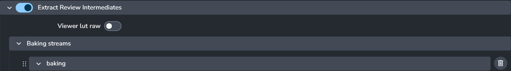

# Nuke addon settings

<AddonInfo />

The settings of the [Nuke addon](index.md) are in **Studio settings > Nuke**, and can be overridden per project in **Project settings > Nuke**. Pasting a location below into the URI bar of the web app opens that setting. How settings and their overrides work is described in [Settings](../../../ayon/how-ayon-works/settings.md). Several settings hold lists of knobs with the same structure, described once in [Knob definitions](#knob-definitions).

## General

<SettingLocation uri="ayon+settings://nuke/general" scope="Studio, with project overrides" />

Keyboard shortcuts of the entries of the AYON menu in Nuke.

<!-- screenshot: settings editor, General -->

<Settings prefix="general">
<Setting name="Menu Shortcuts">

<Settings>
<Setting name="Create..." default="ctrl+alt+c" />
<Setting name="Publish..." default="ctrl+alt+p" />
<Setting name="Load..." default="ctrl+alt+l" />
<Setting name="Manage..." default="ctrl+alt+m" />
<Setting name="Build Workfile..." default="ctrl+alt+b" />
<Setting name="Version Up Workfile" default="alt+shift+s" />
</Settings>

</Setting>
</Settings>

## Workfile callbacks

<SettingLocation uri="ayon+settings://nuke/workfile_callbacks" scope="Studio, with project overrides" />

Which values of the AYON context are applied to the Nuke script when a workfile is created or opened.

<!-- screenshot: settings editor, Workfile Callbacks -->

<Settings prefix="workfile-callbacks">
<Setting name="On Script Create">

Applied to a new workfile.

<Settings>
<Setting name="Resolution from Context" default="Enabled" />
<Setting name="Frame Range from Context" default="Enabled" />
<Setting name="Colorspace from Context" default="Enabled" />
</Settings>

</Setting>
<Setting name="On Script Open">

Applied to a workfile that is opened.

<Settings>
<Setting name="Resolution from Context" default="Enabled" />
<Setting name="Frame Range from Context" default="Enabled" />
<Setting name="Colorspace from Context" default="Enabled" />
</Settings>

</Setting>
</Settings>

## Color management (imageio)

<SettingLocation uri="ayon+settings://nuke/imageio" scope="Studio, with project overrides" />

How Nuke follows the color management of AYON: viewer and monitor processes, the baking target of review outputs, the colorspaces of the script root, the knobs of the nodes that creators build, and the rules that assign a colorspace to read nodes. See [Color management on launch](../../../pipeline/color-management-on-launch.md).

<!-- screenshot: settings editor, Color Management (imageio) -->

<Settings prefix="imageio">
<Setting name="Enable Color Management" default="Enabled">

Master switch of the section.

</Setting>
<Setting name="File Rules">

Rules that assign a colorspace to files by their path.

<Settings>
<Setting name="Activate Host Rules" default="Disabled">

Use the file rules of this host instead of the global ones.

</Setting>
<Setting name="Rules" default="Empty list">

<Settings>
<Setting name="Rule name">

Unique in the list.

</Setting>
<Setting name="Regex pattern" />
<Setting name="Colorspace name" />
<Setting name="File extension" />
</Settings>

</Setting>
</Settings>

</Setting>
<Setting name="Viewer">

The viewer process set when a new viewer node is created.

<Settings>
<Setting name="Display" default="ACES">

Anatomy context tokens are allowed, and a fallback can follow a `;` separator, for example `{project[code]} ; ACES`. Spaces around the separator are stripped.

</Setting>
<Setting name="View" default="sRGB">

Same tokens and fallback as **Display**.

</Setting>
</Settings>

</Setting>
<Setting name="Monitor OUT">

The monitor output of new viewer nodes, for external monitors.

<Settings>
<Setting name="Display" default="ACES">

Same tokens and fallback as the viewer display.

</Setting>
<Setting name="View" default="Rec.709" />
</Settings>

</Setting>
<Setting name="Baking Target Colorspace">

See [Baking target colorspace](#baking-target-colorspace).

</Setting>
<Setting name="Workfile">

See [Workfile](#workfile).

</Setting>
<Setting name="Nodes">

See [Nodes](#nodes).

</Setting>
<Setting name="Assign colorspace to read nodes via rules">

A read node whose file path matches a regex gets the colorspace of the rule.

<Settings>
<Setting name="Inputs" default="One rule">

The default rule has the regex `(beauty).*(?=.exr)` and the colorspace `linear`.

<Settings>
<Setting name="Regex expression" />
<Setting name="Colorspace" />
</Settings>

</Setting>
</Settings>

</Setting>
</Settings>

### Baking target colorspace

<SettingLocation uri="ayon+settings://nuke/imageio/baking_target" />

The colorspace, or display and view, that review outputs are baked into by [Extract Review Intermediates](#extract-review-intermediates). A baking stream can override it.

<Settings prefix="imageio-baking-target">
<Setting name="Enabled" default="Enabled">

Enable the baking target.

</Setting>
<Setting name="Target baking type" default="Use Colorspace">

**Use Colorspace** or **Use Display & View**.

</Setting>
<Setting name="Colorspace" default="Output - Rec.709">

Colorspace name. Anatomy context tokens are allowed.

</Setting>
<Setting name="Display & View" default="Empty">

**Display** and **View**, with the tokens and fallback of the viewer settings.

</Setting>
</Settings>

### Workfile

<SettingLocation uri="ayon+settings://nuke/imageio/workfile" />

Color management values of the root of the Nuke script.

<Settings prefix="workfile">
<Setting name="Color Management Workflow" default="OCIO">

**Nuke** or **OCIO**. Used only when global color management is disabled, so that no global OCIO environment variable is set.

</Setting>
<Setting name="Native OpenColorIO Config" default="aces_1.2">

One of the OCIO configs shipped with Nuke; the numbers in brackets are the compatible Nuke versions: **nuke-default**, **spi-vfx (11)**, **spi-anim (11)**, **aces_0.1.1 (11)**, **aces_0.7.1 (11)**, **aces_1.0.1 (11)**, **aces_1.0.3 (11, 12)**, **aces_1.1 (12, 13)**, **aces_1.2 (13, 14)**, **studio-config-v1.0.0_aces-v1.3_ocio-v2.1 (14)** or **cg-config-v1.0.0_aces-v1.3_ocio-v2.1 (14)**. Used under the same condition, and only when the workflow is **OCIO**.

</Setting>
<Setting name="Working Space" default="role_scene_linear" />
<Setting name="Thumbnails" default="ACES/sRGB" />
<Setting name="Monitor Out" default="ACES/sRGB" />
<Setting name="8-bit Files" default="role_matte_paint" />
<Setting name="16-bit Files" default="role_texture_paint" />
<Setting name="Log Files" default="role_compositing_log" />
<Setting name="Float Files" default="role_scene_linear" />
</Settings>

### Nodes

<SettingLocation uri="ayon+settings://nuke/imageio/nodes" />

Knob values applied to the nodes that creators build.

<Settings prefix="nodes">
<Setting name="Plugin required" default="Five entries">

Node definitions applied to the nodes of the creators. The default entries are for the **Write [Image]** class, and for the **DeepWrite [Image]** class for the deep write creators:

- **Render (write)**: `file_type` `exr`, `datatype` `16 bit half`, `compression` `Zip (1 scanline)`, `autocrop` enabled, `tile_color` 186, 35, 35, `channels` `rgb`, `colorspace` `scene_linear`, `create_directories` enabled.
- **Render (deep write)**: `file_type` `exr`, `datatype` `16 bit half`, `tile_color` 0, 3, 92, `compression` `Zip (1 scanline)`, `channels` `all`.
- **Prerender (write)**: the same as **Render (write)**, with `tile_color` 171, 171, 10.
- **Prerender (deep write)**: the same as **Render (deep write)**.
- **Image (write)**: `file_type` `tiff`, `datatype` `16 bit`, `compression` `Deflate`, `tile_color` 56, 162, 7, `channels` `rgb`, `colorspace` `texture_paint`, `create_directories` enabled.

<Settings>
<Setting name="Used in plugins" default="Empty list">

**Prerender (write)**, **Prerender (deep write)**, **Camera (3d)**, **Gizmo (group)**, **Image (write)**, **Model (3d)**, **Nukenodes (backdrop)**, **Render (write)**, **Render (deep write)** or **Source (read)**.

</Setting>
<Setting name="Nuke Node Class">

**Write [Image]**, **DeepWrite [Image]**, **Read [Image]**, **Group [Other]**, **Camera [3D]**, **Camera [3D Classic]**, **Scene [3D Classic]**, **Backdrop [Other]** or **Custom Class**.

</Setting>
<Setting name="Custom Node Class" default="Empty">

A node class not listed above, for **Custom Class**.

</Setting>
<Setting name="Knobs" default="Empty list">

Knob names must be unique within an entry. See [Knob definitions](#knob-definitions).

</Setting>
</Settings>

</Setting>
<Setting name="Plugin's node overrides" default="Empty list">

The same fields, plus **Task types** and **Product names**: the knobs override the required knobs for the matching products. Empty **Task types** apply the override to all task types.

</Setting>
</Settings>

### Knob definitions

Knob lists appear in several settings. Each knob has a **Type**, a **Name** and the value field of its type.

<Settings prefix="knob">
<Setting name="Type">

**Text**, **Formate from template**, **Color GUI**, **Boolean**, **Number**, **Decimal number**, **2D vector**, **3D vector**, **Color**, **Box** or **Expression**.

</Setting>
<Setting name="Name">

Name of the knob on the node.

</Setting>
<Setting name="Value (Text)" default="Empty">

A string.

</Setting>
<Setting name="Formatable (Formate from template)">

**Template**, a string formatted with context data, such as `{key}` or `{key};{key}`, and **To Knob type**: **Text** (default), **Number**, **Decimal number** or **2D vector**.

</Setting>
<Setting name="RGB Uint8 (Color GUI)" default="0, 0, 255" />
<Setting name="Value (Boolean)" default="Disabled" />
<Setting name="Value (Number)" default="0">

An integer.

</Setting>
<Setting name="Value (Decimal number)" default="0.0" />
<Setting name="Value (2D vector)" default="1.0, 1.0">

**X** and **Y**.

</Setting>
<Setting name="Value (3D vector)" default="1.0, 1.0, 1.0">

**X**, **Y** and **Z**.

</Setting>
<Setting name="RGBA Float (Color)" default="0.0, 0.0, 1.0, 1.0" />
<Setting name="Value (Box)" default="1.0, 1.0, 1.0, 1.0">

**X**, **Y**, **R** and **T**.

</Setting>
<Setting name="Expression (Expression)" default="Empty">

A Nuke expression, such as `parent.first`.

</Setting>
</Settings>

## Nuke directory mapping

<SettingLocation uri="ayon+settings://nuke/dirmap" scope="Studio, with project overrides" />

Rewrites file paths in the script from source paths to destination paths, for example between studio sites.

<!-- screenshot: settings editor, Nuke Directory Mapping -->

<Settings prefix="dirmap">
<Setting name="enabled" default="Disabled">

Rewrite file paths with the mapping.

</Setting>
<Setting name="Dirmap Paths">

The source and destination paths, matched by their position in the lists.

<Settings>
<Setting name="Source Paths" default="Empty list" />
<Setting name="Destination Paths" default="Empty list" />
</Settings>

</Setting>
</Settings>

## Scripts menu definition

<SettingLocation uri="ayon+settings://nuke/scriptsmenu" scope="Studio, with project overrides" />

A custom menu in the menu bar of Nuke.

<!-- screenshot: settings editor, Scripts Menu Definition -->

<Settings prefix="scriptsmenu">
<Setting name="Menu Name" default="Custom Tools">

Title of the menu.

</Setting>
<Setting name="Definition" default="Three actions">

The items of the menu. The defaults are **Ayon Nuke Docs** (opens the Nuke documentation in a web browser), **Set Frame Start (Read Node)** (sets the start frame of read nodes) and **Set non publish output for Write Node** (sets up write nodes for output that is not published), all of the type `action` with the source type `python`.

<Settings>
<Setting name="Type">

Such as `action`.

</Setting>
<Setting name="Command">

The Python code, or the path of the script.

</Setting>
<Setting name="Source Type">

Such as `python` or `file`.

</Setting>
<Setting name="Title" />
<Setting name="Tooltip" />
</Settings>

</Setting>
</Settings>

## Gizmo menu

<SettingLocation uri="ayon+settings://nuke/gizmo" scope="Studio, with project overrides" />

Toolbar menus of gizmos, from gizmo folders or from a list of commands.

<!-- screenshot: settings editor, Gizmo Menu -->

<Settings prefix="gizmo">
<Setting name="Gizmo Menu" default="One menu">

The default menu is **AYON Gizmo**, defined by one item, **Gizmo Note**, which creates a sticky note that explains how to add menus.

<Settings>
<Setting name="Toolbar Menu Name">

Name of the toolbar menu.

</Setting>
<Setting name="Toolbar Icon Path" default="Empty">

Icon of the menu, per platform. Empty uses the AYON icon.

</Setting>
<Setting name="Gizmo Menu Options" default="Add a Gizmo Directory Path">

**Add a Gizmo Directory Path** or **Add Gizmos by Definitions**. The default menu uses **Add Gizmos by Definitions**.

</Setting>
<Setting name="Gizmo Directory Path" default="Empty">

Folders with gizmos, per platform.

</Setting>
<Setting name="Gizmo Definition" default="Empty list">

<Settings>
<Setting name="Gizmo Menu Parent">

Parent menu of the items. Empty uses the toolbar menu name.

</Setting>
<Setting name="Gizmo List" default="Empty list">

<Settings>
<Setting name="Label" />
<Setting name="Type of usage">

Such as `python`.

</Setting>
<Setting name="Python command" />
<Setting name="Icon Path" />
<Setting name="Hotkey" />
</Settings>

</Setting>
</Settings>

</Setting>
</Settings>

</Setting>
</Settings>

## Creator plugins

<SettingLocation uri="ayon+settings://nuke/create" scope="Studio, with project overrides" />

The creators of the Publisher in Nuke. Every creator has these fields:

<Settings prefix="creator">
<Setting name="Enabled" default="Enabled">

Make the creator available.

</Setting>
<Setting name="Order" default="100">

Position in the list of creators.

</Setting>
<Setting name="Product type items" default="Empty list">

Optional list of product types the creator can create, each with a **Product type** and a **Label** shown in the UI.

</Setting>
</Settings>

<!-- screenshot: settings editor, Creator Plugins -->

### Write creators

**Render (write)**, **Prerender (write)** and **Image (write)** create write nodes, and **Render (deep write)** and **Prerender (deep write)** create deep write nodes. Besides the fields above, they share these fields:

<Settings prefix="write-creator">
<Setting name="Temporary rendering path template">

Template of the path the node renders to.

</Setting>
<Setting name="Default variants">

Variants offered in the Publisher.

</Setting>
<Setting name="Instance attributes">

Features of the instance: **Reviewable** (the output is reviewable), **Farm rendering** (the artist can render on the farm), **Use range limit** (the write node renders only the frame range of the instance), **Render On Farm** (a button on the node submits the render to the farm without publishing, for test renders), **Slate Generation** (a slate frame is added before the sequence; needs the Slater addon) and **Conditional Reviewable** (reviewable only for some task types). **Reviewable** and **Conditional Reviewable** cannot be selected together.

</Setting>
<Setting name="Conditional Reviewable Profiles">

**Task types** for which the review toggle is shown. Empty shows it for all.

</Setting>
<Setting name="Render target">

**Local machine rendering**, **Use existing frames**, **Use existing frames - farm** or **Farm rendering**. The farm options apply only when **Farm rendering** is an instance attribute.

</Setting>
<Setting name="Write Node Exposed Knobs">

Names of knobs of the write node that are exposed on the group.

</Setting>
<Setting name="Preceding nodes">

Nodes added before the write node. Node names must be unique.

<Settings>
<Setting name="Node name">

Used in **Incoming dependency** of other preceding nodes to connect them.

</Setting>
<Setting name="Node class" default="Empty">

Nuke class of the node.

</Setting>
<Setting name="Incoming dependency" default="Empty">

Name of another preceding node that comes before this one.

</Setting>
<Setting name="Knobs" default="Empty list">

See [Knob definitions](#knob-definitions).

</Setting>
</Settings>

</Setting>
</Settings>

Their defaults:

<Settings>
<Setting name="Render (write)" default="Enabled, order 100">

<Settings>
<Setting name="Temporary rendering path template" default="{work}/renders/nuke/{product[name]}/{product[name]}.{frame}.{ext}" />
<Setting name="Default variants" default="Main, Mask" />
<Setting name="Instance attributes" default="Reviewable, Farm rendering" />
<Setting name="Conditional Reviewable Profiles" default="No task types" />
<Setting name="Render target" default="Local machine rendering" />
<Setting name="Write Node Exposed Knobs" default="Empty list" />
<Setting name="Preceding nodes" default="Reformat01">

A node `Reformat01` of class `Reformat` with the knobs `resize` `none` and `black_outside` enabled.

</Setting>
</Settings>

</Setting>
<Setting name="Render (deep write)" default="Enabled, order 100">

<Settings>
<Setting name="Temporary rendering path template" default="{work}/renders/nuke/{product[name]}/{product[name]}.{frame}.{ext}" />
<Setting name="Default variants" default="DeepMain" />
<Setting name="Instance attributes" default="Farm rendering" />
<Setting name="Conditional Reviewable Profiles" default="No task types" />
<Setting name="Render target" default="Local machine rendering" />
<Setting name="Write Node Exposed Knobs" default="Empty list" />
<Setting name="Preceding nodes" default="DeepReformat01">

A node `DeepReformat01` of class `DeepReformat` with the knobs `resize` `none` and `black_outside` enabled.

</Setting>
</Settings>

</Setting>
<Setting name="Prerender (write)" default="Enabled, order 100">

<Settings>
<Setting name="Temporary rendering path template" default="{work}/renders/nuke/{product[name]}/{product[name]}.{frame}.{ext}" />
<Setting name="Default variants" default="Key01, Bg01, Fg01, Branch01, Part01" />
<Setting name="Instance attributes" default="Farm rendering, Use range limit" />
<Setting name="Conditional Reviewable Profiles" default="No task types" />
<Setting name="Render target" default="Local machine rendering" />
<Setting name="Write Node Exposed Knobs" default="Empty list" />
<Setting name="Preceding nodes" default="Empty list" />
</Settings>

</Setting>
<Setting name="Prerender (deep write)" default="Enabled, order 100">

<Settings>
<Setting name="Temporary rendering path template" default="{work}/renders/nuke/{product[name]}/{product[name]}.{frame}.{ext}" />
<Setting name="Default variants" default="DeepMain" />
<Setting name="Instance attributes" default="Farm rendering, Use range limit" />
<Setting name="Conditional Reviewable Profiles" default="No task types" />
<Setting name="Render target" default="Local machine rendering" />
<Setting name="Write Node Exposed Knobs" default="Empty list" />
<Setting name="Preceding nodes" default="Empty list" />
</Settings>

</Setting>
<Setting name="Image (write)" default="Enabled, order 100">

<Settings>
<Setting name="Temporary rendering path template" default="{work}/renders/nuke/{product[name]}/{product[name]}.{ext}" />
<Setting name="Default variants" default="StillFrame, MPFrame, LayoutFrame" />
<Setting name="Instance attributes" default="Use range limit" />
<Setting name="Conditional Reviewable Profiles" default="No task types" />
<Setting name="Render target" default="Local machine rendering" />
<Setting name="Write Node Exposed Knobs" default="Empty list" />
<Setting name="Preceding nodes" default="FrameHold01">

A node `FrameHold01` of class `FrameHold` with the knob `first_frame` set by the expression `parent.first`.

</Setting>
</Settings>

</Setting>
</Settings>

### Other creators

These creators have only the shared fields.

<Settings prefix="other-creators">
<Setting name="Nukenodes (backdrop)" default="Enabled, order 100" />
<Setting name="Camera (3d)" default="Enabled, order 100" />
<Setting name="Gizmo (group)" default="Enabled, order 100" />
<Setting name="Shapes (Silhouette .fxs)" default="Enabled, order 100">

Exports the `.fxs` shape format used by Boris FX Silhouette.

</Setting>
<Setting name="Model (3d)" default="Enabled, order 100" />
<Setting name="Source (read)" default="Enabled, order 100" />
<Setting name="Create Workfile">

Has no shared fields.

<Settings>
<Setting name="Mandatory workfile" default="Disabled">

The artist cannot disable the workfile instance in the Publisher. Requires core addon 1.4.1 or newer.

</Setting>
</Settings>

</Setting>
</Settings>

## Publish plugins

<SettingLocation uri="ayon+settings://nuke/publish" scope="Studio, with project overrides" />

The publish plugins of Nuke. Plugins that can be skipped share three switches: **Enabled** (the plugin runs), **Optional** (the artist can turn it off in the Publisher) and **Active** (it is on by default in the Publisher). How validators and the Publisher work is described in [Publishing](../../../pipeline/publishing.md).

<!-- screenshot: settings editor, Publish Plugins -->

### Collectors

<Settings prefix="collectors">
<Setting name="Collect Sync Workfile Version">

<Settings>
<Setting name="Product base types" default="nukenodes, camera, gizmo, source, render, write">

Product base types whose version is synced with the workfile version: **Nukenodes**, **Model**, **Camera**, **Gizmo**, **Source**, **Render**, **Prerender** or **Image**. The default `write` is not one of the options.

</Setting>
</Settings>

</Setting>
<Setting name="Collect Burnin Metadata" default="Enabled, not optional, active">

Exposes values of the Nuke metadata stream entering the write node of the instance, for example from a ModifyMetaData node, as burnin keys such as `{camera/focal}`. Values that change per frame become one value per frame.

<Settings>
<Setting name="Metadata keys" default="camera/">

Exact keys, such as `camera/focal`, or prefixes ending with `/`, such as `camera/` for all `camera/*` keys. Keys cannot contain `{ } : [ ] . !`.

</Setting>
</Settings>

</Setting>
</Settings>

### Validators

<Settings prefix="validators">
<Setting name="Validate Correct Folder Name" default="Enabled, optional, active" />
<Setting name="Validate Knobs" default="Disabled">

<Settings>
<Setting name="Enabled" default="Disabled" />
<Setting name="Knobs" default="{&quot;render&quot;: {&quot;review&quot;: true}}">

A JSON object keyed by product base type, whose values are the knob values to require.

</Setting>
</Settings>

</Setting>
<Setting name="Validate Output Resolution" default="Enabled, optional, active" />
<Setting name="Validate Exposed Knobs" default="Enabled, not optional, active" />
<Setting name="Validate Proxy Mode" default="Enabled, not optional, active" />
<Setting name="Validate Rendered Frames" default="Enabled, not optional, active" />
<Setting name="Validate Nuke Write Node" default="Enabled, not optional, active" />
<Setting name="Validate Gizmo" default="Enabled, optional, active" />
<Setting name="Validate Backdrop" default="Enabled, optional, active" />
<Setting name="Validate workfile attributes" default="Enabled, optional, active" />
</Settings>

### Extractors

<Settings prefix="extractors">
<Setting name="Extract Review Data" default="Disabled">

Adds a raw reviewable representation from the output of a write node, for output that is already ready for review and needs no baking.

<Settings>
<Setting name="Enabled" default="Disabled" />
</Settings>

</Setting>
<Setting name="Extract Review Intermediates" default="Enabled">

See [Extract Review Intermediates](#extract-review-intermediates).

</Setting>
<Setting name="Extract Camera Format">

<Settings>
<Setting name="Camera export format" default="Alembic">

**Alembic** or **FBX**.

</Setting>
</Settings>

</Setting>
<Setting name="Extract Slate Frame">

<Settings>
<Setting name="Viewer lut raw" default="Disabled">

Do not apply the viewer LUT to the slate.

</Setting>
<Setting name="Key value mapping">

Templates of the slate fields, each with an **enabled** switch and a **Template**.

<Settings>
<Setting name="f_submission_note" default="Enabled, {comment}" />
<Setting name="f_submitting_for" default="Enabled, {intent[value]}" />
<Setting name="f_vfx_scope_of_work" default="Disabled, empty" />
</Settings>

</Setting>
</Settings>

</Setting>
</Settings>

### Extract Review Intermediates

<SettingLocation uri="ayon+settings://nuke/publish/ExtractReviewIntermediates" scope="Studio, with project overrides" />

Bakes review videos or image sequences from rendered frames, with a thumbnail, for review and transcoding. Each baking stream is one output, so a studio can produce, for example, a ProRes for editorial and an H.264 for the client from the same render.

<Settings prefix="extract-review-intermediates">
<Setting name="Enabled" default="Enabled">

Run the plugin.

</Setting>
<Setting name="Viewer lut raw" default="Disabled">

Do not apply the viewer LUT.

</Setting>
<Setting name="Baking streams" default="One stream, baking">

The outputs to bake. See [Baking stream](#baking-stream).

</Setting>
</Settings>

#### Baking stream

<SettingLocation uri="ayon+settings://nuke/publish/ExtractReviewIntermediates/outputs" />

One output of the plugin. The default stream `baking` uses the defaults below.

<Settings prefix="baking-stream">
<Setting name="Output name" default="baking">

Name of the output.

</Setting>
<Setting name="Publish" default="Disabled">

Publish the output as its own product.

</Setting>
<Setting name="Filter">

Limits the stream to some instances. Empty lists match everything.

<Settings>
<Setting name="Task types" default="Empty list" />
<Setting name="Sync workfile versions for product base types." default="Empty list">

`render`, `prerender` or `image`.

</Setting>
<Setting name="Product names" default="Empty list" />
</Settings>

</Setting>
<Setting name="Input read node RAW switch" default="Disabled">

Set the input read node to raw.

</Setting>
<Setting name="Write Knobs">

The output write node.

<Settings>
<Setting name="File type" default="mov" />
<Setting name="Additional Knobs" default="mov64_codec ap4h, mov64_write_timecode on">

Knobs set on the write node; see [Knob definitions](#knob-definitions).

</Setting>
</Settings>

</Setting>
<Setting name="Bake viewer process" default="Enabled">

Bake the viewer process into the output.

</Setting>
<Setting name="Target baking colorspace override">

Overrides the [baking target](#baking-target-colorspace) for this stream.

<Settings>
<Setting name="Enabled" default="Disabled" />
<Setting name="Target baking type" default="colorspace">

**Use Colorspace** (`colorspace`) or **Use Display & View** (`display_view`).

</Setting>
<Setting name="Colorspace" default="Empty">

Colorspace name. Anatomy context tokens are allowed.

</Setting>
<Setting name="Display & View" default="Empty">

**Display** and **View**.

</Setting>
</Settings>

</Setting>
<Setting name="Bake viewer input process node (LUT)" default="Enabled">

Bake the viewer input process node.

</Setting>
<Setting name="Reformat Nodes">

Reformat nodes added before the output, applied in order. Only reposition nodes are supported.

<Settings>
<Setting name="Enabled" default="Disabled" />
<Setting name="Reposition knobs" default="One Reformat node">

<Settings>
<Setting name="Node class" default="Reformat" />
<Setting name="Node knobs" default="type to format, format HD_1080, filter Lanczos6, black_outside on, pbb off">

See [Knob definitions](#knob-definitions).

</Setting>
</Settings>

</Setting>
</Settings>

</Setting>
<Setting name="Custom tags" default="Empty list">

Tags added to the representation.

</Setting>
<Setting name="Handle missing frames" default="Fail on missing">

What to do about frames missing from the frame range of the entity, used to fill gaps with custom frames: **Fail on missing**, **Generate blank frame**, **Use checkerboard** or **Use closest existing**.

</Setting>
</Settings>

### Integrators

<Settings prefix="integrators">
<Setting name="Increment Workfile Version" default="Enabled, optional, active">

Saves the next workfile version when the plugins before it have no errors.

</Setting>
<Setting name="Increment path in Write node" default="Disabled, optional, active">

Updates the version in the write node path with the workfile version, to have versioned intermediate `renders` folders. It depends on the custom staging directory profiles of the core addon (`ayon+settings://core/tools/publish/custom_staging_dir_profiles`).

</Setting>
</Settings>

## Loader plugins

<SettingLocation uri="ayon+settings://nuke/load" scope="Studio, with project overrides" />

Every loader has an **Enabled** switch, enabled by default, that makes it available.

<!-- screenshot: settings editor, Loader Plugins -->

<Settings prefix="loaders">
<Setting name="Load AlembicCamera" default="Enabled" />
<Setting name="Load AlembicModel" default="Enabled" />
<Setting name="Load FbxCamera" default="Enabled" />
<Setting name="Load GeoImport" default="Enabled" />
<Setting name="Load GeoReference" default="Enabled" />
<Setting name="Load LinkAsGroup" default="Enabled" />
<Setting name="Load Backdrop Nodes" default="Enabled">

<Settings>
<Setting name="Remove existing AYON backdrops when removing container" default="Disabled">

Also remove the backdrop when the container is removed.

</Setting>
</Settings>

</Setting>
<Setting name="Load Clip" default="Enabled">

<Settings>
<Setting name="Include representations" default="Empty list">

Restrict the loader to these representation names. Empty allows all.

</Setting>
<Setting name="Read node name template" default="{class_name}_{ext}">

Template of the name of the Read node.

</Setting>
<Setting name="Loader option defaults">

Defaults of the options of the loader.

<Settings>
<Setting name="Set frame range to version frame range" default="Enabled">

Set the frame range of the node to the frame range of the version.

</Setting>
<Setting name="Start at workfile's start frame" default="Disabled">

Start the clip at the first frame of the script.

</Setting>
<Setting name="Add retime" default="Enabled" />
<Setting name="Read Node Type" default="Auto-detect">

**Auto-detect**, **Read** or **DeepRead**.

</Setting>
</Settings>

</Setting>
</Settings>

</Setting>
<Setting name="Load Effects" default="Enabled">

<Settings>
<Setting name="Attach to Read Node" default="Enabled">

Connect the effect group to the Read node of its plate. Default of the loader option of the same name.

</Setting>
<Setting name="Exposed Knobs" default="Empty list">

Names of knobs exposed on the effect group node.

</Setting>
<Setting name="Skip Node Classes" default="Empty list">

Node classes of the effect that are not created when it is attached to a Read node loaded with retime, such as `TimeWarp`, so the retime is not applied twice. Empty keeps every node.

</Setting>
</Settings>

</Setting>
<Setting name="Load Effects Input Process" default="Enabled">

<Settings>
<Setting name="Skip Node Classes" default="Empty list">

Node classes of the effect that are not created when its plate is loaded with retime in the script, such as `TimeWarp`, so the retime is not applied twice. Empty keeps every node.

</Setting>
</Settings>

</Setting>
<Setting name="Load Gizmo" default="Enabled" />
<Setting name="Load Gizmo Input Process" default="Enabled" />
<Setting name="Load Image" default="Enabled">

<Settings>
<Setting name="Include representations" default="Empty list">

Restrict the loader to these representation names. Empty allows all.

</Setting>
<Setting name="Read node name template" default="{class_name}_{ext}">

Template of the name of the Read node.

</Setting>
</Settings>

</Setting>
<Setting name="Load Ocio Look Nodes" default="Enabled" />
<Setting name="Load Matchmove" default="Enabled" />
<Setting name="Set Frame Range" default="Enabled" />
<Setting name="Set Frame Range With Handles" default="Enabled" />
<Setting name="Load USD Camera" default="Enabled" />
</Settings>

## Workfile builder

<SettingLocation uri="ayon+settings://nuke/workfile_builder" scope="Studio, with project overrides" />

Deprecated; replaced by the [templated workfile build](#templated-workfile-build).

<!-- screenshot: settings editor, Workfile Builder -->

<Settings prefix="workfile-builder">
<Setting name="Create first workfile" default="Disabled">

Create the first workfile version.

</Setting>
<Setting name="Custom templates" default="Empty list">

<Settings>
<Setting name="Task types" default="Empty list" />
<Setting name="Gizmo Directory Path">

Path of the template file, per platform. The label is a leftover in the settings model.

</Setting>
</Settings>

</Setting>
<Setting name="Run Builder at first workfile" default="Disabled">

Run the builder when the first workfile is created.

</Setting>
<Setting name="Builder profiles" default="Empty list">

<Settings>
<Setting name="Task types" default="Empty list" />
<Setting name="Task names" default="Empty list" />
<Setting name="Current context" default="Empty list">

What to load from the current folder. Each item has **Product name** filters, **Product base types**, **Representations** and **Loader plugins**.

</Setting>
<Setting name="Linked folders" default="Empty list">

The same, for the linked folders.

</Setting>
</Settings>

</Setting>
</Settings>

## Templated workfile build

<SettingLocation uri="ayon+settings://nuke/templated_workfile_build" scope="Studio, with project overrides" />

Profiles that build a workfile from a template script. See [Template builder](../../../pipeline/template-builder.md).

<!-- screenshot: settings editor, Templated Workfile Build -->

<Settings prefix="templated-workfile-build">
<Setting name="Profiles" default="Empty list">

<Settings>
<Setting name="Task types" default="Empty list">

Task types the profile applies to.

</Setting>
<Setting name="Task names" default="Empty list">

Task names the profile applies to.

</Setting>
<Setting name="Folder Types" default="Empty list">

Folder types the profile applies to. Empty matches all.

</Setting>
<Setting name="Folder paths" default="Empty list">

Folder paths the profile applies to. Empty matches all.

</Setting>
<Setting name="Path to template">

Path of the template file.

</Setting>
<Setting name="Keep placeholders" default="Disabled">

Keep the placeholders after the build.

</Setting>
<Setting name="Apply to New Scene" default="Disabled">

Build when a new scene is created.

</Setting>
<Setting name="Apply on Nuke launch" default="Enabled">

Build when Nuke launches.

</Setting>
<Setting name="Save first workfile version" default="Enabled">

Save the first version of the workfile after the build.

</Setting>
</Settings>

</Setting>
</Settings>

## Related

- [Nuke addon](index.md)
- [Color management on launch](../../../pipeline/color-management-on-launch.md)
- [Publishing](../../../pipeline/publishing.md)
- [Template builder](../../../pipeline/template-builder.md)
