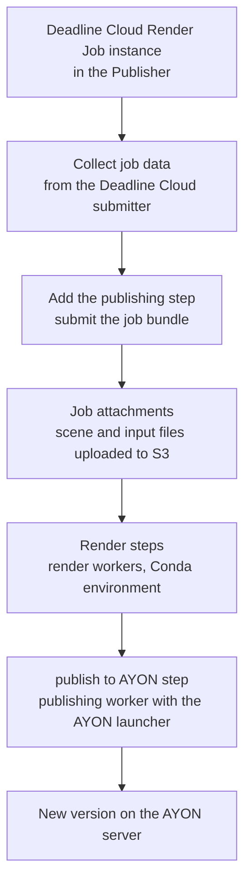

# AWS Deadline Cloud addon

<AddonInfo />

The AWS Deadline Cloud addon connects AYON to AWS Deadline Cloud, the managed render service of Amazon Web Services. It adds a **Deadline Cloud Render Job** creator to Maya, Houdini, Nuke and Blender. Publishing that instance builds a job with the Deadline Cloud submitter of the application and submits it to a Deadline Cloud farm and queue. The job renders the scene, then runs AYON on a worker that publishes the rendered files as a version, with reviews and thumbnails. How this fits the farm flow of AYON is described in [Farm](../../../pipeline/farm.md#aws-deadline-cloud).

Its settings are described on the [settings page](settings.md).

:::note Unreleased
The addon has no proper release yet. This page describes the state of the default branch (`develop`), version `0.0.1`. The integration is still being completed together with AWS, so details may change before the first release, see [Known limitations](#known-limitations).
:::

AWS Deadline Cloud is a different product from the Thinkbox Deadline render farm manager. The addon does not use the Deadline web service, the Deadline repository or the Deadline addon; it calls the `deadline` Python library of AWS Deadline Cloud and the submitters of the applications. The [Deadline addon](../deadline/index.md) covers Thinkbox Deadline.

## How it works



1. **The artist creates the instance.** The fields of the instance in the Publisher come from the job template of the application's Deadline Cloud submitter, for example frame range, cameras or output path.
2. **The local publish collects the job.** The submitter supplies the job template, the parameter values, the queue parameters and the asset references (the files the scene needs and where it writes). AYON adds its context, the Conda packages and a publishing step, then submits the job bundle.
3. **Deadline Cloud copies the files.** The scene and its asset references are uploaded to Amazon S3 as job attachments; the workers do not read the studio storage.
4. **The render steps render** on render workers, in a Conda environment with the application (see [Conda packages](#conda-packages)).
5. **The publishing step publishes.** On a publishing worker, the rendered files come back from S3 and the AYON launcher publishes them into the project, like a publish on a studio workstation.

## Requirements

| Requirement | Detail |
|---|---|
| Addon dependencies | `package.py` declares no required or compatible addons and no minimum AYON server or launcher version. |
| Applications | Maya, Houdini, Nuke or Blender through their AYON addons: the [Maya](../../3d-applications/maya/index.md), [Houdini](../../3d-applications/houdini/index.md), [Nuke](../../compositing-editorial-applications/nuke/index.md) and [Blender](../../3d-applications/blender/index.md) addons. |
| Deadline Cloud submitter | The Deadline Cloud submitter of each application has to be importable there. The addon reuses it to build the job and does not install it. The standard AWS submitters work from the versions that have the unified submitter interface, see [Workstations](#workstations). |
| Deadline Cloud farm | A farm and a queue in AWS Deadline Cloud, a fleet for rendering and a customer-managed fleet for publishing, see [Setting up](#setting-up). |
| Credentials | Deadline Cloud credentials on each workstation that submits. AYON does not manage them. |
| Publishing worker | AYON launcher available as `ayon`, a connection to the AYON server and access to the project roots. |

The addon has no AYON services.

## Setting up

### Farm and queue

Create a farm and a queue in AWS Deadline Cloud. Enter their IDs in the **Farm ID** and **Queue ID** settings, or leave the settings empty and set the default farm and queue in the Deadline Cloud configuration of each workstation (for example in the settings of the submitter).

### Storage profiles

Storage profiles tell Deadline Cloud where the project roots are on the workstations and on the workers. Create one for each operating system of the workstations (the submitter selects it) and one for each customer-managed fleet, with a file system location for each root of the project anatomy. Locations with the same name in two profiles are the same storage, and Deadline Cloud maps paths between them.

The type of a location decides how its files reach the workers:

| Type | Use it when | Files under it |
|---|---|---|
| SHARED | The storage is mounted on the workstations and on every worker that runs the job, as with customer-managed workers in the studio network. | Are not uploaded. The workers read the inputs and write the output in place, with the paths mapped. |
| LOCAL | The workers cannot reach the storage, as with service-managed render workers. | Go through S3 as job attachments: inputs are uploaded at submission, the output is uploaded by the render workers and downloaded by the publishing worker. |

Files outside every location of the profile go through S3 as well.

For roots such as `P:\projects` on Windows and `/mnt/projects` on Linux:

| Setup | Workstation profiles | Fleet profile |
|---|---|---|
| Customer-managed workers on the studio storage | `projectsDrive`, SHARED, `P:\projects` (Windows) and `/mnt/projects` (Linux) | `projectsDrive`, SHARED, `/mnt/projects` |
| Service-managed render workers | `projectsDrive`, LOCAL, `P:\projects` (Windows) and `/mnt/projects` (Linux) | None for the service-managed fleet |

The publishing step uses the path mapping of the session to find the render output on the publishing worker, and the roots of the project anatomy to integrate it.

### Fleets and workers

| Fleet | Used for | Notes |
|---|---|---|
| Service-managed fleet (SMF) | Render steps | Cloud workers managed by AWS. The applications come as Conda packages, so nothing has to be installed. |
| Customer-managed fleet (CMF) | Publishing step, and rendering if wanted | Machines that the studio manages, on premises or in the cloud, running the Deadline Cloud worker agent. |

The publishing step needs a CMF worker, because it runs the AYON launcher and writes into the project roots. Set that machine up like a render node of the studio:

- Install the [Deadline Cloud worker agent](https://docs.aws.amazon.com/deadline-cloud/latest/developerguide/worker-host.html) and connect it to the fleet.
- Install the AYON launcher and put it on the `PATH` of the user that runs the jobs, so `ayon` starts it. The step runs a `bash` script.
- Set `AYON_SERVER_URL` and `AYON_API_KEY` (normally the key of a service user) in its environment.
- Give it access to all project roots, as on an artist workstation.

### Worker roles

The addon keeps render work and publishing apart with the worker capability `attr.role`. It adds a host requirement with the **render Host Requirement Roles** (default `render`) to every render step, and one with the **Publish Host Requirement Roles** (default `publish`) to the publishing step. Set the capability on the workers:

- for a whole fleet, in the AWS console: **Deadline Cloud > farm > Fleets > fleet > Worker capabilities > Custom worker capabilities**, add `attr.role`;
- for one machine, in the configuration of its worker agent, usually `/etc/amazon/deadline/worker.toml`.

Without the roles, publishing can land on SMF workers that have no AYON, and rendering on publishing workers that have no render packages.

### Queue environment

The default Conda queue environment creates a Conda environment for every job session. The publishing worker does not need one, and on a CMF it may not be able to create it. The publishing step sets `DISABLE_CONDA_ENV=true`, so change the queue environment to stop there. In the AWS console, open the farm, the queue and its **Queue environments** tab, and add near the top of the Conda environment script:

```bash
if [ -v DISABLE_CONDA_ENV ]; then
    echo "Disabling Conda."
    exit 0
fi
```

The default script is the [Conda queue environment sample](https://github.com/aws-deadline/deadline-cloud-samples/blob/mainline/queue_environments/conda_queue_env_inline.yaml) of AWS.

### Workstations

Each workstation that submits needs:

- **The Deadline Cloud submitter** of the application, installed as described in the [AWS documentation](https://docs.aws.amazon.com/deadline-cloud/latest/userguide/submitter.html). The addon calls the unified submitter interface (`BaseSubmitter`) of the `deadline` library, so it needs `deadline-cloud` 0.60.2 or newer and at least these submitter versions: Maya 0.15.18, Houdini 0.7.12, Nuke 0.18.19 and Blender 0.6.7. Use the standard AWS submitters; the Ynput forks of the submitters were made before AWS added that interface and are older than these versions. A tool group in the [Applications settings](../../essentials/applications/settings.md) (`ayon+settings://applications/tool_groups`) can add the submitter to the application's environment, for example for Nuke:

  ```json
  {
    "NUKE_PATH": [
      "{NUKE_PATH}",
      "C:\\software\\deadline-cloud-for-nuke\\src"
    ],
    "PYTHONPATH": [
      "{PYTHONPATH}",
      "C:\\software\\deadline-cloud\\src"
    ],
    "DEADLINE_ENABLE_DEVELOPER_OPTIONS": "true"
  }
  ```

- **Deadline Cloud credentials.** Set them up with one of the methods in [Managing users in Deadline Cloud](https://docs.aws.amazon.com/deadline-cloud/latest/userguide/managing-users.html), for example an AWS profile with an access key in `~/.aws/credentials` and its region in `~/.aws/config`:

  ```ini
  # ~/.aws/credentials
  [YourFarmName]
  aws_access_key_id = <access key id>
  aws_secret_access_key = <secret access key>

  # ~/.aws/config
  [profile YourFarmName]
  region = eu-central-1
  ```

### Bundle

Add the AWS Deadline Cloud addon to the production bundle and set the farm, queue and roles in its [settings](settings.md).

Without a publishing worker the render still runs, but nothing is published. The output can be downloaded with Deadline Cloud Monitor or the Deadline Cloud CLI ([Download finished output](https://docs.aws.amazon.com/deadline-cloud/latest/userguide/download-finished-output.html)) and published with the [Tray Publisher](../../essentials/traypublisher/index.md).

## Conda packages

Deadline Cloud workers get their software from Conda packages. The Conda queue environment creates a Conda environment for each job session from two job parameters:

- `CondaPackages`: space-separated package specifications, for example `maya=2025.* maya-openjd maya-mtoa`. When it is empty, no environment is created and the job runs in the worker's own environment.
- `CondaChannels`: the channels to install from, by default `deadline-cloud`.

The `deadline-cloud` channel is provided by AWS for service-managed fleets. It holds applications such as `maya`, `houdini`, `nuke` and `blender`, the `-openjd` adaptor packages that let Deadline Cloud run them, and renderers such as `maya-mtoa`, `maya-vray` and `maya-redshift`. A customer-managed fleet can use its own Conda channel, for example in S3, or software installed on its machines.

The addon sets `CondaPackages` in this order, later steps winning:

1. The value the submitter proposes.
2. The **Conda Packages** setting, when it is not empty. **Conda Channels** replaces `CondaChannels` the same way.
3. When `CondaPackages` is still empty, packages detected from the scene: the application at its running version (for example `maya=2025.*`), the adaptor package at the version of the installed submitter (`maya-openjd=<major.minor>.*`) and, in Maya, `maya-mtoa`, `maya-vray` or `maya-redshift` for the renderers the job uses.
4. The **Extra Conda Packages** field of the instance in the Publisher, appended.

These steps apply only when the job template has the `CondaPackages` and `CondaChannels` parameters, which the queue environment defines.

## Products it can create

| Product base type | Creator | Applications |
|---|---|---|
| `deadline_cloud` | Deadline Cloud Render Job | Maya, Houdini, Nuke, Blender |

The creator builds its attributes from the `parameterDefinitions` of the job template of the submitter, so the fields in the Publisher depend on the submitter version and the scene. `STRING` and `PATH` parameters become text fields, check boxes for the `CHECK_BOX` control and multiple-choice lists for the `DROPDOWN_LIST` control; `INT` parameters become number fields. Other parameter types are not exposed. The `deadline_cloud` instance itself is not integrated as a product.

| Application | Creator details |
|---|---|
| Maya | Adds an empty dummy set to the instance so the default empty-instance check passes. Fills `ProjectPath` and `OutputFilePath` from the scene settings, or from the AYON work directory when they are empty. |
| Houdini | Creates a node of type `deadline_cloud` and gives its path to the submitter, which reads the job from that node. The `productType`, `productBaseType` and `id` parameters are locked. |
| Nuke | Uses the standard AYON Nuke creator. The job attributes come from the Nuke submitter. |
| Blender | Uses the standard AYON Blender creator. The job attributes come from the Blender submitter. |

## Publishing from the application

The plugins below run for `deadline_cloud` instances when the Publisher runs in the application (target `local`).

| Plugin | Order | What it does |
|---|---|---|
| Collect AWS Deadline Cloud Instances | Collector + 0.1 | Adds the `deadline_cloud` family to every instance with the `deadline_cloud` product base type and turns off integration for it. |
| Collect AWS Deadline Cloud Job Data | Collector + 0.4999 | Gets the job template, parameter values, queue parameters and asset references from the submitter of the application. Adds the AYON context parameters, applies the instance attributes and the Conda packages, and picks the farm and queue. |
| Add Publishing Step to the Job Template | Integrator | Adds the render role requirement to the existing steps and appends the publishing step. |
| Submit Job to AWS Deadline Cloud | Integrator + 0.1 | Writes `template.yaml`, `parameter_values.yaml` and `asset_references.yaml` to a temporary job bundle and submits it. The submitter name is "AYON Deadline Cloud Addon" and the job attachments file system mode is `COPIED`. |

### Job data

The collector adds these hidden parameters to the job template when it does not already define them: `folderPath`, `taskName`, `projectName`, `userName`, `hostName`, `sourceFile`, `productBaseType`, `variant` and `OutputFilePath`. `OutputFilePath` is the single output directory of the asset references, or their common root path when there are several; the publish fails when they have no common root.

The values the artist sets in the Publisher are applied to parameters that the submitter leaves empty or does not define; a value the submitter already proposes is kept. The farm and queue come from the Deadline Cloud configuration of the workstation unless **Farm ID** and **Queue ID** are set.

### Files and job attachments

The asset references come from the submitter, which walks the scene for the files it reads and the folders it writes. At submission, the files that are not under a SHARED location of the storage profile are uploaded to the job attachments bucket of the queue in S3; files already there are skipped, and the paths are mapped for the workers. Output folders that are not under a SHARED location are synchronized back through S3 to the publishing worker. Files under SHARED locations stay where they are, see [Storage profiles](#storage-profiles).

Files that the submitter does not detect are not uploaded, and the render fails or misses them on the worker. Examples are LUT files referenced by an older OCIO config beside the `.ocio` file, or all frames of an Alembic sequence in an Arnold stand-in (only one frame is detected). A single-file OCIO config avoids the first.

### Job steps

The publishing step is named `publish to AYON`. It depends on every other step of the template and runs a `bash` script that calls `ayon addon deadline_cloud publish` with the AYON context taken from the job parameters and the path mapping file of the session. The render steps get the render roles and the publishing step the publish roles (see [Worker roles](#worker-roles)); the code treats every step of the template as a render step. The publishing step sets `DISABLE_CONDA_ENV` to `true` and passes `AYON_STUDIO_BUNDLE_NAME` and `AYON_BUNDLE_NAME` from the submitting session, so the worker publishes with the same bundle.

## Publishing on the worker

The addon adds the command `ayon addon deadline_cloud publish`. Its path argument is a folder or file with the render output.

| Option | Required | Meaning |
|---|---|---|
| `-p`, `--project-name` | Yes | AYON project. |
| `-f`, `--folder-path` | Yes | Folder path of the context. |
| `-t`, `--task-name` | No | Task of the context. |
| `-u`, `--user-name` | Yes | User the publish runs as, when the connection uses a service user. |
| `--host-name` | No | Host that submitted the job. It is accepted but not used further yet. |
| `--product-base-type` | Yes | Product base type passed to the created instances. |
| `--variant` | Yes | Product variant. |
| `-s`, `--source-file` | No | Source workfile. |
| `--path-mapping-file` | No | JSON file with `path_mapping_rules`. The output path is remapped by replacing the first matching `source_path` prefix with its `destination_path`. |

`OutputFilePath` is a `STRING` parameter, which Deadline Cloud does not remap (a `PATH` parameter would have to be relative to the job bundle), so AYON remaps it with the path mapping file that Deadline Cloud writes from the storage profiles.

The command starts a publish in the `shell` host with the `farm` target. The plugin **Create publishing instances from files** (collector order -0.2) creates the instances from the output path.

| Files found | Instances created |
|---|---|
| Frame sequences | One instance per sequence pattern. Sequences that differ only in file extension share an instance with one representation per extension. The variant is taken from the file name. |
| Other files | One instance when their names share a prefix of at least two characters, with a representation per file. Otherwise one instance per file. |

The instances use the family `render` and a product name built with the project settings and the product base type given on the command line. Each file gets a standard representation tagged `review` and a trait-based representation with a mime type and, for images, an image trait. Frame ranges come from the sequence indexes. The folder and the task are looked up on the AYON server and the publish fails if they do not exist. The other plugins of the publish pipeline, such as review and thumbnail extractors, then process the instances, and the integrator moves the files to their published location.

## Settings areas

| Area | What it covers |
|---|---|
| Farm and queue | **Farm ID** and **Queue ID** overrides of the local Deadline Cloud configuration. |
| Conda | **Conda Packages** and **Conda Channels** passed to the worker environment. |
| Host requirement roles | Worker capability values that separate render workers from publishing workers. |
| Extra job parameters | Key and value pairs for job parameters (not used by the code yet, see the settings page). |

## Known limitations

- The submitters have to be installed separately, and the addon does not check that they are present.
- Only image output is supported; caches and other data are not.
- Publishing runs only on CMF workers with the AYON launcher, a connection to the AYON server and access to the studio file system. The addon does not bring published results back from S3 to the studio by itself.
- Credentials are those configured on the machine; AYON does not log in to Deadline Cloud.
- Single-frame sequences are not handled, and the frame range of a product comes from its folder or from the length of the representation, so representations with different lengths are not handled.
- Color management data and review tags of the render are not passed to the publishing step.
- Failures of the publishing step are only visible in the job logs in Deadline Cloud Monitor.
- Path remapping on the worker is a basic string replacement.
- In Nuke, instances cover all write nodes or one, not several.
- There is no validator for missing referenced files.

## Command line

The addon adds the command group `addon deadline_cloud` to the [launcher command line](../../../pipeline/launcher-command-line.md#addon-commands).

| Command | What it does |
|---|---|
| `publish <path>` | Publishes the render output of a Deadline Cloud job on the worker. The publish step that the addon adds to the job runs it. Its options are listed in [Publishing on the worker](#publishing-on-the-worker). |

## Related

- [AWS Deadline Cloud addon settings](settings.md)
- [Farm](../../../pipeline/farm.md): the farm flow and the other farm managers
- [Deadline addon](../deadline/index.md) for Thinkbox Deadline
- [AWS Deadline Cloud user guide](https://docs.aws.amazon.com/deadline-cloud/latest/userguide/)
