# Planner addon

<AddonInfo />

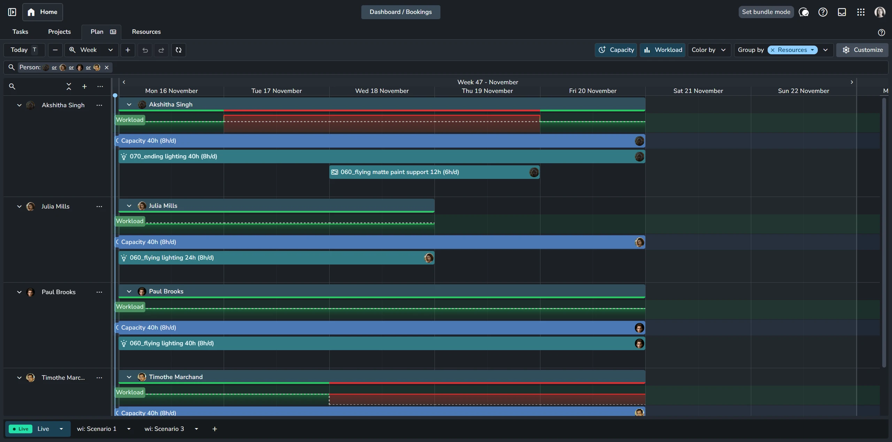

The Planner addon adds resource planning and task scheduling to the AYON web app: a studio **Plan**, a **Resources** page, and a **Schedule** tab in each project. It is a server addon with a web frontend: it has no launcher or DCC part and runs no services. Its settings are on the [settings page](settings.md). How planning is used in a production is described in [Planning](../../../production-tracking/planning.md).

- **[Plan](#plan):** a studio-level timeline of bookings that put people, rooms, hardware and software licences on work, across all projects.
- **[Capacity and workload](#capacity-and-workload):** the hours each resource can work, and a workload line that shows when bookings exceed them.
- **[Time off](#time-off) and milestones:** absences that remove capacity, and key dates such as deliveries.
- **[Recurring events](#recurring-events):** events that repeat, such as a working week or dailies, with exceptions for single occurrences.
- **[Time zones](#time-zones):** events keep the time zone they were planned in.
- **[Scenarios](#scenarios):** separate versions of the studio plan and of each project's schedule, one of them live.
- **[Resources](#resources):** a page to manage resources, resource types, booking statuses and custom attributes, with access per attribute.
- **[Schedule](#schedule):** a timeline of a project's tasks with their dates and assignees, with the studio plan shown above it, kept in sync with the tasks.
- **[Subtasks](#subtasks):** tasks split into dated subtasks, also shown in the details panel and task tables.
- **[Views and export](#controls-and-interactions):** saved timeline views, and export of bookings as CSV or ICS.
- **[Event access](#access-and-permissions):** who can see and edit events, for the studio and per project.

## Requirements

- **AYON server** 1.17.3 or newer. The [compatibility check](../../../ayon/web-ui/studio/bundles.md#compatibility-check) of a bundle reports it when the server is too old.
- **Installation:** install the addon from the [Market](../../../ayon/web-ui/market.md), then add it to a production, staging or developer [bundle](../../../ayon/web-ui/studio/bundles.md). For a staging or developer bundle, select that bundle in the **Bundle mode** of the [App header](../../../ayon/web-ui/app-header.md).
- **No other addons, launcher or services** are needed.

<Columns widths="55 45">
<Column>

With the addon in a staging or developer bundle, the Planner tabs show a dot; its tooltip names the addon version and the bundle.

</Column>
<Column>

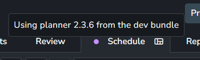

</Column>
</Columns>

:::caution
All bundles share the same Planner data, so changes made while testing in a staging or developer bundle are real. To try changes safely, use a scenario that is not live.
:::

The studio-level **Projects** page belongs to the AYON web app itself and is available without the addon. Without the addon, `/dashboard/planner` and the project **Schedule** tab show a feature overview, and the subtasks views show a notice about the Planner addon.

## Plan

The **Plan** page (**Home > Plan**, `/dashboard/bookings`) is a studio-level timeline of booking events, grouped by resource by default.

### Event types

| Type (`event_type`) | UI label | Meaning |
|---|---|---|
| `capacity` | Capacity | Hours a resource can work. |
| `allocation` | Booking | Allocates one or more resources to work. |
| `absence` | Time off | Removes capacity. A time off without hours (all day) sets the day's capacity to zero; a time off with hours is subtracted from capacity. |
| `milestone` | Milestone | A key date. |

### Booking events

<Columns widths="55 45">
<Column>

A booking event has a label, a status, a time range with its hours, an optional repeat rule, the booked resources, an optional project and track, and the attributes of its event type.

</Column>
<Column>

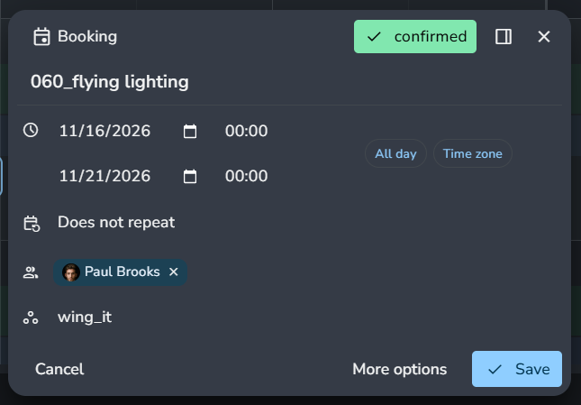

</Column>
</Columns>

| Feature | Behavior |
|---|---|
| Creation | **Ctrl/Cmd**-drag creates a booking, **Ctrl/Cmd+Alt**-drag a time off and **Ctrl/Cmd**+double-click a milestone; `S` toggles creation mode. Right-clicking empty space offers **Create** > **Booking**, **Time off**, **Milestone** or **Capacity**, which switch to that creation mode. A new event in a group row takes the group's value; in a group without a single resource (such as a resource type or attribute group), the resource picker opens filtered to that group. |
| Fields | Label, type, status, time, repeat, duration, resources (with unit count), project, track and the attributes scoped to the event type. Each event records who created and last updated it, and when. |
| Project | A booking can be assigned to an AYON project. The project selector, and the **+** button of the sidebar when the Plan is grouped by **Project**, can create a new project; it is created as a skeleton project (name, code, label and color, default anatomy preset). An event's track and project must match: a track bound to a project accepts only events of that project, and a track without project accepts only events without one. |
| Status | New events take the default status. The status's **confirmed** flag decides whether the event counts as confirmed or unconfirmed workload. |
| Hours | An event has a start, an end and an optional net duration in seconds. In the dialog the duration is **hours total** or **hours per day** (a total is spread evenly over the days of the event: 8 hours over two days count 4 hours per day). All-day events without hours are not counted in the workload. |
| Default hours | New events use a default duration, resolved in this order: the `duration` attribute of the booked resource, the duration of its resource type, the duration of the event type, then the global default (8 hours). Resource-based values apply only when all booked resources agree. The defaults are set in the [Default durations](settings.md#default-durations) addon settings. |
| Dependencies | Events can link to other events (`depends_on`, `dependents`) through the API; circular links are rejected by the database. The timeline does not draw them. |
| Search | Resources and events keep a text search index; it can be rebuilt through the API by managers. |

### Capacity and workload

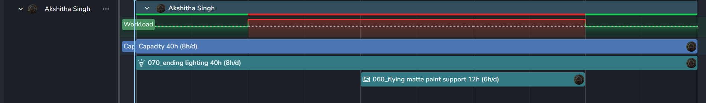

Capacity events are shown in a capacity row above each resource; a workload indicator above each resource shows how much of the capacity is booked. Both are toggled in the toolbar (**Shift+C** and **Shift+W**) and are on by default.

| Quantity | Computation |
|---|---|
| Capacity per day | Hours of `capacity` events minus hours of partial time off; zero when the day has an all-day time off. |
| Booked per day | Hours of `allocation` events, confirmed plus unconfirmed, spread over the days of each event. |
| Workload color | Grey to green with the booked share of capacity; full green at exactly 100 percent. Orange when over capacity by up to one hour per day. Red when over by more than one hour, including bookings on days without capacity. |
| Graph | Clicking the workload strip of a row shows that row's workload graph; **Workload** in the toolbar shows it for every row. Capacity is a dashed line and booked hours a solid line, per timeline unit. |
| Tooltip | Booked hours over capacity, and the hours **Left** or **Over**. |
| **Match capacity** | Event context menu action on bookings: creates capacity events equal to the booked hours. Useful for bookings made before capacity was set, which show red because their resources have no capacity. |

### Time off

<Columns widths="45 55">
<Column>

A time off event (`absence`) removes capacity: an all-day time off sets the day's capacity to zero, a time off with hours is subtracted from it. Bookings over it then show as over capacity in the workload.

</Column>
<Column>

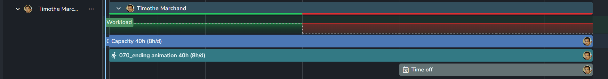

</Column>
</Columns>

### Recurring events

<Columns widths="55 45">
<Column>

Any event can repeat. The rule is an RFC 5545 `RRULE` with a time zone, evaluated in that zone (so wall-clock times hold across daylight-saving changes).

| Preset | Notes |
|---|---|
| Does not repeat, Daily, Weekly on a day, Monthly on the nth weekday, Annually, Every weekday | Presets end one calendar year after the event starts. |
| Custom | Day, week, month or year interval; weekdays for weekly rules; monthly by date or by nth weekday; ends on a date or after 1 to 10000 occurrences. |

Edits and deletions apply to this event only, this and following events, or the whole series. A deleted single occurrence is kept as a hidden ghost so the series does not recreate it. The API accepts any valid `RRULE` string.

</Column>
<Column>

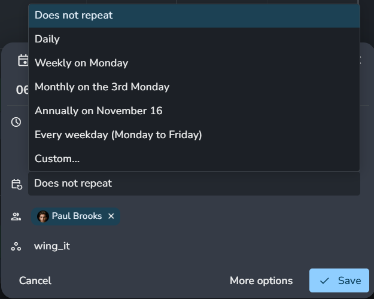

</Column>
</Columns>

### Time zones

An event keeps the time zone it was planned in. The viewing time zone switcher changes only how the timeline is displayed and is stored in the browser. All-day events are stored as UTC calendar dates.

### Scenarios

Scenarios are separate versions of a plan. Events without a scenario are shared by every scenario.

| Action | Who |
|---|---|
| List scenarios | Everyone |
| Create, rename, reorder, duplicate, set live, delete | Admins and managers |

The scenario menu offers **Delete**, **Details**, **Rename** and **Make Live**, and on the Schedule also **Duplicate** and **Sync**. Making a scenario live asks for confirmation and applies to all users; **Ctrl/Cmd**-click skips the confirmation. On the Plan, the live scenario cannot be deleted, and deleting another scenario requires typing its name. See [Schedule](#schedule) for the **Sync** action.

## Resources

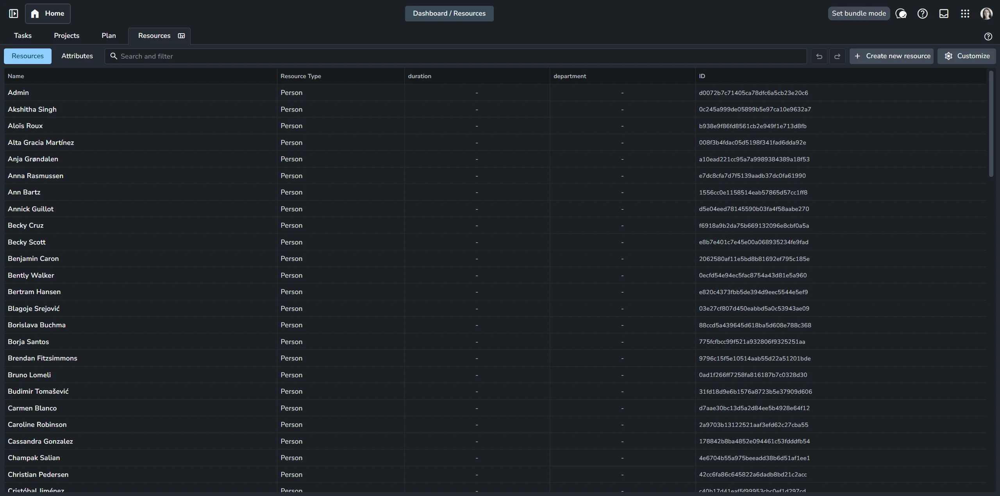

The **Resources** page (**Home > Resources**, `/dashboard/resources`) lists resources in a table with the columns **Name**, **Resource Type**, one column per attribute, and **ID**.

| Feature | Behavior |
|---|---|
| Person resources | Every AYON user (except support and service users) gets a `person` resource, created when the addon starts and whenever a user is created. A person resource can also exist without an AYON user, for example as a placeholder; only `person` resources can be linked to a user. |
| Resource editing | Only admins and managers can create (**Create new resource**), duplicate, edit or delete resources. Selecting several rows edits them together in the side panel; fields with different values show as mixed. Deleting a resource removes its bookings. |
| Filtering | Filter by attribute; a new resource takes the values of the active filter. The resource picker of a booking has an **Advanced Resources Search** by attribute. |
| **Show restricted resources** | Lists person resources that are redacted for the current user. Admins and managers always see everything. |
| Visibility of people | Users who are not managers see another person resource only when the two users share at least one project through access groups; otherwise the resource is redacted (empty label and no attributes). When the server limits user visibility, all other people are redacted. Managers and admins are never redacted. |
| Undo | 100 steps on the Resources page. |

### Attributes, resource types and statuses

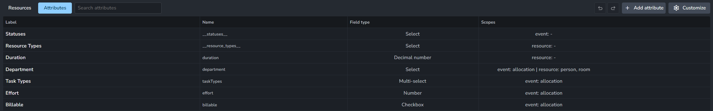

Admins and managers get an **Attributes** mode on the page with lists for attributes, resource types and booking statuses.

| Item | Details |
|---|---|
| Attribute scopes | `resource` (optionally limited to resource types) and `event` (optionally limited to event types). A scope without a list applies to all types. |
| Data types | The AYON attribute types: `string`, `integer`, `float`, `boolean`, `datetime`, `list_of_strings`, `list_of_integers`, `list_of_any`, `list_of_submodels` and `dict`. An enum can be fixed options or resolved from a server enum such as `taskTypes`. |
| Default attributes | **Department** (resource and event scopes, with Animation, Lighting, Layout options), **Task Types**, **Effort**, **Billable** (event scope), **Duration** (resource scope, float). Created only when missing. |
| Attribute access | In the **Access** section of an attribute: **No access** (hidden), **Viewer** (read-only) or **Editor** for everyone, users or access groups. With no rules, everyone is an editor. Managers and admins always have full access. For example, a rate attribute can be hidden from everyone, visible to supervisors and editable by producers. |
| Resource types | Label, icon, color, order. Deleting a type that resources use is refused by the database. |
| Booking statuses | Label, color, icon, order, **confirmed** flag (any number of statuses can be confirmed) and one **default** status applied to new events. New installs have **Confirmed** (confirmed), **Tentative** (default), **Pencil** and **Pencil 2**. |

## Schedule

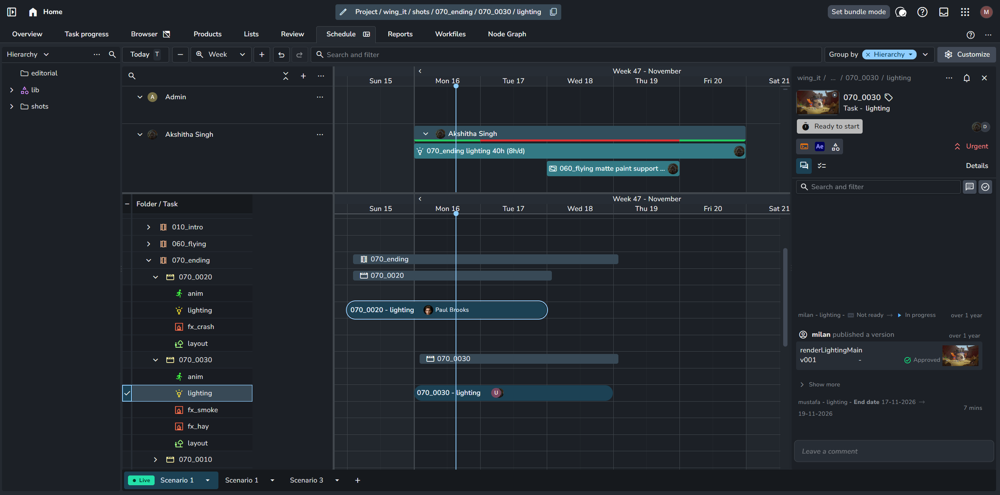

The **Schedule** tab of a project (`/projects/<project>/scheduler`) shows one bar per task (and per subtask) as task events of the current scenario. The first time the Schedule opens for a project, the web app initializes the project tables and creates the first live scenario. **Show Plan** shows the studio plan above the tasks; it is toggled with `P` when the timeline has focus (click in it), from the right-click menu of the timeline, or in the **Customize** settings.

| Feature | Behavior |
|---|---|
| Task events | One main event per task with start, end and assignees, plus one event per subtask that has both dates. Moving a parent moves its subtasks; a parent spans its subtasks when **Link parent & subtasks** is on (default). |
| Creation | **Create** in the context menu: **Event**, **Sub task**, **Milestone**. |
| Subtasks | A task with subtasks has a **View Subtasks** button at the left of its row. **Split into subtasks** in the context menu divides the event at the mouse position into subtask events. |
| **Sync with subtasks** | Resizes a parent event to its subtasks. |
| Tags | Task events can carry tags from the [Tags](settings.md#tags) addon setting and the [color presets](settings.md#color-presets). |
| Grouping | None, folder or an attribute; the page also has a filter and a slicer. |
| **Show Plan** (`P`) | Overlays the studio Plan above the task list, with its own scenario, grouping, **Show capacity** and **Show workload**. Selected bookings are ghosted over the tasks they match; the **Ghosting** option chooses the match, by **Task Types** (default), **People**, both or none. |
| **Create schedule** | On a booking in the overlay: applies the booking's dates to matching tasks (all, by task type, or by people). When tasks already have events, it asks whether to overwrite or skip them; **Ctrl/Cmd**-click overwrites without asking. |
| Group adjustment | Moving or scaling a group of tasks rescales every task event in the group in proportion. |

:::note
Tags on Schedule events are separate from the tags of AYON tasks. They are stored with the task events of the Planner, are not synced to the tasks, and do not show anywhere else in AYON.
:::

### Synchronization with tasks

| Direction | Trigger | Effect |
|---|---|---|
| Tasks to events | The server handles task created, `startDate` or `endDate` changed, assignees changed and subtasks changed events. | Updates the main and subtask events of the **live** scenario. Tasks without both dates are skipped. |
| Events to tasks | Changes in the live scenario are queued and sent 2 seconds after the last change; making a scenario live; **Sync** in the live scenario's menu. | Overwrites `startDate`, `endDate`, assignees and subtasks of the tasks. Subtasks missing from the events are unscheduled (their dates are cleared). |

**Sync** has two directions, **Events → Tasks** (live scenario only) and **Tasks → Events**. Edits in non-live scenarios never change tasks.

### Subtasks

Subtasks are stored in the task data (`subtasks`). The addon provides the Subtasks manager to the AYON web app: the **Subtasks** tab of the details panel and the **Subtasks** column of task tables, see [Subtasks](../../../production-tracking/subtasks.md). The Schedule uses it as well. Subtask events are created from subtasks that have a start and an end date.

## Controls and interactions

### Shortcuts

Shortcuts work in the Plan and Schedule timelines when no dialog or text field has focus.

| Action | Control |
|---|---|
| Jump to today | `T` |
| Zoom | `+`, `-`; `H` hour, `D` day, `W` week, `M` month, `Q` quarter, `Y` year (default week). Clicking a period in the header zooms into it, **Alt**-click zooms out. |
| Fit item, go to off-screen events | Hover an item and press `F`; `G` or the arrows at the timeline edges jump to events outside the view. |
| Select several | Drag a selection box; the selected events move together. |
| Move (Plan) | Context menu **Move** > to the next or previous day or week. |
| Create mode | `S` |
| Copy, paste | **Ctrl/Cmd+C**, **Ctrl/Cmd+V**. Events are copied as tab-separated rows with headers, so they paste into a spreadsheet; rows from a spreadsheet with the same columns (or **Title**, **Start Date**, **End Date** headers) paste back as events. **Ctrl/Cmd+V** pastes on the day of the selected event; **Paste** in the context menu pastes on the clicked row and day. |
| Duplicate | **Shift+Alt+Arrow** keys in the direction; in the Plan **Shift+Ctrl/Cmd+Left/Right** duplicates to the previous or next period |
| Delete | `Delete` or `Backspace` |
| Undo, redo | **Ctrl/Cmd+Z**, **Ctrl/Cmd+Shift+Z** or **Ctrl+Y**; 50 steps |
| Event info | **Ctrl/Cmd+I** |
| Refresh | **Shift+R** (Plan) |

### Context menus

Right-clicking the timeline opens a menu that depends on where the click lands.

<Columns widths="50 50">
<Column>

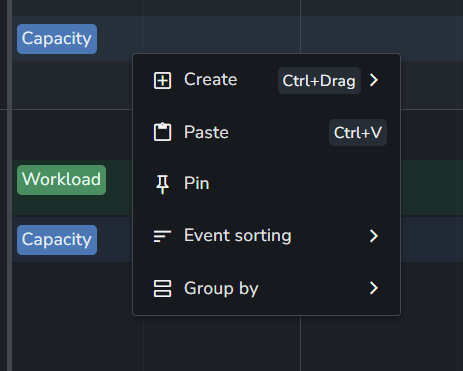

</Column>
<Column>

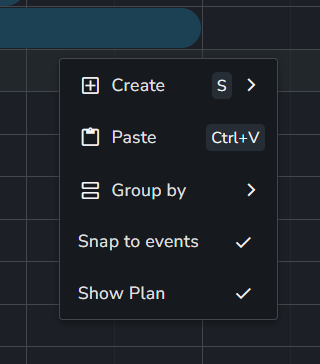

</Column>
</Columns>

| Where | Items |
|---|---|
| Plan, empty space | **Create** > **Capacity**, **Booking** (`S`), **Time off** (**Ctrl/Cmd+Alt**+drag), **Milestone** (**Ctrl/Cmd**+double-click), which switch to that creation mode; **Paste**; **Pin** or **Unpin** the row's group; **Event sorting**; **Group by**. |
| Plan, event | **Copy**, **Paste**; **Duplicate** > **Duplicate** (below), **Duplicate Left**, **Duplicate Right**, **Duplicate to previous** or **next** day or week; **Move** > to the next or previous day or week; **Edit**; **Match capacity** (bookings); **Show raw data**; **Create schedule** > **Task type**, **People**, **All** (on the Schedule's plan only); **Delete**. |
| Plan, group row | **Pin** or **Unpin**, **Export**, and, on a group of a resource, resource type, status or project, **Rename**, **Edit** and **Delete**. |
| Schedule, empty space | **Create** > **Event** (`S`), **Sub task** (**Shift+S**), **Milestone**; **Paste**; **Group by** > **None**, **Folder** or an attribute; **Snap to events**; **Show Plan**. |
| Schedule, event | **Edit**, **Copy**, **Paste**; **Duplicate** > **Duplicate Above**, **Duplicate Below**; **Delete**; **Sync with subtasks** (tasks with subtasks); **Split into subtasks** (or **Split N events** for several). |
| Timeline header | **Zoom in**, **Zoom out**, **Navigate Previous**, **Navigate Next**. |

### Timeline settings

The display settings of the Plan and Schedule timelines; they are saved in views, not in the addon settings.

| Setting | Options |
|---|---|
| Group by (Plan) | **Resources**, **Resource Type**, **Project**, **Status** and every attribute with options; several levels. An attribute of both events and resources is listed twice, as ***attribute* - Event** and ***attribute* - Resources**, to group by where a booking takes place or where a person is based. Groups can be pinned to the top. |
| Color by | Plan: **Event Type**, **Resource Type**, **Project**, **Status** and attributes with options. Schedule: **Default**, **Status** and task attributes with colored options. |
| Event sorting (Plan) | **Auto** stacks events compactly; otherwise one row per event, sorted by **Start Date**, **Duration**, **Name**, **Task Type** or **Resource Count**. |
| **Snap to events** | On by default: a dragged event snaps to the edges of nearby events. Times snap to the grid of the zoom level: hours in day view, days in week view. |
| Event preview | Hover preview, on by default. |
| [Views](../../../ayon/web-ui/views.md) | Filters, grouping, sorting, zoom and the settings above are saved in views. |
| **Export** (Plan only) | **Export** in the menu of the sidebar header (all groups) or of a group row. Exports the bookings of a date range and selected groups as CSV (spreadsheet) or ICS (calendar), or copies them to the clipboard. On the Schedule, tasks can only be copied as tab-separated rows. |

## Addon settings

The [Planner addon settings](settings.md) are in **Studio settings > Planner**; all but event access can be overridden per project in the project settings.

- **[Event access](settings.md#event-access):** who can see and edit events, for events without a project and per project. See [Access and permissions](#access-and-permissions).
- **[Default durations](settings.md#default-durations):** the hours of new events, globally, per event type and per resource type.
- **[Color presets](settings.md#color-presets):** six colors offered as color tags next to the tags.
- **[Tags](settings.md#tags):** the tags available for task events on the Schedule.

Resources, resource types, booking statuses and attributes are not addon settings: they are managed on the [Resources](#resources) page.

## Access and permissions

- **Opening the Planner and reading events:** the **Plan**, **Resources** and **Schedule** tabs are open to every user. The [Event access](settings.md#event-access) addon settings decide how much of an event each user sees: without access, the event shows with its details redacted. Attribute values follow the access of each [attribute](#attributes-resource-types-and-statuses).
- **Editing bookings on the Plan:** needs the **Editor** level in [Event access](settings.md#event-access), for the event's project or, for an event without a project, at studio level; setting an attribute also needs **Editor** access to that attribute. This level comes from the Event access rules only, not from the task permissions of the user's access groups.
- **Editing the Schedule:** follows the project permissions of AYON, not Event access. A user who is not an admin or manager needs an [access group](../../../ayon/web-ui/studio/permissions.md) on the project that allows updating the task's folder (reading it is enough to see the task events) and, when the access group limits attribute writes, write access to `startDate`, `endDate` and `assignees`.
- **Managing resources:** only admins and managers create, edit and delete resources, resource types, booking statuses, attributes and scenarios.

## For developers

### Data the addon stores

| Entity | What it is | Stored in |
|---|---|---|
| Resource | Anything that can be booked: label, resource type, attributes, optional link to an AYON user (`person` type only). The pool flag exists in the data model but is hidden in the interface. | `public.planner_resources` |
| Resource type | Category of resources with label, icon and color. Defaults on first start: Person, Room, Software, Hardware. | `public.planner_resource_types` |
| Attribute | Custom field of resources and/or events, with data type, scopes, optional enum options and an access list. | `public.planner_attributes` |
| Booking event | An item on the Plan timeline: type, label, time range, status, optional project, track and scenario, attributes, resources, links between events. | `public.planner_booking_events` |
| Booking | One resource's slice of a booking event (unit count, time range, net duration). Workload is computed from these rows. | `public.planner_bookings` |
| Booking status | Label, color, icon, a **confirmed** flag and a **default** flag. | `public.planner_booking_statuses` |
| Track | A named lane that groups events, optionally bound to one project. | `public.planner_booking_tracks` |
| Recurrence schedule | An RFC 5545 rule with time zone that generates events. | `public.planner_booking_schedules` |
| Scenario | A named copy of a plan. Exactly one scenario per set is live. Booking scenarios are studio-wide; the Schedule has its own scenarios per project. | `planner_scenarios` in `public` and in each project schema |
| Task event | The bar of a task, or of a subtask, in a scenario of the project Schedule. | `planner_task_events` in the project schema |

Event access and attribute access are not stored in these tables but in the [addon settings](settings.md#event-access) and in each attribute's access list.

### Integration with AYON

| Mechanism | Detail |
|---|---|
| Frontend modules | `SchedulerProject` (Schedule tab), `BookingsStudio` (Plan), `ResourcesStudio` (Resources) and `SubtasksManager`. |
| Server events handled | `entity.user.created` (creates a person resource), `entity.task.created`, `entity.task.attrib_changed`, `entity.task.assignees_changed`, `entity.task.data_changed` (sync to the live scenario), `bundle.updated` (re-run setup). Handlers are active only when the addon version is the production bundle's version. |
| Server events dispatched | `planner.scenario.created`, `planner.scenario.updated`, `planner.scenario.deleted`, `scheduler.event.created`, `scheduler.event.updated`, `scheduler.event.deleted`. |
| Event access | Event access rules are evaluated by the AYON server's entity access helper. In the open-source server that helper is a placeholder that allows everything, so rules take effect only on a server that implements it. |
| Task data written | `attrib.startDate`, `attrib.endDate`, `assignees`, `data.subtasks`, `data.subtaskSyncID` and `data.schedulerSyncData`. |

### REST API

Endpoints are under `/api/addons/planner/<version>/`.

| Path | Purpose |
|---|---|
| `booking/events` (`POST`, `PATCH`/`DELETE` on `/{id}`), `booking/events/find` | Booking events. `DELETE` takes `scope`: `event`, `future` or `schedule`. |
| `booking/events/{id}/schedule`, `.../split-schedule`, `booking/schedule` | Recurrence of events. |
| `booking/resources`, `booking/resources/find`, `booking/resource-types`, `booking/statuses`, `booking/tracks`, `booking/attributes` | Resources and their configuration. |
| `booking/find-allocations` | Capacity and booked time per resource and time step (used for the workload). |
| `booking/planner-access` | Event and attribute access level of the current user. |
| `scenarios`, `scenarios/{id}/duplicate`, `tags` | Scenarios (studio or `?project=`) and tags. |
| `taskEvents`, `taskEventsOperations`, `taskGroups`, `taskGroups/adjust`, `syncEventsToTasks` | Schedule task events and sync (require `project`). |
| `setup/booking`, `setup/scheduler/{project}` | Initialization status and initialization of the Plan and of a project's Schedule. |

The legacy `events`, `tracks` and `setup` (root) routes are marked deprecated.

## Related

- [Settings](settings.md)
- [Views](../../../ayon/web-ui/views.md)
- [Subtasks](../../../production-tracking/subtasks.md)
- [Teams](../../../ayon/web-ui/project/teams.md)
- [Users](../../../ayon/web-ui/studio/users.md)
