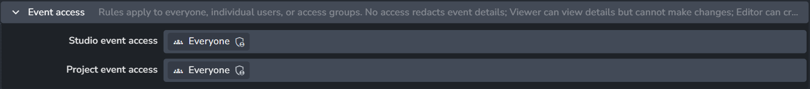
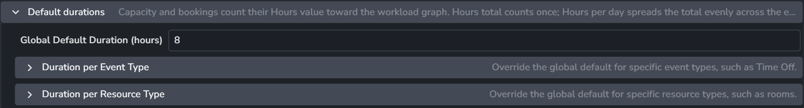
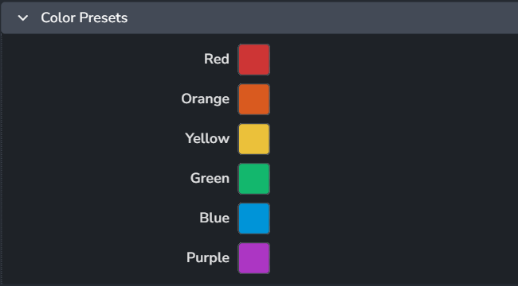
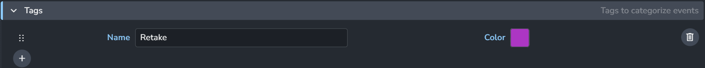

# Planner addon settings

<AddonInfo />

The settings of the [Planner addon](index.md) are in **Studio settings > Planner**. Pasting a location below into the URI bar of the web app opens that setting. Resources, resource types, booking statuses and attributes are not addon settings: they are managed on the [Resources](index.md#resources) page. Settings saved by older versions of the addon are converted when a new version is used; see [What changes when addon versions change](../../../ayon/how-ayon-works/settings.md#what-changes-when-addon-versions-change).

## Event access

<SettingLocation uri="ayon+settings://planner/event_access" scope="Studio only" />

Who can see and edit the events of the Plan. Without rules, every user can see and edit every event; admins and managers always have full access. How this fits with the other permissions of the Planner is described in [Access and permissions](index.md#access-and-permissions).

<Settings>
<Setting name="Studio event access" default="No rules (shown as Everyone)">

Rules for events without a project.

</Setting>
<Setting name="Project event access" default="No rules (shown as Everyone)">

Rules for events assigned to a project. A rule for an access group applies per project: a user gets its level only on the projects where the group is assigned to that user.

</Setting>
</Settings>

Each rule gives **Everyone**, a user or an access group one of three levels:

- **No access:** the event is listed, but its label, project, schedule link and attributes are redacted, and it cannot be saved.
- **Viewer:** all details, but the event cannot be created, edited, moved or deleted.
- **Editor:** the event can be created, edited, moved and deleted.

For example, to let users edit the events of some projects and only view others: create two [access groups](../../../ayon/web-ui/studio/permissions.md), such as *Planner edit* and *Planner view*, assign them to users per project in the [project access](../../../ayon/web-ui/project/project-access.md), and in **Project event access** give *Planner edit* the **Editor** level and *Planner view* the **Viewer** level. A user with *Planner edit* on one project and *Planner view* on another can edit the events of the first, only view those of the second, and sees the events of other projects redacted, unless another rule (such as one for **Everyone**) gives a level.

Access to single attributes, such as a day rate, is set on each attribute on the Resources page, with the same three levels; see [Attributes, resource types and statuses](index.md#attributes-resource-types-and-statuses).

## Default durations

<SettingLocation uri="ayon+settings://planner/default_durations" scope="Studio, with project overrides" />

The hours that new capacity and booking events start with, which the workload counts. A new event takes the first value that applies: the `duration` attribute of the booked resource, the duration of its resource type, the duration of its event type, then the global duration. The resource-based values apply only when all booked resources give the same value. Hours are between 0 and 168.

<Settings>
<Setting name="Global Default Duration (hours)" default="8">

Duration of new events when no event type or resource type has its own.

</Setting>
<Setting name="Duration per Event Type" default="Empty list">

Overrides for event types, such as a shorter default for time off. Each event type can appear once.

<Settings>
<Setting name="Event Type" default="Capacity">

**Capacity**, **Booking**, **Time off** or **Milestone**.

</Setting>
<Setting name="Duration (hours)" default="8">

Duration of new events of this type.

</Setting>
</Settings>

</Setting>
<Setting name="Duration per Resource Type" default="Empty list">

Overrides for resource types, such as 12 hours for rooms. Each resource type can appear once.

<Settings>
<Setting name="Resource Type">

One of the resource types of the studio.

</Setting>
<Setting name="Duration (hours)" default="8">

Duration of new events booking resources of this type.

</Setting>
</Settings>

</Setting>
</Settings>

## Color Presets

<SettingLocation uri="ayon+settings://planner/color_presets" scope="Studio, with project overrides" />

Six colors offered as color tags next to the [tags](#tags) of Schedule events.

<Columns widths="45 55">
<Column>

<Settings>
<Setting name="Red" default="#cd3535" />
<Setting name="Orange" default="#d95a1f" />
<Setting name="Yellow" default="#ebc13a" />
<Setting name="Green" default="#13b76d" />
<Setting name="Blue" default="#0094d8" />
<Setting name="Purple" default="#ac36c3" />
</Settings>

</Column>
<Column>

</Column>
</Columns>

For developers: the tags endpoint returns the presets with the tags, under the reserved names `__red`, `__orange`, `__yellow`, `__green`, `__blue` and `__purple`.

## Tags

<SettingLocation uri="ayon+settings://planner/tags" scope="Studio, with project overrides" />

The tags that task events on the [Schedule](index.md#schedule) can carry, for example to mark retakes or client notes.

:::note
These tags are separate from the tags of AYON tasks: they are stored with the task events of the Planner and are not synced to the tasks.
:::

<Settings>
<Setting name="Tags" id="tags-list" default="Empty list">

<Settings>
<Setting name="Name">

1 to 50 characters, unique in the list.

</Setting>
<Setting name="Color" default="#ac36c3">

Color of the tag.

</Setting>
</Settings>

</Setting>
</Settings>
