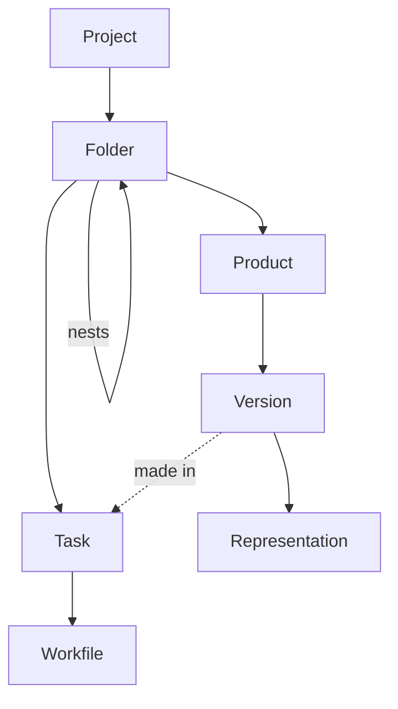
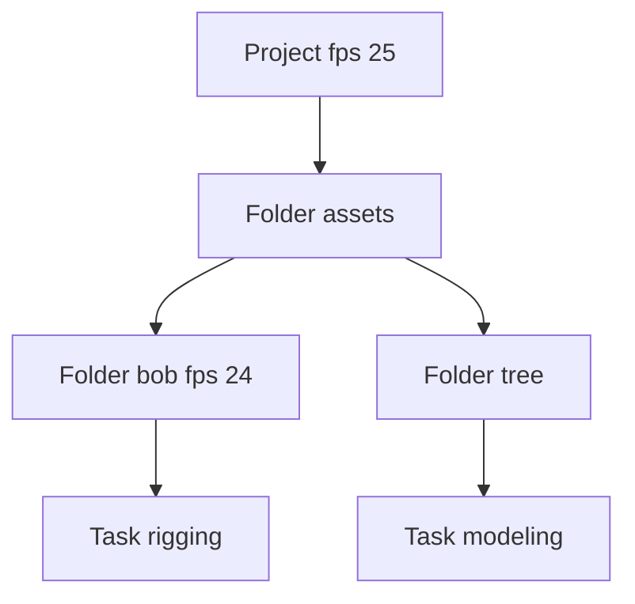

# Data model

AYON stores the work of a production as entities that belong to each other. A project owns folders, a folder owns tasks and products, a product owns versions and a version owns representations. Every entity has a parent, and the parent decides where the entity appears in the web app, which values it inherits and what is removed with it. This page describes the entities, what they hold and how they relate. Database tables and endpoints are not covered.

## Entity hierarchy

| Entity | Belongs to | Notes |
|---|---|---|
| Project | AYON server | The top of the hierarchy. |
| Folder | Project, or a parent folder | Folders nest to any depth. A folder without a parent is a root folder. |
| Task | Folder | A task always has exactly one folder. |
| Product | Folder | Published data of a folder. |
| Version | Product | A numbered iteration of the product. It can also refer to the task it was made in. |
| Representation | Version | One form of the data of a version, with its files. |
| Workfile | Task | A scene file saved in the task. |

The reference from a version to a task is optional and does not make the task a parent. A version is always owned by its product.

Three more kinds of entities are outside this tree:

| Entity | Scope | What it relates |
|---|---|---|
| Link | Project | Two entities of one project, through a link type. See [Links](#links). |
| List | Project | A collection of entities of one type. See [Lists](#lists). |
| User | AYON server | Not part of any project. A user gets access to projects through access groups and can be assigned to tasks. |

## What entities hold

Most entities share the same fields.

| Field | Entities | Meaning |
|---|---|---|
| Name | Project, folder, task, product, representation, user | Short identifier of the entity. See [Names, labels and paths](#names-labels-and-paths). A version is named by its number and a workfile by its file name. |
| Label | Project, folder, task, list | Optional display name that is free of the naming rules. |
| Type | Folder (folder type), task (task type), product (product type and product base type) | Classification of the entity. Folder types and task types are defined in the project anatomy. |
| Status | Folder, task, product, version, representation, workfile | The progress state, chosen from the statuses of the project. |
| Tags | Folder, task, product, version, representation, workfile | A list of tag names. |
| Attributes | All entities | Typed values defined by the AYON server, such as `fps` or `description`. See [Attributes](#attributes-and-inheritance). |
| Data | All entities | Free-form auxiliary values that addons and the pipeline store, for example the subtasks of a task. Data is not defined as attributes and is not inherited. |
| Active | All entities | Whether the entity is in use. See [Active flag](#active-flag). |
| Thumbnail | Folder, task, version, workfile | The image shown for the entity. |
| Created and updated | All project entities | Timestamps and the names of the users who created and last updated the entity. |

### Project

A project is identified by its name, which can contain letters, digits and underscores only. It also has a project code and an optional label. A project marked **Library** is a library project that other projects load data from. A project holds its own attribute values, its anatomy and its settings. The anatomy defines the folder types, task types, statuses, tags, link types, roots and templates that the entities of the project can use.

### Folder

A folder has a name, an optional label, a folder type, a status, tags and attributes. Its position in the hierarchy is its parent folder. A folder without a parent sits directly under the project.

A folder can hold tasks and products at the same time. Which folders are used for what (assets, sequences, shots) is a convention of the project, expressed through folder types, not a rule of the server.

### Task

A task has a name, an optional label, a task type, a status, tags, attributes and a list of assignees (users). Task names are unique within a folder, so several tasks of the same type can exist in one folder, for example two `fx` tasks named `fx_fire` and `fx_cloth`.

### Product

A product has a name, a product type, a product base type, a status, tags and attributes. The product type is the type stored on the product; the product base type is the technical type that creators and settings work with. The base type is filled with the product type when it is not given. Both are described in [Product types](../../../pipeline/product-types.md). The product attribute `productGroup` groups products in the web app.

### Version

A version is identified by its number within the product and is shown as `v001`. The number is an integer; a version with a negative number is the hero version of the product, shown as `HERO`. A product has at most one hero version. A version has an author, can refer to the task it was made in, and holds the attributes of the publish, such as `comment`, `intent`, `source` and `families`. See [Publishing](../../../pipeline/publishing.md).

### Representation

A representation has a name, usually the format such as `abc` or `ma`, and the list of its files with path, size and hash. It can also hold traits that describe the content. A representation belongs to one version, and a version can have any number of them.

### Workfile

A workfile is identified by its path. Its name is the file name of that path. It belongs to a task and has a status, tags and attributes.

### User

A user has a name, an active flag and attributes such as `fullName` and `email`. The role of a user (administrator, manager, guest, service account or developer) and the access groups are stored in the user data. A user is not a child of any project.

### Activities

An activity is an entry of the feed of an entity: a comment, a reviewable, a status change, an assignee change, an attribute change, a tag change, a published version or a review. An activity references the entity it belongs to, and can reference users and other entities through mentions. Activities are stored per project. They belong to folders, tasks and versions in the web app. See [Activity feed and comments](../../../production-tracking/activity-feed-and-comments.md).

## Attributes and inheritance

### Where attributes live

An attribute is defined once for the AYON server. The definition has a name, a type and the entity types it exists on (its scope), and an **Inherit** switch. The value belongs to the entity: each entity stores the values it owns. An entity owns a value when it was set on that entity, and has no value of its own otherwise. See [Attributes](../../web-ui/attributes.md) for the definitions.

Only attributes whose scope contains the entity type exist on that entity. For example `frameStart` exists on projects, folders, tasks, versions and representations, and `productGroup` only on products.

### What inherits from what

Inheritance applies to folders and tasks.

| Entity | Takes a missing value from |
|---|---|
| Folder | Its parent folder, then that folder's parent and so on up to the root folder, then the project |
| Task | Its folder, which resolves the same way |
| Product, version, representation, workfile | Nothing. A value that is not set is empty. |

A value is resolved for each attribute separately. The nearest entity above that owns a value wins. A project always provides a value for an attribute that has a project default, so such an attribute always has a value for folders and tasks.

| Entity | Own value of `fps` | Resulting value | Taken from |
|---|---|---|---|
| Project | 25 | 25 | The project |
| Folder `assets` | none | 25 | The project |
| Folder `bob` | 24 | 24 | The folder itself |
| Task `rigging` of `bob` | none | 24 | The folder `bob` |
| Folder `tree` | none | 25 | The folder `assets`, which takes it from the project |
| Task `modeling` of `tree` | none | 25 | The folder `tree` |

A child follows its parent. When the value changes on the project or on a folder, every child below that does not own the attribute shows the new value.

### Overriding

Setting a value on a folder or task makes the entity the owner of that value. Its own value replaces the inherited one for this entity and, for a folder, for everything below that does not own the attribute. Clearing the value (the **Inherit from parent** entry of the table context menu) removes the own value, and the entity shows the inherited value again. A value that equals the inherited one is still an own value until it is cleared.

The web app marks a value that is inherited and not owned. In tables, an inherited cell is shown as **Inherited** while it is focused.

### Attributes that are not inherited

| Case | Result |
|---|---|
| Attribute with **Inherit** off | The value stays on the entity that owns it. The built-in `description` and `entityListCategory` are defined this way. |
| Attribute whose scope does not contain folders or tasks | Not available for inheritance, for example the version attributes `comment` and `intent`. |
| Product, version, representation and workfile attributes | Never inherited, even for attributes such as `fps` that also exist on folders. The value is taken from the entity itself. |
| Data | Not inherited. |

Only attributes of the project scope have a default. For all other entities an attribute without an own value is empty, unless the project provides a value that is passed down to folders and tasks.

## Statuses, types and tags

Folder types, task types, statuses, tags and link types are defined for each project in its anatomy, not for the AYON server. Two projects can offer different values. An entity can use only values defined in its project.

| Definition | Used by | Fields |
|---|---|---|
| Folder types | Folders | Name, short name, icon, color |
| Task types | Tasks | Name, short name, icon, color |
| Statuses | Folders, tasks, products, versions, representations, workfiles | Name, short name, state, icon, color, scope |
| Tags | All entities with tags | Name, color |
| Link types | Links | Link type, input type, output type, color, style |

A status has one of the states not started, in progress, done and blocked, which groups statuses regardless of their names. The scope of a status limits the entity types that can use it. The default statuses are Not ready, Ready to start, In progress, Pending review, Approved, On hold and Omitted, each limited to the entity types it fits.

A new folder or task takes the first type of the list when none is given. A new entity takes the first status of the list whose scope contains its entity type.

Renaming a type or status in the anatomy renames it on every entity that uses it.

## Names, labels and paths

| Item | Rule |
|---|---|
| Name | Letters, digits and underscores. A dot or a hyphen is allowed inside a name, not at its start or end. |
| Uniqueness | A name is unique among active siblings, ignoring upper and lower case: folders within one parent (and root folders in a project), tasks and products within one folder, representations within one version. Version numbers are unique within a product. |
| Label | Free text for display. A label cannot contain a single quote or a semicolon. |
| Type names | Folder types, task types and statuses can also contain spaces and hyphens. |

Every entity below the project has a path built from the names of its parents.

| Entity | Path |
|---|---|
| Folder | `/assets/characters/bob` |
| Task | `/assets/characters/bob/rigging` |
| Product | `/assets/characters/bob/modelMain` |
| Version | `/assets/characters/bob/modelMain/v003` |
| Representation | `/assets/characters/bob/modelMain/v003/abc` |

The path changes when a parent folder is renamed or moved. These paths identify entities in the AYON server and are separate from the file paths of work files and published files, which come from the anatomy templates and roots. See [Naming conventions](../../../pipeline/naming-conventions.md) for how product names, versions and file paths are built.

## Links

A link is a stored relationship between two entities of one project. It has an input end and an output end, and a link type.

A link type is defined in the project anatomy by its name and the entity types of its two ends. Its full name is `link type|input type|output type`, for example `breakdown|folder|folder`. Any entity types of a project can be linked, and the same link type name can exist for different pairs of types. The defaults are `generative` and `reference` between versions and `breakdown` and `template` between folders. The default link types cannot be deleted.

| Rule | Behavior |
|---|---|
| Self-link | An entity cannot be linked to itself. |
| Deleting an entity | Removes all links of the entity. |
| Deleting a link type | Removes all links of that type. |
| Display | The links manager lists the links of an entity in each direction. |

See [Links manager](../../../production-tracking/links-manager.md).

## Lists

A list collects entities of one type from anywhere in a project, without changing where they belong.

| Property | Meaning |
|---|---|
| Entity type | The type of the entities in the list. The web app offers folders, tasks and versions. |
| List type | `generic` for lists of the **Lists** page, or `review-session` for review sessions. |
| Items | References to entities, in an order. Each item can carry its own attribute values, tags and a label that apply to the list only. |
| Attributes | Values of the list itself, such as its category. |
| Access | A level for each user or team: read, update or manage. |
| Folder | An optional list folder that groups lists. |
| Owner, active, tags | The user who owns the list, whether it is active, and its tags. |

An item refers to an entity and does not copy it. Deleting a list removes only the list. See [Lists](../../../production-tracking/lists.md).

## Identifiers

| Entity | Identifier |
|---|---|
| Project | Its name |
| User | Its name |
| Folder, task, product, version, representation, workfile, link, list | A unique ID of 32 hexadecimal characters, generated when the entity is created |
| Attribute, status, type, tag | Its name |

An ID never changes and stays the same when the entity is renamed or moved, so an ID is the stable reference for links, lists and activities. Names and paths can change. The ID is unique within the project.

## Active flag

Every entity has an **active** flag. An inactive entity is kept in the project and is not deleted. An entity is effectively inactive when it or any of its parents is inactive: an inactive folder deactivates its tasks, products, versions and representations and its child folders. Name uniqueness is checked only among active entities, so an inactive entity does not block a name.

## Deleting

Deleting an entity removes everything below it: a task takes its workfiles, a product its versions and their representations, a version its representations and a folder its child folders and tasks. A folder that still has products is not deleted unless the removal is forced. The task of a version is cleared when the task is deleted.

## Related

- [Attributes](../../web-ui/attributes.md)
- [Glossary](../../glossary/index.md)
- [Product types](../../../pipeline/product-types.md)
- [Naming conventions](../../../pipeline/naming-conventions.md)
- [Links manager](../../../production-tracking/links-manager.md)
- [Lists](../../../production-tracking/lists.md)
