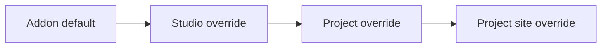
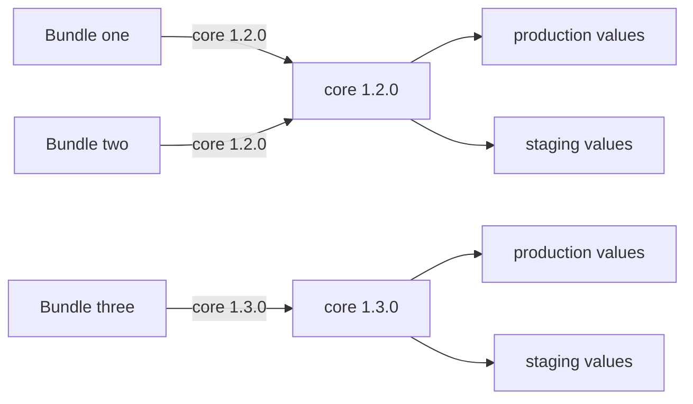

# Settings scopes and storage

Every addon that has settings exposes them in four scopes: addon settings at the studio level, addon settings at the project level, site settings at the studio level and site settings at the project level. The scopes decide where a value is edited, who can edit it and what it applies to. Values are stored per addon version and variant, not per bundle. A bundle only selects which addon versions are active.

## The four scopes

| Scope | Edited in the web app | Who edits | Applies to | Inheritance |
|---|---|---|---|---|
| Addon settings, studio | **Studio settings** page (`/settings/studio`, `s+s`) | Managers and admins | Every project and every workstation | Starts from the defaults built into the addon version |
| Addon settings, project | **Project settings** tab of the project pages (`/manageProjects/projectSettings`, `p+p`) | Managers and admins; users whose access group grants **Project addon settings** | One project | Inherits the studio values and stores only the differences |
| Site settings, studio | **Site settings** page (`/settings/site`) | Each user, for the sites registered to that user | One workstation (site) of one user, in every project | None. Separate from every other scope |
| Site settings, project | **Site settings** tab of the project pages (`/manageProjects/siteSettings`) | Each user, for the sites registered to that user | One workstation (site) of one user, in one project | Overrides on top of the project values. Does not read the studio site settings |

Notes on the table:

- **Studio site settings and project site settings are two different things that share a name.** Studio site settings are their own set of fields, defined by the addon separately from its normal settings. Project site settings are not an extension of them. They are per-workstation overrides of the addon's normal settings fields that the addon marks as site-capable, applied on top of the studio and project values. Neither scope reads the other.
- Both site scopes are stored per site ID and per user name. The same workstation used by two users has two independent sets of site values.
- Studio, project and project site settings exist per variant (see [Variants](#variants)). Studio site settings have no variant: one set of values per addon version, site and user.
- An addon decides which of its fields belong to which scope. A field can be limited to studio, project, site or a combination. By default a field is available at the studio and project levels. A field that is not in the scope of the open page is not shown on that page. An addon only appears in the addon list of a page when it has at least one field in that scope.
- Studio site settings appear for the addons of the Production bundle only.
- In a project that uses a project bundle, addons with an explicit version also show their studio-scope fields on the **Project settings** tab.

The addon list of the **Studio settings** and **Project settings** pages marks an addon row when the addon has overrides at the studio, project or site level for the selection. In a project that uses a project bundle, addons that follow the studio bundle show **(Inherited)** after the version.

### Where the pages are

| Page | Menu entry | Shown to |
|---|---|---|
| Studio settings | **Studio Settings** in the app menu, or the **Studio settings** tab of Settings | Managers and admins |
| Site settings (studio) | **Site Settings** in the app menu (users), or the **Site settings** tab of Settings | Everyone with the menu |
| Project settings | **Projects Settings** in the app menu, then the **Project settings** tab | Managers and admins; users with read or write access to **Project addon settings** in a project's access group |
| Site settings (project) | **Projects Settings** in the app menu, then the **Site settings** tab | Everyone |

For users with the user role, the `s+s` entry opens **Site Settings** instead of **Studio Settings**. See [Navigation bar](../../web-ui/navigation-bar.md) for the menu and tabs.

## How overrides work

The value of a field is built in layers. Each layer applies on top of the previous one:



| Layer | Source | Stored |
|---|---|---|
| Addon default | Built into the addon version. Changes only with a new addon version | Not stored |
| Studio override | Saved on the **Studio settings** page | Only the fields that differ from the default |
| Project override | Saved on the **Project settings** tab | Only the fields that differ from the studio value |
| Project site override | Saved on the **Site settings** tab of the project pages | Only the fields that differ from the project value |

A project value that equals the studio value is not stored, unless the field already had a project override or was explicitly set as an override. A field that is not overridden follows the layer above it, so a later change at the studio level reaches every project that has no override for that field. Lists and fields the addon declares as groups are stored as a whole value.

### Override states in the editor

Every field and group in the editor carries a marker: a colored left edge on groups and a colored label on fields. A group shows the strongest state among its children, so an override deep in a tree is visible from the top.

| State | Marker | Meaning |
|---|---|---|
| Default | No color | The value comes from the addon version's built-in default |
| Studio override | Green | The value is saved at the studio level |
| Project override | Orange | The value is saved for the open project |
| Site override | Pink | The value is saved for the selected site in the open project |
| Unsaved edit | Theme highlight color | The value was changed in the editor and not saved yet |

The header of each addon panel shows badges for the project name, the site ID and the variant that the panel is editing.

### Right-click menu on fields

| Entry | What it does |
|---|---|
| **Add current &lt;field&gt; value as &lt;level&gt; override** | Marks the current value as an override at the level of the open page (studio, project or site), even when it equals the inherited value. Asks for confirmation (**Pin override**) and stores the override at once, without **Save Changes**. Disabled when the field already has an override at this level |
| **Remove &lt;level&gt; override from &lt;field&gt;** | Deletes the override at the level of the open page after a confirmation. The field falls back to the layer above. Takes effect immediately. Disabled when the field has no override at this level |
| **Remove all &lt;level&gt; overrides** | On the root of an addon panel. Deletes every override of the addon at this level, for the open variant |
| **Copy** | Copies the value as JSON to the clipboard |
| **Paste** | Pastes JSON into the field. The structure must match the field |

The addon list has a context menu with **Copy settings from...** (see [Copying settings](#copying-settings)) and, for admins, **Low-level editor**, which edits the stored override document of one addon directly without validation.

## Site IDs

A site ID identifies one workstation. It is what ties site settings to a machine.

| Property | Value |
|---|---|
| Format | Lowercase letters, digits and hyphens |
| Created by | The AYON launcher, at its first start on the machine. Three random words joined by hyphens |
| Stored on the machine | In a file named `site_id` in the launcher's local data folder. The `AYON_SITE_ID` environment variable overrides the file |
| Sent to the server | In the `x-ayon-site-id` header, together with the platform, host name and launcher version |
| Registered on the server | When a signed-in, non-guest user opens a session with those headers. The server adds the site, or updates its platform, host name or version, and adds the user to the site's user list |
| Listed in the web app | The **Site ID** and **Platform** columns of the site lists on both **Site settings** pages show the sites registered to the signed-in user |

Site settings are read and saved for the signed-in user and the selected site. A user cannot edit the site settings of another user in the web app.

Sites can be listed and deleted through the server API (`/api/system/sites`); the web app has no page for it. Deleting a site is limited to admins and removes the site's studio and project site settings and its custom roots. A maintenance task also removes project site settings whose site or user no longer exists.

## Storage model

### Settings belong to an addon version and variant

Settings are not part of a bundle. Overrides are stored under the addon name, the addon version and the variant:

```text
addon[version][variant] = overrides
```

and not as:

```text
bundle[addon] = overrides
```

A bundle holds a list of addon versions. It selects which addon versions are active, and the active versions then read their own values.



| Bundle | Addon version selected | Values read |
|---|---|---|
| Bundle one | core 1.2.0 | core 1.2.0, variant of the bundle's state |
| Bundle two | core 1.2.0 | The same values as bundle one, when both read the same variant |
| Bundle three | core 1.3.0 | core 1.3.0 values, separate from core 1.2.0 |

An addon version exists once on the server, so it has one copy of its values per variant. Two bundles that use the same version of an addon share those values and no data is duplicated. Deleting a bundle does not delete settings.

### What is stored

| Scope | Key | Content |
|---|---|---|
| Studio | Addon name, addon version, variant | Studio overrides |
| Project | Project, addon name, addon version, variant | Project overrides |
| Studio site | Addon name, addon version, site ID, user name | The complete site settings document |
| Project site | Project, addon name, addon version, site ID, user name | Project site overrides |

Studio overrides and studio site settings are stored in the shared database. Project overrides and project site overrides are stored in the database schema of their project.

### Variants

A variant is a named copy of the values of an addon version.

| Variant | Used when | Notes |
|---|---|---|
| `production` | The addon is read through the Production bundle | The default variant of every settings call |
| `staging` | The addon is read through the Staging bundle | Independent of `production` even when one bundle holds both states |
| Dev bundle name | The addon is read through a Dev bundle | Created on demand. Available to the developer who owns the Dev bundle; the **Dev** variant button is shown when the **Developer mode** attribute is on |

The factory defaults are not a stored variant. They are built into the addon version.

The variant buttons of the **Studio settings** and **Project settings** pages (**Production**, **Staging**, and **Dev**) select the variant being edited. The bundle dropdown below them selects which bundle's addon versions are listed. Site settings have no variant selector.

The launcher resolves its bundle by mode (production, staging or dev) and reads the matching variant of each addon version in that bundle. A bundle without a state is stored but is not read by default.

## What changes when addon versions change

A new addon version starts with no values of its own and uses its built-in defaults. Values saved for the previous version stay stored under that version and are not read by the new one.

| Event | Effect on settings |
|---|---|
| A bundle is switched to another version of an addon | The addon reads the values stored for the new version and variant. The old version's values stay unchanged and return when that version is used again |
| Production or Staging is set on a bundle | A dialog offers to copy settings from another bundle and variant into the bundle's variant. Skipping it leaves the target variant as it was |
| The version of a server addon is changed in a bundle that holds Production | The studio, project and project site settings of the old version's `production` variant are converted and copied to the new version automatically. Other states and other addon types are not migrated automatically |
| Settings are copied from another version | Overrides are converted to the structure of the target version. Overrides of fields that still exist and whose values still validate are carried over, the others are dropped, and every other field uses the target version's default. An addon can supply its own conversion |
| A staging bundle is promoted to production | The `staging` values of every addon in the bundle replace the `production` values, for the studio and for every project. Production values of addons that have no staging values are deleted. The server offers this as an admin-only bundle action; the web app does not expose a control for it |
| A project bundle is frozen or unfrozen | See [Project bundles](#project-bundles-and-settings) |
| An addon version is removed from the server | Its stored values remain in the database but are not read |

Only some bundle edits are possible after a bundle is created (see [Bundles](../../web-ui/studio/bundles.md)). On a bundle without the Dev state only the versions of server addons can still be changed, so most version changes happen by creating a new bundle and copying settings.

### Copying settings

| Operation | Where | What it copies |
|---|---|---|
| Copy settings between bundles | **Bundles** page: dialog shown when a state is set, or **Copy settings from...** in the bundle context menu | Studio, project and project site settings of every addon that exists in both bundles, from the source bundle and variant to the target bundle and variant. Studio site settings are not copied. Admin only |
| Copy settings from another bundle | **Studio settings** and **Project settings** pages: toolbar button (tooltip **Copy settings from another bundle**) | Per addon, with a comparison of old and new values. The values are loaded into the editor as unsaved edits |
| Copy settings from another addon | Addon list context menu **Copy settings from...** | Per addon, from any installed addon version, variant and (on the project page) project, regardless of bundles. Loaded as unsaved edits |
| Copy a single value | Right-click menu **Copy** and **Paste** on a field | One value, as JSON |

Copies made in the editor change nothing until **Save Changes** is used. **Clear Changes** discards them.

## Project bundles and settings

A project bundle freezes the addon versions of one project (see [Project bundles](../../web-ui/project/project-settings.md)). It does not hold settings. The same storage model applies, with these effects:

| Action | Effect on settings |
|---|---|
| Freeze or update freeze | For every addon with an explicit version, the project's complete resolved settings (studio values plus project overrides) are written as project overrides for that addon version and variant. Later studio changes to those fields no longer reach the project |
| Saving project settings of a frozen addon | The whole settings document is stored, not only the differences |
| Removing overrides of a frozen addon | Rejected while the project bundle exists |
| Addons set to inherit | Not frozen. They follow the studio bundle and use ordinary override storage |
| Unfreeze | Fields that are not project-scoped are removed from the project overrides. The remaining project overrides are converted to the addon versions of the studio bundle. The project bundle is deleted. Project overrides are not lost |

Project bundles exist for the Production and Staging variants only, one per variant and project. They are not available for Dev variants.

## Permissions

| Action | Required |
|---|---|
| Edit studio settings | Manager or admin |
| Edit project settings | Manager or admin, or write access to **Project addon settings** in the user's access group for that project |
| View project settings in the web app | Read or write access to **Project addon settings**, or manager or admin |
| Edit site settings (both scopes) | Any signed-in user, for their own user name and a site registered to them |
| Low-level editor (raw overrides) | Admin |
| Copy settings between bundles, migrate addon settings, promote a bundle | Admin |
| Delete a site | Admin |

Access groups are described in [Users](../../web-ui/studio/users.md). Each save of studio or project settings creates a `settings.changed` event (see [Event Viewer](../../web-ui/event-viewer.md)).

## Related

- [Bundles](../../web-ui/studio/bundles.md)
- [Project bundles](../../web-ui/project/project-settings.md)
- [Navigation bar](../../web-ui/navigation-bar.md)
- [Users](../../web-ui/studio/users.md)
- [Core addon settings](../../../addons/essentials/core/settings.md)
- [Addons](../../../addons/index.md)
- [Self-hosting](../../deployment/on-premise.md)
