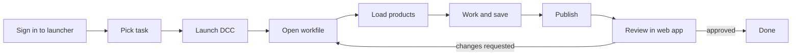
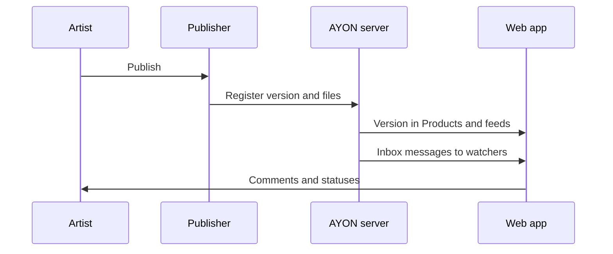

# Artist workflow

This page follows one artist through a typical piece of work with the AYON pipeline: a modeler who has been assigned the **modeling** task of a chair asset. It shows what happens, in which order, and in which part of AYON, from signing in on the workstation to a reviewed and approved model. Other disciplines follow the same pattern with other applications and other [product types](../../pipeline/product-types.md). The tools themselves are described on their reference pages, linked in each section.

The scenario assumes that the studio has prepared the pipeline: a production bundle with the integration of the artist's application, application paths, project roots and the project's folders and tasks. See [Production workflow](production-workflow.md) for the producer's side.

## The day at a glance

The same flow as a list:

1. The artist starts the AYON launcher, which signs in to the AYON server and shows the tray icon.
2. In the **Launcher** window the artist picks the project, the folder and the task.
3. An application action starts the DCC application in the context of that task.
4. The last workfile of the task opens, or a new one is saved with a name from the project templates.
5. The artist loads published products from other departments and keeps them up to date.
6. The artist works and saves new workfile versions.
7. The Publisher checks the work and publishes it as a new version of a product.
8. The version appears in the web app, where it is reviewed and commented on.
9. On requested changes the artist returns to the workfile and publishes the next version; on approval the task is done.

## Who does what

| Step | Artist | Supervisor or lead | AYON |
|---|---|---|---|
| Assignment | Sees the task on Tasks home and in the launcher | Assigns the task | Notifies the artist and makes them a watcher of the task |
| Launch | Picks the context and the application | | Prepares the environment, work directory and workfile |
| Work | Models, saves workfiles | | Names and places the workfiles |
| Publish | Creates the product and publishes | | Validates, writes files, registers the version |
| Review | Reads feedback, iterates | Comments, annotates, sets statuses | Delivers notifications to the inbox |

## 1. Sign in to the launcher

The launcher is the desktop application that connects a workstation to the AYON server. Its installer is offered in the web app under **Download Launcher** in the **User** menu, and as a download prompt in the top bar when the server hosts an installer for the platform.

| Moment | What happens |
|---|---|
| First start | The **Login to server** dialog asks for the server **URL** and a username and password, or signs in through the web browser with **Login with AYON server**. |
| Every start | The launcher reads the bundle of its mode (production by default), downloads the addons and dependency packages that the bundle needs, and starts the tray. |
| While running | The tray icon gives access to the **Launcher** window, the **Browser** and other tools. When the studio switches to a new production bundle, the tray offers **Restart && Update**. |

See [Launcher](../../pipeline/launcher.md) for the pipeline modes and the tray menu.

## 2. See the task and pick the context

The artist can check the assignment in two places. In the web app, Tasks home (`h+h`) shows the task card in the column of its status, and dragging the card from **Ready to start** to **In progress** tells the team that work has started. See [Tasks (home) page](../../production-tracking/tasks-home.md).

On the workstation, the **Launcher** window (tray entry **Launcher**, or a double click on the tray icon) has three levels:

| Level | Content |
|---|---|
| Projects | Active projects, pinned ones first. |
| Folders and tasks | The folder tree and the tasks of the selected folder, both with their status. The my tasks toggle limits them to the tasks assigned to the artist. |
| Workfiles | The workfiles of the selected task, with their modification time and the user who saved them last. |

Below, the actions pane shows the applications allowed for the task type of the selected task, one icon per application with its versions as variants.

## 3. Launch the application

Selecting an application action starts it in the context of the task. Before the application starts, AYON prepares its environment from the studio settings (plugins, environment variables, color management), creates the work directory from the project anatomy, and decides which workfile to open.

| Situation | Result |
|---|---|
| The task has workfiles | The last workfile opens, by default (core setting **Open last workfile on launch**). |
| A workfile is selected in the launcher | That workfile opens, and only the application that created it is offered. |
| The task has no workfile | The application opens an empty scene. When the studio has a workfile template for the application and task, the first workfile is created from it instead. See [Template builder](../../pipeline/template-builder.md). |
| **Skip last workfile** is set on the action | The application starts without opening a workfile. |

The same application actions are available in the web app, among the web actions of a task's details panel. The web app hands them to the launcher on the workstation.

## 4. The workfile

Inside the application, the integration adds an **AYON** menu with the pipeline tools. The Workfiles tool (**Work Files...** in most integrations) replaces the application's own open and save dialogs. Its **Save As** dialog calculates the file name and folder from the work templates of the project anatomy, so the artist chooses only the version (by default the next available one), an optional subversion comment and the extension.

| Template part | Example value |
|---|---|
| Work directory | `{root[work]}/{project[name]}/{hierarchy}/{folder[name]}/work/{task[name]}` |
| File name | `{project[code]}_{folder[name]}_{task[name]}_{@version}<_{comment}>.{ext}` |
| Result for the chair | `mp_chair_modeling_v001.blend` in the `work/modeling` folder of the asset |

Each save is a new file with a higher version, and the AYON server keeps a workfile record with the author and an optional artist note. See [Workfiles](../../pipeline/workfiles.md) and [Naming conventions](../../pipeline/naming-conventions.md).

## 5. Load what others published

A modeler often starts from published material: a concept image, a scan, a reference model from a library project. **Load...** in the AYON menu opens the loading tool, by default in the [Browser](../../pipeline/browser.md) interface (or the [Loader](../../pipeline/loader.md) when the studio uses the legacy one). It lists the products of the current project and of library projects, with their versions, statuses and representations. A load action (load, reference, import, depending on the integration) brings the chosen representation into the scene as a container that remembers where it came from.

Afterwards, **Manage...** opens the [Scene Inventory](../../pipeline/scene-inventory.md), which lists the containers of the scene:

| Situation in the inventory | What the artist can do |
|---|---|
| A newer version was published | The version is shown in red. **Update to latest** or the update arrow brings it up to date; **Set version** picks a specific one. |
| A version was approved | **Update to last approved** switches to the newest version with a done status. |
| The wrong asset or format was loaded | **Switch Folder** changes the folder, product or representation. |
| The content is no longer needed | **Remove items** removes it from the scene. |

Some integrations warn about outdated containers when a scene opens, and the publish validation can stop on them.

## 6. Create the product and publish

When the model is ready to share, the artist publishes it. The Publisher (**Create...** and **Publish...** in the AYON menu of most integrations) has two parts in one window. See [Publisher](../../pipeline/publisher.md).

| Part | What the artist does | What AYON does |
|---|---|---|
| **Create** tab | Selects the geometry, picks the model creator under **Choose publish type** and keeps or changes the variant (`Main` by default). | Calculates the product name, here `modelMain`, and stores a publish instance in the scene. The scene content is not changed. |
| **Publish** tab | Writes a comment, checks the options of the instances, and starts **Publish** (or **Validate** first). | Runs the publish stages. |

The instance stays in the workfile, so the next publish of the same model needs only the **Publish** tab. The stages run on every publish:

| Stage | In short |
|---|---|
| Collect | Gathers data from the scene, the instances and the AYON server. |
| Validate | Checks the model against the studio's rules. Errors stop the publish and are listed with a description, and many come with a repair action. |
| Extract | Writes the files (for example `.blend`, `.abc`, a review movie, a thumbnail) to a temporary staging folder. |
| Integrate | Copies the files to the publish folder of the anatomy and registers the product, the version and its representations on the AYON server. |

The first publish creates `v001` of `modelMain`, stored for example at `.../chair/publish/model/modelMain/v001/`. Every later publish creates the next version; published versions are never overwritten. See [Publishing](../../pipeline/publishing.md).

## 7. What the artist sees afterwards

In words:

1. The Publisher registers the version and its files on the AYON server.
2. The version appears on the project's **Products** page and as a published version in the activity feed of the task.
3. Watchers of the task, such as the supervisor, get a message in their inbox.
4. Feedback from reviewers reaches the artist as comments, statuses and inbox messages.

| Result | Where it shows |
|---|---|
| New version | The **Products** page of the project, and the task's details panel. See [Products and versions](../../production-tracking/products-and-versions.md). |
| Reviewable | When the publish produced a review movie or image, it is uploaded as a reviewable of the version and plays in the viewer. See [Reviewables](../../production-tracking/reviewables.md). |
| Activity | A published version entry in the activity feed of the version and of the task. See [Activity feed and comments](../../production-tracking/activity-feed-and-comments.md). |
| Watchers | The artist becomes a watcher of the new version; watchers of the task also follow it. |
| Version status | Set at publish only when the studio enables a version status option in the Publisher; otherwise the version gets the project's default version status. |
| Task status | Unchanged by the publish. The artist moves the task to **Pending review** on Tasks home or in the details panel, unless the studio uses status automation (see [AYON plans](../plans.md)). |

## 8. Feedback and iteration

The supervisor reviews the version in the viewer or in a review session, writes comments (with frame-accurate notes and annotations where available), mentions the artist with `@`, and changes the status of the version or the task. The artist receives these in the **Important** tab of the [inbox](../../production-tracking/inbox-and-notifications.md) (`i+i`), where each message opens the entity in the details panel with the comment highlighted.

To address the notes, the artist opens the task again from the launcher, saves the workfile as the next version, makes the changes and publishes again from the **Publish** tab. The new version, for example `v002`, appears next to the first one, and the viewer can compare the two. Artists in other departments who loaded `modelMain v001` see it as outdated in their Scene Inventory and update when they are ready.

When the supervisor approves the version, the task is usually set to **Approved**, and its card moves to the **Approved** column of the artist's board.

## Related

- [Launcher](../../pipeline/launcher.md)
- [Workfiles](../../pipeline/workfiles.md)
- [Browser](../../pipeline/browser.md) and [Loader](../../pipeline/loader.md)
- [Scene Inventory](../../pipeline/scene-inventory.md)
- [Publisher](../../pipeline/publisher.md) and [Publishing](../../pipeline/publishing.md)
- [Product types](../../pipeline/product-types.md) and [Naming conventions](../../pipeline/naming-conventions.md)
- [Tasks (home) page](../../production-tracking/tasks-home.md)
- [Activity feed and comments](../../production-tracking/activity-feed-and-comments.md)
- [Quick navigation](navigation.md)
- [Production workflow](production-workflow.md)
