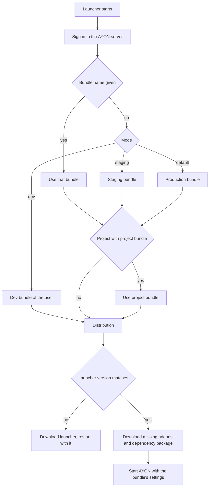
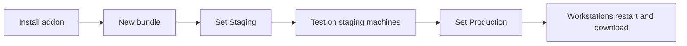

# Bundles

A bundle is the release unit of an AYON setup. It names one version of each addon, one AYON launcher version and one dependency package per platform. Installing an addon only places it on the server; a bundle with a state (Production, Staging or Dev) is what puts addon versions into use. This page describes what the server and the workstations do with bundles. The **Bundles** and **Addons** pages are described in [Bundles](../web-ui/studio/bundles.md).

## What a bundle holds

| Part | Content | Used by |
|---|---|---|
| Addons | Addon name and version for each addon in the bundle. An addon left out (`NONE`) is not part of the bundle. | Server (settings, web actions, addon pages) and workstations (client code) |
| Launcher version | The AYON launcher version the workstations should run | Workstations |
| Dependency packages | One package per platform with the Python modules the client code of the bundle's addons needs | Workstations |
| State | Production, Staging, Dev or none | Server and workstations, to pick the bundle |
| Dev bundle only | The developer it belongs to and, per addon, an optional local folder with the client code | The developer's workstation |

System addons that a bundle does not list are added at their latest installed version when the bundle is created.

## Which bundle is used by whom

There is one Production bundle, one Staging bundle (they can be the same bundle) and one Dev bundle per developer. A bundle without a state is stored but not used unless a workstation asks for it by name.

| Bundle | Used by the launcher when | Used by the web app when | Settings variant |
|---|---|---|---|
| Production | No other mode is requested. The default for every workstation and farm machine. | Always, for the addon pages, single sign-on options and web actions | `production` |
| Staging | The launcher is started with `--use-staging` or with `AYON_USE_STAGING=1` | The user has **Staging access** and turns on **Staging Mode** in the header, for web actions | `staging` |
| Dev | The launcher is started with `--use-dev` (or `AYON_USE_DEV=1`) and the signed-in user is the developer assigned to a Dev bundle, or with `--bundle` and the name of a Dev bundle | The user has **Developer** and turns on **Developer Mode** | The bundle name |
| A named bundle | The launcher is started with `--bundle` and the bundle name (or `AYON_STUDIO_BUNDLE_NAME`) | | The variant of the bundle's state |
| Project bundle | The launcher works for a project that has a project bundle for its mode | | `production` or `staging` |

Staging is chosen explicitly on each machine; it is never derived from a bundle name. **Staging access** on the user account only controls the switch in the web app; the launcher does not check it.

## How a workstation picks and installs its bundle

The launcher resolves its bundle every time it starts, before any addon code runs.

Plain-text equivalent:

1. The launcher signs in to the AYON server and reads the list of bundles.
2. A bundle name given with `--bundle` (or `AYON_STUDIO_BUNDLE_NAME`) is used as is. Otherwise the mode decides: dev uses the Dev bundle assigned to the signed-in user, staging uses the Staging bundle, and the default is the Production bundle.
3. Outside dev mode, when the launcher runs for a project (`--project` or `AYON_PROJECT_NAME`) and that project has a project bundle for the mode, the project bundle replaces the studio bundle.
4. If no bundle is found, the launcher stops and shows that no bundle is set for the mode on the server.
5. If the bundle names another launcher version than the running one, the launcher downloads that installer from the server, installs it and starts again with the new version.
6. The launcher compares the bundle's addons and the dependency package for its platform with what is already on the machine. Missing addon versions and a missing package are downloaded from the server and unpacked into the launcher's local storage. Versions already on the machine are reused. In a Dev bundle, addons that point to a local folder are loaded from that folder instead.
7. The launcher puts the client code of these addon versions and the dependency package on the Python path and starts AYON. Every settings request of the session reads the settings variant that belongs to the bundle.

`AYON_AUTO_UPDATE=skip` skips the download step, and `AYON_AUTO_UPDATE=block` stops the launcher with a message when a download would be needed. The local storage is the launcher's data folder unless `AYON_LAUNCHER_STORAGE_DIR` points elsewhere, and needs write access for the user.

## What changes when a bundle becomes Production

The server loads every installed addon version when it starts, whether or not a bundle uses it. Setting a bundle to Production does not load or unload code and does not restart the server. It changes which versions count as the production ones.

| Area | Effect |
|---|---|
| Previous Production bundle | Loses the state. It stays stored and can be set back to Production. |
| Compatibility check | The server checks the addon versions of the bundle against each other. A bundle with errors is refused. |
| Settings | The `production` variant of each addon version in the bundle is read from now on. An addon version that has never been used in production starts from its built-in defaults unless settings are copied (see below). Values of the previous versions stay stored. |
| Web app | Addon pages, single sign-on options and web actions come from the new addon versions. |
| Events | The server emits `bundle.updated` and clears its settings cache. |
| Running workstations | Keep the bundle they started with. The AYON tray watches bundle events and checks the server periodically (Core setting **Update check interval (minutes)**, default 5). When the bundle in use is no longer the Production bundle (or the Staging bundle in staging mode), it shows **AYON update** with **Restart & Update** and **Ignore**, and the tray menu gets a **Restart & Update** entry. |
| Next launcher start | Downloads the new addon versions, the dependency package and, if needed, the new launcher version, as described above. |
| Farm and service machines | Pick up the bundle the next time their launcher starts. Running jobs keep their versions. |
| Project bundles | Projects with a project bundle keep their frozen addon versions. Addons that inherit the studio version follow the new Production bundle. |

Settings for the new bundle come from one of these:

| Path | What happens |
|---|---|
| **Copy all settings** in the dialog shown when the state is set | Studio, project and project site settings of every addon in both bundles are copied from the chosen source bundle and variant, converted to the new addon versions. |
| **Do not copy** | Addon versions that already have values in the variant keep them. New versions use their defaults. |
| Changing the version of a server addon inside the Production bundle | That addon's production settings are migrated to the new version automatically. |

The rules of storage per addon version and variant are explained in [Settings scopes and storage](../backend/settings/index.md).

On a server connected to Ynput Cloud, addons that the subscription requires are added to the Production bundle at server start once they are installed, with the settings of the previous version migrated.

## Adding an addon to production

Bundles keep their pipeline addon versions once created, so a new addon or a new version reaches production through a new bundle.

Plain-text equivalent:

| Step | Action | Effect |
|---|---|---|
| 1 | Install the addon from the [Market](../web-ui/market.md) or upload its package | The addon version is placed on the server and is loaded after a server restart. Nothing changes for users yet. |
| 2 | **Duplicate and edit** the Production bundle and select the new version, or create a bundle from a pipeline release | A new bundle without a state. The compatibility check runs. |
| 3 | **Set Staging** on the new bundle, with **Copy all settings** from the Production bundle | The new addon versions receive the production values as their staging values. The Production bundle is unchanged. |
| 4 | Configure the new addon in the staging variant of the studio settings and test with launchers started in staging mode, and in the web app's **Staging Mode** for web actions | Only staging machines and users see the change. |
| 5 | **Set Production** on the bundle, copying settings from the staging variant | The bundle becomes Production for everyone. |
| 6 | Users restart from the tray prompt or at their next start | Workstations download the new client code. |

A server addon that has no client part can also be updated in place: its version can be changed directly in the Production bundle, and its settings are migrated. Admins perform all bundle operations.

## Project bundles

A project bundle is a bundle tied to one project and one variant (production or staging), named `__project__` followed by the project name and the variant. It fixes the launcher version, the dependency packages and the versions of the addons that allow project overrides, while the other addons inherit the studio bundle. The launcher uses it whenever it works for that project in that mode, and the project's settings are frozen for the fixed addon versions. A new project has no project bundle. See [Project bundles](../web-ui/project/project-settings.md).

## Where to look

| Question | Place |
|---|---|
| Which bundle is Production or Staging? | **Bundles** page, status column |
| Which bundles use an addon version? | **Addons** page, version and bundle tables |
| Which bundle did a workstation start with? | The version entry of the AYON tray menu opens an information window with **AYON Bundle:**. Processes started by the launcher carry the `AYON_BUNDLE_NAME` and `AYON_STUDIO_BUNDLE_NAME` environment variables. |
| When did the Production bundle change, and who changed it? | **Event Viewer**, topic `bundle.updated` |
| Why does a workstation report a missing bundle? | No bundle has the requested state, the requested name does not exist, or no Dev bundle is assigned to the user |

## Related

- [Bundles](../web-ui/studio/bundles.md)
- [Project bundles](../web-ui/project/project-settings.md)
- [Settings scopes and storage](../backend/settings/index.md)
- [Market](../web-ui/market.md)
- [Services](../web-ui/services.md)
- [Pipeline storage](pipeline-storage.md)
- [Launcher](../../pipeline/launcher.md)
