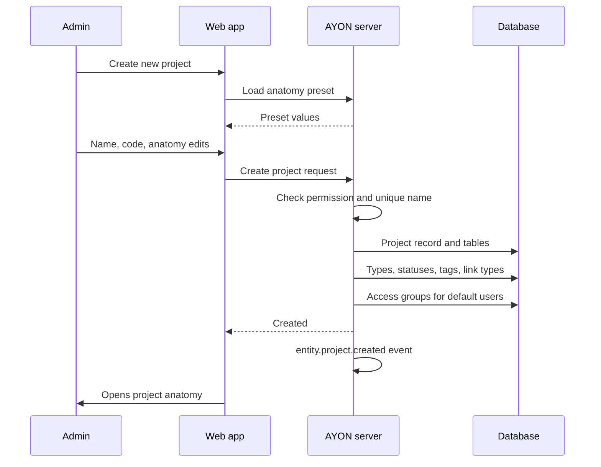

# Creating a project

All production data in AYON lives in a project. Creating one does more than add a row to the project list: the server copies an anatomy into the project, creates the project's own database tables and type lists, fills its attributes, and gives access to the users who have default access groups. This page describes that process, what exists when it is done, and what is usually configured next. The dialog itself and the pages mentioned here are described in their reference pages, linked below.

## The sequence

Plain-text equivalent:

1. **Create new project** on the **Projects** tab of the home page (`/dashboard/projects`), or the add button of a project list, opens the dialog **Create a new project**.
2. The web app selects the primary anatomy preset (or **AYON default** when no preset is primary) and loads its values into the anatomy editor of the dialog.
3. The admin enters the project label, name and code, can switch to another preset and can edit any anatomy value for this project.
4. **Create Project** (or `Ctrl+Enter` / `Shift+Enter`) sends the name, code, label, library flag and the complete edited anatomy to the server.
5. The server checks that the user may create projects and that no project already uses the name or the code.
6. In one database transaction the server creates the project record, the project's own database schema, the folder types, task types, statuses, tags and link types, and assigns the project to every user with default access groups.
7. The server emits the `entity.project.created` event, which services and addons can react to (see [Event Viewer](../web-ui/event-viewer.md)).
8. The web app opens the **Anatomy** page of the new project (`/manageProjects/anatomy?project=...`).

## Who can create a project

| User | Can create projects |
|---|---|
| Admin, manager, service user | Yes |
| User | Only when one of the user's **Default projects access** groups has **Create projects** in its studio permissions |
| Guest | No |

The **Create new project** button is shown only to users who can create projects. The server repeats the check on the request. See [Permissions](permissions.md) for why the default access groups decide studio-level permissions.

## Name, code and label

| Value | Rules in the dialog | Rules on the server | Used for |
|---|---|---|---|
| **Project label** | Required. Typing the label suggests the name. | Optional. No single quote or semicolon. | Display in the web app. |
| **Project name** | Required, at least 3 characters, letters, digits and `_`, not starting or ending with `_`. Spaces typed in the field become `_`. | Letters, digits and `_`. Unique, ignoring upper and lower case. | The identifier of the project in the API, in the database schema name (`project_` followed by the name) and in the `{project[name]}` template key, which the default work and publish directories start with. |
| **Project code** | Required, at most 10 characters, same character rules as the name. Suggested from the name. | Letters, digits and `_`. Unique among projects, ignoring upper and lower case. | The `{project[code]}` template key, which the default work and publish file names start with. |

The code suggestion uses the regular expression **Project Code Regex** in the **Project Options** of the **Global** server settings (default `^.{0,3}`, the first three characters of the name). The tooltip of the code field shows the expression. A code typed by hand is kept when the name changes.

## The anatomy preset becomes the project's own anatomy

An anatomy preset is a template stored in **Studio settings / Anatomy presets**. The dialog lists **AYON default** (the built-in anatomy), every stored preset and marks the primary one with `(primary)`. What the server receives is not the preset name but the full anatomy as shown in the editor, including the edits made in the dialog.

The server converts that anatomy into project data and stores it on the project. From then on the project has its own copy:

- Later changes to the preset do not reach the project. Changing the primary preset does not change existing projects either.
- Changes to the project anatomy (on the project's **Anatomy** page) do not change the preset.
- Two projects created from the same preset are independent of each other.

A request through the API can also name a preset (`anatomyPreset`) or send no anatomy at all; the server then uses the named preset or the primary preset.

## What is created

| Item | Where it comes from | Where it is seen afterward |
|---|---|---|
| Project record | Name, code, label, library flag, color | **Projects** tab, project details panel |
| Project database schema | Created empty, with the tables for folders, tasks, products, versions, representations, workfiles, thumbnails, activities and the project's access group overrides | Not visible; the schema is named `project_` followed by the project name |
| Roots | **Roots** of the anatomy, one path per platform | Project **Anatomy** page; the **Roots** page of the project for per-site paths |
| Templates | **Templates** of the anatomy: work, publish, hero, delivery, staging and others, plus version and frame padding and formats | Project **Anatomy** page |
| Entity naming | **Entity Naming** of the anatomy | Name suggestions when folders and tasks are created |
| Folder types, task types, statuses, tags | The anatomy lists. The project must have at least one folder type, one task type and one status. | Project **Anatomy** page, and the type and status pickers of the project |
| Link types | The anatomy list. Default link types missing from it (`generative` and `reference` between versions, `breakdown` and `template` between folders) are added. | Project **Anatomy** page, links manager |
| Product types | **Product Types** of the anatomy (the differences from the defaults) | Project **Anatomy** page |
| Project attributes | The **Attributes** section of the anatomy | Project details panel on the **Projects** tab |
| Access for users | **Default projects access** of active users with the **User** level | **Project access** page |

### Project attributes

The **Attributes** section of the anatomy editor lists every attribute whose scope includes projects, such as `fps`, `resolutionWidth`, `frameStart` or `startDate`, with the defaults of the attribute definitions (see [Attributes](../web-ui/studio/attributes.md)). The values in the dialog become the project's own attribute values. Because folders and tasks inherit missing values from the project, these values apply to the whole hierarchy until a folder or task sets its own (see [Data model](../backend/data-model/index.md)). After creation, project attributes are edited in the project details panel; the **Attributes** section of the project anatomy edits the same values.

### Access for users with default access groups

While the project is created, the server looks up every active user whose **Default projects access** is not empty. For each user with the **User** level, it adds the new project with those access groups to the user's project access and updates the user's open sessions, so the project appears without signing in again. Admins, managers and service users are skipped because they see every project anyway. Inactive users are skipped.

Default access groups are applied only at this moment. Changing a user's **Default projects access** later does not change existing projects, and a user created later gets no access to existing projects. API calls can turn the assignment off with `assignUsers: false`.

## What is not created

| Not created | Consequence |
|---|---|
| Folders, tasks and other entities | The project starts empty. The hierarchy is built in the web app, imported, created by editorial publishing, or synced by a production tracker addon. |
| Directories on disk | Nothing is written to the studio storage. Work directories are created when an application is launched in a task, publish directories when files are published, and an optional skeleton by the web action **Create Project Folder Structure** from the Core setting **Project folder structure** (see [Pipeline storage](pipeline-storage.md)). |
| Project bundle | The project uses the studio Production and Staging bundles (see [Bundles](bundles.md)). |
| Project addon settings | The project has no overrides and reads the studio settings of the addon versions in the active bundle. |
| Project access group overrides | The project uses the studio definitions of the access groups. |
| Site root paths | Every workstation uses the root paths of the anatomy until a per-site path is set on the project's **Roots** page. |

## Planning projects

The dialog has a **Project state** of **Production** (the default) or **Planning**. A planning project is a project record without the project's database tables: it appears in project lists with the state **Planning**, can carry attributes and a thumbnail, and gets the access groups of default users, but it holds no hierarchy. The dialog shows no anatomy editor for it, so the server stores the primary preset (or the built-in anatomy) with the record. The **Library project** switch is offered for production projects only.

When a project with the same name is created again in the **Production** state, the server turns the planning project into a full project: it creates the database tables and the type lists, applies the anatomy sent with the request, and emits `entity.project.created`.

## What to configure afterward

| Area | Where | Why |
|---|---|---|
| Roots | Project **Anatomy**, **Roots** | The default root `work` points to example paths (`C:/projects`, `/mnt/share/projects`, `/Volumes/projects`). Every workstation needs paths that reach the studio storage. Change roots before production starts: existing work files and publishes are found through them. |
| Templates, types, statuses | Project **Anatomy** | Adjust the copy taken from the preset. A template name selected in project settings must exist in this anatomy. |
| Project attributes | Project details panel | Frame range, resolution, frame rate, dates. |
| Project settings | **Project settings** (`/manageProjects/projectSettings`) | Project overrides of addon settings, such as Core profiles or application variants (see [Settings scopes and storage](../backend/settings/index.md)). |
| Access | **Project access** (`/manageProjects/projectAccess`) | Users who did not receive access through default access groups. |
| Access group overrides | **Project permissions** (`/manageProjects/permissions`) | Project-specific changes to an access group. |
| Project bundle | Lock button of **Project settings** | Only when the project must stay on fixed addon versions (see [Project bundles](../web-ui/project/project-settings.md)). |
| Folders on disk | Web action **Create Project Folder Structure** | Creates the directories defined in the Core setting **Project folder structure** under the project root. |

## Where to look

| Question | Place |
|---|---|
| Did the creation run, and who created the project? | **Event Viewer**, topic `entity.project.created` |
| Which anatomy does the project use? | The project's **Anatomy** page (its own copy, not the preset) |
| Which users got access? | **Project access** page of the project |
| Why can a user not see the new project? | The user has the **User** level and no access group in the project. Default access groups were empty, the user was inactive, or the user was created after the project. |
| Why can a user not create projects? | None of the user's **Default projects access** groups has **Create projects**. |

## Related

- [Users](../web-ui/studio/users.md)
- [Permissions](permissions.md)
- [Pipeline storage](pipeline-storage.md)
- [Bundles](bundles.md)
- [Attributes](../web-ui/studio/attributes.md)
- [Data model](../backend/data-model/index.md)
- [Naming conventions](../../pipeline/naming-conventions.md)
- [Settings scopes and storage](../backend/settings/index.md)
- [Project bundles](../web-ui/project/project-settings.md)
