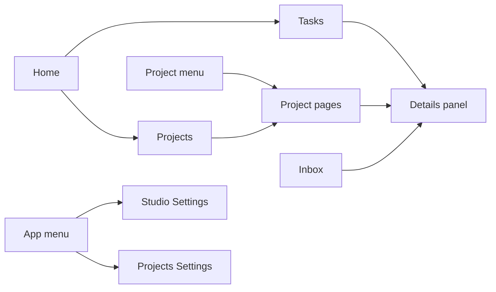

# Quick navigation

The AYON web app has a handful of areas that people return to every day: their own tasks, the pages of a project, the inbox, and the settings. This page is a map of those areas for someone new to AYON. It explains which area is for what, how to move between them with the keyboard, and how to reach a single project, task, product or version quickly. Every control is described in detail on the reference pages linked from here, starting with [Navigating the web app](../web-ui/navigating-the-web-app.md) and [Keyboard shortcuts](../web-ui/keyboard-shortcuts.md).

## The main areas

| Area | What happens there | Who uses it most | How to get there |
|---|---|---|---|
| **Home**, **Tasks** tab | The landing page after sign-in. The user's assigned tasks across projects, as a status board or a list. Statuses change by dragging cards between columns. See [Tasks (home) page](../../production-tracking/tasks-home.md). | Artists, supervisors | **Home** button, `h+h` |
| **Home**, **Projects** tab | The list of projects with their details, and **Create new project** for managers, administrators and users with the permission to create projects. | Producers, managers | **Home**, then the **Projects** tab |
| **Home**, **Plan** and **Resources** tabs | Studio-level resource planning, when the [Planner addon](../../addons/production-tracking/planner/index.md) is installed. Without it a **Planner** tab shows an overview of the feature. | Producers, resource managers | **Home**, then the tab |
| Project pages | Everything about one project, in tabs: **Overview**, **Task progress**, **Products**, **Lists**, **Review**, **Schedule**, **Reports**, **Workfiles**, plus tabs added by addons. See the table below. | Everyone except guests | Project menu (`1`), or a double click on a project in **Projects** |
| **Inbox** | Mentions, assignments, comments and publishes that concern the user, split into **Important**, **Other** and **Cleared**. See [Inbox and notifications](../../production-tracking/inbox-and-notifications.md). | Everyone | Inbox icon, `i+i` |
| **Studio Settings** | Server-wide configuration: addons, bundles, studio settings of the addons, anatomy presets, attributes, users, permissions, secrets. Users without the manager role get **Site Settings** in its place. | Administrators, managers, pipeline TDs | **App** menu, `s+s` |
| **Projects Settings** | Per-project configuration: anatomy, addon settings for the project, project permissions, project access, roots, teams. | Managers, pipeline TDs | **App** menu, `p+p` |
| **App** menu | Settings entries, **Event Viewer**, **Services**, **Market** and server maintenance, filtered by role. | Administrators, managers | Grid icon, `9` |
| **User** menu | **Account**, **Download Launcher**, **Sign out**. | Everyone | Avatar, `0` |
| **Help** menu | Help center, latest changes, feedback, community links, and the server's REST API and GraphQL documentation. | Everyone | Question mark icon, `8` |

### Project tabs

| Tab | Use it to |
|---|---|
| **Overview** | See and edit folders and tasks in a spreadsheet: create the hierarchy, set assignees, statuses and dates. See [Project overview](../../production-tracking/project-overview.md). |
| **Task progress** | See how far each folder is, task type by task type. See [Task progress](../../production-tracking/task-progress.md). |
| **Products** | Browse everything published in the project, version by version. See [Products and versions](../../production-tracking/products-and-versions.md). |
| **Lists** | Work with hand-picked sets of folders, tasks or versions. See [Lists](../../production-tracking/lists.md). |
| **Review** | Review sessions, with the [Review addon](../../addons/production-tracking/review/index.md). |
| **Schedule** | Task dates on a timeline, with the [Planner addon](../../addons/production-tracking/planner/index.md). |
| **Reports** | Dashboards of counts and charts, with the [Reports addon](../../addons/production-tracking/reports/index.md). |
| **Workfiles** | The workfiles saved for the project's tasks. |

**Review**, **Schedule** and **Reports** are always in the tab row. Without their addon in the production bundle, they show an overview of what the addon provides. A deprecated **Browser** tab appears only when the server enables it.

The diagram in words:

1. **Home** holds the **Tasks** and **Projects** tabs.
2. A project opens from **Projects** or from the project menu, and its pages share one tab row.
3. Tasks home, the project pages and the inbox all open the selected entity in the same details panel.
4. The **App** menu leads to **Studio Settings** and **Projects Settings**.

## Shortcuts

Page shortcuts are the same key pressed twice within 400 milliseconds. Menu shortcuts are a single key. Shortcuts do nothing while the cursor is in a text field.

| Keys | Opens |
|---|---|
| `h+h` | Home, on the **Tasks** tab |
| `i+i` | Inbox, **Important** tab |
| `s+s` | Studio settings (site settings for users) |
| `p+p` | Project settings, keeping the selected project |
| `a+a` | Project anatomy, keeping the selected project |
| `u+u` | Users |
| `b+b` | Bundles |
| `e+e` | Event viewer |
| `v+v` | Services |
| `m+m` | Market |
| `1` | Toggles the project menu |
| `8` | Toggles the **Help** menu |
| `9` | Toggles the **App** menu |
| `0` | Toggles the **User** menu |
| `0+0` | Signs out |

A user who opens a page their role does not allow is redirected. Shortcuts for tables, the viewer, lists and the inbox are on the [Keyboard shortcuts](../web-ui/keyboard-shortcuts.md) page.

## Search

There is no single search across the whole server. Searching happens where the things are:

| Looking for | Where to search |
|---|---|
| A project | The project menu (`1`). Typing a letter starts the search, `Enter` opens the top result. The Projects tab has its own filter. |
| A folder or task | The search and filter bar of the **Overview** or **Task progress** page, which matches names and paths, or the hierarchy slicer on the left. |
| One of the user's own tasks | The **Filter tasks...** field on Tasks home. |
| A product or version | The filter bar and slicer of the **Products** page. Filters can combine folder, product, version and task fields. |
| A message | The filter bar of the inbox, in project mode. |
| An activity on an entity | The search bar at the top of the activity feed in the details panel. |

## Reaching things quickly

| To reach | Fastest way |
|---|---|
| A project | `1`, type part of the name, `Enter`. Pinned projects stay at the top of the project menu. A project opens on the tab used last (the **Overview** the first time), and switching projects while on a project page keeps the current tab. |
| My next task | `h+h`. The task's card opens the details panel with a double click, and `Ctrl` or `Cmd` with a double click opens it on the project **Overview**. |
| Any task or folder | The **Overview** of the project, narrowed with the hierarchy slicer or the search bar. |
| The latest version of a task | `Space` on the task, on Tasks home or Task progress, plays its reviewables in the viewer. |
| A product or version | The **Products** page, with the hierarchy slicer on the folder and **Group by** set to **Product**. |
| Something a colleague pointed to | A link from **Share** in the details panel's **More actions** menu, or a link in an inbox message. Opening it shows the entity in the details panel. |
| The web page of a launcher context | **Show in AYON** in the desktop [Launcher](../../pipeline/launcher.md) opens the project overview on the selected folder or task. |

The center of the top bar shows the current location as breadcrumbs. On project pages with a selected entity it holds the entity's AYON URI, in the form `ayon+entity://project/folder/path?task=name`, and a copy button next to it copies the URI.

## The details panel

Every page that lists folders, tasks, versions or representations opens them in the same side panel, the [details panel](../../production-tracking/details-panel.md). Learning it once covers most of the web app.

| In the panel | What it gives |
|---|---|
| Header | Thumbnail, name, status, assignees, priority, and web actions such as launching an application through the desktop launcher. |
| Activity feed | Comments, status changes and published versions on the entity. See [Activity feed and comments](../../production-tracking/activity-feed-and-comments.md). |
| Version files | For versions, the reviewables and representations. See [Reviewables](../../production-tracking/reviewables.md). |
| Details | Description and all attributes, editable where permissions allow. |
| **More actions** | **Open in viewer**, **Picture in picture** (keeps the panel floating while moving to other pages), **Upload version**, **Add to list**, **Share** and more. |

| Gesture | Effect |
|---|---|
| Double click on a row or card | Opens the details panel. |
| `Escape` | Closes it. |
| `Space` | Opens the selected entity in the viewer. |
| A mention or linked version inside the panel | Opens a second panel next to the first. |

## What depends on the role

| Role | What they see |
|---|---|
| Administrator | Every area and menu entry. |
| Manager | Everything except **Market**, server restart and pipeline update entries, and the **Global** studio settings tab. |
| User | Home, project pages of the projects their access groups allow, the inbox, **Site Settings** and the project settings tabs their permissions allow. |
| Guest | **Home** and the **User** menu only. Guests reach review sessions they are invited to. |

Which projects and which folders a user sees follows the access groups assigned in **Project access**. See [Users and permissions](../web-ui/users-and-permissions.md).

## Related

- [Navigating the web app](../web-ui/navigating-the-web-app.md)
- [Keyboard shortcuts](../web-ui/keyboard-shortcuts.md)
- [Tasks (home) page](../../production-tracking/tasks-home.md)
- [Project overview](../../production-tracking/project-overview.md)
- [Details panel](../../production-tracking/details-panel.md)
- [Inbox and notifications](../../production-tracking/inbox-and-notifications.md)
- [Artist workflow](artist-workflow.md)
- [Production workflow](production-workflow.md)
