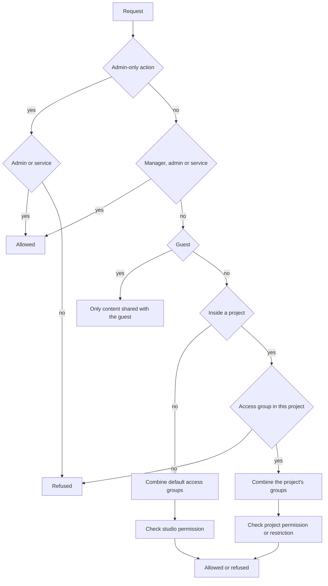

# Permissions

AYON decides what a request may do in two layers. The first layer is the access level of the account: admin, manager, user, service or guest. It decides what kind of account it is, and admins, managers and services stop there, with access to every project. The second layer applies to accounts with the **User** level only: access groups, assigned per project, define what the user can see and change inside that project. This page explains how the two layers are evaluated on every request. Each control of the **Users**, **Permissions**, **Project permissions** and **Project access** pages is described in [Users](../web-ui/studio/users.md).

Permissions cover AYON data and actions only. They do not change who can read or write files on the studio storage.

## Decision flow

Plain-text equivalent:

1. If the action is reserved for admins (for example bundles, addons, the Market, the **Global** server settings, secret values and the **Developer** switch), only admins and service users pass.
2. Otherwise, admins, managers and service users pass without any access group being read.
3. A guest only reaches the endpoints opened to guests and only the content shared with that guest.
4. For a user with the **User** level outside of a project (creating projects, listing all users), the groups in the user's **Default projects access** are combined and their studio permissions are checked.
5. Inside a project, the user needs at least one access group assigned in that project. Without one, the project is not listed and every request to it is refused.
6. The groups assigned in the project are combined, each one in its project override if the project has one, otherwise in its studio definition, and the combined permission for the action is checked.

## Layer 1: access level

The access level is stored on the user account. It is set on the **Users** page.

| Level | What it means for permissions |
|---|---|
| Admin | Everything, including the admin-only actions. Access groups are not evaluated. |
| Manager | Every project and the studio and project settings pages. Access groups are not evaluated. Admin-only actions are refused. Managers cannot change admin accounts or grant the admin level. |
| Service | An account for scripts and services that signs in with an API key. Treated as an admin, and it can act on behalf of another user. |
| User | No project access by default. Everything inside a project comes from access groups. |
| Guest | No stored account and no access groups. A guest signs in through a link sent by email and gets a session that reaches only the review content shared with the guest, such as a list or review session the guest was invited to. |

Two account switches sit next to the level. **Developer** (admins only) allows developer mode and Dev bundles. **Staging access** shows the staging mode switch in the web app. Neither changes project permissions.

## Layer 2: access groups

An access group is a named set of permissions, defined once for the AYON server on the **Permissions** page of the studio settings. A group does nothing until it is assigned: the assignment is stored on the user account as a list of groups per project.

| Assignment | Where it is stored | Set on | Effect |
|---|---|---|---|
| Groups in a project | User account, per project name | **Project access** page | The user sees the project and works with the combined permissions of these groups in it. |
| **Default projects access** | User account, one list | **Users** page | Copied into every project created afterward (see [Creating a project](creating-a-project.md)), and used for the studio permissions. It does not give access to existing projects. |

A project exists for a user only through these assignments. Adding a user to a project means assigning at least one group; removing the last group removes the project from the user's view. Deleting an access group removes it from every user's assignments and default list.

### Studio definition and project overrides

Each access group has a studio definition. A project can override a group on the **Project permissions** page. The override replaces the whole definition of that group in that project; it is not merged with the studio definition. Projects without an override keep following the studio definition, so a change at the studio level reaches them at once. **Clear project overrides** returns the project to the studio definition.

Groups are created and deleted at the studio level only. In the web app, the **Project permissions** tab is open to managers and admins only. The server also accepts a project override from a user who has **Read & Write** on **Project access** in that project, for example through the API.

### How several groups combine

A user can hold several groups in one project. The server merges them into one set of permissions, so that each group can only add rights:

| Kind of permission | How groups combine |
|---|---|
| Restrictions (folder, attribute, activity, action and link restrictions) | A restriction applies only if it is enabled in every group. If any group leaves it disabled, the user is unrestricted for it. When it is enabled everywhere, the allowed items of all groups are added together. |
| Studio permissions (**Create projects**, **List all users**) | On if any group has it on. |
| Project permissions (**Project anatomy**, **Project access**, **Project addon settings**) | The highest level of any group: **Read & Write** over **Read only** over **No access**. |
| **Show sibling tasks** | On if any group has it on. |

An assigned group name that no longer exists is ignored.

## Permission keys

Each setting of an access group has a key. The keys appear in the API (`/api/accessGroups`) and in error messages such as "You are not allowed to access ...".

| Key | Setting | What the server checks |
|---|---|---|
| `studio.create_projects` | **Create projects** | Creating a project. |
| `studio.list_all_users` | **List all users** | Listing every user of the server, for example to pick users on the **Project access** page. |
| `project.anatomy` | **Project anatomy** | Reading (level 1) or saving (level 2) the project anatomy. |
| `project.access` | **Project access** | Reading or changing the project's user assignments, its access group overrides and its guest list. |
| `project.settings` | **Project addon settings** | Reading or saving project addon settings. |
| `create` | **Restrict folder creation** | Creating folders, tasks and other entities below the allowed folders. |
| `read` | **Restrict folder read** | Which folders, with their tasks and contents, are returned at all. The parents of an allowed folder are readable so that the tree can be navigated. |
| `update` | **Restrict folder update** | Changing entities in the allowed folders. |
| `publish` | **Restrict publishing** | Creating products, versions, representations and workfiles in the allowed folders. |
| `delete` | **Restrict folder delete** | Deleting in the allowed folders. |
| `attrib_read` | **Restrict attribute read** | Which attributes are returned. Other attributes are left out of the response. |
| `attrib_write` | **Restrict attribute update** | Which attributes and which fields (name, label, status, tags, active, parent, type, assignees, product types, data) may change. The thumbnail can always be changed. |
| `activities` | **Restrict activities** | Commenting and uploading reviewables. |
| `actions` | **Restrict actions** | Which web actions are listed and can be run. |
| `links` | **Restrict entity links creation** | Which link types the user can create. |
| `endpoints` | **Restrict REST endpoints** | A list of endpoints. It is stored and combined like the other restrictions, but requests are not checked against it. |
| `advanced.show_sibling_tasks` | **Show sibling tasks** | With **Assigned** access, whether the other tasks of the same folders are visible. |

The folder restrictions take a list of **Assigned**, **Hierarchy** and **Children** entries. **Assigned** is computed from the user's task assignments; it changes as soon as the user is added to or removed from a task.

## Typical setups

| Need | Setup |
|---|---|
| Artists who must not reorganize the hierarchy | A group with **Restrict folder creation** and **Restrict folder delete** enabled and empty, like the default `artist` group. |
| Freelancers who see only their own work | A group with **Restrict folder read** and **Restrict publishing** set to **Assigned**, like the default `freelancer` group. **Show sibling tasks** off hides colleagues' tasks in the same folders. |
| A coordinator who assigns people to projects without being a manager | A group with **Project access** set to **Read & Write**, assigned in the projects, plus a group with **List all users** in the user's **Default projects access** so the user list can be read. |
| A user who can start new projects | A group with **Create projects** in the user's **Default projects access**. The user then needs access to the new project, which the default access groups provide if they contain project groups. |
| One project with stricter rules | A project override of the group on **Project permissions** of that project. |

## Where to look

| Question | Place |
|---|---|
| What level does an account have? | **Access level** column of the **Users** page. |
| Which groups does a user have in a project? | **Project access** page, with the project selected. |
| What does a group allow in a project? | **Project permissions** page of that project (marks groups with an override), or **Permissions** in the studio settings. |
| What does a user effectively get? | `GET /api/users/{user name}/permissions/{project name}` (managers and admins) returns the combined permissions of the user in that project; `GET /api/users/{user name}/permissions` returns the studio permissions. A user can read their own with `/api/users/me/permissions`. |
| Why was a request refused? | The error message names the permission, for example "You are not allowed to modify ..." or "No access group assigned on this project". |

## Related

- [Users](../web-ui/studio/users.md)
- [Creating a project](creating-a-project.md)
- [Attributes](../web-ui/studio/attributes.md)
- [Data model](../backend/data-model/index.md)
- [Settings scopes and storage](../backend/settings/index.md)
- [Bundles](bundles.md)
