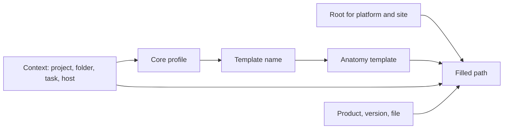

# Pipeline storage

Work files and published files are written by the workstations to the studio's own storage: a local disk, a network share or a synced location. The AYON server does not hold these files. It holds the records that describe them (products, versions, representations and their file lists) and the rules that produce their paths. Every path is computed on the workstation, at the moment a file is saved or published, from three pieces: the roots and templates of the project anatomy, the template profiles of the Core addon settings, and the context of the current task. This page explains that chain. The template keys and the default templates are listed in [Naming conventions](../../pipeline/naming-conventions.md).

## The chain

Plain-text equivalent:

| Step | Input | Source | Result |
|---|---|---|---|
| 1 | Task type and host name (work files), or product base type, host, task name and task type (publishes) | The context of the artist's session or of the published instance | Filter values |
| 2 | Filter values | Core addon settings: **Workfile template profiles**, **Template name profiles**, **Hero template name profiles** | A template name, such as `default` or `render` |
| 3 | Template name | Project anatomy: **Templates**, group **Work**, **Publish** or **Hero** | A directory template and a file name template |
| 4 | The templates | Project anatomy: **Roots**, resolved for the current platform and site | The `{root[...]}` part of the path |
| 5 | The templates | Context data: project name and code, folder path, task, user, product, version, representation, frame | The filled directory and file name |

## Roots

A root is a named base path with one value per platform (Windows, Linux, macOS). Templates start with `{root[name]}`, so the same template works on every platform. The values live in the project anatomy; a new project takes them from its anatomy preset (see [Creating a project](creating-a-project.md)).

The path used for a root on a workstation is decided in this order:

| Order | Source | Applies to |
|---|---|---|
| 1 | Site Sync root overrides of the active site, when the SiteSync addon is enabled for the project and the active site is not `studio` | The workstation's active site |
| 2 | The root paths saved for the workstation's site on the project's **Roots** page (`/manageProjects/roots`) | One site ID and one user |
| 3 | The project anatomy value for the current platform | Everyone |

The **Roots** page lists the sites registered to the signed-in user, with one field per root. A value saved there replaces the anatomy path for that user on that machine in that project. This covers workstations that mount the storage under another drive letter or mount point.

Published file records store paths with the root replaced by its key, for example `{root[work]}/my_project/shots/sq01/sh010/publish/...`. Each workstation resolves the key with its own root path, so one record works on every platform and site. A publish whose destination is not inside one of the project roots fails.

## Templates and profiles

The anatomy holds named templates in groups (**Work**, **Publish**, **Hero**, **Delivery**, **Staging directories**, **Others**). A template is chosen by name, and the name comes from profiles in the Core addon settings. Profiles are filters: each has lists of hosts, task types, task names or product base types (empty means any), and the most specific matching profile wins.

| Use | Profile setting (Core addon) | Filters | Anatomy group | Without a matching profile |
|---|---|---|---|---|
| Work area and work file name | **Tools / Workfiles / Workfile template profiles** | Task types, host names | **Work** | The shipped settings contain a profile for every host and task that selects `default` |
| Published files | **Tools / Publish / Template name profiles** | Product base types, host names, task types, task names | **Publish** | `default` |
| Hero versions | **Tools / Publish / Hero template name profiles** | Same as above | **Hero** | `default` |
| Temporary publish files | **Tools / Publish / Custom Staging Dir Profiles** | Hosts, task types, task names, product base types, product names | **Staging directories** | A temporary directory |

Profiles are addon settings, so they follow the settings scopes: studio values, project overrides and the addon version of the active bundle (see [Settings scopes and storage](../backend/settings/index.md)). Templates are part of the project anatomy. A profile that names a template missing from the project anatomy makes the save or publish fail for that context. Because the studio settings are edited against the primary anatomy preset and project settings against the project anatomy, a template name has to exist in the anatomy of every project that uses the profile.

The profiles are described in [Core addon settings](../../addons/essentials/core/settings.md); the default templates and every key in [Naming conventions](../../pipeline/naming-conventions.md).

## When directories and files are written

| Moment | What happens | Written by |
|---|---|---|
| Project or folder created in AYON | Nothing on disk. | |
| Web action **Create Project Folder Structure** | The directories of the Core setting **Project folder structure** are created, with their root and project keys filled from the project anatomy. Existing directories are left as they are. The action runs through the AYON launcher of the user who starts it. | The user's workstation |
| An application is launched in a task | The work directory is filled from the work template and created if it is missing. It is passed to the application as `AYON_WORKDIR`. | The workstation |
| A work file is saved | The file name is filled from the work template; the version is the next free one in the work directory. | The workstation |
| A publish integrates an instance | The server receives the product and version first. The workstation then copies (or hard-links) the files to the publish directory and registers the representations with their rootless paths, sizes and hashes. A failed copy is rolled back. | The publishing workstation, or the farm worker for instances published on a farm |
| A hero version is integrated | The latest version is copied to the hero directory. | The publishing workstation |

Because the files are written by the machines that run the pipeline, these machines need write access to the studio storage under the root paths. AYON permissions do not grant or limit file system access.

## What the AYON server stores

| Data | Stored on the server | Notes |
|---|---|---|
| Projects, folders, tasks, products, versions, representations, workfile records | Database | A representation lists its files with rootless path, size and hash. The files themselves stay on the studio storage. |
| Anatomy, settings, users, events | Database | |
| Thumbnails | Database (resized copy) and the project file storage (original) | Uploaded by the publish plugins and the web app. |
| Reviewables and comment attachments | Project file storage of the server | Review media are uploaded copies (the **Integrate AYON Review** publish plugin uploads them), separate from the published files. |
| Launcher installers and dependency packages | Server storage | Downloaded by workstations (see [Bundles](bundles.md)). |
| Installed addons | Server addon directory | |

The project file storage is a directory on the server (`/storage/server/projects` by default) or an S3 bucket. For a self-hosted server these locations are described in [Self hosting](../hosting/self-hosting.md). Deleting a project removes its records and its server-side files; it does not delete anything on the studio storage.

## Site sync

Without the SiteSync addon, every workstation reads and writes the same storage through its root paths, and that location is the `studio` site. With the SiteSync addon enabled for a project, each workstation has an active site, which can be its own local disk or a remote storage provider. Publishes go to the active site, the server keeps the sync state of every representation per site, and the sync service copies the files between sites. The root paths of the active site come from the addon's site settings and replace the anatomy roots. Only published files are synchronized, not work files. See the [SiteSync addon](../../addons/pipeline-features/sitesync/index.md).

## Where to look

| Question | Place |
|---|---|
| Which root paths does the project use? | Project **Anatomy**, **Roots**; per-site paths on the project's **Roots** page |
| Which template does a host and task get? | Core addon settings, **Workfile template profiles** and **Template name profiles**, at the project level |
| Where did a version go? | The representation's file paths (rootless) and its stored template and context, visible in the web app's version details and in the loader |
| Why did a publish fail with a path error? | The destination is outside every root, or the selected template name does not exist in the project anatomy, or a key outside an optional part has no value |

## Related

- [Naming conventions](../../pipeline/naming-conventions.md)
- [Core addon settings](../../addons/essentials/core/settings.md)
- [SiteSync addon](../../addons/pipeline-features/sitesync/index.md)
- [Self hosting](../hosting/self-hosting.md)
- [Creating a project](creating-a-project.md)
- [Settings scopes and storage](../backend/settings/index.md)
- [Data model](../backend/data-model/index.md)
- [Publishing](../../pipeline/publishing.md)
- [Workfiles](../../pipeline/workfiles.md)
