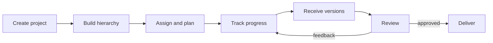
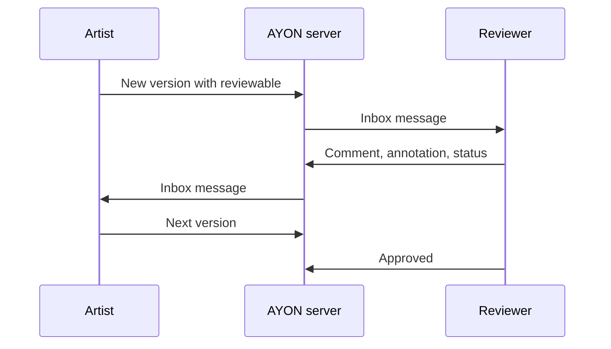

# Production workflow

This page follows a producer or production manager through a typical project in AYON: from an empty project to delivered work. It shows what happens in which order, who does it, and where in the web app it happens. Every step links to the page that describes the tool in full. The artist's side of the same project is on [Artist workflow](artist-workflow.md).

Much of this works with the AYON server alone, without the desktop pipeline: a studio can track and review work that artists make in any application and upload to the web app. The pipeline adds published files on studio storage, loading between departments and delivery of the published files.

## The production at a glance

The same flow as a list:

1. Create the project and give the team access.
2. Build the folders (assets, sequences, shots) and their tasks.
3. Assign people, set statuses and plan dates.
4. Track progress on Tasks home, Task progress, the Overview and Reports.
5. Receive versions, published from the pipeline or uploaded in the web app.
6. Review the versions, alone or in review sessions, with comments and statuses.
7. Loop back with feedback until the work is approved.
8. Deliver the approved versions to the client or a vendor.

## What each step needs

| Step | Where | Community | AYON Pro | AYON Studio |
|---|---|---|---|---|
| Projects, hierarchy, tasks, statuses, assignees | **Projects**, **Overview** | Included | Included | Included |
| Task and folder templates | **Overview** | No | Included | Included |
| Table grouping, complex filters and slicer | **Overview**, **Products** | No | Included | Included |
| Task progress, Tasks home, lists, inbox | Web app | Included | Included | Included |
| Planning and scheduling | **Plan**, **Schedule** ([Planner](../../addons/production-tracking/planner/index.md)) | No | Paid addon | Included |
| Reporting dashboards | **Reports** ([Reports](../../addons/production-tracking/reports/index.md)) | No | Paid addon | Included |
| Uploading versions and reviewables in the web app | Details panel, **Overview**, **Products** | Included | Included | Included |
| Annotations | Viewer, review sessions | No | Included | Included |
| Review sessions, internal and with guests | **Review** ([Review](../../addons/production-tracking/review/index.md)) | No | Paid addon | Included |
| Batch delivery | Version actions ([Batch delivery](../../addons/pipeline-features/batch-delivery/index.md)) | No | Included | Included |

The full comparison is on [AYON plans](../plans.md).

## Who does what

| Step | Producer or production manager | Supervisor or lead | Artist |
|---|---|---|---|
| Setup | Creates the project, builds the hierarchy, grants access | Advises on task types and structure | |
| Planning | Sets dates, assigns tasks, books people | Balances work within the team | Sees the assignment |
| Production | Tracks progress, follows up on blocked tasks | Reviews versions, gives notes | Works, publishes or uploads, sets statuses |
| Review | Prepares review sessions, invites clients | Leads the review, approves | Reads notes, iterates |
| Delivery | Selects the approved versions, starts the delivery | Checks the result | |

## 1. Set up the project

The project is created on the **Projects** tab of Home with **Create new project**, available to managers, administrators and users with the permission to create projects. Its name, code, anatomy preset and attributes such as frame rate, resolution and dates are described on [Creating a project](creating-a-project.md).

Users with the user role see a project only when they have an access group in it. Access is granted in **Projects Settings** (`p+p`), on the **Project access** tab: each user gets one or more access groups, which decide what they can see, edit and publish in the project. Managers and administrators have access to every project. See [Users](../web-ui/studio/users.md).

## 2. Build the folder hierarchy and tasks

The project's **Overview** page is the spreadsheet where the hierarchy is built and maintained. See [Project overview](../web-ui/production-tracking/overview.md).

| Method | What it creates |
|---|---|
| **Create** menu (`N`, `M`, `T`) | One folder, a numbered sequence of folders (for example `sh010` to `sh200`), or a task in the selected folder. Names are generated from the labels by the project's naming rules. |
| **Import CSV** | A whole hierarchy of folders and tasks from a spreadsheet, with folder types and task types per row. See [Data import](../web-ui/dialogs/import-csv.md). |
| Entity templates | A stored set of folders and tasks, for example all the tasks of a character asset, reused for every new asset. See [hierarchy templates](../../addons/production-tracking/power-pack/index.md#hierarchy-templates) of the Power Features addon. |

Folder types (asset, sequence, shot, and others) and task types (modeling, animation, compositing, and others) come from the project anatomy. Attributes such as frame range or resolution are inherited from the parent folder unless a folder or task has its own value, which the Overview shows in gray when inherited.

## 3. Assign people and statuses

Assignees and statuses can be set wherever tasks are listed: in the cells of the **Overview**, on the cards of **Task progress**, and in the details panel. With several tasks selected, a change applies to all of them.

| Action | Effect |
|---|---|
| Assigning a user | The user sees the task on Tasks home and in the launcher's my tasks filter, gets an **Important** inbox message and becomes a watcher of the task. |
| Setting a status | Moves the task to that column on everyone's Tasks home board and updates the progress figures. |
| Grouping people into [teams](../web-ui/project/teams.md) | Lets comments mention a whole team at once. |

The default task statuses of a new project are **Not ready**, **Ready to start**, **In progress**, **Pending review**, **Approved**, **On hold** and **Omitted**. Each status belongs to a state (not started, in progress, done, blocked) that the progress figures count. The list is part of the project anatomy and can be changed per project.

## 4. Plan

Planning works on two levels, both provided by the [Planner addon](../../addons/production-tracking/planner/index.md).

| Level | Where | What it holds |
|---|---|---|
| Studio plan | **Plan** tab of Home | Bookings of people, rooms and other resources over time, with capacity, time off, milestones and workload per person. Bookings can belong to a project but are not tasks. |
| Project schedule | **Schedule** tab of the project | One bar per task, with its start and end dates and assignees, plus subtasks. The live scenario stays in sync with the `startDate`, `endDate` and assignees of the tasks. |

The **Schedule** can show the studio plan above the task list and apply a booking's dates to matching tasks. Other scenarios of the schedule are drafts that do not change the tasks until one is made live.

Without the addon, task dates are still attributes of the tasks and are edited in the **Overview** columns, which is practical for smaller projects. Any change to the dates in the **Overview** also appears in the live schedule when the addon is installed.

## 5. Track progress

| Page | Question it answers |
|---|---|
| [Home tasks](../web-ui/home/tasks.md) | What is each person working on? Managers can show the tasks of other users with the **Assignees** selector. |
| [Task progress](../web-ui/production-tracking/task-progress.md) | How far is each shot or asset, task type by task type? Each folder row shows the share of done tasks. |
| [Project overview](../web-ui/production-tracking/overview.md) | Which tasks match a condition, for example overdue or unassigned? Filters, slicers and saved [views](../web-ui/views.md) keep these questions one click away. |
| [Reports](../../addons/production-tracking/reports/index.md) | How do the counts of tasks, folders and versions by status, type or assignee look now, and how did they change over time? |
| [Lists](../web-ui/production-tracking/lists.md) | What is in a hand-picked set, for example this week's priority shots or the shots for the next client session? |

The [inbox](../web-ui/inbox/index.md) collects the activity on everything the producer watches: new versions, comments and status changes.

## 6. Receive versions

Work reaches AYON as versions of products. How it arrives decides what can be done with it later.

| Source | How it arrives | Files stored in | Usable by the pipeline and delivery |
|---|---|---|---|
| Pipeline publish | The artist publishes from the DCC application with the [Publisher](../../pipeline/publisher.md), or a render farm job publishes the renders. | The publish folders of the project anatomy, on studio storage | Yes |
| Tray Publisher | Files such as plates, references or edits are published from the desktop without an application. See [Tray Publisher](../../addons/essentials/traypublisher/index.md). | The publish folders | Yes |
| Web Publisher | Files are uploaded in the web app and published by a service. See [Web Publisher](../../addons/pipeline-features/web-publisher/index.md). | The publish folders | Yes |
| Upload in the web app | Media files are dropped on the details panel of a folder, task or version, or uploaded with **Upload Version** in the **Overview** or **Products** context menu. See [Versions without a pipeline](../../production-tracking/versions-without-a-pipeline.md). | The AYON server's own storage | No. The version holds reviewables only. |

Uploading in the web app is the way to run AYON as a tracking and review platform without the pipeline: an artist uploads a movie or images to the task, and sets the task to **Pending review**. In both cases the new version appears in the task's activity feed, on the **Products** page, and in the inbox of the task's watchers.

## 7. Review

In words:

1. The artist publishes or uploads a version with a reviewable.
2. The reviewer is notified in the inbox.
3. The reviewer comments, annotates and changes the status.
4. The artist is notified and works on the notes.
5. The next version arrives, and the loop repeats until the reviewer approves.

There are two ways to review.

| Way | Where | Suited to |
|---|---|---|
| Single review | The viewer, opened with `Space` or from a thumbnail on Tasks home, Task progress, **Overview**, **Products** or **Lists**. It plays the reviewables of a version next to its activity feed, switches between versions of the product and compares them at the same frame. See [Reviewables](../../production-tracking/reviewables.md). | A supervisor checking one submission |
| Review session | The **Review** tab, with the [Review addon](../../addons/production-tracking/review/index.md). A session is a playlist of versions, made from a selection of folders, tasks or versions, or from a list. | Dailies, team reviews, client reviews |

A review session can be played by one person or synchronized between several people, with one presenter controlling playback for everyone. Temporary sessions are discarded after an hour; saved sessions are kept as lists of the project. External people take part as guests:

| Guest access | How it works |
|---|---|
| Invited guest | Added by email to one session. An invitation email carries a sign-in link without a password. |
| Open link | A link that gives anyone who has it access to one session, without signing in. |
| Commenting | Allowed only when the guest or the link has a comment category, which also limits who sees the guest's comments. |
| Approval | Guests have **Approve** and **Request changes** buttons, which post a review result to the version's activity feed. |

Guests see only the session they are given and never the internal statuses.

## 8. Give feedback

Feedback lives in the [activity feed](../web-ui/details-panel.md) of the version or the task, which every page shows in the details panel.

| Tool | Use |
|---|---|
| Comment | Notes on the version or task. A comment on a version also shows in the feed of its task. |
| Mention | `@` notifies a user or a team, `@@` links a version, `@@@` links a task. |
| Frame link and annotation | Ties a note to a frame or a frame range; annotations draw on the frame. |
| Checklist | A to-do list inside a comment, which the artist ticks off. |
| Comment category | Limits who sees a comment, for example notes meant for the internal team only. Needs the [Power Pack addon](../../addons/production-tracking/power-pack/index.md). |
| Status | The version and the task each have a status. Setting the version to **Approved** or back to **In progress**, and the task to **Approved** or a status for more work, is how the decision is recorded. |

Lists help to organize the feedback rounds: a list of the shots for tomorrow's dailies, a list of client picks, or a list of versions to deliver. A list can be turned into a review session.

## 9. Deliver

Delivery packages approved work for a client or a vendor. It works on versions published through the pipeline; versions uploaded in the web app hold only reviewables on the AYON server and cannot be delivered this way.

| Tool | Where | What it does |
|---|---|---|
| **Deliver Versions** | An action of the desktop [Browser](../../pipeline/browser.md), opened from the tray without an application | Copies the files of the selected versions to a delivery location and renames them by the delivery templates of the project anatomy, on the workstation. |
| [Batch delivery](../../addons/pipeline-features/batch-delivery/index.md) | **Batch Delivery Submit** and **Batch Transcode Submit** actions on versions in the web app | Sends the selected versions to a Deadline render farm, where Nuke re-processes them by a delivery preset (for example a color transform, a resize or a new file format) and publishes the result as a delivery version or as extra representations. |

## Related

- [Upload version](../web-ui/dialogs/upload-version.md)
- [Creating a project](creating-a-project.md)
- [Project overview](../web-ui/production-tracking/overview.md)
- [Task progress](../web-ui/production-tracking/task-progress.md)
- [Home tasks](../web-ui/home/tasks.md)
- [Lists](../web-ui/production-tracking/lists.md)
- [Versions without a pipeline](../../production-tracking/versions-without-a-pipeline.md)
- [Planner addon](../../addons/production-tracking/planner/index.md)
- [Reports addon](../../addons/production-tracking/reports/index.md)
- [Review addon](../../addons/production-tracking/review/index.md)
- [Batch delivery addon](../../addons/pipeline-features/batch-delivery/index.md)
- [AYON plans](../plans.md)
- [Quick navigation and server layout](../web-ui/quick-navigation.md)
- [Artist workflow](artist-workflow.md)
