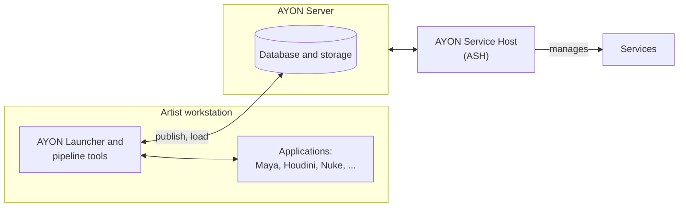

# Introduction to AYON

AYON is a production platform for creative studios that make VFX, animation, games and other media. It joins two things that studios usually run as separate systems:

- **Production management**: planning, tracking, review and delivery of a project.
- **Pipeline**: the tools that launch applications in the right context, save versioned work files, publish results and load them again.

Both work on the same data, a status that a producer sees is backed by the files and versions that artists actually published, instead of being typed in by hand.

## What it is used for

| Need | What AYON provides |
|---|---|
| **Plan** | Projects built from folders (episodes, sequences, shots, assets) and tasks, with assignments. Scheduling and capacity planning come with the Planner addon. |
| **Create** | Artists launch their application from a task, save versioned work files, publish results as versioned and validated products, and load work published by others. Includes hero versions, OpenUSD workflows, and syncing files between storage locations, such as a cloud drive and the studio storage. |
| **Review** | Review sessions in the web app with annotations and version comparison. Guests can review without an account. |
| **Deliver** | Tools to package and hand off versions to clients and vendors. |
| **Report** | Progress across departments, lists, filters and reports. |

Some features are addons that are only part of certain [plans](../ynput-cloud/plans/index.md).

## Why pipeline and production together

- **Statuses are backed by work.** A task marked "approved" points to a specific published version, with its files and its review media.
- **Artists work in context.** Every action happens within a project, folder and task, so published files are named and stored by the studio's rules.
- **One source of truth.** Producers, supervisors, artists and clients look at the same data through different tools.

## Use it your way

AYON does not have to be adopted as a whole. Studios are free to use it the way that works for them:

- **Pipeline without the production features**, or **production management without the pipeline.** Production tracking works on its own: reviewable versions can be uploaded directly in the web app, without pipeline tools or application integrations ([how it works](https://help.ayon.app/en/help/articles/3889290-create-versions-without-a-pipeline)). Currently this is limited to reviewable media.
- **Customised to the studio.** Settings can be set for the whole studio or per project, and addons and the APIs allow further changes.
- **Next to what a studio already has.** A studio that already has a production tracker can keep it and use AYON for the pipeline, or use a connector while moving over to AYON.

## Main components

AYON has two main parts, the server and the launcher on the artist workstations. Addons extend both.

| Component | Where it runs | What it does |
|---|---|---|
| **AYON Server** | Once, centrally: on Ynput Cloud or self-hosted | The database for all pipeline data (projects, users, versions, relationships, settings). The web app for production tracking and administration. The REST and GraphQL APIs. Management of addons and settings. |
| **AYON Launcher and pipeline tools** | On every artist workstation, as a tray application | Launches applications in the right context. Provides the tools artists use: Workfiles, Creator and Publisher, Loader, Scene Inventory. The tools run on the workstation, either on their own or inside the application, and talk to the server. |
| **Addons** | On the server, the workstation, or both | The modular part of AYON. Integrations with applications (Maya, Houdini, Nuke, Blender and many more), production trackers, render farm managers, review tools and automation. Installed from the AYON Market or uploaded, and activated through bundles. |
| **Services** | Background workers, started by the AYON Service Host (ASH) | Long-running tasks that addons need, such as keeping a connected tracker in sync. The server does not run them itself: it talks to ASH, and ASH manages the services (starts and stops them, and pulls new images). |

The table above is the text version of this diagram.

Where to read more: [how AYON works](how-ayon-works/index.md) (bundles, addons, project anatomy), [pipeline tools](../pipeline/pipeline-tools/index.md), the [web UI](../server/web-ui/index.md), [ASH](../hosting/ash/index.md) and the [addons](../addons/index.md).

## Who it is for

AYON is built for everyone: the Community edition is free to host and use, and its source code is published. Studios of any size can use it, and the difference is felt most in studios that have outgrown manual organisation or that work remotely:

| Studio | How AYON fits |
|---|---|
| **Small teams, freelancers, schools** | The free Community edition, self-hosted. Educational institutions can also get the Studio plan for free with an on-premise installation. |
| **Mid-sized studios** | **Where AYON changes the most.** With many artists and many handoffs between departments, the shared context, publishing, review and tracking tools replace the manual naming, folder browsing and status updates that a studio of this size struggles with. |
| **Remote and distributed studios** | **Equally large difference.** Artists in different places, or on different storage, work from the same project context with the same tools, hosted by Ynput or self-hosted. |
| **Large studios** | The Studio plan has no user limit, and Enterprise offers role-based licensing, with full access for developers, managers and producers and lower-cost artist-only access for the wider team. |

The paid plans, Pro and Studio, start at 5 users. Pro supports up to 200 users. See the [plans](../ynput-cloud/plans/index.md) and the [pricing page](https://ayon.app/pricing-eur) for what each includes.

## Setups and hosting

**Hosting.** The server is either hosted by Ynput on **Ynput Cloud**, or **self-hosted** (the server is distributed as a Docker setup, and Linux is recommended for production).

**Studio setups.** AYON is not tied to one studio layout. The documented cases are:

- A single physical location with one central project storage.
- A fully remote studio working from artists' home workstations.
- A distributed studio running fully or partly in the cloud.
- A hybrid setup with different storage per project.

A few points to weigh when planning (from the documentation): artists on different storage locations add complexity; some applications do not support environment variables in paths, which makes variable storage roots hard across platforms; and working directly on network storage over a VPN is slow.

More detail is in [ways to set up AYON](ways-to-set-up/index.md) and the [hosting](../hosting/server-hosting/index.md) section.

## Open and extensible

- **Source available.** The code is published on [GitHub](https://github.com/ynput) under a combination of Fair Source and Open Source licensing, so a studio can see how the server works.
- **APIs.** Python, REST, GraphQL and C++. AYON can also be connected to no-code automation tools such as n8n and Make.
- **Modular.** Addons add integrations and features without changing the foundations. Studios can write their own.

## Trust and status

- **Compliance.** Ynput reports SOC 2 Type 2, ISO 27001 and GDPR compliance. The [Ynput Security Trust Center](https://trust.inc/ynput) shows the current compliance and security posture.
- **Access and isolation.** Single sign-on is available, and cloud deployments are isolated per customer.
- **Status.** [AYON status](https://status.ayon.app/) shows live status and uptime for Ynput Cloud and the AYON download server.

## Try it

- [Explore AYON Playground](https://help.ayon.app/en/help/articles/3452772-explore-ayon-playground): a ready-made sandbox project to look around without setting anything up.
- [AYON on Cloud: a complete studio walkthrough](https://help.ayon.app/en/help/articles/0358916-ayon-on-cloud-a-complete-studio-walkthrough): starting your own workspace on Ynput Cloud, from the server to the first publish.
