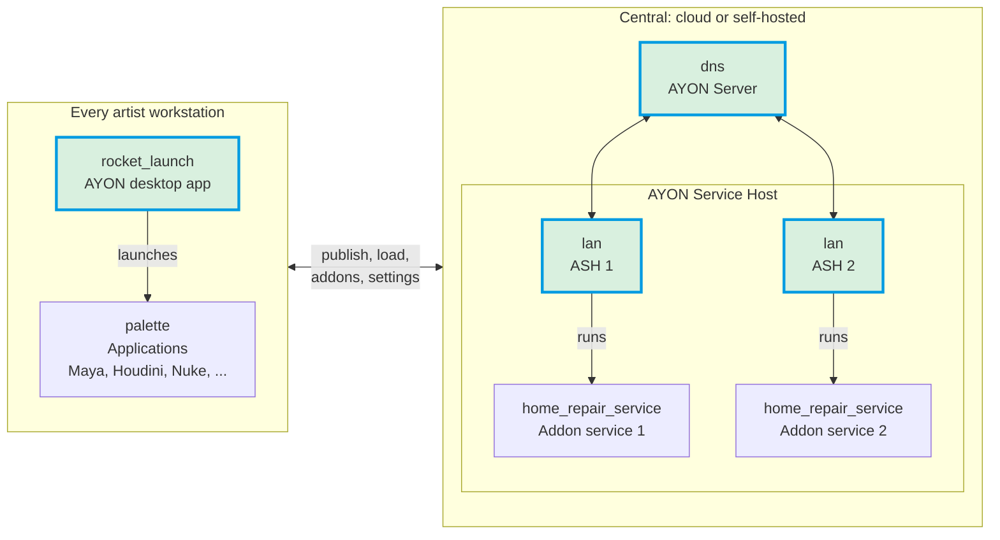

# Introduction to AYON

AYON is a production platform for creative studios that make VFX, animation, games and other media. It joins two things that studios usually run as separate systems:

- **Production management**: planning, tracking, review and delivery of a project.
- **Pipeline**: the tools that launch applications in the right context, apply studio environment, save versioned work files, publish results and load them again.

:::tip Production management and Pipeline go hand in hand

Both work on the same data, in one place, which connects the creative work to the production:

- **Statuses are backed by work:** A task marked "approved" points to a specific published version, with its files and its review media.
- **Artists work in context:** Every action happens within a project, folder and task, so published files are named and stored by the studio's rules.
- **One source of truth:** Producers, supervisors, artists and clients look at the same data through different tools.

:::

## Try it

Quick ways to start getting around AYON:

<Cards>
<Card icon="ayon" title="Explore AYON Playground" href="https://help.ayon.app/en/help/articles/3452772-explore-ayon-playground">
A ready-made sandbox project to look around without setting anything up.
</Card>
<Card icon="ynput" title="AYON on Cloud: a complete studio walkthrough" href="https://help.ayon.app/en/help/articles/0358916-ayon-on-cloud-a-complete-studio-walkthrough">
Start your own workspace on Ynput Cloud, from the server to the first publish.
</Card>
</Cards>

## Why AYON

AYON was built to solve problems that many VFX and animation studios face with their pipeline and production tools:

| Studio problem | How AYON addresses it |
|---|---|
| **Rigid, over-engineered tools** that are hard to change mid-production | **A modular system:** studios add only the addons they need and grow at their own pace. |
| **Endless maintenance**, and falling behind as new application versions keep coming | **Maintained integrations:** the application integrations are kept up to date, so recent versions keep working. |
| **Per-project solutions** that don't carry over to the next project or team, and **pipelines that don't scale** as projects and teams grow | **One system for the whole studio:** every project and team works with the same pipeline, so setups, tools and data carry over instead of being rebuilt. |
| **Starting from scratch** when a pipeline breaks down, and **no engineering team**, or a pipeline left behind when its developer leaves | **Published code and a community:** the code stays available under fair-source and open-source licences, and a large community keeps it going, so the pipeline does not depend on one person. |
| **Separate systems and complex APIs** that keep production data apart | **Production tracking and pipeline in one platform:** all production data lives in one place. |
| **Pipelines that are hard for artists to manage** without writing code | **Built with artists in mind:** configurable settings replace writing scripts. |

## Who it is for

AYON suits studios of any size, from the free Community edition to the Pro and Studio plans. The difference is felt most in studios that have outgrown manual organisation or that work remotely:

| Studio | How they benefit |
|---|---|
| **Small teams, freelancers** | **A pipeline without a pipeline team:** AYON is configured in settings instead of code, and its application integrations cover a wide variety of DCCs. The integrations keep up with new application versions and bugs are fixed regularly, so a small team is not left on its own, and it joins a large community of studios that work with the same tools. The server can be started on Ynput Cloud in a few minutes, fully managed by Ynput, or self-hosted. |
| **Mid-sized studios** | **Where AYON changes the most:** With many artists and many handoffs between departments, publishing, review, tracking and automation keep every department working the same way, instead of manual naming, folder browsing and status updates. Production management grows with it: planning, review sessions and reports. The setup stays expandable, so artists and freelancers who join for a crunch get the same tools and work the same way from their first day. |
| **Remote and distributed studios** | **Equally large difference:** Artists in different places, or on different storage, work from the same project context with the same tools, and their files are synced with the studio storage. |
| **Large studios** | **Designed to scale:** AYON is built to handle large productions, with many projects, assets, shots and publishes. The Studio plan has no user limit and unlocks every feature, and Enterprise offers role-based licensing, with full access for developers, managers and producers and lower-cost artist-only access for the wider team. |
| **Schools** | **Learning on studio tools:** Students work with the same pipeline and production tracking that studios use. Educational institutions can get the Studio plan for free with an on-premise installation. |

The paid plans, Pro and Studio, start at 5 users. Pro supports up to 200 users. See the [plans](plans.md) and the [pricing page](https://ayon.app/pricing-eur) for what each includes.

## What it is used for

| Need | What AYON provides |
|---|---|
| **Plan** | Projects built from folders (episodes, sequences, shots, assets) and tasks, with assignments. Scheduling and capacity planning come with the Planner addon. |
| **Create** | Artists launch their application from a task, save versioned work files, publish results as versioned and validated products, and load work published by others. Includes hero versions, OpenUSD workflows, and syncing files between storage locations, such as a cloud drive and the studio storage. |
| **Review** | Review sessions in the web app with annotations and version comparison. Guests can review without an account. |
| **Deliver** | Hand off versions to clients and vendors. |
| **Report** | Progress across departments, and a Reports dashboard with key metrics. |

Some features are part of certain [plans](plans.md).

## Use it your way

AYON does not have to be adopted as a whole. Studios are free to use it the way that works for them or tailor it for their needs:

- **Production management without the pipeline:** Production tracking works on its own: reviewable versions can be uploaded directly in the web app, without pipeline tools or application integrations.
- **Pipeline without the production features:** AYON started as a pipeline, and it still works as one on its own: all artist work is recorded on the AYON server, and the web app serves as the pipeline's configuration panel and user management.
- **Part of the pipeline:** Some studios use AYON for launching applications in context and managing environments, and keep their own publishing tool, connected to AYON or separate.
- **Customised to the studio:** Studios can extend AYON with their own addons.
- **Keep what a studio already has:** A studio that already has a production tracker can keep it and use AYON for the pipeline, or use a connector while moving over to AYON.

## Main components

AYON has three main parts to set up, the AYON server, the AYON Service Host (ASH) and the AYON desktop app, and addons extend all of them.

The table and the diagram below are a simplified view of how these parts fit together. A real setup can have more pieces, such as a render farm or more than one storage location, which are described on the server deployment and [artist workstation setup](workstation-setup.md) pages.

| Component | Where it runs | What it does |
|---|---|---|
| **AYON Server** | Once, centrally: on Ynput Cloud or self-hosted | The database for all pipeline data (projects, users, versions, relationships, settings). The web app for production tracking and administration. The REST and GraphQL APIs. Management of addons and settings. |
| **AYON desktop app (AYON Launcher)** | Installed on every artist workstation, as a tray application | Launches applications in the right context. Provides the tools artists use: Workfiles, Creator and Publisher, Loader, Scene Inventory. The tools run on the workstation, either on their own or inside the application, and talk to the server. |
| **AYON Service Host (ASH)** | Once or more, centrally: on Ynput Cloud or self-hosted | The addon services run inside ASH, which starts and stops them and pulls their new images. |
| **Addons** | On the server, the workstation, or both | The modular part of AYON. Integrations with applications (Maya, Houdini, Nuke, Blender and many more), production trackers, render farm managers, review tools and automation. Installed from the AYON Market or uploaded, and activated through bundles. |

The table above is the text version of this diagram.

Where to read more: [how AYON works](how-ayon-works/index.md) (bundles, addons, project anatomy), [pipeline tools](../pipeline/launcher.md), the [web UI](web-ui/navigation-bar.md), [ASH](deployment/ash.md) and the [addons](../addons/index.md).

## Studio setups

The AYON server is the center of every setup: artists, tools and services reach the same server wherever they are, so AYON is not tied to one studio layout. A setup comes down to three choices:

| Choice | Options |
|---|---|
| **Where the server runs** | Hosted by Ynput on **Ynput Cloud**, or **self-hosted** (distributed as a Docker setup; Linux is recommended for production). |
| **Where people work** | In one studio location, fully remote from home workstations, or distributed across several locations. |
| **Where the files are** | **One local storage**; **several local storages**, for example one per location; **hybrid**, a local storage synced to a cloud storage; or **fully in the cloud**. |

More detail is in the server deployment pages, [cloud](deployment/cloud.md) and [on-premise](deployment/on-premise.md), and in [artist workstation setup](workstation-setup.md).

## Open and extensible

- **Source available:** The code is published on [GitHub](https://github.com/ynput) under a combination of Fair Source and Open Source licensing, so a studio can see how the server works.
- **APIs:** Python, REST, GraphQL and C++. AYON also offers no-code automation through the Workflow addon.
- **Modular:** Addons add integrations and features without changing the foundations. Studios can write their own.

## Trust and status

- **Compliance:** Ynput reports SOC 2 Type 2, ISO 27001 and GDPR compliance. The [Ynput Security Trust Center](https://trust.inc/ynput) shows the current compliance and security posture.
- **Access and isolation:** Single sign-on is available, and cloud deployments are isolated per customer.
- **Status:** [AYON status](https://status.ayon.app/) shows live status and uptime for Ynput Cloud and the AYON download server.
