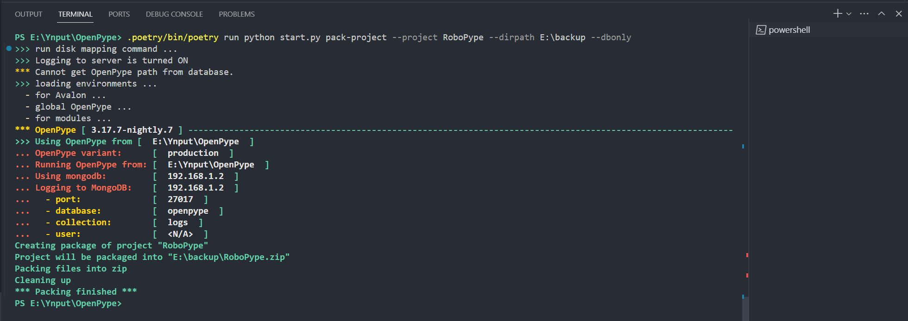
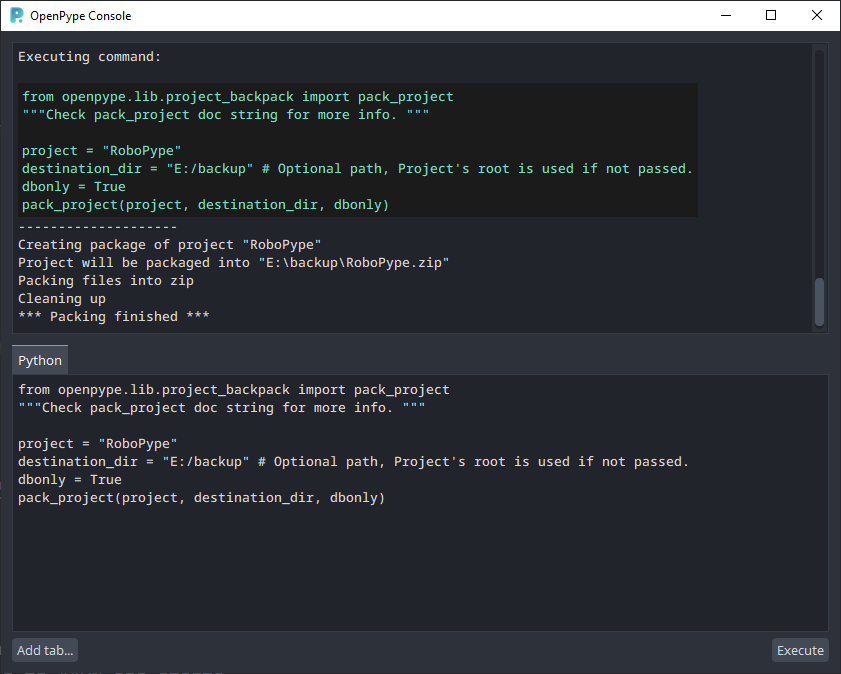
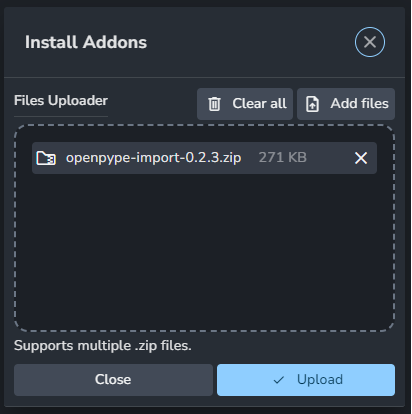
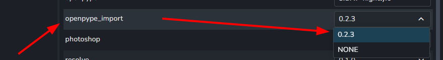
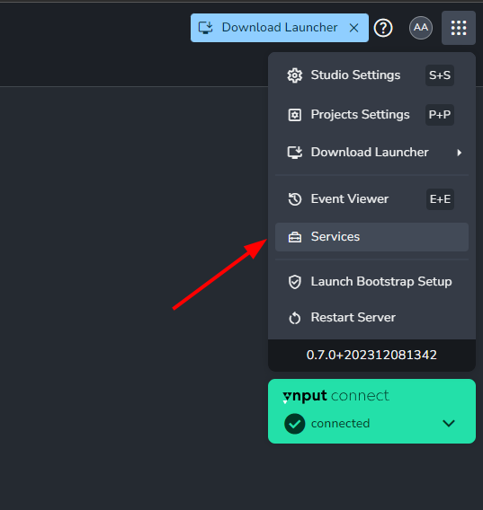
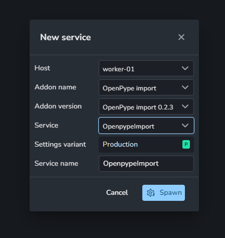
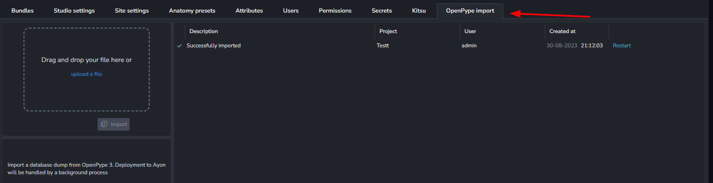
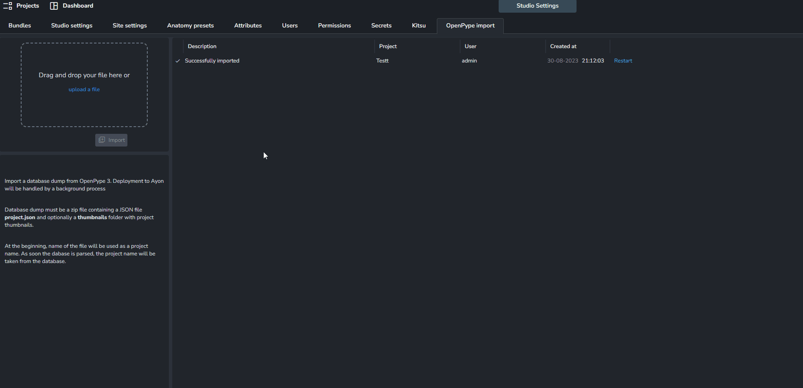

# Migrating OpenPype projects

:::note Legacy
OpenPype is the predecessor of AYON, see [History](introduction.md#history). The OpenPype Import addon is kept for studios that still have OpenPype 3 projects; the screenshots on this page show older versions of OpenPype and of the AYON web app.
:::

The OpenPype Import addon (`ayon-openpype-import`) imports OpenPype 3 projects into AYON. It is meant for finished projects, so that they stay accessible without running two pipelines side by side. It is not recommended for moving a project in the middle of production, and the imported project does not match the original exactly, see [OpenPype and AYON](#openpype-and-ayon).

:::caution Known limitations:

- Only projects with one project root can be exported.
- Studio and project settings are not transferred.
- In workfiles made in OpenPype, the version of a loaded product cannot be changed without loading the product again.
- Version 0.3.0 of the addon needs AYON server 1.6.1 or newer. Earlier versions of the addon work only with AYON server 1.0.2 and older.

:::

## Export the project from OpenPype

OpenPype's `pack-project` command exports a project into a ZIP file. It runs from the OpenPype executable, from an OpenPype source checkout, or as a Python function in OpenPype's console.

From the executable:

```shell
./openpype_console.exe pack-project --project <project name> --dirpath ../export/path --dbonly
```

From an OpenPype source checkout:

```shell
./.poetry/bin/poetry run python start.py pack-project --project <project name> --dirpath ../export/path --dbonly
```

| Argument | Meaning |
|---|---|
| `--project` | The name of the project. |
| `--dirpath` | Where the ZIP file is written. Required with `--dbonly`. |
| `--dbonly` | Exports only the MongoDB documents, not the project's files. |

The ZIP file contains the project files (unless `--dbonly` is used), `database.json` with the MongoDB documents of the project, and `metadata.json` with the project root definitions.



:::tip Thumbnails
Thumbnails are imported too, when the folder in which OpenPype stores the project's thumbnails is added to the ZIP file as a `thumbnails` folder.
:::

### From OpenPype's console

In OpenPype's console, list the project names first to use the exact name, then pack the project:

```python
from openpype.client import get_projects

print([project["name"] for project in get_projects()])
```

```python
from openpype.lib.project_backpack import pack_project

project = "project_name"
destination_dir = "desired_output_path"  # optional, the project root is used when empty
dbonly = True
pack_project(project, destination_dir, dbonly)
```



## Import the project into AYON

### 1. Get the addon

Download the addon package from the [releases of ayon-openpype-import](https://github.com/ynput/ayon-openpype-import/releases). It can also be built from the repository with its `create_package.py` script, see [Build a package](../developer/addon-development/overview.md#build-a-package).

### 2. Install the addon

<Columns widths="55 45">
<Column>

Upload the package with **Upload Addons** on the [Bundles](web-ui/studio/bundles.md) or [Addons](web-ui/studio/addons.md) tab of Studio settings, and restart the server. Then add the addon version to a bundle, and use that bundle as the Production bundle. How a new addon version is put into use is described in [Adding an addon to production](how-ayon-works/bundles.md#adding-an-addon-to-production).

</Column>
<Column>



</Column>
</Columns>



Once the bundle is in use, Studio settings has an **OpenPype Import** tab.

### 3. Run the import service

The import runs in a service of the addon, `OpenpypeImport`, which an [AYON Service Host](deployment/ash.md) (ASH) runs. Create it on the [Services](web-ui/services.md) page with **New service**: choose the host, the OpenPype Import addon and version, and the service, then **Spawn**. The tab can be opened without the service, but imports are only processed while it runs. How services work is described in [Addon services](how-ayon-works/services.md).

<Gallery columns={2} rows={1}>





</Gallery>

### 4. Import

On the **OpenPype Import** tab, drop the ZIP file on the upload area, or choose it with **upload a file**, then select **Import**. The table on the right lists the imports with their status, project, user and time; **Restart** runs an import again.





## OpenPype and AYON

An OpenPype project has two parts: the files on disk, such as scenes, scripts and renders in the `work` and `publish` areas, which depend on each other; and the records of folders, products, versions and representations in a MongoDB database. AYON uses the same files, but stores the records in PostgreSQL, with IDs in another format.

| Kept | Lost |
|---|---|
| The files, untouched, and the relations between them, such as references. | Studio and project settings. |
| The project structure: folders, products, versions and representations. | The link between a loaded product in a workfile and its version: the loaded products of workfiles made in OpenPype cannot be versioned with the scene inventory, they must be loaded again. |
| Thumbnails, when the `thumbnails` folder is in the ZIP file. | |

### How IDs are converted

MongoDB IDs are 24-character hexadecimal strings; AYON IDs are 32-character hexadecimal UUIDs without hyphens. The import converts each ID with a name-based UUID, so the same OpenPype ID always gives the same AYON ID:

```python
import uuid

mongo_id = "64cfae2b9f1b2c3d4e5f6a7b"  # OpenPype ID, 24 hexadecimal characters
ayon_id = uuid.uuid5(uuid.NAMESPACE_OID, mongo_id).hex
print(ayon_id)  # 4c0f909e98995b4ea2206aefe94f791d
```

This makes it possible to write a tool that updates the IDs in workfiles, but none exists.

## Related

- [History](introduction.md#history)
- [Bundles](web-ui/studio/bundles.md)
- [Services](web-ui/services.md)
- [AYON Service Host](deployment/ash.md)
- [Addon services](how-ayon-works/services.md)
