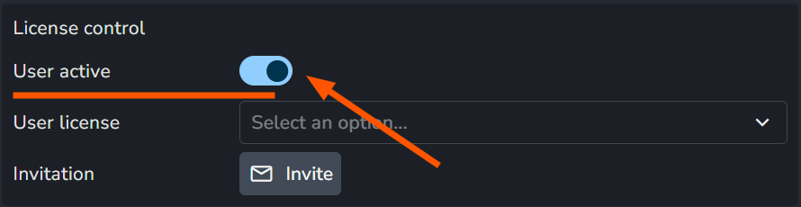

# AYON plans

AYON comes in a free Community edition and in the commercial plans AYON Pro and AYON Studio. The Community edition is the AYON server without a subscription. Connecting the same server to a Pro or Studio subscription, or getting one hosted by Ynput, keeps everything the Community edition has and unlocks the features and addons of the plan, including the paid addons. This page lists what each plan includes. The [addons catalogue](../addons/index.md) shows the license of every addon with the same names: **Free**, **Pro** and **Studio**.

## Plans at a glance

| Plan | What it is |
|---|---|
| **Community** | Self-hosting for free, with a combination of fair-source and open-source code (license FSL-1.1-AL2). Includes the base features, all DCC integrations and the pipeline features. |
| **AYON Pro** | The production-ready plan: everything in Community, plus the power features, single sign-on and more pipeline addons, with optional paid addons on top. |
| **AYON Studio** | Everything in Pro, with every addon included, so nothing is bought separately. Adds unlimited users, an additional developer server and high-availability cloud hosting. |
| **Enterprise** | Role-based licensing for large studios: full access for developers, managers and producers, and artist-only access for the wider team. Arranged individually. |
| **Schools** | Educational institutions can get AYON Studio free of charge with an on-premise installation, or hosted by Ynput for a fee. |

AYON Pro and AYON Studio are priced **per active user**. A subscription has a number of seats, one for each active user, and on a server connected to a subscription only active users with a seat can log in. A user who becomes active takes a free seat automatically, and the seat stays assigned to that user. Pro and Studio start at 5 active users. Pro supports up to 200 active users and Studio an unlimited number. How the seats appear in the AYON server is described on the [licenses page](licenses.md).

All seats of a server must be on the same plan, with the same addons:

- One server cannot have some users on AYON Pro and others on AYON Studio.
- On AYON Pro, a paid addon covers every seat of the server. With 10 seats, each paid addon is bought for 10 seats; it cannot be split, for example 2 seats of Planner and 5 of Review.
- On AYON Studio, every seat includes all addons.

## AYON Community

The AYON server without a subscription, self-hosted for free, with a combination of fair-source and open-source code (license FSL-1.1-AL2).

- **Production tracking:** unlimited projects, the tasks overview, lists, links between entities, the inbox with notifications, and uploading and viewing reviewables.
- **Pipeline:** all DCC integrations, the AYON Launcher, the OpenUSD workflow and resolver, the Desktop Publisher and the simple version publisher, Site Sync, hero versions, and environment and plugin management.
- **API:** REST, GraphQL, Python and C++.
- **Support:** the [community forum](https://community.ynput.io/), the [Discord server](https://discord.gg/ynput), the [feedback portal](https://feedback.ayon.app/), and the help chat, where an AI assistant answers questions, in the web app, on the AYON website and on the feedback portal.

:::tip Run by the studio

With the Community edition, the studio hosts the server and takes care of its storage, monitoring, backups and updates. See [on-premise deployment](deployment/on-premise.md).
:::

## AYON Pro

Everything in Community, plus:

- **Power features:** annotations in the reviewable player, table view grouping, complex filters and slicer, custom view sharing, the related work panel, list attributes, calculated attributes, task and folder templates, and status automation.
- **Single sign-on:** with Microsoft Entra, Google, Okta, Authentik and Discord through the [SSO addon](../addons/server-features/sso/index.md), and with a Keycloak server through the [Keycloak addon](../addons/server-features/keycloak/index.md).
- **Pipeline addons:** [Batch Ingest](../addons/pipeline-features/batch-ingest/index.md), [Batch Delivery](../addons/pipeline-features/batch-delivery/index.md) tools, [advanced burn-ins](../addons/pipeline-features/premium-burnins/index.md) and [automated slates](../addons/pipeline-features/slater/index.md).
- **Support:** email.
- **Onboarding:** during the trial, up to 2 hours of support for the pipeline deployment and first steps, and, with a yearly subscription, 4 hours of consultation and training in the first paid month.
- **Users:** 5 to 200 active users.
- **Licensing:** online.
- **With [cloud hosting](deployment/cloud.md):**
  - **Cloud options:** a cloud-hosted dev server and production freeze, both optional.
  - **Detailed audit history:** 21 days of the event stream of everything that happens in AYON, to browse and process.

Paid addons can be added on top: [Planner](../addons/production-tracking/planner/index.md) (planning and scheduling), [Reports](../addons/production-tracking/reports/index.md) (reporting dashboards), [Node Graph](../addons/production-tracking/node-graph/index.md) (project node graph), [Review](../addons/production-tracking/review/index.md) (internal and guest review sessions), [Web Publisher](../addons/pipeline-features/web-publisher/index.md) and [archival tools](../addons/pipeline-features/archival-tool/index.md).

## AYON Studio

Everything in Pro, with every addon included, so none is bought separately:

- **Paid Pro production tracking addons, included:** planning and scheduling with [Planner](../addons/production-tracking/planner/index.md), reporting dashboards with [Reports](../addons/production-tracking/reports/index.md), the project [Node Graph](../addons/production-tracking/node-graph/index.md), and internal and guest review sessions with [Review](../addons/production-tracking/review/index.md).
- **Paid Pro pipeline addons, included:** publishing from the web app with [Web Publisher](../addons/pipeline-features/web-publisher/index.md) and the [archival tools](../addons/pipeline-features/archival-tool/index.md).
- **Automation:** node-based automation with [AYON Workflows](../addons/automation/workflow/index.md), available only on Studio.
- **Support:** email and live chat.
- **Users:** from 5 active users, with no upper limit.
- **Licensing:** online and offline.
- **With [cloud hosting](deployment/cloud.md):**
  - **Cloud options:** a cloud-hosted dev server included, and production freeze optional.
  - **Detailed audit history:** 60 days of the event stream of everything that happens in AYON, to browse and process.

## Frequently asked questions

### Does the Community edition work with the paid addons?

Yes, once the server is connected to a subscription. With AYON Pro, the Pro addons and the bought paid addons can be installed; with AYON Studio, every addon. From there they are set up [like any other addon](how-ayon-works/index.md).

### What is an active user?

An active user is a user that can log in and, on a server connected to a subscription, has a seat. AYON Pro and AYON Studio are billed per active user.

A user is active when **User active** is turned on in the **License control** section of the user's details on the [Users](web-ui/studio/users.md#active-and-inactive-users) page.

### Does a user need a seat to log in?

On a server connected to a subscription, yes. A user without a seat gets one automatically when a seat is free. Without a free seat, the user cannot log in. 

On a Community server, users don't need seats: every active user can log in, and there is no limit on the number of users.

### Can users be added without a seat?

Yes. Inactive users do not take a seat, and a server can have any number of them. They cannot log in, but they can be kept in the user database, for example freelancers who are assigned to projects and planned ahead before they start.

### How much does AYON cost?

- **AYON Pro:** €180/$216/£162 per active user per year, or €19/$23/£17 per active user per month.
- **AYON Studio:** €360/$432/£324 per active user per year, or €38/$46/£34 per active user per month. Includes all addons.
- **Minimum:** every subscription has at least 5 users.
- **Each paid addon on AYON Pro:** €36/$48/£36 per active user per year, or €3/$4/£3 per active user per month, on top of the plan.
- **Hosting by Ynput with AYON Pro:** €2,880/$3,480/£2,520 per year, or €300/$360/£265 per month, billed separately from the plan.
- **Hosting by Ynput with AYON Studio:** €5,760/$6,960/£5,040 per year, or €600/$720/£530 per month, billed separately from the plan.
- **Additional media storage, with hosting by Ynput:** €50 per month for each 500 GB.
- **Production freeze, with hosting by Ynput:** €90 per month on AYON Pro, or €180 per month on AYON Studio. It pauses the server between projects at a lower monthly cost.

All prices exclude VAT and other applicable taxes. The calculator on the [pricing page](https://ayon.app/pricing-eur) works out the exact cost for a team.

### Are there setup or hidden fees?

There is no deployment fee for self-hosting. With hosting by Ynput, deployment and maintenance are part of the subscription. An annual subscription includes up to 4 hours of production onboarding support, and a support contract includes the hours agreed in it. Further setup help is available as paid consultation. Subscription changes are made on [Ynput Cloud](../ynput-cloud/index.md), which shows the amount due before they are confirmed.

### Does Ynput offer professional services and support plans?

Yes, with every edition. Studios can get expert help from Ynput to assess, configure and improve their AYON setup, as well as dedicated onboarding and training, and development of AYON features and bug fixes for the studio's needs. It can be ad hoc help or a support plan with a set number of hours per month. Contact [sales@ynput.io](mailto:sales@ynput.io) for a quote.

### Are there custom plans for large studios or specific needs?

Yes. Besides [Enterprise](#plans-at-a-glance), with its role-based licensing, Ynput arranges custom plans for needs that the standard plans do not cover. Contact the sales team at [sales@ynput.io](mailto:sales@ynput.io).

### What happens when a studio exceeds its plan's limits?

Ynput lets the studio know, and the studio can upgrade to a plan that fits or adjust its usage. Extra usage is not charged without the studio's acknowledgment.

### What is the cancellation policy?

- **Free trial:** The trial lasts 14 days, can be cancelled at any time and ends by itself.
- **First 14 days of a subscription:** Cancelling within 14 days of the start gives a full refund.
- **After 14 days:** Subscription fees are not refundable, and the full subscribed term is paid.
- **Addons:** Fees under the AYON Addon license cannot be cancelled or refunded.

The details are in the [terms of service](https://ayon.app/terms) and the [AYON Addon license](https://ayon.app/ayon-addon-license).

### What is the cloud-hosted dev server?

An additional AYON server that comes with hosting by Ynput: included with AYON Studio and optional with AYON Pro. It is a separate environment for testing, development and experiments next to production, not for production work, customer demos or staging. It has up to 5 users on the same plan as the main server and 50 GB of storage. For more users, Ynput can be contacted, or a separate server can be set up: self-hosted with an additional AYON Pro subscription, which is the simplest and cheapest, or hosted by Ynput, charged per user plus the hosting fee.

## Related

- [Licenses page](licenses.md): how seats and user license pools appear in the web UI.
- [Addons catalogue](../addons/index.md): license of every addon.
- [Cloud deployment](deployment/cloud.md) and [on-premise deployment](deployment/on-premise.md).
- [Ynput Cloud](../ynput-cloud/index.md): where subscriptions are managed.
