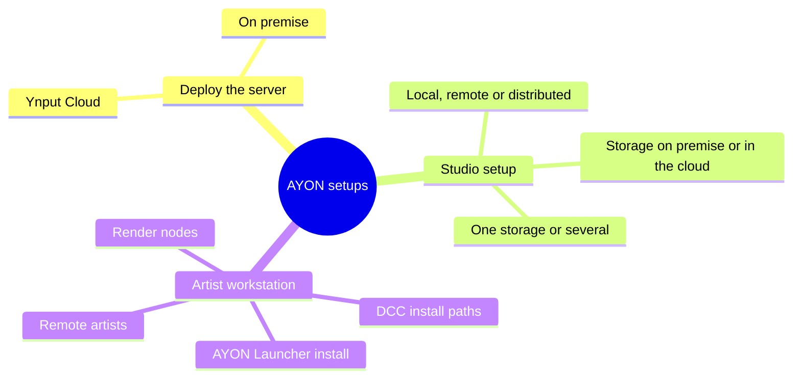

# AYON setups

AYON adapts to how a studio works instead of asking the studio to change. This page is a map of the choices it supports, in three areas: where the server runs, how the studio's people and storage are arranged, and how each artist workstation is set up. It does not explain how to set anything up; it shows what is possible, so a newcomer can see the whole picture first.

The sections below are the text version of this map. The [Introduction](introduction.md) explains what AYON is and what its components are.

## Deploy the server

The AYON server is installed once for the whole studio. There are two ways to run it:

| Option | What it is | Good to know |
|---|---|---|
| **Ynput Cloud** | A managed server, started in a few clicks and run by Ynput. Each one is an *AYON workspace*: a separate server on its own domain, belonging to the studio's organization on Ynput Cloud. | Updates, maintenance and backups are handled by Ynput. Every workspace is isolated from the others. A free trial is available. |
| **On premise** | The studio runs the server itself. The Docker setup that AYON provides can be run as it is, or used as a reference for a customised setup. | Some knowledge of Docker is recommended. Linux is recommended for production. Studios without internet access are possible, but the images for the background services must be loaded in advance. |

Both options run the same AYON, with one difference: the free Community edition provides the base features out of the box, while the cloud provides the base features plus the Pro or Studio features that come with the plan. It's also possible to connect the on premise AYON server to a Pro or Studio plan to unlock more features (see the [plans](plans.md)).

Read more: [Getting started on Ynput Cloud](https://help.ayon.app/en/help/articles/6619325-getting-started-with-ayon-cloud-hosted) and [server local deployment](https://help.ayon.app/en/help/articles/2293963-ayon-server-local-deployment).

:::note

A cloud server comes with an AYON Service Host. When deploying AYON on premise, an [AYON Service Host](https://help.ayon.app/en/help/articles/7620452-ayon-service-host-ash) is needed for the addons that come with services. A studio that does not use the Services page in AYON does not need to deploy one. It can run together with the server or separately; see the community guide [Setting up AYON Service Host (ASH)](https://community.ynput.io/t/setting-up-ayon-service-host-ash/1535).

:::

## Studio setup

Setting up AYON starts with a few questions about the studio. The answers decide essential configurations:

| Question | Options |
|---|---|
| **Where do people work?** | In one **local studio**; fully **remote**, from home workstations; or **distributed** across several locations, including a mix of these. |
| **How many storages are there?** | A **single central storage** for everything, or **several storages**, for example one per location or per project or per department. |
| **Where is the storage?** | **On premise**, on the studio's own disks and servers, or **in the cloud**. |

Any combination of answers is possible, from a small team on one shared disk to a studio spread over several countries with storage in more than one place.

**Where do people work?** for local studio, on premise works well, but for remote or hybrid, having a cloud instance is the best bet which by passes a lot of technical challenges leaving you focusing more on the creative process.

<!-- Stopped here -->

**How many storages are there?** for each storage, you'll need to define a **root** in project anatomy . 

Storage is described to AYON as **roots**: the folders where project files live, set for each operating system the studio uses. Several roots can exist, for example to keep one kind of data on another disk. When files must exist in more than one storage location, such as a secondary studio in another country and the main studio, or a cloud drive and the studio storage, the **Site Sync** addon keeps published files in step between them. AYON calls each storage location a *site*.

Read more: [project anatomy and roots](https://help.ayon.app/en/help/articles/3815114-project-anatomy) and [Site Sync](https://help.ayon.app/en/help/articles/3882937-site-sync). A few points to weigh when planning are listed in the [Introduction](introduction.md#setups-and-hosting).

## Artist workstation setup

Each workstation needs four things: the applications, the AYON Launcher, access to the project storage, and access to the AYON server. The server is how the launcher is downloaded and how every AYON tool reaches the studio's data, so remote workstations need it just like the ones in the studio.

### DCC applications

AYON starts each application from its executable paths, which are defined in settings for each operating system. Because of that, a studio can keep applications in their **default install location**, or in a **location agreed across the studio**, and one set of settings then fits every machine. Several paths can be listed for one application, and the launcher can show only the applications that are installed on the machine in front of the artist.

Read more: [Applications and tools](https://help.ayon.app/en/help/articles/3945756-applications-and-tools).

### AYON Launcher

The launcher is downloaded from the studio's AYON Server and can be installed in different ways:

- **For all users** of a machine. This needs administrative privileges.
- **For one user only.**
- In a **shared location**, so that machines use the same installation.

The launcher keeps two kinds of files. The **launcher storage** holds the addons and dependency packages, and can be local to a machine or a shared folder. Files that belong to one user or machine, such as its site ID, always stay local and are not shared. The launcher updates itself to the version the studio's bundle specifies every time it starts.

Read more: [installing the launcher](https://help.ayon.app/en/help/articles/4678978-installing-ayon-launcher-on-user-machine), [launcher admin notes](https://help.ayon.app/en/help/articles/2308428-launcher-admin-notes) and the community guide [Use a shared location for the launcher and addons](https://community.ynput.io/t/use-shared-location-for-ayon-launcher-and-addons/1175).

### Render nodes

Every machine with the launcher gets its own **site ID**, which identifies the machine to AYON. It is used for settings that differ per machine, such as local roots, and by Site Sync, which treats each machine as a storage location. Dedicated render nodes can be given the **same site ID**, which reduces the load of requests on the server during publishing jobs. This is meant for dedicated farm machines of the same operating system only, never for artist workstations.

Read more: [optimizing farm render nodes](https://help.ayon.app/en/help/articles/5372986-configure-deadline-addon).

### Remote artists

Remote artists have two ways to reach the project files:

| Approach | How it works | Trade-off |
|---|---|---|
| **Local storage with Site Sync** | The artist works on their own disk. The project's root locations are mapped to local folders in the artist's own site settings, and the Site Sync addon downloads published files **on demand** and uploads what the artist publishes. | The artist only stores the files they need. Needs Site Sync to be set up. With Site Sync, the Loader knows which files are available and can request them. |
| **Mounted storage** | The studio storage, or a cloud storage, is mounted on the artist's machine with a third-party storage client. | Simple for the artist, with nothing to set up in AYON. Depending on the storage client and its mode, files are either fetched when they are opened or all kept as a full local copy, so the cost is local disk space or waiting on first access. AYON does not know about the mount: its tools read what was published from the database and expect the files to be there. |

## Related

- [Introduction](introduction.md)
- [Settings and scopes](backend/settings/index.md) (planned)
- [Self hosting](hosting/self-hosting.md) and [AYON Service Host](hosting/ash.md)
