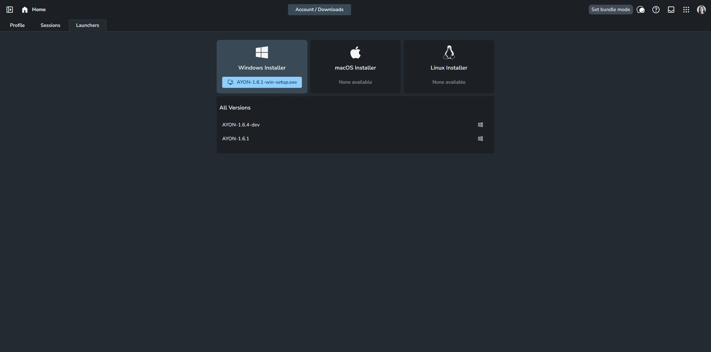

# Launchers

<PageInfo />

The Launchers page offers the AYON launcher installers hosted on the server for download. The launcher is the desktop application that artists install on their workstation to run the pipeline, see [Launcher](../../../pipeline/launcher.md). The page puts the installer of the production bundle first, for each platform, and lists every other version below. Admins upload the installers on the [Bundles](../studio/bundles.md#launchers-and-dependency-package-uploads) page, which also sets the launcher version of each bundle.

## Installers

| Part | Content |
|---|---|
| Platform cards | **Windows Installer**, **macOS Installer** and **Linux Installer**. Each lists the installers of the launcher version in the production bundle for that platform, as buttons named by file name. The card of the browser's own platform is highlighted and its buttons are filled. A card without such an installer shows **None available**. |
| **All Versions** | Every installer on the server, one line per launcher version, newest first. Each line has one button per platform, with the platform logo; the tooltip shows the file name. |

When the production bundle has no launcher version, or no installer exists for that version, all platform cards show **None available** and only **All Versions** offers downloads.

## Controls and interactions

- A button starts the download in the browser. Installers uploaded to the server are downloaded from it (`/api/desktop/installers/<file name>`); installers registered only with an external URL are downloaded from that URL. An installer with neither shows "URL for launcher not found".
- The App header shows a **Download launcher** prompt while the production bundle's launcher has an installer for the browser's platform that this browser has not downloaded yet. A download from the prompt or from this page, or closing the prompt, is remembered in the browser. See [App header](../app-header.md#right-region).

## Related

- [Account](index.md)
- [Bundles](../studio/bundles.md)
- [Launcher](../../../pipeline/launcher.md)
- [Bundles and how a workstation picks one](../../how-ayon-works/bundles.md)
