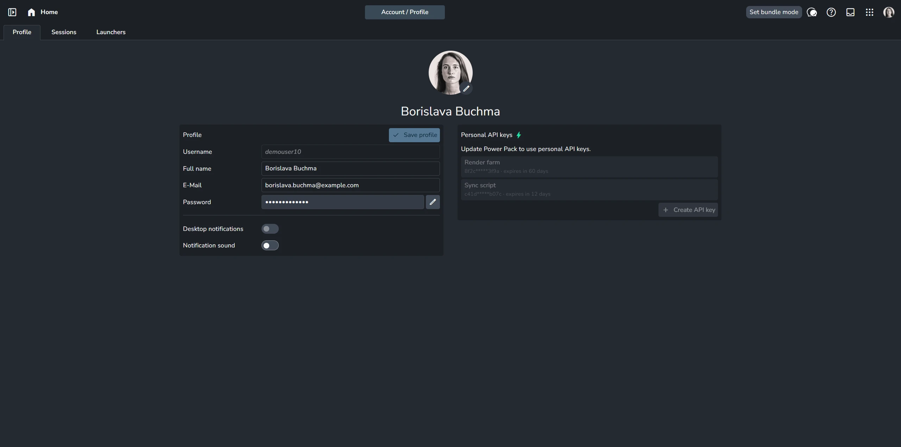
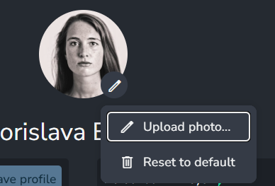
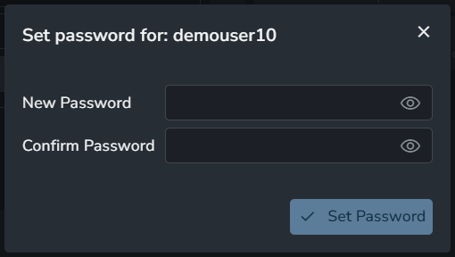

# Profile

<PageInfo />

The Profile page is where users edit their own account: the avatar, the full name and email, the custom user attributes of the server, the password, and how the web app notifies them of new [inbox](../inbox/index.md) messages. Managers edit the same values of other users on the [Users](../studio/users.md) page, together with what is not on this page: the access level, access groups, active state and password login.

## Profile card

The avatar and the full name are at the top. Below them, the **Profile** card holds the form; sections added by addons, such as **Personal API keys**, are next to it, or below it on narrow screens.

### Avatar

<Columns widths="65 35">
<Column>

The edit button on the avatar opens **Upload photo...** (a PNG or JPEG file) and **Reset to default**. Both take effect at once, without **Save profile**. Without an uploaded photo, the avatar comes from the **Avatar URL** attribute when it is set, otherwise it shows the user's initials.

</Column>
<Column>

</Column>
</Columns>

### Fields

| Field | What it does |
|---|---|
| **Username** | The login name. Read-only. |
| **Full name**, **E-Mail** | Built-in user attributes. Spaces around the values are removed when saved. |
| Custom user attributes | Every other attribute with the user scope, below a divider. Attributes with a list of values are dropdowns, boolean attributes are switches. **Avatar URL** and **Developer mode** are not shown. |
| **Password** | A masked field with an edit button that opens the password dialog. Hidden when password login is disabled for the user. |
| **Desktop notifications** | Shows a notification for new [Important](../inbox/important.md) messages: a desktop notification while the web app is in the background, a toast while it is in front. Disabled unless the server is reached over HTTPS or as `localhost`, with the tooltip **Browser notifications only work over HTTPS**. |
| **Notification sound** | Plays a chime for new Important messages while the web app is in the background. Works independently of **Desktop notifications**. |
| **Save profile** | Saves the fields and both switches. Active when something has changed. |

### Password dialog

<Columns widths="60 40">
<Column>

The dialog, titled **Set password for:** and the username, has **New Password** and **Confirm Password**. **Set Password** is active when both are filled; different values are refused with "Passwords do not match".

The current password is not asked for. By default the server requires at least 8 characters with letters, digits and special characters (the `AYON_AUTH_PASS_MIN_LENGTH` and `AYON_AUTH_PASS_COMPLEX` settings). Changing the password does not end the user's other sessions; they can be ended on the [Sessions](sessions.md) page.

</Column>
<Column>

</Column>
</Columns>

## Controls and interactions

### Enabling desktop notifications

Switching **Desktop notifications** on and saving asks the browser for permission to show notifications. When the browser blocks notifications for the server, or the request is denied, the switch is turned off again. The **Enable notifications** button of the inbox does the same in one click. See [Real-time notifications](../inbox/index.md#real-time-notifications).

## Power features

These features need the [Power Pack](../../../addons/production-tracking/power-pack/index.md) and a license, see [Power features](../../../production-tracking/power-features.md).

### Personal API keys

The **Personal API keys** card lets users create API keys of their own, for example for a script. Without the Power Pack, the card shows a preview with **Create API key**, which explains the feature. When the Power Pack is licensed but too old to provide the keys, the card reads "Update Power Pack to use personal API keys." Guests do not see it.

## Related

- [Account](index.md)
- [Sessions](sessions.md)
- [Users](../studio/users.md)
- [Attributes](../studio/attributes.md)
- [Inbox and notifications](../inbox/index.md)
