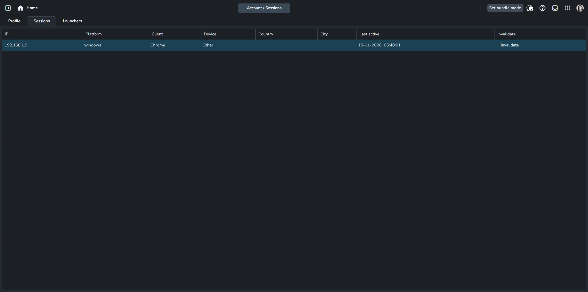

# Sessions

<PageInfo />

The Sessions page lists the sessions the signed-in user has on the server: one for each sign-in in a browser, in the AYON launcher or in another client. It shows where and with what each session was opened and when it was last used, and ends any of them, for example after signing in on a shared machine. The password is changed on the [Profile](profile.md) page.

## Session table

One row per session. The session of the current browser is highlighted.

| Column | Content |
|---|---|
| **IP** | The client's IP address when the session was created. |
| **Platform** | `windows`, `darwin` or `linux` for browsers; the platform reported by AYON clients. |
| **Client** | The browser, or `Ayon client <version>` for AYON clients such as the launcher. |
| **Device** | The device type reported by the browser, or the machine's host name for AYON clients. |
| **Country**, **City** | The location looked up from the IP address. Empty for local network addresses and on servers without a GeoIP database. |
| **Last active** | When the session was last used. |
| **Invalidate** | Ends the session at once, without confirmation. Invalidating the current browser's session signs the user out. |

### Session lifetime

A session ends by itself when it has not been used for the session lifetime of the server, 72 hours by default (the `AYON_SESSION_TTL` setting, see [On-premise deployment](../../deployment/on-premise.md#configuration)). Each use extends it. A session used from a different public IP address than the one it was created from is ended, unless the server sets `AYON_DISABLE_CHECK_SESSION_IP`. Signing out ends the session of the current browser only. Changing the password or the profile keeps all sessions; a user who is deactivated loses all of them.

## Controls and interactions

- **Invalidate** on a row ends that session. There is no confirmation and no undo; the client of that session has to sign in again.
- Managers and admins can list and end other users' sessions through the REST API; the web app has no page for it.

## Related

- [Account](index.md)
- [Profile](profile.md)
- [Users](../studio/users.md)
