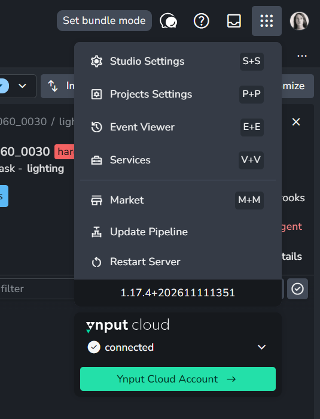
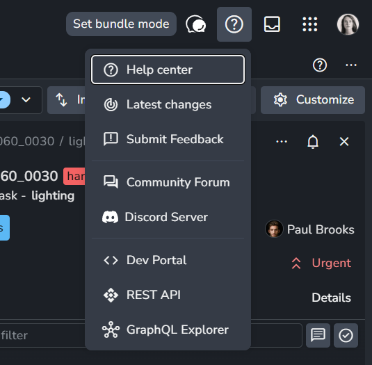
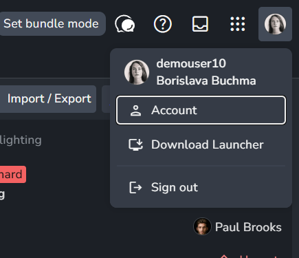
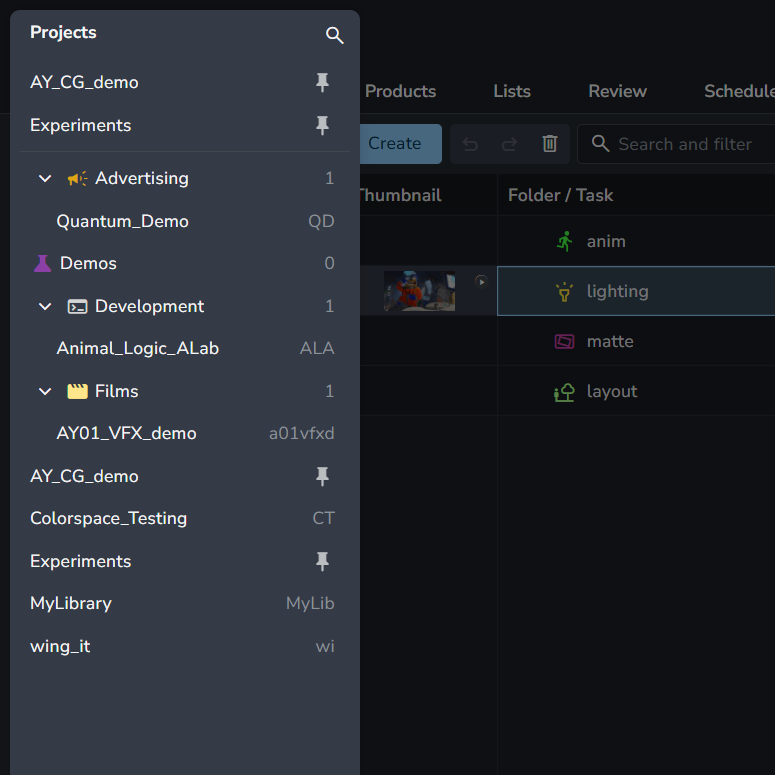
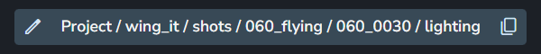
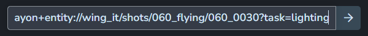

# App header

<PageInfo />

Every page of the web app has the App header at the top. It opens projects and Home on the left, shows where the user is in the middle, and opens the menus on the right. Most pages add a row of tabs below it. What the App header shows depends on the user's role; guests see only **Home** and the **User** menu.

## Header and menus

### Left region

| Control | What it does | Shown to |
|---|---|---|
| Project menu (panel icon) | Opens a searchable list of projects, with pinned projects at the top. Selecting a project opens its pages. | Users, managers and admins |
| **Home** | Opens [Home](home/index.md) at its Tasks page. Highlighted on every Home page. | Everyone |
| Addon items | Buttons that addons add to the App header, shown with their label. | Everyone except guests |

### URI bar

The URI bar in the middle of the App header shows the current location, for example `Project / wing_it / shots / 060_flying / 060_0030 / lighting` for a selected task. The copy button next to it copies the location as a URI, such as `ayon+entity://wing_it/shots/060_flying/060_0030?task=lighting`, for example to share it in a message. A URI can also be typed or pasted, see [Go to a URI](#go-to-a-uri).

### Right region

| Control | What it does | Shown to |
|---|---|---|
| **Download launcher** | Downloads the launcher installer for the user's platform. Shown until it is downloaded in this browser, or closed. | Everyone, when the server has an installer |
| **Setup pipeline** | Opens the pipeline release installer. Shown until the server has a launcher installer and a dependency package; the close button hides it for the browser session. | Admins |
| Bundle mode | Chooses the bundle the user's session uses: **Production** (shown as **Set bundle mode**), **Staging** or **Developer**. A user with only one of the two sees a switch instead. See [Bundles](../how-ayon-works/bundles.md). | Users with developer or staging access |
| Addon items | Buttons that addons add to the App header, shown as icons. | Everyone except guests |
| Chat | Opens the support chat once it has loaded. A dot shows unread messages. | Everyone except guests |
| **Help** (question mark) | Opens the [Help menu](#help-menu). | Everyone except guests |
| **Inbox** | Opens the [Inbox](inbox/important.md). A dot shows unread important messages. | Everyone except guests |
| **App** (grid icon) | Opens the [App menu](#app-menu). A dot shows that the server needs a restart. | Everyone except guests |
| **User** (avatar) | Opens the [User menu](#user-menu). | Everyone |

### App menu

<Columns widths="55 45">
<Column>

The App menu opens the settings and system pages. Its footer shows the server version, for example `1.17.4+202611111351`: the server version and the build of the web app. Admins also see the [Ynput Cloud](../../ynput-cloud/index.md) connection below the menu.

| Entry | Opens | Shown to |
|---|---|---|
| **Studio Settings** | [Studio settings](studio/index.md) | Managers and admins |
| **Site Settings** | Site settings | Users, instead of Studio Settings |
| **Projects Settings** | [Project settings](project/index.md) | Everyone with the menu |
| **Event Viewer** | [Event Viewer](event-viewer.md) | Managers and admins |
| **Services** | [Services](services.md) | Managers and admins |
| **Market** | [Market](market.md) | Admins |
| **Update Pipeline** | The pipeline release installer | Admins |
| **Restart Server** | Restarts the server after a confirmation. Reads **Restart Required** when a change needs a restart. | Admins |
| **Launch Bootstrap Setup** | Starts the first-run setup again | Users with developer mode on |

</Column>
<Column>

</Column>
</Columns>

### Help menu

<Columns widths="55 45">
<Column>

**Help center**, **Latest changes** and **Submit Feedback** appear once the help widget has loaded. The other entries are shown to users, managers and admins.

| Entry | Opens |
|---|---|
| **Help center** | The help center |
| **Latest changes** | The changelog |
| **Submit Feedback** | The feedback form |
| **Community Forum** | [community.ynput.io](https://community.ynput.io/) |
| **Discord Server** | The Ynput Discord server |
| **Dev Portal** | [docs.ayon.dev](https://docs.ayon.dev/) |
| **REST API** | The [REST API](rest-api.md) documentation of this server |
| **GraphQL Explorer** | The [GraphQL Explorer](graphql-explorer.md) |

</Column>
<Column>

</Column>
</Columns>

### User menu

<Columns widths="55 45">
<Column>

The top of the menu shows the user's name and full name, or a **Set Full Name** link when the full name is empty.

| Entry | Opens |
|---|---|
| **Account** | The user's [account](account/index.md): profile, sessions and launchers |
| **Download Launcher** | The launcher installers on this server |
| **Sign out** | Signs the user out |

Guests see only **Sign out**.

</Column>
<Column>

</Column>
</Columns>

### Page tabs

Most pages have a row of tabs below the App header. Addons can add tabs to Home and to the project pages, so the tabs differ between servers.

| Area | Tabs |
|---|---|
| [Home](home/index.md) | **Tasks**, **Projects**, plus addon pages |
| Project | **Overview**, **Task progress**, **Browser** (when enabled), **Products**, **Lists**, **Review**, **Reports**, **Workfiles**, plus addon pages. Shown to users, managers and admins. |
| [Project settings](project/index.md) | **Anatomy**, **Project settings**, **Project permissions** (managers), **Project access**, **Site settings**, **Roots**, **Teams** (managers) |
| [Studio settings](studio/index.md) | **Global** (admins), **Addons**, **Bundles**, **Studio settings**, **Site settings**, **Anatomy presets**, **Attributes**, **Users**, **Permissions**, **Secrets**, plus a tab for each addon in the production bundle that has a settings page. All except **Site settings** need the manager role. |
| [Inbox](inbox/index.md) | **Important**, **Other**, **Cleared** |
| [Account](account/index.md) | **Profile**, **Sessions**, **Launchers** |

The project settings tabs also depend on the user's access groups. A user without the manager role who opens **Project permissions** or **Teams** is sent to the first tab they can open.

## Controls and interactions

### Keyboard shortcuts

<Columns widths="55 45">
<Column>

| Key | Opens |
|---|---|
| `1` | Project menu |
| `8` | Help menu |
| `9` | App menu |
| `0` | User menu |
| `h+h` | Home |
| `i+i` | Inbox |
| `s+s`, `p+p`, `e+e`, `v+v`, `m+m` | Studio or site settings, project settings, Event Viewer, Services, Market |
| `0+0` | Signs the user out |

While the project menu is open, only `1`, `8`, `9` and `0` work. Some pages have a shortcut but no menu entry: `a+a` (project anatomy), `b+b` (bundles) and `u+u` (users). All shortcuts are listed in [Keyboard shortcuts](quick-navigation.md#keyboard-shortcuts).

</Column>
<Column>

</Column>
</Columns>

### Copy the URI

The copy button on the right of the [URI bar](#uri-bar) copies the current location as an `ayon+entity://` or `ayon+settings://` URI.

### Go to a URI

The edit button on the left of the URI bar, or a click in it, shows the URI for editing. Typing or pasting another URI and pressing `Enter`, or the arrow button, opens it; `Escape` cancels.

<Gallery columns={2} rows={1}>

</Gallery>

| URI | Opens |
|---|---|
| `ayon+entity://<project>/<folder path>` for a folder, with `?task=<task>` for a task, or with `?product=<product>&version=<version>` for a version | The entity in the [details panel](details-panel.md). On Home tasks and on the Overview, Browser and Products pages of the same project, the current page stays; on other pages the project's [Overview](production-tracking/overview.md) opens. |
| `ayon+settings://...` | The matching place in the studio or project settings. |

A URI of a product alone, or of another kind, is not supported and shows **Unsupported URI**.

## Related

- [Keyboard shortcuts](quick-navigation.md#keyboard-shortcuts)
- [Details panel](details-panel.md)
- [Bundles](../how-ayon-works/bundles.md)
- [Market](market.md)
- [Event Viewer](event-viewer.md)
- [Services](services.md)
