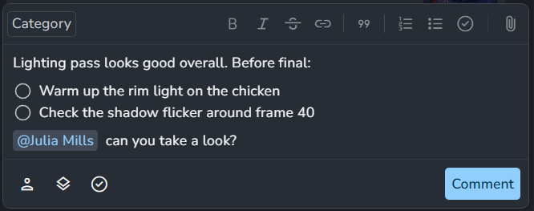
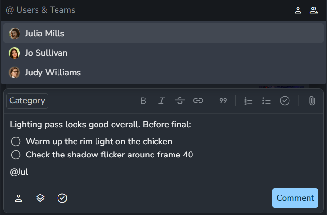
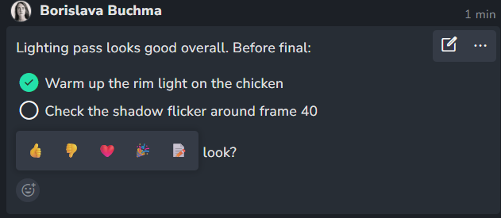
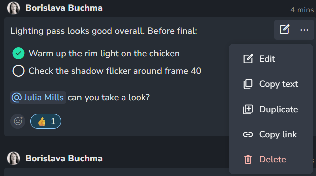
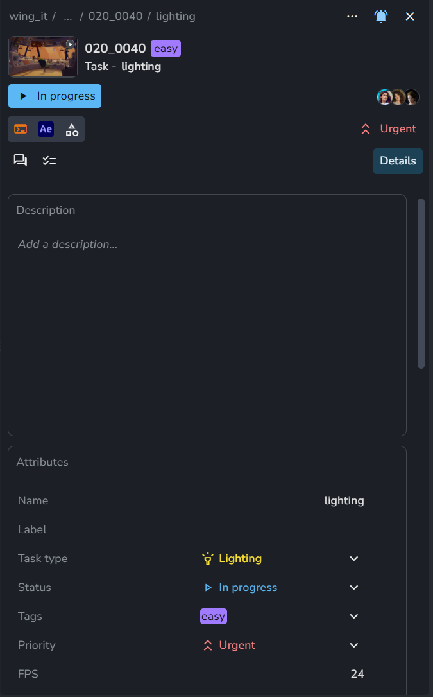
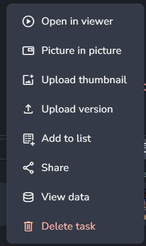
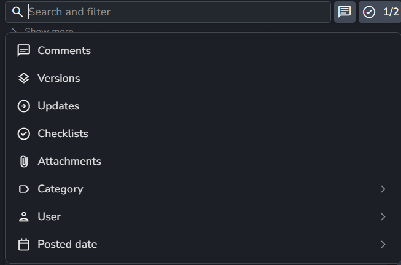

# Details panel

<PageInfo />

The details panel is the side panel that opens when a folder, task, version or representation is selected. It shows the main fields of the selection, lets users change them, and holds the comments and activity of the entity, so it is the shared place to talk about a piece of work. The same panel appears on the project pages, on [Home tasks](home/tasks.md), in the [Inbox](inbox/index.md) and next to the player in the [web viewer](web-viewer.md); only the pages around it differ.

## Panel and feed

### Where it appears

| Page | Opens with |
|---|---|
| [Overview](production-tracking/overview.md), [Task progress](production-tracking/task-progress.md), [Products](production-tracking/products.md), [Browser](production-tracking/browser.md) | Selecting a row, card or cell |
| [Lists](production-tracking/lists.md) | Selecting a list item. The list itself has a separate panel. |
| [Home tasks](home/tasks.md) | Double-click on a task |
| [Inbox](inbox/index.md) | Selecting a message |
| [Web viewer](web-viewer.md) | Always open next to the player, for the version being watched |
| Addon pages | When the addon uses it |

A shared link or an `ayon+entity://` URI typed in the [URI bar](app-header.md#uri-bar) also opens the panel on that entity. The **Projects** page of Home has its own project panel, which is not described here.

### Header

| Element | What it shows or does |
|---|---|
| Path | The project and parents of the entity. |
| Thumbnail | The entity thumbnail. With exactly one entity shown, a click opens the [web viewer](web-viewer.md). An entity with reviewables shows a play badge, and moving the mouse over the thumbnail scrubs through the reviewable. |
| Title and subtitle | Depends on the entity: a folder shows its name and folder type; a task shows its folder and below it **Task -** and the task name; a version shows its product and **Version -** and the version name, plus a **Task** row that opens the task; a representation shows its version and the representation name. |
| Tags | The tags of the entity. New tags are added to the project anatomy. |
| Status | Shows and changes the status. The statuses depend on the project and the entity type. |
| Assignees | For tasks, the assigned users, editable. For versions, the author, read-only. |
| Web actions | Actions for the entity, such as launching an application through the AYON launcher. |
| Priority | The priority of the entity, if the project has a priority attribute for it. |
| Tabs | See [Tabs](#tabs). |

With several entities selected, the title reads for example **3 tasks** and the subtitle lists their names. A change to status, priority, tags or assignees then applies to all of them. With entities of several projects selected, commenting is disabled.

Files dropped on the header can be used as a new thumbnail (**Upload thumbnail**) or as a new version (**Upload version**).

### Tabs

| Tab | Button | Shown for | Content |
|---|---|---|---|
| Activity feed | Speech bubble icon, tooltip **Activity Feed** | Folders, tasks, versions | Comments and activity, see [Activity feed](#activity-feed). |
| Subtasks | Checklist icon, tooltip **Subtasks** | Tasks | The task's subtasks, see [Subtasks](../../production-tracking/subtasks.md). |
| Addon tabs | The addon's icon | Entity types the addon chooses | Content added by an addon. |
| Version files | Playlist icon, tooltip **Version files** | Versions | **Reviewables** and **Representations** of the version, see [Reviewables](../../production-tracking/reviewables.md). |
| **Details** | Text button | All | Description and attributes, see [Details tab](#details-tab). |

When the next selected entity does not have the open tab, the panel switches to the activity feed, or to **Details** for a representation.

### Activity feed

The activity feed is the timeline of an entity: comments, status changes, assignee changes, attribute, tag and type changes, published versions and version reviews (**approved this** or **requested changes**). Folders, tasks and versions have a feed; products and representations do not.

- A published version shows its product, version name, status and thumbnail. Selecting it opens the version in a [slide-out panel](#slide-out-panel).
- Runs of more than two small changes in a row (status, assignee, attribute, tag or type changes) are folded into one item that can be expanded. Several published versions in a row are folded behind **Show more**.
- Activities also appear on related entities: a comment on a version is shown in the feed of its task, and a version published for a task appears in that task's feed. Comments on a task are not shown in the feeds of its versions.
- A single folder's feed starts with a line saying when and by whom the folder was created.

### Comments

<Columns widths="55 45">
<Column>

The comment box at the bottom of the feed reads **Leave a comment**. Clicking it opens the editor, which stores the comment as Markdown.

- **Formatting:** the toolbar above the text has bold, italic, strikethrough, link, quote, numbered list, bullet list and checklist, and an attach button. The category selector sits at its left, see [Comment categories](#comment-categories).
- **Slash menu:** typing `/` offers **Heading 1** to **Heading 3**, **Bullet list**, **Numbered list**, **Checklist**, **Quote**, **Code block**, **Inline code**, **YouTube video**, **Image or video**, **Attachment** and **Mention user**, **Mention version**, **Mention task**. In the web viewer it also offers frame links.
- **Emoji:** typing `:` and a short name inserts an emoji.
- **Buttons below the text:** mention a user, a version or a task, link to the current frame (in the web viewer), and **Comment**. While editing a comment, **Save** and **Cancel**.
- **Keys:** `Ctrl`/`Cmd` + `Enter` posts the comment, `Escape` closes the editor. An unsent comment is kept as a draft in the browser.

</Column>
<Column>

</Column>
</Columns>

#### Mentions

<Columns widths="55 45">
<Column>

| Type | Mentions | Suggestions |
|---|---|---|
| `@` | Users and [teams](project/teams.md) of the project. `user:` or `team:` before the text limits the list to one kind. | Project users and teams |
| `@@` | Versions | Versions related to the entity, latest first. Not available on folders. |
| `@@@` | Tasks | For a task, the other tasks of the same folder |

A mention notifies the mentioned users and shows the comment in the feed of the mentioned version or task. Guests cannot mention.

</Column>
<Column>

</Column>
</Columns>

#### Checklists, attachments and frame links

- **Checklists:** everyone who can see a comment can check and uncheck its items; only the author can change their text. The **Checklists** button at the top of the feed shows the progress, for example `1/2`. Checking items does not change the task status.
- **Attachments:** files are added with the attach button, by dragging them onto the editor or by pasting them. Images are previewed in the feed.
- **Frame links:** a comment on a single version can carry a frame number or a frame range. In the [web viewer](web-viewer.md), the comment shows the frame as a chip, and clicking it jumps to that frame.

#### Reactions

<Columns widths="55 45">
<Column>

The smiley button below a comment adds a reaction from a fixed set of five: thumbs up, thumbs down, heart, celebration and notes. Reactions show their count and do not send notifications.

</Column>
<Column>

</Column>
</Columns>

#### Comment menu

<Columns widths="55 45">
<Column>

The edit button and the `...` button appear when hovering a comment.

| Entry | Shown to |
|---|---|
| **Edit** | The author and admins |
| **Copy text** | Everyone, when the comment has text |
| **Duplicate** | Everyone who can comment. Copies the comment into a new one. |
| **Copy link** | Everyone. Copies a link that opens the entity at this comment. |
| **Delete** | The author and admins, after a confirmation |

</Column>
<Column>

</Column>
</Columns>

### Details tab

| Section | Content |
|---|---|
| **Description** | The description of the entity, with mentions. Empty, it reads **Add a description...**; a click opens an editor with **Save** and **Cancel**. |
| **Attributes** | Name, Label, Folder type or Task type, Status, Tags, and every attribute that applies to the entity type, see [Attributes](studio/attributes.md). |
| **Details** | Read-only: ID, Entity Type, Project Name, Path, Created at, Created by, Updated at, Updated by. Each row has a copy button. |

- With several entities selected, differing values show **Multiple values**.
- The folder type of a folder that has published versions is locked.
- For versions, only the status, the tags and attributes that are not built in can be changed.
- Attributes the user's access group cannot read are hidden; attributes it cannot write are read-only (see [Users](studio/users.md)).

### Watchers

The bell button at the top of the panel, tooltip **Watchers**, lists the users who get notifications for the entity. Users can be added or removed for all selected entities at once; each entity keeps its other watchers. Guests cannot change watchers. How watching and notifications work is described in [Inbox](inbox/index.md).

### Newer version notice

In the [Inbox](inbox/index.md), a panel showing an older version reads **A newer version (vNNN) exists.**, with a button to go to it.

## Controls and interactions

### More actions menu

<Columns widths="60 40">
<Column>

The `...` button at the top of the panel, tooltip **More actions**, opens this menu.

| Entry | Shown when | What it does |
|---|---|---|
| **Open in viewer** | A folder, task or version is shown, on pages that have the viewer | Opens the [web viewer](web-viewer.md) on the entity. |
| **Picture in picture** | Always | Opens the panel in a floating window, see [Picture in picture](#picture-in-picture). |
| **Upload thumbnail** | Always | Sets a chosen image as the thumbnail. |
| **Upload version** | One entity that is not a representation, on the project pages and in the Inbox | Opens the [Upload version](dialogs/upload-version.md) dialog. |
| **Add to list** | Pages that have lists | Adds the selection to a [list](production-tracking/lists.md). |
| **Add to session** | Versions or representations, with the Review addon | Adds them to a review session. Disabled with **No reviewables on selected version** when none has reviewables. |
| **Share** | Always | Shows a **Link** and a **Markdown Link** to the entity, each with a copy button. |
| **View data** | Always | Shows the raw data of the entity. |
| **Delete task**, **Delete 3 tasks**, ... | Always | Deletes the selection after a confirmation. |

Addons can add entries of their own, and can pin them as buttons next to `...`.

</Column>
<Column>

</Column>
</Columns>

### Feed filter

<Columns widths="55 45">
<Column>

The **Search and filter** field at the top of the feed searches the comment text and adds filters:

| Filter | Shows |
|---|---|
| **Comments** | Comments |
| **Versions** | Published versions |
| **Updates** | Status, assignee, attribute, tag and type changes, without folding |
| **Checklists** | Comments with checklist items |
| **Attachments** | Comments with attached files |
| **Review session** | Activity from review sessions. Folders and versions only. |
| **Category** | Comments of a comment category, or with **No category** |
| **User** | Activity by or assigned to a user |
| **Posted date** | Activity in a date range |

The two buttons to the right of the field are quick filters for comments and checklists. While a filter that excludes comments is active, the comment box is hidden.

</Column>
<Column>

</Column>
</Columns>

### Keyboard

| Key | Action |
|---|---|
| `Escape` | Closes the panel, or the slide-out panel when one is open. Ignored while typing in a field. The panel in the web viewer has no close button. |
| `Ctrl`/`Cmd` + `Enter` | Posts the comment being written |

See [Keyboard shortcuts](quick-navigation.md#keyboard-shortcuts) for the shortcuts of the pages.

### Slide-out panel

Opening an entity from inside the panel, such as a published version in the feed, a mentioned version or task, or the **Task** row of a version, opens a second panel that slides out next to the first. It closes with `Escape` or when the main panel shows another entity.

### Picture in picture

**Picture in picture** keeps the panel open in a small window while moving to other pages. Where the browser supports it, this is a separate always-on-top window; otherwise a floating panel on the right of the page. It shows the thumbnail, title, status, assignees and the feed.

## Power features

These features need the [Power Pack](../../addons/production-tracking/power-pack/index.md) and a license.

### Comment categories

A comment category limits who can see a comment. The **Category** selector in the editor lists **No category** and the categories the user may write in. A categorized comment is highlighted in the category color, and users without access to the category do not see it at all.

- The selector is shown to admins and to users who may write in at least one category. Guests never see it.
- Categories and their access lists are set in the Power Pack settings. Without the Power Pack, the selector is shown disabled with the tooltip **Comment categories is a Powerpack feature**.

## Related

- [Web viewer](web-viewer.md)
- [Upload version](dialogs/upload-version.md)
- [Inbox](inbox/index.md)
- [Subtasks](../../production-tracking/subtasks.md)
- [Reviewables](../../production-tracking/reviewables.md)
- [Links manager](links-manager.md)
