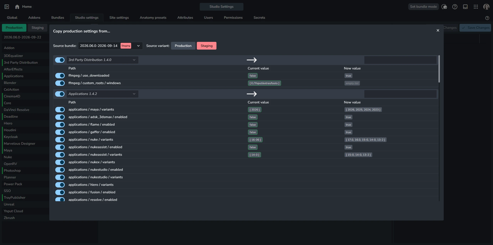
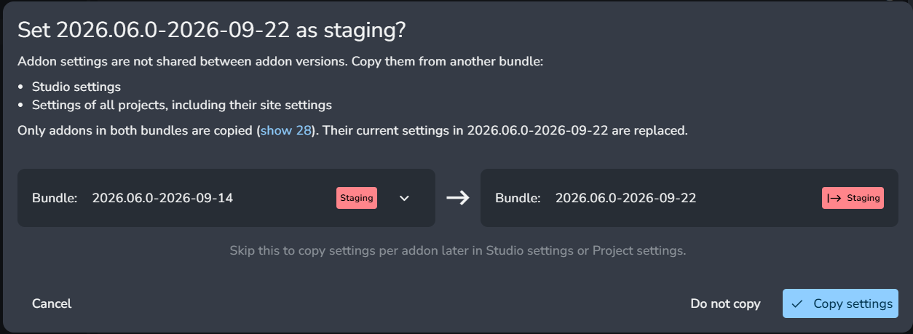
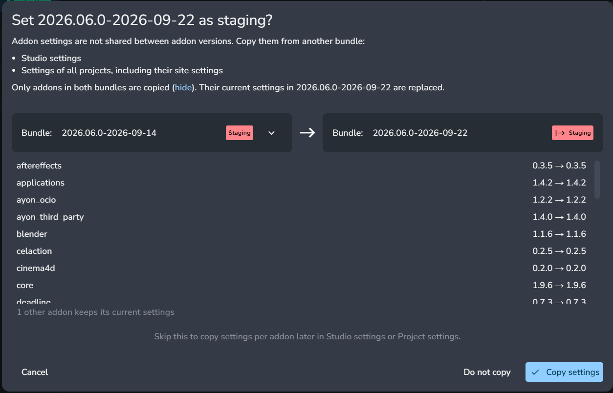

# Copy settings

<PageInfo />

Addon settings are stored per addon version and variant, so a new addon version does not see the values of the previous one (see [Settings](../../how-ayon-works/settings.md)). The web app has two dialogs that copy values across addon versions, variants, bundles and projects: the [settings copy dialog](#settings-copy-dialog) of [Studio settings](../studio/studio-settings.md) and [Project settings](../project/project-settings.md) compares the values one by one and loads the chosen ones into the editor, and the [bundle dialog](#bundle-state-dialog) of [Bundles](../studio/bundles.md) copies all settings of the shared addons from one bundle to another at once.

## Dialogs

### Settings copy dialog

The dialog is titled **Copy &lt;variant&gt; settings from...** on Studio settings and **Copy &lt;project&gt; &lt;variant&gt; settings from...** on Project settings, where the variant is `production`, `staging` or the name of a dev bundle. It covers most of the window. The close button discards the comparison.

Toolbar:

| Control | What it does |
|---|---|
| **Source bundle:** | Dropdown of bundles, with badges for **Production**, **Staging** and, in developer mode, **Dev** (**Active** on the user's own dev bundle). Dev bundles are listed in developer mode only; when the source variant is a dev bundle, only dev bundles are listed. Choosing a bundle also sets the source variant to the state of that bundle, or to production for a bundle without a state. Preselected with the bundle that holds the target variant. |
| **Source variant:** | **Production**, **Staging** and, in developer mode, **Dev**. Choosing one also selects the bundle that holds that state. **Dev** without a dev bundle of the user gives **No dev bundle found for your user. Please create one first.** |
| **Source project:** | Project settings only. Dropdown of the active projects, preselected with the current project. |

**LOADING...** covers the panels while values are read. Then each addon has a panel: the source, an arrow and the target, with a change table under it.

| Panel header | Content |
|---|---|
| Switch | Includes the addon in the copy. Available only when the addon has changes. |
| Source version | Dropdown of the installed versions of the addon, newest first, labelled `<addon title> <version>`. |
| Source project | Project settings only: the source project. |
| Arrow or message | An arrow when there are changes. Otherwise **cannot copy from itself** (same version, variant and project), **no overrides to copy**, or **Nothing to copy**. |
| Target version | The addon version being edited. Read-only. |

| Change table | Content |
|---|---|
| Switch | Includes the change. Changes are switched on by default; a change whose structure does not fit the target field is switched off and cannot be switched on. |
| **Path** | The field address, as `group / field`. |
| **Current value** | The value in the editor now. |
| **New value** | The value that would be copied. |

Values are colored by the override level they come from (see [Override states in the editor](../../how-ayon-works/settings.md#override-states-in-the-editor)). Booleans read `true` or `false`, simple lists `[ a, b ]`, and lists of named items show their names. Other values read **no value**, **empty list**, **[ complex list ]** or **[ complex object ]**; hovering a complex value shows it as JSON.

**Copy selected settings** loads the switched-on changes into the editor as unsaved changes, closes the dialog and shows **Settings copied**. It is disabled when no change is switched on. Nothing is stored until **Save Changes**; **Clear Changes** discards the copy. Where the copied value comes from a lower level (a default copied into a studio field, or a studio or default value copied into a project field), the target override is removed on save, and the changes list marks the path `(unpin)`.

#### Which fields are compared

| Rule | Effect |
|---|---|
| Overrides only | A field is listed when it has an override in the source or in the target. Fields that both take from the defaults are not compared. |
| Scope | On Studio settings only studio-scoped fields are listed; on Project settings only project-scoped fields. |
| Groups and lists | A group or a list is listed as one entry; the fields inside it are not listed one by one. |
| Equal values | A field with the same value at the same override level on both sides is not listed. The same value at a different level is listed. |
| Versions | Source values are converted to the model of the target version before the comparison. |

### Compare two variants or projects

The settings copy dialog doubles as a comparison tool: choosing the staging bundle as source on the production variant lists every studio override that differs between the two, field by field, without changing anything until **Copy selected settings** and **Save Changes**. On Project settings, choosing another project as **Source project:** shows how two projects differ.

### Bundle state dialog

The Bundles page opens this dialog when a state is set on a bundle and another bundle exists to copy from, and from **Copy settings from...** in the bundle right-click menu.

| Opened by | Title | Buttons |
|---|---|---|
| Setting Production, Staging or Dev on a bundle | **Set &lt;bundle&gt; as &lt;state&gt;?** | **Cancel** (the state is not set), **Do not copy** (sets the state without copying), **Copy settings** (sets the state, then copies) |
| **Copy settings from...** | **Copy settings into &lt;bundle&gt;?** | **Do not copy** (closes the dialog), **Copy settings** |

When no other bundle holds Production, Staging or (in developer mode) Dev, setting a state applies at once without the dialog. **Copy settings from...** is disabled for bundles without a state, for a bundle that holds both Production and Staging, with several bundles selected, and for a Production bundle when no Staging bundle exists (or a Staging bundle when no Production bundle exists), unless dev bundles exist in developer mode.

The dialog reads **Addon settings are not shared between addon versions. Copy them from another bundle:** followed by **Studio settings** and **Settings of all projects, including their site settings**, and **Only addons in both bundles are copied (show &lt;n&gt;). Their current settings in &lt;bundle&gt; are replaced.**

| Element | Content |
|---|---|
| Source card | **Bundle:** with a dropdown of the source bundles and their state badges. |
| Arrow | Points from source to target. |
| Target card | **Bundle:** with the target bundle and a badge of the state being set (or the states it holds, from **Copy settings from...**). |
| **show &lt;n&gt;** | Lists the addons that will be copied, with the source and target version, for example `core 1.9.6 → 1.9.6`, and how many other addons keep their current settings. **hide** closes the list. |
| Note | **Skip this to copy settings per addon later in Studio settings or Project settings.** |

Clicking outside the dialog does not close it. Results are reported as **Settings copied from &lt;bundle&gt; successfully** or **Failed to copy settings: &lt;message&gt;**.

| Source dropdown | Rule |
|---|---|
| Listed bundles | Bundles that hold Production or Staging, and in developer mode Dev bundles. Each entry is one bundle and one state; a bundle that holds both Production and Staging is listed twice. |
| Excluded | The target bundle with the state that is being set (or, from **Copy settings from...**, with the states it holds). |
| Previous holder | When Production or Staging is being set, the bundle that holds that state now is listed with its badge struck through. |
| Default source | When Production or Staging is being set and another bundle holds it: that bundle, with the same variant. Otherwise the Production bundle, unless it is the target for production; then the Staging bundle, unless it is the target for staging; then, in developer mode, the first dev bundle. |

#### What is copied

The copy runs on the server for every addon that has a version in both bundles and is installed in both versions. Addons that exist in only one of the bundles keep their settings.

| Settings | Effect on the target |
|---|---|
| Studio settings | The studio overrides of the source variant, converted to the target version, replace the studio overrides of the target variant. When the source has none, the target overrides are removed. |
| Project settings | The same, for every project. |
| Project site settings | For every project, site and user, the site overrides of the source version replace those of the target version. They have no variant. |
| Studio site settings | Not copied. |

The variants are `production` or `staging`, or the dev bundle's name for a Dev source or target. Every changed or removed override creates a `settings.changed` event (see [Event Viewer](../event-viewer.md)).

### Check which addons a bundle copy touches

**show &lt;n&gt;** in the bundle dialog lists each addon that will be copied with its source and target version, so a copy between bundles with different addon versions can be checked before it runs.

## Controls and interactions

### Where it opens

| Opens from | Control | Who sees it |
|---|---|---|
| Studio settings, addon list toolbar | Copy settings button (tooltip **Copy settings from another bundle**) | Managers and admins |
| Studio settings, addon list right-click menu | **Copy settings from...** | Managers and admins |
| Project settings, addon list toolbar | Copy settings button (tooltip **Copy settings from another bundle**) | Users who can open the project settings |
| Project settings, addon list right-click menu | **Copy settings from...** | Users who can open the project settings |
| Bundles, detail toolbar | **Set Production**, **Set Staging** | Admins |
| Bundles, right-click menu | **Set production**, **Set staging**, **Set dev** (developer mode) | Admins |
| Bundles, right-click menu | **Copy settings from...** | Admins |

The copy settings button is disabled while the editor has unsaved changes and when no bundle holds the selected variant. The right-click entry of the addon list acts on the selected addons, or on the clicked addon when it is not selected.

### Button or right-click entry

The two entry points of the settings copy dialog differ:

| | Copy settings button | **Copy settings from...** |
|---|---|---|
| Addons | Every addon of the addon list. | The selected addons. |
| **Source bundle:** | Can be changed. | Can be changed only when the source variant is a dev bundle. |
| Source version of each addon | The version in the source bundle, fixed unless the source is a dev bundle. | Preset to the version in the source bundle, and can be changed to any installed version. |
| Addons without anything to copy | Hidden, unless the source is a dev bundle. | Shown with a message. |

With a dev bundle as the source, addons that are not part of that bundle are not shown.

### Saving the copied values

The settings copy dialog only fills the editor; saving needs the right to save the page: managers and admins on [Studio settings](../studio/studio-settings.md), and on [Project settings](../project/project-settings.md#changes-and-saving) the users whose access allows it. The bundle dialog writes the settings itself and is available to admins only.

## Related

- [Settings](../../how-ayon-works/settings.md)
- [Studio settings](../studio/studio-settings.md)
- [Project settings](../project/project-settings.md)
- [Bundles](../studio/bundles.md)
- [Bundles in How AYON works](../../how-ayon-works/bundles.md)
- [Install pipeline release](install-pipeline-release.md)
