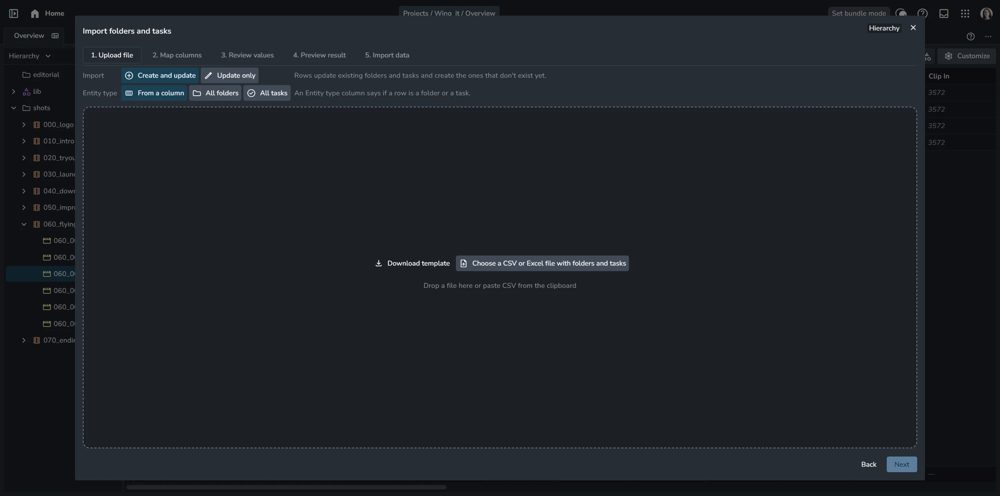
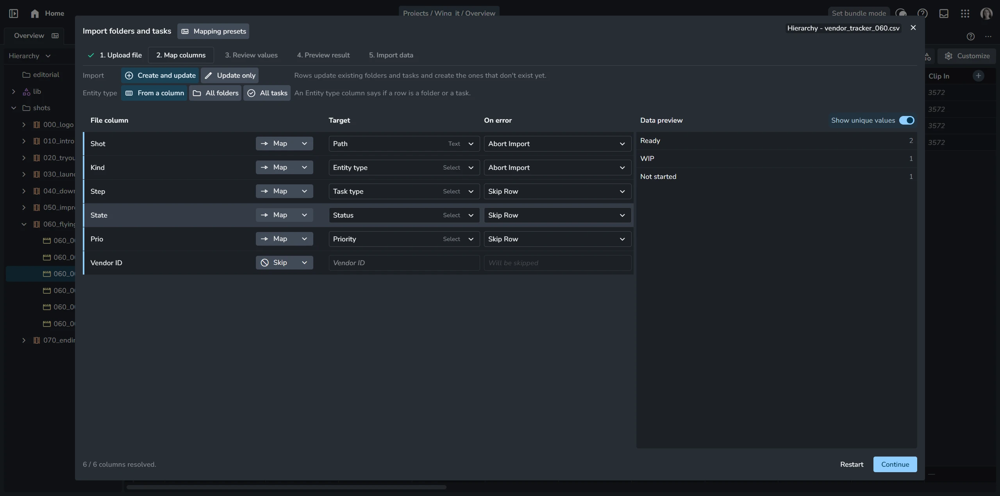
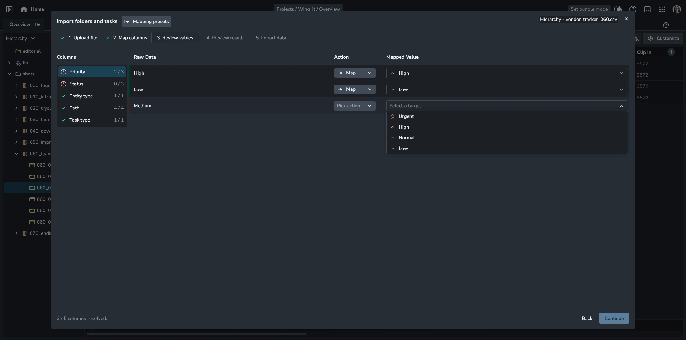
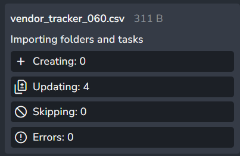

# Import CSV

<PageInfo />

The import dialog creates or updates folders and tasks, list items and users in bulk from a CSV file, a sheet of an Excel file, or cells pasted from a spreadsheet. The columns of the file do not have to match the AYON names: each column and each value is mapped to an AYON field in the dialog, so exports from other production trackers or vendor spreadsheets can be used as they are. Every import is checked by the AYON server and previewed before anything is written. Exporting the same tables is described on [Project overview](../production-tracking/overview.md), [Lists](../production-tracking/lists.md) and [Users](../studio/users.md).

## Import stages

The dialog title is **Import &lt;items&gt;**, for example **Import folders and tasks**, followed by **into &lt;list&gt;** when it imports into a list. The top right shows the kind of import (**Hierarchy**, **List items** or **Users**) and the loaded file, with the sheet name for an Excel file.

The stage bar shows **1. Upload file**, **2. Map columns**, **3. Review values**, **4. Preview result** and **5. Import data**. A finished stage shows a check mark; stages that are not reachable yet are disabled. After the import starts, the earlier stages are locked.

### Import options

The options above the content are shown during **Upload file** and **Map columns**.

| Option | Choices | Shown for |
|---|---|---|
| **Import** | **Create and update**: rows update existing entities and create the missing ones. **Update only**: rows only update existing entities; rows that match nothing are skipped. | Folders and tasks, users, list items imported into an existing list |
| **New list** | Name of the list to create. Filled with the file name; pasted data gives **Imported list**. | List items without a selected list |
| **List of** | **Folders**, **Tasks**, **Products** or **Versions**: the entity type of the new list. | List items without a selected list |
| **Values** | Without the Power Pack, a list import writes its values to the listed entities themselves, see [List values](#list-values). | List items, without the Power Pack |
| **Entity type** | **From a column**: an **Entity type** column says whether a row is a folder or a task. **All folders** or **All tasks**: every row is of that type and no entity type column is needed. In **Update only** without an entity type column, rows take the type of what they match. | Folders and tasks |
| **Same name** | What happens when a name matches several entities and no path or id tells them apart: **Skip the row**, or **Update all of them** (**Use all of them** for lists). | List items; folders and tasks in **Update only** |

Changing an option after the columns were mapped keeps the mapping where it still fits and maps the remaining columns again.

### 1. Upload file

| Element | Description |
|---|---|
| Drop area | Takes a `.csv` or `.xlsx` file dropped on it (**Drop a file here or paste CSV from the clipboard**). Pasting with `Ctrl+V` or `Cmd+V` also works, for example cells copied from a spreadsheet. |
| **Choose a CSV or Excel file with &lt;items&gt;** | Opens a file picker. |
| **Download template** | Downloads a CSV with the expected columns for the import kind and the **Import** option. |
| File summary | After loading: file name and size, **&lt;n&gt; columns found** and **&lt;n&gt; rows found**, and **Sheet: &lt;name&gt;** for an Excel file. The close button removes the file. |
| **Back**, **Next** | **Back** closes the dialog. **Next** is enabled once a file is loaded. |

An Excel file is read in the browser. With several sheets, the dialog asks **Which sheet do you want to import?** and lists each sheet with its number of rows; empty sheets are left out. The button next to **Sheet:** picks a different sheet later. The data is sent to the AYON server as CSV and kept there for 30 minutes. A file that cannot be read shows **Could not parse this file: &lt;message&gt;**.

### 2. Map columns

Each column of the file is a row of the table.

| Column | Description |
|---|---|
| **File column** | The column header from the file. A coloured bar marks its state: red for unresolved, another colour for mapped or skipped. |
| Action | **Map** or **Skip**. A skipped column is left out of the import, for example an id from another system. |
| **Target** | The AYON field the column is mapped to, with its data type, picked from a searchable list. Unmapped required fields are marked **(required)**, or **(required, or &lt;other field&gt;)** when one of several fields is enough. A field that is already used shows **mapped to "&lt;column&gt;"**; choosing it again asks to move the mapping. |
| **On error** | What happens when a value cannot be imported: **Skip Row**, **Set to default value** or **Abort Import**. The choices depend on the field; a required field has no default and starts with **Abort Import**. |

| Element | Description |
|---|---|
| Automatic mapping | A column is mapped when its header equals the key or the label of a field, ignoring case, an `attrib.` or `data.` prefix, underscores, dots, asterisks and spaces. A `subtype` column maps to the folder or task type. |
| Selection | Clicking rows selects them; `Ctrl+click` and `Shift+click` select several. **Map** or **Skip** on a selected row applies to the whole selection. |
| **Data preview** | The values of the hovered or selected column. **Show unique values** lists each distinct value once, with its count. |
| Footer | **&lt;n&gt; / &lt;m&gt; columns resolved.** and the required fields that still need a column. When the missing fields are only needed to create entities, **Switch to Update only** changes the **Import** option. |
| **Restart**, **Continue** | **Restart** returns to **Upload file**. **Continue** is enabled when every column is mapped or skipped and every required field is mapped. |

### 3. Review values

The **Columns** list on the left shows the target field of each mapped column, with a check mark or an error icon and the number of resolved values out of its distinct values. The table shows the values of the selected column.

| Column | Description |
|---|---|
| **Raw Data** | A distinct value of the file. **(empty)** stands for empty cells. With selected rows, the header shows how many are selected. |
| **Action** | **Map**, **Create** or **Skip**, depending on the field (see below). Applies to all selected rows. |
| **Mapped Value** | The AYON value: a dropdown for fields with a fixed set of values, a text field for free values, or a **Yes** / **No** switch for true or false fields. |

| Action | Description |
|---|---|
| **Map** | Maps the source value to an existing value of the project, for example `WIP` to **In progress** or `Medium` to **Normal**. Values that equal an existing value or label are mapped automatically. |
| **Create** | For fields with a fixed set of values, adds the value to the project, for example a new task status. Not offered for fields whose values cannot be created, such as **Entity type** and **Comment category**. For free fields such as names, numbers and dates, the value is imported as shown in **Mapped Value**, where it can be edited. |
| **Skip** | Leaves the value out. |

Other rules:

- True or false fields recognize `true`, `yes`, `1`, `on` and `false`, `no`, `0`, `off`; other values are skipped.
- Dates are converted to ISO dates. When the values can be read both ways, a **Day and month order** bar with **Day first** and **Month first** sets the order. Dates from Excel cells are read as dates.
- Values of **Folder type**, **Task type** and **Folder or Task type** can only be reviewed after the values of **Entity type** are mapped, because the offered types depend on it.

Footer: **&lt;n&gt; / &lt;m&gt; columns resolved.**, **Back** and **Continue**.

### 4. Preview result

<Columns widths="65 35">
<Column>

The AYON server runs the whole import without writing anything and shows a progress bar while it checks the rows. The result lists counters under the file name, with the subtitle **Importing &lt;items&gt;** or **Updating existing &lt;items&gt;**.

| Counter | Meaning |
|---|---|
| **Creating** | Rows that create a new entity. |
| **Updating** | Rows that update an existing entity. |
| **Comments** | Comments that would be added. Shown when the file has a comment column. |
| **Skipping** | Rows left out on purpose, for example rows with nothing to update or, in **Update only**, rows that match nothing. The tooltip lists the rows and reasons. |
| **Errors** | Rows with data that cannot be imported. The tooltip lists the rows and reasons. |

**Back** returns to **Review values**. **Import data** starts the import. When the check fails, the stage shows **The import could not be validated**.

</Column>
<Column>

</Column>
</Columns>

### 5. Import data

Shows a progress bar during the import, then **Import finished** with the same counters (**Created**, **Updated**, **Comments**, **Skipped**, **Errors**). **Open the new list** opens a list the import created. **Close** closes the dialog. When the import fails, the stage shows **Import failed**.

### Columns of each import kind

#### Folders and tasks

Folders and tasks are in the same file; each row is one folder or one task.

| Column | Required | Description |
|---|---|---|
| **Path** (`path`) | With **Create and update** | Path of the folder, or of the task including its folder. With **Update only**, **Path** or **Name** is required. |
| **Entity type** (`entity_type`) | With **Create and update** and **From a column** | `folder` or `task`. Source values such as an object type of another system are mapped in **Review values**. |
| **Folder or Task type** (`folder_or_task_type`) | No | One column for the folder type and the task type. Alternatively the types are in separate `folder_type` and `task_type` columns. |
| **Name**, **Label**, **Status**, **Tags**, **Active**, **Id** | No | Fields of folders and tasks. |
| Attributes (`attrib.<name>`) | No | Any attribute of folders or tasks, for example `attrib.priority`. |
| **Comment** (`comment`) | No | Adds a comment with this text to the folder or task after the import. |
| **Comment category** (`comment_category`) | No | Category of that comment. Offered when the project has comment categories. |

A task without a task type gets the first task type of the project. The template for **Create and update** has the columns `path`, `entity_type`, `folder_type`, `task_type`, `status` and `attrib.priority`; the template for **Update only** has `name`, `status`, `attrib.frameStart`, `attrib.frameEnd`, `comment` and `comment_category`.

#### List items

| Column | Required | Description |
|---|---|---|
| **Entity Id** (`entity_id`) | One of the three | Id of the entity to list. |
| **Entity path** (`folder_path`) | One of the three | Path of the folder or task to list. |
| **Entity name** (`name`) | One of the three | Name of the entity to list. |
| List attributes, attributes and fields of the listed entities | No | The attributes of the list, and the fields and attributes of its entity type. Fields such as status, tags or assignees are offered only when the values are written to the listed entities. |
| **Comment**, **Comment category** | No | A comment on the listed entity. |

The template has the columns `folder_path` and `entity_id`.

#### Users

| Column | Required | Description |
|---|---|---|
| **Name** (`name`) | Yes | User name. |
| Attributes (`attrib.<name>`) | No | User attributes such as `attrib.fullName` and `attrib.email`. |
| **Admin**, **Developer** (`data.isAdmin`, `data.isDeveloper`) | No | Access flags. Default `False`. |
| Active (`active`) | No | Whether the user can log in. Applied only to users the import creates. |

A user created by the import gets the user name as password. The template has the columns `name`, `attrib.fullName`, `attrib.email`, `data.isAdmin` and `active`.

### Rights for each import kind

| Import | Who can run it |
|---|---|
| Users | Admins. Managers see the menu entry on the **Users** tab, but the AYON server rejects their import. |
| Folders and tasks, list items | Managers and admins, and users whose access group restricts neither creating entities nor writing attributes in the project. List items also need the right to change the list. |

### Existing entities

| Import | Matched by |
|---|---|
| Folders and tasks, **Create and update** | Id or path. A matching row updates the entity instead of creating a second one. |
| Folders and tasks, **Update only** | Path, or name when there is no path. See **Same name** in [Import options](#import-options). |
| Users | User name. |
| List items | Entity id, path or name. An entity that is already in the list is updated, not added twice. |

A folder, task or user row whose values equal the existing entity is skipped with the reason **Nothing to update**.

### Update statuses from a spreadsheet

With **Update only**, a file needs only the path or name and the columns to change, for example the status and priority columns of a vendor's tracker. New statuses that do not exist in the project can be added with **Create** in **Review values**, and the preview shows how many rows will change before anything is written.

## Controls and interactions

### Where it opens

| Opens from | Control | Imports | Shown to |
|---|---|---|---|
| [Project overview](../production-tracking/overview.md), toolbar | **Import / Export**, **Import** | Folders and tasks | Users who can open the project |
| [Lists](../production-tracking/lists.md), toolbar of the selected list | **Import / Export**, **Import** | Items into the selected list | Users who can open the project |
| Lists, menu of the lists panel | **Create list from CSV** | Items into a new list | Users who can open the project |
| Lists, right-click menu of a list folder | **Create list from CSV** | Items into a new list in that folder | Users who can open the project |
| Lists, empty list area (**Start by selecting or importing a list.**) | **Import** | Items into a new list | Users who can open the project |
| [Users](../studio/users.md), toolbar | **Import / Export**, **Import** | Users | Managers and admins |

The close button at the top right closes the dialog at any stage before the import.

## Power features

These features need the [Power Pack](../../../addons/production-tracking/power-pack/index.md) and a license, see [Power features](../../../production-tracking/power-features.md).

### Mapping presets

The column and value mappings of an import can be saved as a preset, for repeated imports from the same source, such as a weekly vendor delivery or an export of another tracker. Presets use the same mechanism as [views](../views.md), separately for each import kind. The **Mapping presets** button appears next to the title during **Map columns** and **Review values**.

| Entry | Description |
|---|---|
| **Mapping presets** (button) | Opens the preset menu. Shows the name of the selected preset instead when one is selected. |
| **Working preset** (**Personal preset** without the Power Pack) | The current mapping, kept without a name. |
| **My presets**, **Shared presets** | Saved presets. |
| **Default preset** | **Studio** and **Project** defaults. Shown to admins. |
| **Create new preset** | Saves the current mapping as a preset. |

Creating and sharing presets and the project default need the Power Pack. Without it, **Create new preset** opens the Power Pack dialog.

### List values

With the Power Pack, a list import writes its values to the list items, so each list keeps its own values and the entities stay unchanged. List items hold only attributes, so entity fields such as label, status, tags and assignees are offered as columns only when the values go to the entities. Without the Power Pack, the **Values** option says that values are saved to the entities themselves, and its **List values** button opens the Power Pack dialog.

## Related

- [Project overview](../production-tracking/overview.md)
- [Lists](../production-tracking/lists.md)
- [Users](../studio/users.md)
- [Attributes](../studio/attributes.md)
- [Views](../views.md)
- [Power features](../../../production-tracking/power-features.md)
