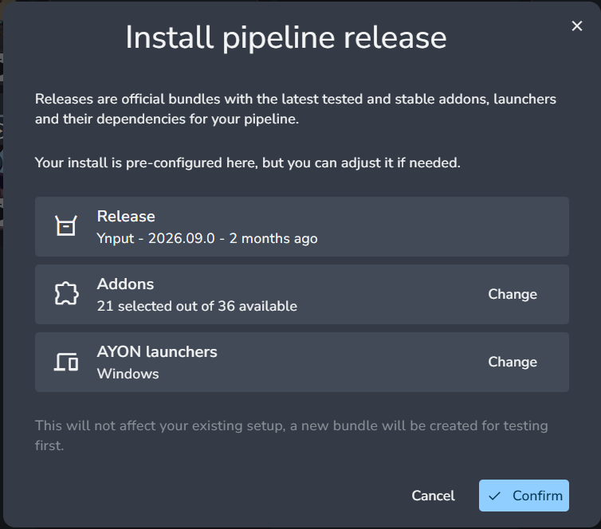
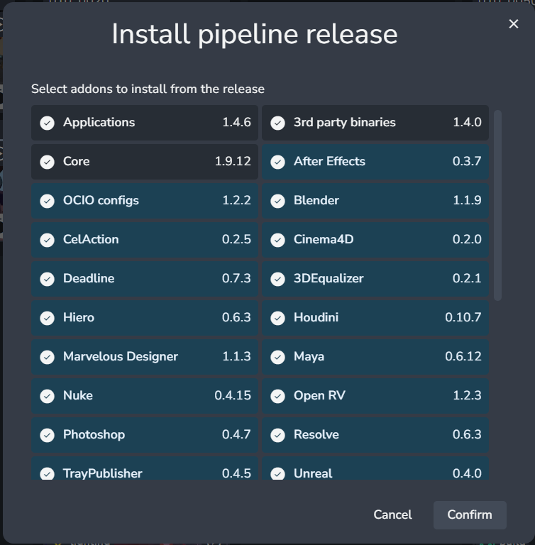
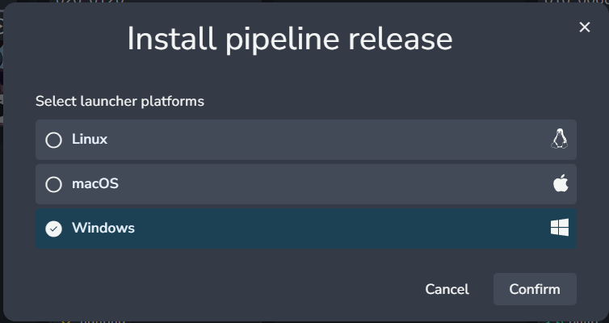

# Install pipeline release

<PageInfo />

A pipeline release is an official set of tested addons, AYON launchers and dependency packages, published by Ynput on Ynput Cloud. The **Install pipeline release** dialog downloads one release to the server and creates a new [bundle](../studio/bundles.md) from it, without changing the bundles in use. The release catalog itself is browsed in the [Market](../market.md); how bundles are used once they exist is explained in [Bundles](../../how-ayon-works/bundles.md). The first-run setup of a new server installs a release with its own steps; see [First-run setup](first-run-setup.md). Installing needs a server connected to Ynput Cloud and not in offline mode. The latest release is available to every connected server; earlier releases are offered on the Market and need an active subscription.

## Dialog

The dialog has four views: the overview, the addon selection, the launcher platform selection and the progress view.

### Overview

The overview reads **Releases are official bundles with the latest tested and stable addons, launchers and their dependencies for your pipeline.** and **Your install is pre-configured here, but you can adjust it if needed.**, followed by three cards.

| Card | Content | Control |
|---|---|---|
| **Release** | Ynput, the release version and how long ago it was published. | None. The release cannot be changed in the dialog. |
| **Addons** | **&lt;n&gt; selected out of &lt;m&gt; available** | **Change** opens the addon selection. Reads **Pick Addons** when no addon, or only mandatory addons, are selected. |
| **AYON launchers** | The selected platforms, or **None selected**. | **Change** opens the platform selection. Reads **Pick AYON launchers** when no platform is selected. |

Under the cards the note **This will not affect your existing setup, a new bundle will be created for testing first.** is shown.

| Button | Effect |
|---|---|
| **Cancel** | Closes the dialog. |
| **Confirm** | Starts the downloads and switches to the progress view. Disabled while the release is loading and until at least one addon and one platform are selected. |

### Initial selection

| Choice | Opened from **Update Pipeline** or **Setup pipeline** | Opened from the Market |
|---|---|---|
| Addons | The addons of the current bundle (the Production bundle, otherwise the Staging bundle, otherwise the first listed bundle), plus the mandatory addons of the release. Without a bundle, every addon of the release. | Every addon of the release. |
| Platforms | The platforms of the launcher installers uploaded for the launcher version of the current bundle. Without a bundle, the operating system of the browser. | Same as from the App menu. |

Only addons that are part of the release are counted and downloaded.

### Keep a current bundle's addon choice

Opened from **Update Pipeline**, the dialog preselects the addons and launcher platforms of the current bundle, so updating a studio to a new release keeps the same set of applications without picking them again. Addons that are not part of the release, such as server addons of the current bundle, are carried into the new bundle at their current versions.

### Addon selection

<Columns widths="55 45">
<Column>

Titled **Select addons to install from the release**. A grid of cards shows each addon of the release with its title and version. Clicking a card selects or deselects it. Mandatory addons of the release, such as **Applications**, **Core** and **3rd party binaries**, are selected, cannot be deselected and are drawn in grey. Selected addons are listed first, mandatory ones at the top.

| Button | Effect |
|---|---|
| **Cancel** | Returns to the overview without changes. |
| **Confirm** | Keeps the selection and returns to the overview. |

</Column>
<Column>

</Column>
</Columns>

### Launcher platform selection

<Columns widths="55 45">
<Column>

Titled **Select launcher platforms**. One card per platform for which the release has a launcher, such as **Linux**, **macOS** and **Windows**. The tooltip of **Linux** reads **This will install Rocky 9 specific environment that should be compatible with all EL9 linux variants**. The selected platforms decide which launchers and dependency packages are downloaded.

The buttons are the same as in the addon selection.

</Column>
<Column>

</Column>
</Columns>

### Progress view

| Element | Content |
|---|---|
| Progress bar | Overall progress of all downloads. |
| Message | **Installing: &lt;item&gt;...** for the item in progress, for example `Installer - windows`, `Dependency package - linux` or `Addon - core`. **Installing release...** before the first item starts. |
| Result | **Installed successfully. Restart server to apply changes.** once every download has finished. |

| Button (after the installation) | Effect |
|---|---|
| **Restart later (snooze)** | Closes the dialog, opens the Bundles page and hides the restart banner until 20:00 of the same day. |
| **Restart now** | Closes the dialog, opens the Bundles page and asks **Restart Server?** before restarting the server. |

The progress view has no cancel button. The list of running downloads is kept for the browser tab, so the progress view comes back when the dialog is opened again in the same tab while downloads are still running.

### What the installation creates

| Item | Description |
|---|---|
| Launcher installers | One per selected platform, downloaded from the release. An installer with the same file name is overwritten. |
| Dependency packages | The packages of the release for the selected platforms, downloaded and overwritten in the same way. |
| Addons | The selected addons, at the versions of the release. |
| Bundle | Created when all downloads have finished. See below. |

Every download runs on the server in the background as an event with the topic `installer.install_from_url`, `dependency_package.install_from_url` or `addon.install_from_url`, visible in the [Event Viewer](../event-viewer.md), where a failed download can be restarted.

| Bundle property | Value |
|---|---|
| Name | `<release>-<YYYY>-<MM>-<DD>-<nn>`, for example `2026.09.0-2026-11-15-01`. `nn` counts the bundles created with the same prefix that day. |
| Addons | The selected addons at the release versions. Server addons (addons of type `server`) of the current bundle are added at the versions the current bundle uses. |
| Launcher version | The launcher version of the release. |
| Dependency packages | The release packages for the selected platforms. |
| State | None. When the server has no Production bundle yet, the new bundle becomes Production. |

The bundle is created without the [compatibility check](../studio/bundles.md#compatibility-check). The current Production and Staging bundles are not changed. Addon settings are not carried over to the new addon versions by the installation; they can be copied when the bundle receives a state, see [Copy settings](copy-settings.md#bundle-state-dialog).

### Errors

| Situation | Display |
|---|---|
| No release can be loaded | **No releases** with **No releases found: &lt;message&gt;** and a **Close** button. |
| A download cannot be started | **Error installing release: &lt;message&gt;** on the overview. |

## Controls and interactions

### Where it opens

| Opens from | Control | Installs |
|---|---|---|
| [App menu](../app-header.md#app-menu) | **Update Pipeline** | The latest release |
| [App header](../app-header.md#right-region) | **Setup pipeline**, shown on a server that has no launcher installers or no dependency packages. It also opens the [Bundles](../studio/bundles.md) page; its close button hides it for the browser session. | The latest release |
| [Market](../market.md), release details | **Install release bundle** | The release whose details are open |

All three are shown to admins only. When the server is not connected to Ynput Cloud, the **Connect to Ynput Cloud** dialog opens instead (see [Connecting to Ynput Cloud](../market.md#connecting-to-ynput-cloud)).

The open dialog is remembered by the browser and opens again after a page reload.

## Related

- [Bundles](../studio/bundles.md)
- [Market](../market.md)
- [First-run setup](first-run-setup.md)
- [Copy settings](copy-settings.md)
- [Bundles in How AYON works](../../how-ayon-works/bundles.md)
- [App header](../app-header.md)
