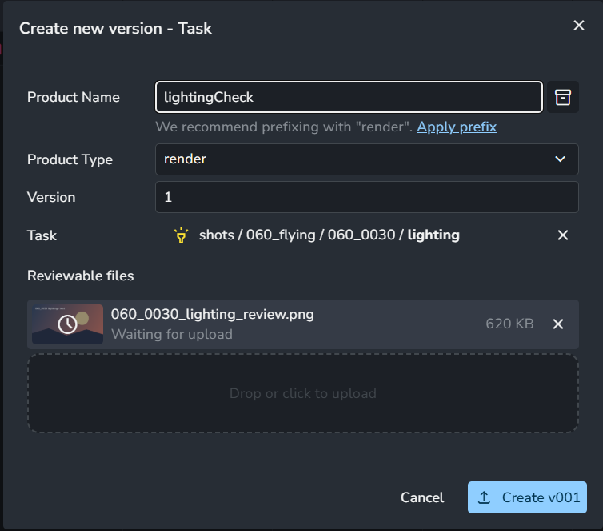
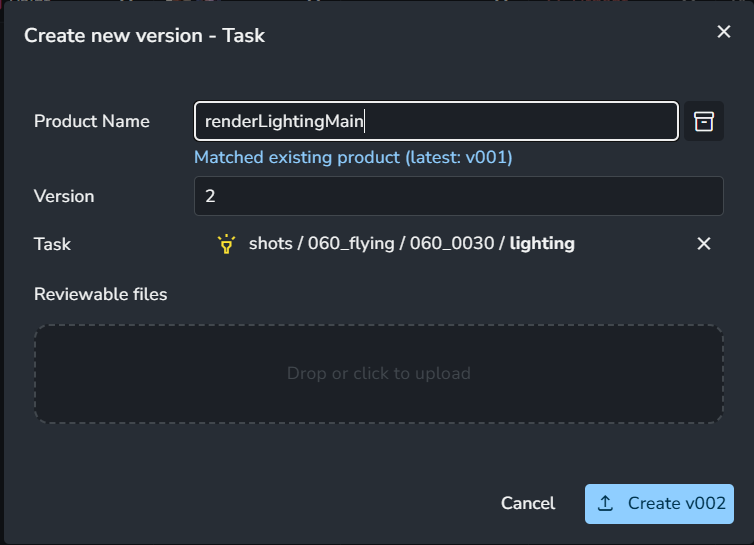
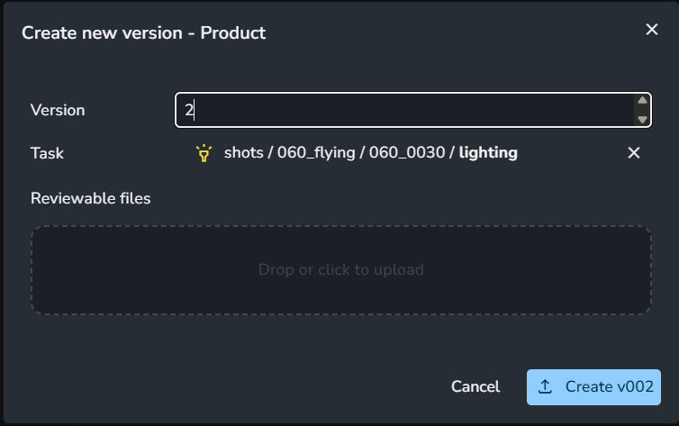
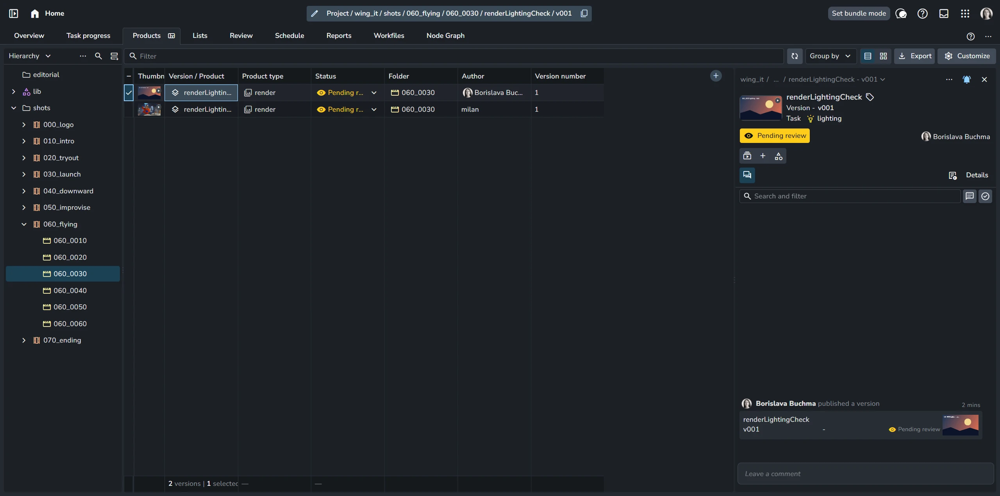
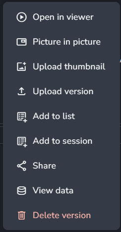

# Upload version

<PageInfo />

The **Create new version** dialog creates a version from media files uploaded in the browser, without the pipeline tools. It creates the product when needed, then the version, and uploads the files to the version as [reviewables](../details-panel.md#version-files-tab), which can then be played in the [web viewer](../web-viewer.md) and reviewed. It suits quick deliveries such as a reference, a client cut or a test render. How this fits into production work, and what it does not do, is explained in [Versions without a pipeline](../../../production-tracking/track-work-without-a-pipeline.md).

## Dialog

The title is **Create new version - Folder**, **Create new version - Task** or **Create new version - Product**, depending on what the dialog was opened for. Opened from a version, it works on the version's product.

### Fields

| Field | Description |
|---|---|
| **Product Name** | Name of the product. Typing the name of an existing product of the folder adds the version to that product, and the field shows **Matched existing product (latest: v&lt;nnn&gt;)** or **Matched existing product (no versions)**. Hidden when the dialog is opened for a product or version. |
| Existing products button | Next to the name (tooltip **Browse existing products**). Lists the products of the folder and fills in the name. Disabled when the folder has none. |
| Prefix note | **We recommend prefixing with "&lt;product type&gt;".** with an **Apply prefix** link, shown while the name does not start with the product type and matches no product. **Apply prefix** turns `lightingCheck` into `renderLightingCheck`. Changing **Product Type** also changes a name that starts with the previous type. |
| **Product Type** | Product type of a new product, from the product types of the project. Hidden when the dialog is opened for a product or version, and while the name matches an existing product. |
| **Version** | Version number. Cannot be lower than the latest version of the product. |
| **Task** | Optional task the version is linked to, shown as folder path and task name. Clicking it opens a task picker; the close button removes the link. Without a task, the field shows **Link task**. |
| **Reviewable files** | Upload area (**Drop or click to upload**) that takes any number of files. Files added before the version exists are listed as cards with **Waiting for upload** and a remove button. |

<Gallery columns={2} rows={1} more="show-all">

</Gallery>

### Prefilled values

| Field | Prefilled with |
|---|---|
| **Product Name** | `review`. When the folder has products: the product name last used in this dialog for the same folder, otherwise the last product of the folder. |
| **Product Type** | `review`, or the type of the matched product. When the name stops matching a product, the type stays as it was. |
| **Version** | The latest version of the product plus one, or `1` for a new product. For a new product, a version number in the name of the first added file is used, for example `shot010_comp_v003.mov` gives `3`. |
| **Task** | The task the dialog was opened for. Opened for a product or version, or when the name matches a product, the task of the product's latest version, unless a task was chosen by hand. |

### What gets created

| Step | Result |
|---|---|
| Product | When the name matches no product of the folder, a new product with the name and **Product Type**. Otherwise the existing product is used. A product name may contain letters, digits, underscores, dots and dashes, and must not start or end with a dot or dash. |
| Version | A new version with the number from **Version**, linked to the **Task** when one is set, with the signed-in user as author. **Created new version** confirms it. |
| Reviewables | The waiting files are uploaded to the version. Each reviewable gets the file name without its extension as label. An image also becomes the thumbnail of the version. |

After the version is created, the fields are locked and the upload area stays active: files added now go straight to the new version. The dialog closes when all uploads have finished, or right away when no files were added. A failed upload is reported in a message and leaves the dialog open. A version without files can get reviewables later in the **Files** tab of its details panel.

### Where the files are stored

| Topic | Behavior |
|---|---|
| Processing | Uploads need no local installation or addon. The files are processed and stored on the AYON server. |
| Storage location | The files are kept in the storage of the AYON server for the project. They are not written to the local or network storage defined in the project anatomy, so pipeline tools in an application cannot load them. To keep versions in the pipeline storage, publish them with the [Tray Publisher](../../../addons/essentials/traypublisher/index.md) instead. |
| Product types | Any product type can be chosen. The default is `review`. |
| File types | Video or image files. For smooth playback the files must be in a format the browser plays; see [Supported formats](../web-viewer.md#supported-formats). Files are not converted on upload. |

## Controls and interactions

### Where it opens

<Columns widths="70 30">
<Column>

| Opens from | Control |
|---|---|
| [Details panel](../details-panel.md), **More actions** | **Upload version**. Shown when one entity other than a representation is shown. |
| Details panel, dragging files over it | Drop zone **Upload version**. The dropped files wait in the dialog. |
| Details panel, right-click on the thumbnail | **Upload version**. Opens a file picker; the chosen files wait in the dialog. |
| [Project overview](../production-tracking/overview.md), right-click menu of a folder or task | **Upload Version** |
| [Slicer](../slicer.md), right-click menu of the hierarchy | **Upload version**, for a folder or task |
| [Products and versions](../production-tracking/products.md), right-click menu in table and grid view | **Upload version**, for one product or version. Disabled with several selected. |
| [Browser](../production-tracking/browser.md), right-click menu of the folder hierarchy, the task list and the products | **Upload version**, for one selected folder, task or product |
| [Workfiles](../production-tracking/workfiles.md), right-click menu of the task list | **Upload version**, for one selected task |

</Column>
<Column>

</Column>
</Columns>

The dialog is available on the project pages and in the [Inbox](../inbox/index.md). On pages without the dialog, such as [Tasks](../home/tasks.md) on Home and the [web viewer](../web-viewer.md), dropping files on the details panel uploads them directly; see [Upload without the dialog](#upload-without-the-dialog).

### Upload without the dialog

On pages without the dialog, dropping files on the **Upload version** drop zone of the details panel uploads them at once:

| Shown entity | Result |
|---|---|
| A version | A new version of the same product, with the next version number and the task of the shown version, gets the files as reviewables. |
| A folder or task | The **Upload Entity** dialog asks for the **Product Name**, prefilled with `review` and the name of the first file, for example `reviewShot010Comp`. **Upload** creates a product of type `review` in the folder and version 1 (linked to the task when a task is shown), and uploads the files. **Cancel** discards them. The name is converted to camel case and characters other than letters, digits, underscores and dashes are removed. |

A progress bar (**Uploading version...**) covers the panel during the upload; its close button hides it.

### Buttons and keys

| Control | Description |
|---|---|
| **Cancel** | Closes the dialog. Waiting files are discarded. |
| **Create v&lt;nnn&gt;** | Creates the version, with the number in three digits, for example **Create v002**. `Ctrl+Enter` or `Cmd+Enter` in the dialog does the same. |

Errors are shown at the bottom of the dialog, for example **Name is required**, **Version must be greater than &lt;n&gt;**, or an error from the AYON server.

### Permissions {#permissions}

| Action | Requirement |
|---|---|
| Create the product and the version | The right to create products and versions in the project; access groups can restrict creating entities. |
| Upload the files | The **Upload reviewables** activity permission of the access group, and the right to create on the version. |

See [Users](../studio/users.md) and [Permissions](../studio/permissions.md).

## Related

- [Versions without a pipeline](../../../production-tracking/track-work-without-a-pipeline.md)
- [Reviewables](../details-panel.md#version-files-tab)
- [Details panel](../details-panel.md)
- [Products and versions](../production-tracking/products.md)
- [Web viewer](../web-viewer.md)
