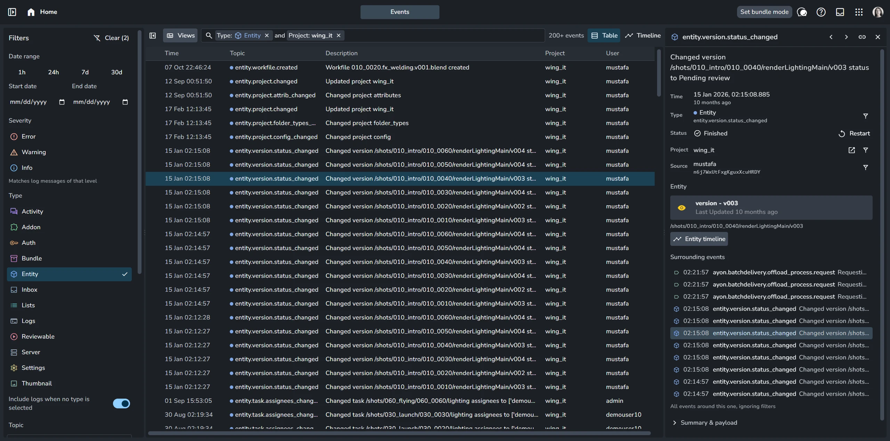
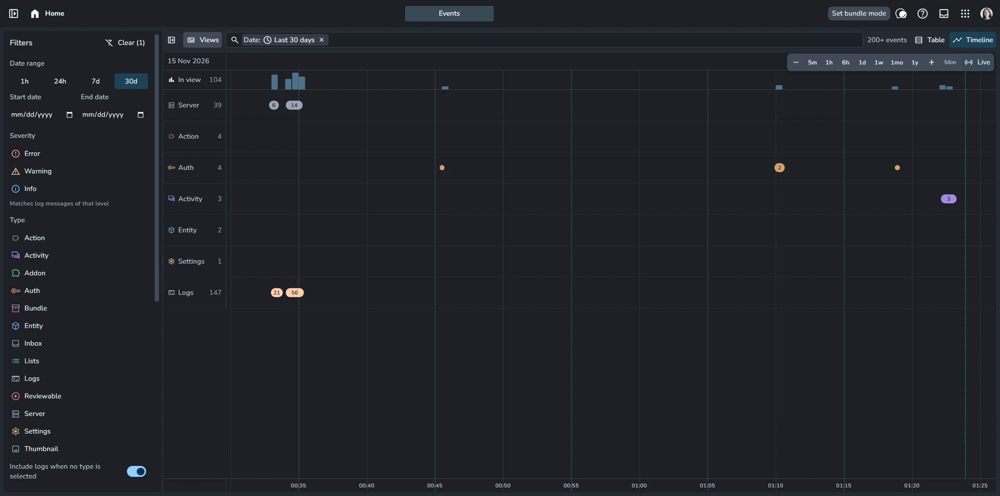
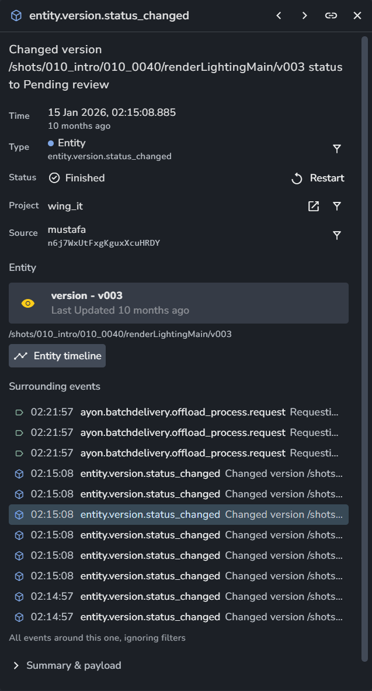
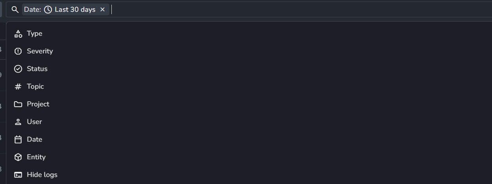

# Event Viewer

<PageInfo />

The Event Viewer shows the events of the AYON server: changes to entities, comments and other activities, sign-ins, settings and bundle changes, background jobs, actions and, optionally, the server log. Managers and admins use it to see who changed what and when, and to find out why a job or a service failed. The page has the filters panel on the left, the events in the middle as a table or a timeline, and the details of the selected event on the right. Services that run jobs are managed on [Services](services.md).

## Events

### Table

The table is the default layout. It lists the events newest first, 200 at a time, and loads more when scrolled to the bottom. New events that match the filters appear at the top while the page is open. The toolbar shows how many events are loaded, for example **200+ events** when there are more.

| Column | Content |
|---|---|
| Severity | An icon for events that need attention: the level of a log message (error, warning or info), an error icon for a `failed` event and a warning icon for an `aborted` one. A spinner for `pending` and `in_progress` events. Hovering the icon shows the status. Rows with an error or a warning are tinted. |
| **Time** | When the event was created: the time only for today, otherwise the day and time. Hovering it shows how long ago it was. |
| **Topic** | The event topic, such as `entity.task.status_changed`, with a dot in the color of its type. |
| **Description** | What happened, for example **Changed task /shots/030_launch/030_0010/lighting assignees to ['demouser14']**. |
| **Project** | The project of the event. Empty for server-wide events. |
| **User** | The user who caused the event. Empty for events of the server itself. |

The column widths can be changed by dragging the column borders; the browser remembers them.

### Timeline

**Timeline** in the toolbar shows the same events on a time axis, with one row (lane) per event type and the number of loaded events of that type. It shows bursts of activity and the order of events across types, for example a settings change just before a series of errors.

- **In view** at the top is a histogram of the events in the visible time range, with their number. The red part of a bar is the share of errors. Clicking a bar zooms to its time range.
- Events close together are drawn as one marker with their count. Clicking a marker zooms in on it; a single event is selected. Hovering a marker lists its events.
- The controls at the top right zoom out (`-`), jump to a span of **5m**, **1h**, **6h**, **1d**, **1w**, **1mo** or **1y**, zoom in (`+`), and show the visible span. **Live** means the view follows new events; after moving away it reads **Now** and returns to the present.
- Older events load automatically while the view moves back in time, up to 5,000 events. After that, or before the first load reaches the visible range, **Load older** loads the next ones. Outside the loaded range the axis is shaded.
- When the visible range has no events, **No events in this time range** offers **Show latest events**.

### Event details

Selecting an event opens its details on the right.

| Part | Content |
|---|---|
| Header | The topic, the **Older event** and **Newer event** buttons, **Copy link** (copies a link to the page with this event selected) and **Close**. |
| Description | What happened. |
| **Time** | The exact time, how long ago, and when it was last updated if that was later. |
| **Type** | The type and the full topic. The filter button shows only events of this type. |
| **Status** | The status, see [Statuses](#statuses). **Restart** is shown for finished, aborted and failed events that are not log messages, see [Restart an event](#restart-an-event). |
| **Project** | The project, with buttons to open it and to filter by it. |
| **Source** | The user and the sender (the id of the client or service that sent the event), with a button to filter by the user. |
| **Entity** | The folder, task, version or other entity the event is about, with its path. For reviewable events, the version. **Entity timeline** shows all events of this entity (admins only). |
| **Message**, **Traceback** | Shown when the event carries a message or a traceback, as log errors and failed jobs do. |
| **Related events** | **Depends on**: the event this one was created for, for example the source event of a service job. **Dependent events**: the events created for this one (admins only). Clicking one selects it. |
| **Surrounding events** | The events just before and after this one, ignoring the filters. It shows what else happened at the same moment. |
| **Summary & payload**, **Raw event** | Expandable JSON views of the event data and of the whole event record. |

An event that no longer exists shows **Event not found**.

### Restart an event

**Restart** sets the event status to `restarted`, so that the service or handler that processes it runs it again, for example a failed job of an addon service. The server accepts it for events created for another event (service jobs), for the download events `installer.install_from_url`, `dependency_package.install_from_url` and `addon.install_from_url`, and for `action.launcher` events of the same user (or any, for admins). Other events show an error.

### Statuses

| Status | Meaning |
|---|---|
| **Finished** | Done. Most events are finished as soon as they are created. |
| **Pending** | Waiting to be processed, for example by a service. |
| **In progress** | Being processed. |
| **Failed** | Processing failed. |
| **Aborted** | Processing was stopped. |
| **Restarted** | Set to be processed again. |

### Event topics

Topics are dotted names such as `entity.task.created` or `settings.changed`; the first part is the event type shown in the filters and the timeline lanes. The server raises a standard set and addons add their own. The topics, and when each one is raised, are listed in [Well known topics](../../developer/server/event-system.md#well-known-event-topics).

## Controls and interactions

### Filters panel

The panel on the left filters the events. The button at the left of the toolbar hides and shows it; while it is hidden, the button shows the number of active filters. **Clear (n)** at its top removes all filters.

| Filter | What it does |
|---|---|
| **Date range** | **1h**, **24h**, **7d** and **30d** show the last hour, day, week or month, counted from when the events load. **Start date** and **End date** set a range of whole days instead. |
| **Severity** | **Error**, **Warning**, **Info**: log messages of that level. |
| **Type** | The event types, such as **Activity**, **Addon**, **Auth**, **Bundle**, **Entity**, **Inbox**, **Lists**, **Logs**, **Reviewable**, **Server**, **Settings** and **Thumbnail**, plus any other type found in the loaded events (for example **Action**). |
| **Include logs when no type is selected** | On by default. Off hides log messages when no type is chosen. |
| **Topic** | Topics picked from the loaded events or typed, with `*` as a wildcard, for example `entity.task.*`. |
| **Status** | **Finished**, **Pending**, **In progress**, **Failed**, **Aborted**, **Restarted**. |
| **Project**, **User** | One or more projects or users. |
| **Entity** | An entity id, pasted. Shows all events of that entity. Admins only; other users see **Filtering by entity requires admin access**. |

Type, topic and severity add up: choosing **Entity** and **Error** shows entity events and error messages. All other filters narrow the result.

### Follow one entity

**Entity timeline** in the details of an event filters the page to every event of that entity, such as all status changes, comments and publishes of one task or version. Admins can also paste an entity id into the **Entity** filter.

### Search and filter bar

The bar at the top holds the same filters as chips, so they stay visible while the panel is hidden. Clicking it lists **Type**, **Severity**, **Status**, **Topic**, **Project**, **User**, **Date**, **Entity** (admins) and **Hide logs**. **Date** also offers calendar ranges, such as today, yesterday, this week or last month, and a custom range.

Typed text searches the topic, project, user and description of the events. Words shorter than three characters are ignored; all other words must match.

### Views

**Views** saves the filters and the layout (table or timeline) of the page as a view, the same way as on the project pages; see [Views](views.md). Saving and sharing views needs the Power Pack, see [Saved and shared views](#saved-and-shared-views).

### Share a filtered view as a link

The address of the page holds the filters, the layout and the selected event, for example `/events?project=wing_it&type=entity&layout=timeline`. Opening such a link applies its filters, so a link from **Copy link** or from the address bar shows a colleague the same events. Rolling date ranges such as **24h** stay relative: a saved view or link shows the last 24 hours at the time it is opened.

### Keyboard and mouse

| Where | Action |
|---|---|
| Table | Click a row to select it. `Escape` clears the selection. |
| Timeline | Mouse wheel zooms around the pointer; `Shift` + wheel or a horizontal scroll pans; dragging pans. |
| Timeline | `ArrowLeft` / `ArrowRight` select the older or newer event; `ArrowUp` / `ArrowDown` move to the nearest event in the lane above or below. |
| Timeline | `Shift` + `ArrowLeft` / `ArrowRight` pan; `+` and `-` zoom; `N` or `End` jump to now and follow new events; `Escape` clears the selection. |
| Details | **Older event** and **Newer event** step through the events in the current order. |

## Power features

These features need the [Power Pack](../../addons/production-tracking/power-pack/index.md) and a license.

### Saved and shared views

The filters and the layout of the page can be saved as named views and shared, as on the project pages. See [Views](views.md).

## Related

- [Services](services.md)
- [Event system](../../developer/server/event-system.md)
- [Views](views.md)
- [Users](studio/users.md)
- [App header](app-header.md)
- [Keyboard shortcuts](quick-navigation.md#keyboard-shortcuts)
