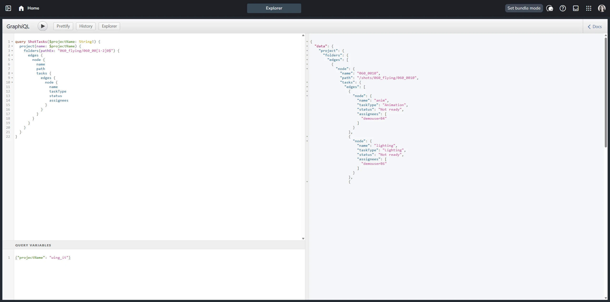
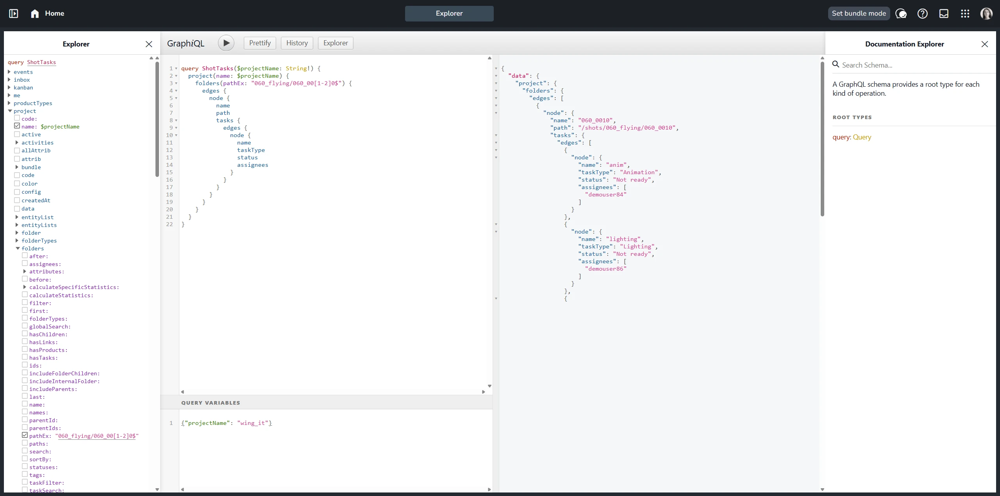

# GraphQL Explorer

<PageInfo />

The GraphQL Explorer is an editor for the GraphQL API of the AYON server, built on GraphiQL. It is used to try out queries, to look up which fields and arguments an entity has, and to copy working queries into scripts and tools. Queries run on the live server with the signed-in user's own session, so the results contain exactly what that user may see in the rest of the web app. How to write queries, with examples, is in the developer guide [GraphQL API](../../developer/api/graphql.md); the REST endpoints are on the [REST API reference](rest-api.md) page.

## Editor

The page keeps the [App header](app-header.md); the [URI bar](app-header.md#uri-bar) reads **Explorer**. Below it the server shows GraphiQL in a frame.

### Panes

| Pane | What it holds |
|---|---|
| Query editor (left) | The GraphQL query. When empty, it shows a welcome text with the keyboard shortcuts. Typing suggests the fields of the schema, and errors are underlined. |
| **Query Variables** (below the editor) | JSON values for the variables of the query, for example `{"projectName": "wing_it"}`. Clicking its title bar opens or closes it. |
| Result (right) | The JSON response of the server, including errors. |

### What it can run

The AYON GraphQL API reads data only: its schema has queries, no mutations or subscriptions. Changes go through the [REST API](rest-api.md).

Every query runs as the signed-in user, with their access level and access groups. A user sees only the projects, folders and other entities their permissions allow. The Help menu entry is hidden for guests.

### Open the editor without the App header

The editor is served by the server at `/graphiql`. Opening that address shows the same editor full screen, without the App header. It needs a signed-in session in the same browser.

## Controls and interactions

### Toolbar

| Control | What it does |
|---|---|
| Run (play button) | Runs the query. With several named operations in the editor, it asks which one to run. |
| **Prettify** | Reformats the query. |
| **History** | Shows the queries run before. The history and the last query are kept in the browser. |
| **Explorer** | Opens the query builder, see [Build a query by ticking fields](#build-a-query-by-ticking-fields). |
| **Docs** | Opens the **Documentation Explorer**: every type, field and argument of the schema with its description, and **Search Schema...**. |

### Build a query by ticking fields

**Explorer** opens the schema as a tree on the left. Ticking a field or an argument writes it into the query, and the query and the tree stay in sync. It is the quickest way to find the arguments of a field, such as the filters of `folders` (`pathEx`, `names`, `statuses`, `tags` and more), without reading the schema.

### Keyboard shortcuts

| Shortcut | Action |
|---|---|
| `Ctrl+Enter` | Run the query |
| `Shift+Ctrl+P` | Prettify the query |
| `Shift+Ctrl+M` | Merge fragments into the query |
| `Ctrl+Space` | Show suggestions |

## Related

- [GraphQL API](../../developer/api/graphql.md)
- [REST API reference](rest-api.md)
- [App header](app-header.md#help-menu)
- [Users](studio/users.md)
