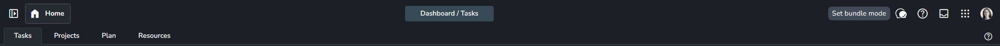

# Home

<PageInfo />

Home is the studio-level start page of the web app. It is not tied to one project: it shows the signed-in user's tasks across projects, the list of all projects, and studio pages added by addons, such as resource planning. The **Home** button in the [App header](../app-header.md) opens it, and so do `h+h` and the server address itself, which leads to **Tasks**. Project work happens on the project pages, opened from the [project list](../project-list.md) or from **Projects**.

## Pages

The web app has two Home pages of its own. The other tabs come from addons, so they differ between servers. On a server with the Planner addon, the tabs read **Tasks**, **Projects**, **Plan** and **Resources**.

| Tab | Comes from | URL path | Page |
|---|---|---|---|
| **Tasks** | Built in | `/dashboard/tasks` | [Home tasks](tasks.md): the tasks assigned to the user, or to other users, as a board or a list. |
| **Projects** | Built in | `/dashboard/projects` | [Home projects](projects.md): all projects in one table, with project folders and a details panel. |
| **Plan** | Planner addon | `/dashboard/bookings` | A timeline of the resources, such as people, with their capacity and workload, and planning scenarios. The URI bar reads **Dashboard / Bookings**. See the [Planner addon](../../../addons/production-tracking/planner/index.md). |
| **Resources** | Planner addon | `/dashboard/resources` | The table of resources that the plan uses, such as people, with their type and attributes. See the [Planner addon](../../../addons/production-tracking/planner/index.md). |
| **Planner** | Built in, without the Planner addon | `/dashboard/planner` | A preview of what the Planner addon provides, shown in place of **Plan** and **Resources** when the addon is not in the bundle. |
| Other addon tabs | Addons | `/dashboard/<page>` or `/dashboard/addon/<addon name>` | Documented with each addon. An addon can limit its tab to admins or to managers. |

The help button at the right end of the tab row (**Get help for this page**) opens the help article for the open tab, or a support message when there is none. When an addon page comes from the staging or developer bundle instead of production, its tab shows a colored dot while it is open; the tooltip names the addon version and the bundle.

## Opening Home

The server root `/` and `/dashboard` both open `/dashboard/tasks`. The URI bar shows Home as **Dashboard**, for example **Dashboard / Tasks**, because its URL paths start with `/dashboard`. Home is not related to the dashboards of the [Reports addon](../../../addons/production-tracking/reports/index.md), which are a tab of each project.

Guests see "Sorry, you don't have access to this page" in place of every Home page.

## A server without projects

When the server has no projects, **Tasks** and **Projects** show **No Projects**. Admins and managers also see **Create first project** there, which opens the new project dialog and then the project's **Anatomy** page. Addon pages that do not need projects stay usable. See [Creating a project](../../how-ayon-works/creating-a-project.md).

## Related

- [Home tasks](tasks.md)
- [Home projects](projects.md)
- [Planner addon](../../../addons/production-tracking/planner/index.md)
- [App header](../app-header.md)
- [Keyboard shortcuts](../quick-navigation.md#keyboard-shortcuts)
