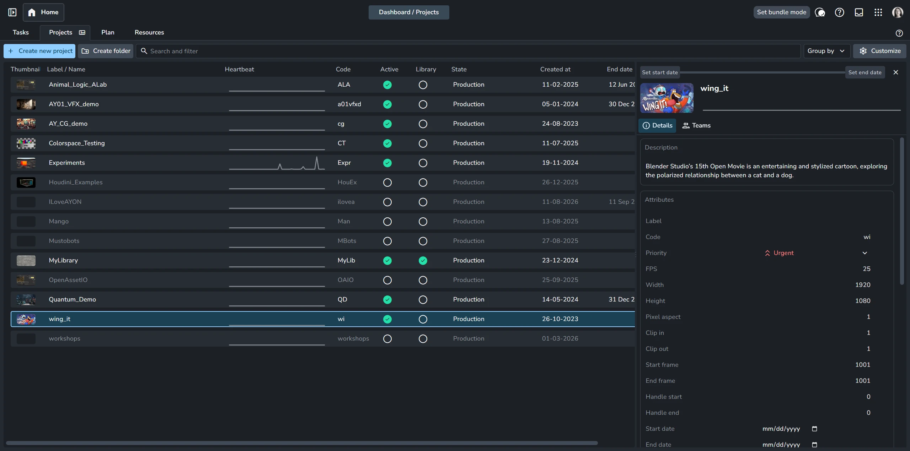
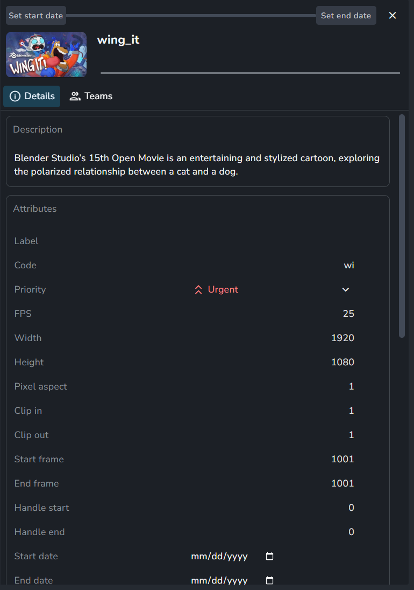
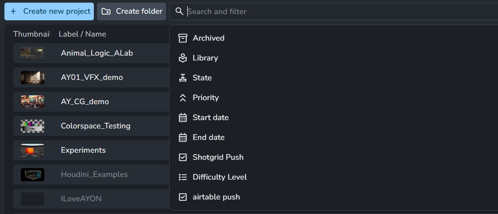
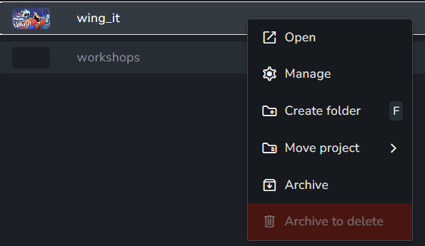
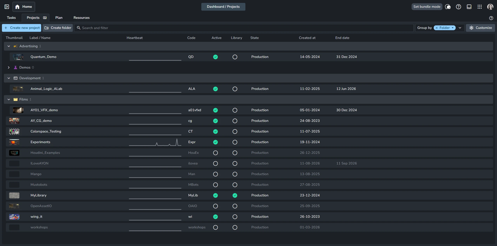

# Home projects

<PageInfo />

The page lists the projects of the server in one table, with their thumbnail, recent activity, state and project attributes. Producers and managers use it to get an overview of all productions, to create new projects, to archive or delete old ones and to organize projects into folders. Selecting a project opens its details panel on the right; double-clicking it opens the project's own pages, such as the [Overview](../production-tracking/overview.md). The [Tasks](tasks.md) page next to it shows the work inside the projects.

Admins, managers and users with the **Create projects** studio permission see all projects. Other users see the projects where they have an access group.

## Projects table

One row per project, or project rows inside groups when **Group by** is set. Archived projects are dimmed. The table loads up to 20,000 projects; beyond that a warning reads "Showing &lt;count&gt; projects. Some projects are not listed." With no projects on the server, the page shows **No Projects**, see [Home](index.md#a-server-without-projects).

### Columns

Columns can be sorted from their header, resized, reordered, and shown or hidden in **Customize**. The cells are read-only: values are edited in the [details panel](#details-panel).

| Column | Shown by default | Content |
|---|---|---|
| **Thumbnail** | Yes | The project thumbnail. Dropping an image on it, or **Upload thumbnail** in its right-click menu, uploads a new one. Needs write access to the project's anatomy. |
| **Label / Name** | Yes | The project label, or the name when there is no label. |
| **Name** | No | The project name. |
| **Heartbeat** | Yes | A line of the project's activity: the number of entity events per day over the last 30 days. Sorting by it puts the most active projects first, with recent days weighted more. |
| **Code** | Yes | The project code. |
| **Active** | Yes | Off for archived projects. |
| **Library** | Yes | On for library projects. |
| **State** | Yes | **Production**, or **Planning** for a planning project without a hierarchy. See [Planning projects](../../how-ayon-works/creating-a-project.md#planning-projects). |
| **Created at**, **Updated at** | **Created at** only | Dates of the project record. |
| Project attributes | **End date** only | One column per attribute with the project scope, such as **Start date**, **End date** or **Priority**. |

### Details panel

<Columns widths="60 40">
<Column>

Clicking a project opens its details panel on the right. With several projects selected, the panel shows the first one.

- **Timeline:** **Set start date** and **Set end date** at the top, with a bar between them. With both dates set, the bar shows the days passed, **&lt;days&gt; Left** and a **Day &lt;n&gt;** marker for today. A start date after the end date is refused.
- **Header:** the thumbnail, the project name and its heartbeat. Dropping an image on the header uploads a new thumbnail.
- **Details** tab: the **Description**, then **Attributes**: **Label**, **Code**, every project attribute, **Active** and **Library**, followed by the read-only **Name**, **Created at** and **Updated at**. Changes are saved as soon as they are made. Only admins and managers can save them.
- **Teams** tab: the project's teams with their leaders (or **No leaders**) and members, and **Manage teams**. A team opens on the project's [Teams](../project/teams.md) page; with no teams the tab reads **No teams created yet**.

</Column>
<Column>

</Column>
</Columns>

## Controls and interactions

### Toolbar

| Control | What it does | Shown to |
|---|---|---|
| **Create new project** | Opens the **Create a new project** dialog. The new project appears in the table; the page does not change. See [Creating a project](../../how-ayon-works/creating-a-project.md). | Admins, managers, and users whose **Default projects access** includes an access group with the **Create projects** studio permission, see [Permissions](../studio/permissions.md#studio-permissions) |
| **Create folder** | Creates a project folder at the top level, see [Project folders](#project-folders). Without the Power Pack, it is marked with a lightning symbol and opens the Power Pack dialog. | Everyone |
| **Search and filter** | Typed text matches the project name, label, code and description. Filters are described below. | Everyone |
| **Group by** | Groups the rows by **Folder**, **Archived**, **Library**, **State**, or any project attribute that is a boolean or has a list of values. Several levels can be combined, ascending or descending. | Everyone |
| **Customize** | Opens the **Settings** panel with **Columns** (visibility and order), **Sort** and **Group by**. | Everyone |
| Views button | The button on the **Projects** tab itself. It holds the working view and saved views; the filters, sorting, grouping and columns are stored in the view. See [Views](../views.md). | Everyone |

### Filters

<Columns widths="55 45">
<Column>

Clicking the search bar lists the filters:

- **Archived** (Archived or Active), **Library** (Library or Not library) and **State** (Production or Planning).
- Every project attribute that is a boolean, a date or has a list of values, such as **Priority**, **Start date** and **End date**. Date filters offer preset ranges and a custom range.
- More filter options need the Power Pack, see [Advanced filters](#advanced-filters).

</Column>
<Column>

</Column>
</Columns>

### Interactions

| Gesture | Effect |
|---|---|
| Click a row | Selects the project and opens its details panel. `Ctrl` and `Shift` add rows to the selection. |
| Double-click a row | Opens the project's pages, on the project tab used last. |
| `Escape` | Clears the selection and closes the details panel. |
| Right-click a row | Opens the right-click menu for the selected rows. |

### Right-click menu

<Columns widths="60 40">
<Column>

Entries that do not apply to the selection are hidden.

| Entry | What it does | Shown to |
|---|---|---|
| **Open** | Opens the project's pages. One project. | Everyone except guests |
| **Manage** | Opens the project's **Anatomy** page in [Project settings](../project/index.md). One project. | Everyone except guests |
| **Create folder** (`F`) | Creates a folder for the selected projects, see [Project folders](#project-folders). Without the Power Pack, it opens the Power Pack dialog. | Admins and managers |
| **Archive** / **Activate** | Sets one project inactive, or active again. | Admins and managers |
| **Archive to delete** / **Delete** | Only archived projects can be deleted: an active project shows **Archive to delete**, disabled. **Delete** asks for confirmation and removes the project with all its data. | Admins and managers |

</Column>
<Column>

</Column>
</Columns>

## Power features

These features need the [Power Pack](../../../addons/production-tracking/power-pack/index.md) and a license, see [Power features](../../../production-tracking/power-features.md).

### Project folders

Project folders group projects in the table and in the [project list](../project-list.md) on other pages, for example by client or by type of production. **Group by** **Folder** shows the folder tree, with the number of projects in each folder; projects without a folder are listed below it. Empty folders are shown too.

Creating, editing, moving and deleting folders is for admins and managers. Folder entries of the right-click menu:

| Entry | What it does |
|---|---|
| **Edit folder** | Edits the label, icon and color of a folder row. |
| **Create folder** (`F`) / **Create subfolder** | Creates a folder for the selected projects, or inside the selected folder. |
| **Move project** / **Move folder** | A submenu with the folder tree. **Unset folder** takes projects out of their folder; **Make root folder** moves a folder to the top level. |
| **Delete (only folder)** | Deletes the selected folders. Their projects stay. |

### Advanced filters

Attribute filters can also match a value or no value, and exclude values. Filters on attributes with a list of values can switch their operator, for example to match all values. Without the Power Pack, these options are not offered.

## Related

- [Home](index.md)
- [Home tasks](tasks.md)
- [Creating a project](../../how-ayon-works/creating-a-project.md)
- [Project list](../project-list.md)
- [Teams](../project/teams.md)
- [Views](../views.md)
- [Power features](../../../production-tracking/power-features.md)
