# Home tasks

<PageInfo />

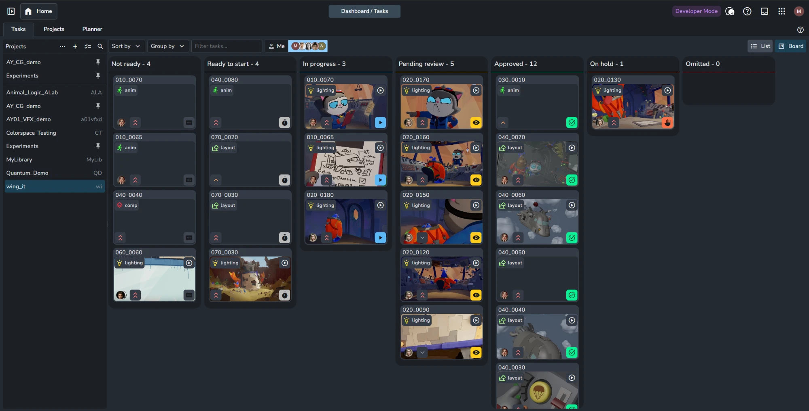

The page shows the tasks assigned to the signed-in user, or to selected users, as a board (kanban) or as a list. The [project list](../project-list.md) on the left chooses the projects, and the toolbar above the tasks sorts, groups and filters them. Only assigned tasks are shown, so the page has no option for unassigned tasks. Unassigned tasks are found on the [Project overview](../production-tracking/overview.md) page, with the **Assignee** filter set to no value. How the page differs from Task progress and the Overview is described in [Task pages](../../how-ayon-works/task-pages.md).

## Board and list

The **Board** and **List** buttons at the top right switch between the two views. The board is the default.

### Board

The board has one column per task status, with a card for each task. It suits a visual overview of where each task stands.

- Drag a card to another column to change the task status. Several selected cards move together.
- Double-click a card to open its [details panel](../details-panel.md), with the activity feed, versions and attributes of the task.
- Minimize the board by collapsing the columns that are not needed, with the button in the top right corner of each column. Collapsed columns next to each other merge into one narrow strip.

<Gallery columns={3} rows={1} more="show-all">

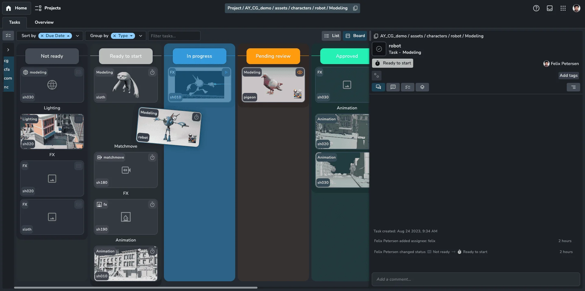

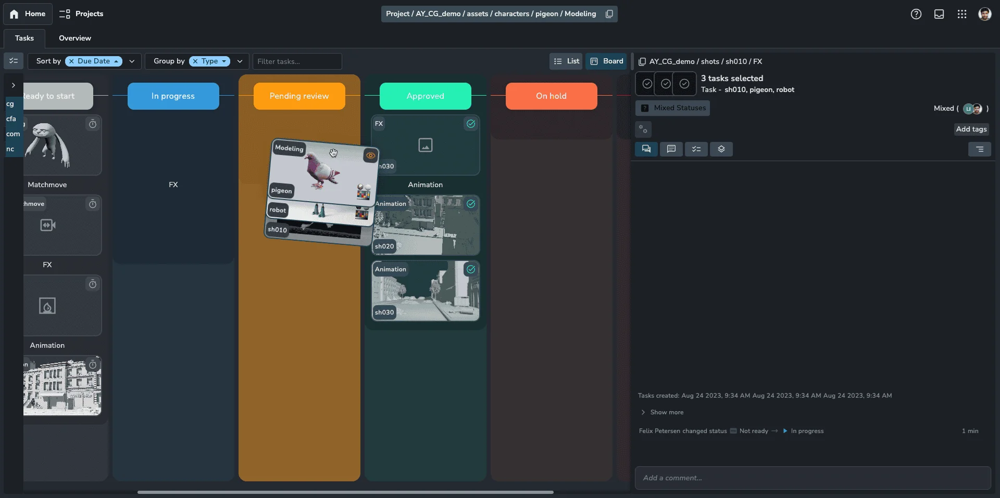

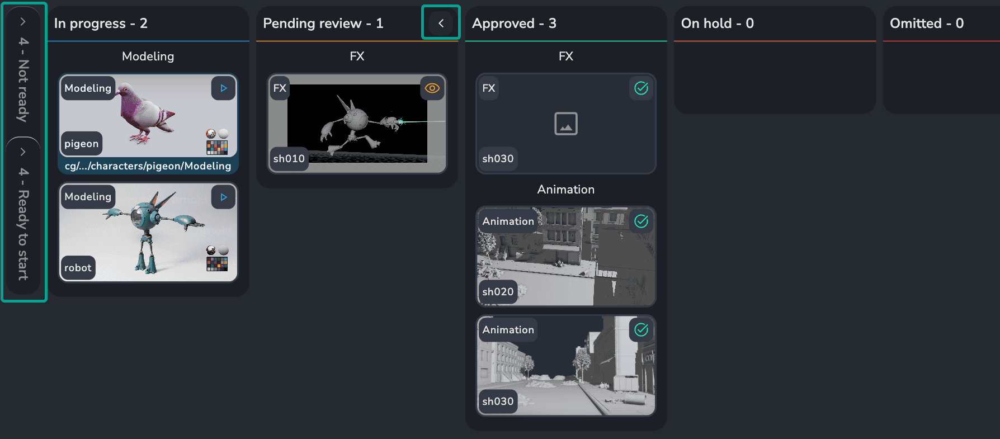

</Gallery>

:::tip What a card shows

<Columns widths="65 35">
<Column>

- **Top:** the folder name, and the task name with the icon and color of its task type. Hovering the folder name shows its path, starting with the project code.
- **Middle:** the thumbnail: the task's own thumbnail if one is set, otherwise the thumbnail of its latest version. Without either, the task type icon. A play button at the top right means the task has reviewables to watch in the [web viewer](../web-viewer.md).
- **Bottom:** the assignees and the priority on the left, the status icon on the right.
- **Scrubbing:** moving the mouse from left to right over the thumbnail of a card with a play button scrubs through its reviewable. A thin bar at the bottom shows the position.

</Column>
<Column>

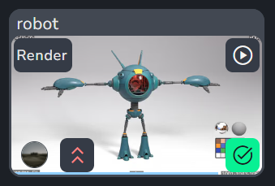

</Column>
</Columns>
:::

### List

The list has one row per task, with its status, thumbnail, folder, task type, tags, assignees, priority and project code. It fits more tasks on screen and can be used from the keyboard, which suits long task lists.

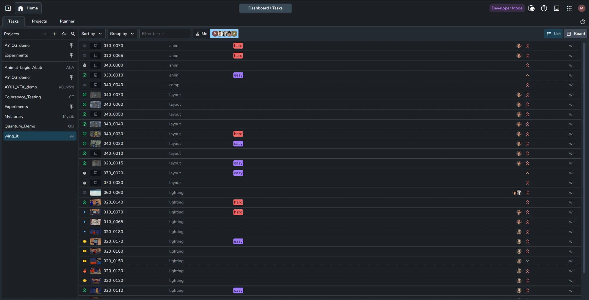

- Click the status icon of a row to change the task status.
- `ArrowUp` and `ArrowDown` move the selection; with `Shift` held, they add to it.
- Double-click a row to open its [details panel](../details-panel.md).
- With **Group by** set, press `C` while hovering a group to collapse or expand it.

<Gallery columns={3} rows={1} more="show-all">

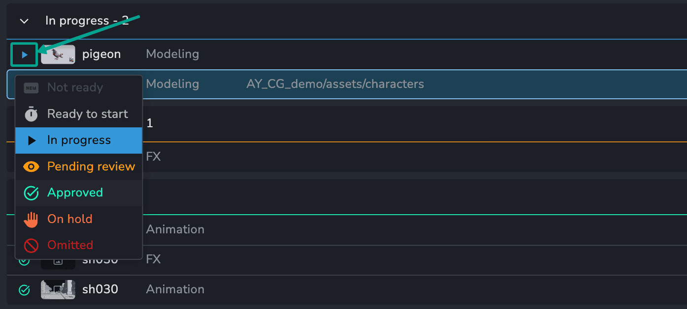

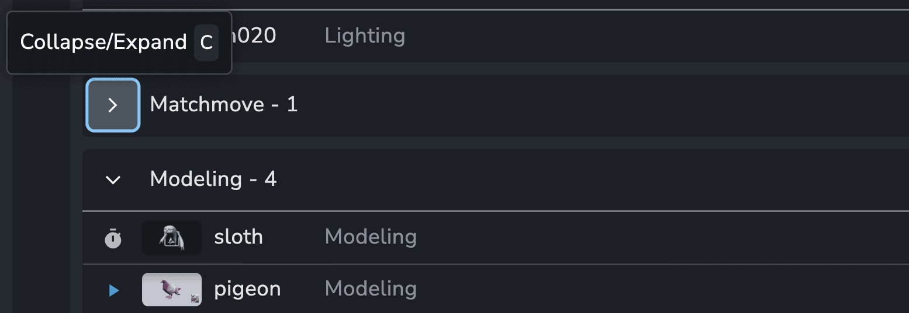

</Gallery>

## Controls and interactions

### Projects

The [project list](../project-list.md) on the left chooses the projects whose tasks are shown. Several projects can be selected, to see the tasks of all of them together. Pinned projects stay at the top of the list.

### Sort by

**Sort by** orders the tasks by Task, Folder, Status, Priority or Due Date, each ascending or descending. Several sort keys can be combined. For example, sorting by Folder and then by Task keeps tasks in equally named folders, such as `sh020` in two sequences, ordered by task name.

### Group by

**Group by** puts the tasks into groups by Folder, Parent Folder, Status, Priority, Type or Project, and by Assignee when other users' tasks are shown. Grouping works together with sorting, which then orders the tasks within each group. On the board, the groups appear inside each status column; in the list, they can be collapsed.

<Gallery columns={2} rows={1} more="show-all">

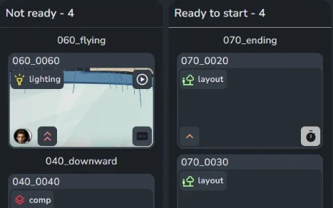

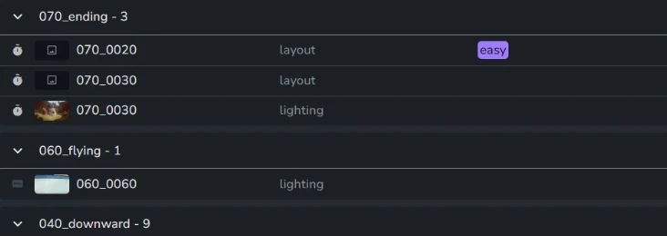

</Gallery>

### Filter tasks

**Filter tasks...** shows only the tasks that match the typed text. It searches the task name, folder name, folder path, status, task type and assignees. Words separated by a space must all match; words separated by a comma match any of them, for example `anim, layout`.

### Assignees

**Me** shows the tasks assigned to the signed-in user. The **Assignees** dropdown next to it shows the tasks of one or more other users, or of all users with **All Users**, for example to check the workload of an artist. It is available to admins and managers, and to other users when none of the selected projects has read restrictions in their access group.

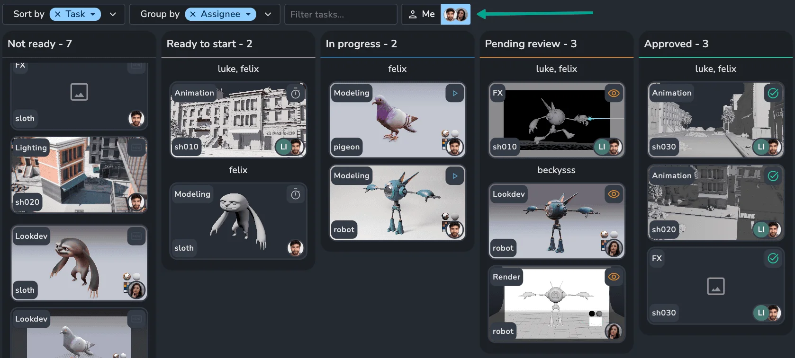

### Interactions

The mouse and keyboard interactions with the tasks on this page.

<Columns widths="70 30">
<Column>

- **Multi-select:** select several tasks with `Ctrl`/`Cmd` + click or `Shift` + click. Edits then apply to all of them.
- **Open details panel:** double-click a task to open its [details panel](../details-panel.md). `Escape` closes it.
- **Play reviewable:** press `Spacebar` to open the selected task in the [web viewer](../web-viewer.md).
- **Open in overview:** `Ctrl`/`Cmd` + double-click a task to open it in the [Project overview](../production-tracking/overview.md).
- **Context menu:** right-click a task for the same options, plus **Copy task ID** and **Copy latest version ID**.

</Column>
<Column>

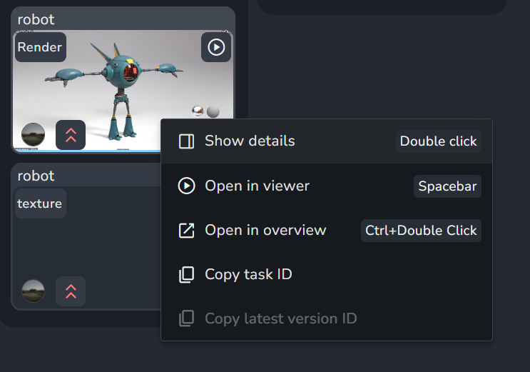

</Column>
</Columns>

## Power features

### Related panel

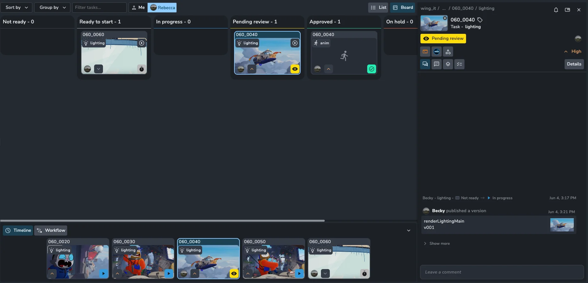

The Related panel shows the selected task next to the tasks around it, for example the previous and next shots. It is a bar at the bottom of the page; expanded, it shows thumbnails of the selected task and up to five related tasks. The two buttons at its top left switch between two modes, **Timeline** and **Workflow**.

The Related panel needs a Pro or Studio plan, see [Power features](../../../production-tracking/power-features.md). Without it, the panel is not shown.

- **Timeline**, the default, shows the tasks of the same task type in the sibling folders, such as the lighting tasks of the previous and next shots. It helps to check continuity across a sequence.
- **Workflow** shows the other tasks of the same folder, ordered as in the project anatomy. It helps to check the upstream and downstream work of a shot, such as layout before lighting.

<Gallery columns={1} rows={2} more="show-all" fit="contain">

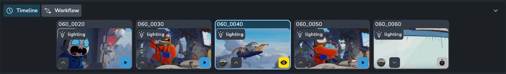

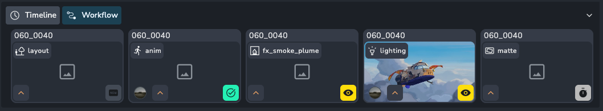

</Gallery>

:::tip Related tasks in the web viewer

When the [web viewer](../web-viewer.md) is opened from this page (`Spacebar`), the Related panel stays below the player, in either mode. Clicking a related task switches playback to it without closing the player. The panel is not shown in the web viewer when it is opened from other pages.

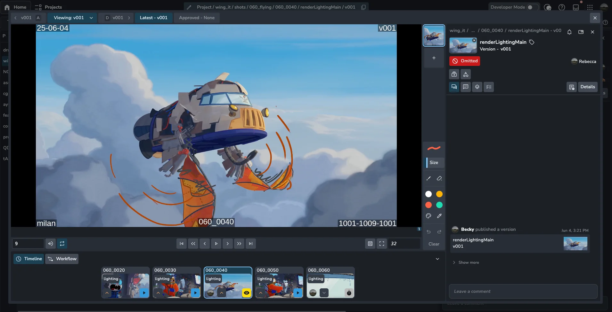
:::

## Related

- [Home](index.md)
- [Details panel](../details-panel.md)
- [Project overview](../production-tracking/overview.md)
- [Web viewer](../web-viewer.md)
