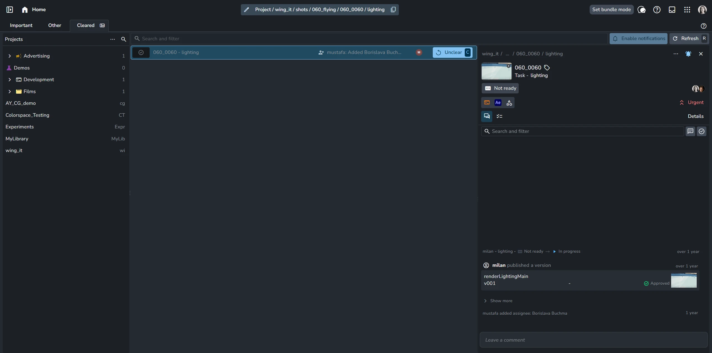

# Cleared

<PageInfo />

**Cleared** is the third tab of the [Inbox](index.md). It holds the messages cleared from [Important](important.md) and [Other](other.md), together in one list, so nothing that was cleared is lost. Clearing a message marks it read; restoring it returns it to its own tab as unread. The layout, filters and actions are described on the [Inbox](index.md) page.

## What lands here

| How a message is cleared | On |
|---|---|
| **Clear** on the message, `C`, or **Clear** in the right-click menu | [Important](important.md), [Other](other.md) |
| **Clear read** | The read messages of the tab |
| **Clear all**, `Shift`+`C` | All messages of the tab, or, with filters, the matching messages loaded in the list |

New activity never arrives on this tab directly.

## Controls and interactions

- **Unclear** (`C`) moves the message back to **Important** or **Other**, by the same rule that placed it there, and marks it unread. On a row of a multiple selection the button reads **Unclear selection**; the right-click menu shows **Unclear** followed by the number of messages.
- `Shift`+`C` has no button here, but restores every cleared message, in all projects or in the selected project, as unread. With filters, it restores the matching messages loaded in the list.
- **Mark as read** and **Mark as unread** are shown in the right-click menu but disabled; `X` does nothing.
- The tab has no unread count, and **Unread**, **Clear read** and **Clear all** are not shown.
- Messages of both tabs are listed without day dividers.
- The **Reason** filter offers **Mentioned**, **Watching** and **Related**.

## Related

- [Inbox and notifications](index.md)
- [Important](important.md)
- [Other](other.md)
