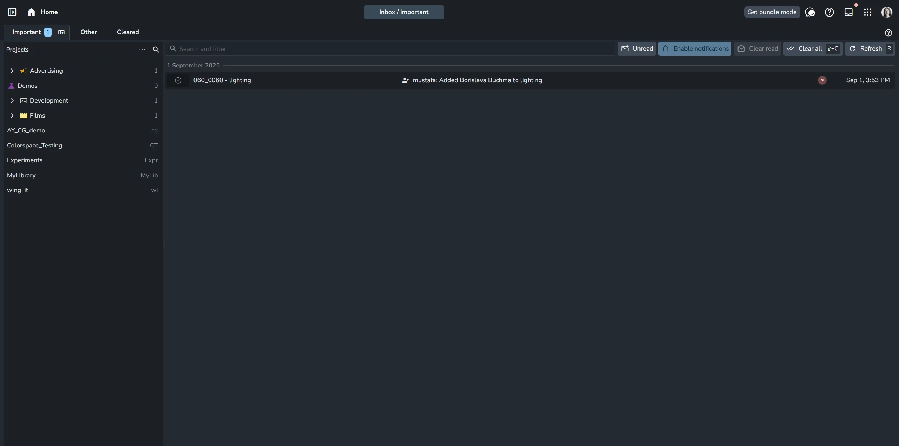

# Important

<PageInfo />

**Important** is the default tab of the [Inbox](index.md). It lists the activity where the user is mentioned or watches the entity, except status changes. The **Inbox** button, `i+i` and notifications open it, and it is the only tab whose new messages notify. Status changes and activity on entities the user is only related to go to [Other](other.md). The layout, filters and actions are described on the [Inbox](index.md) page.

## What lands here

A message is important when the user's reference to the activity is a mention or watching, and the activity is not a status change. When several references apply, a mention wins over watching, and watching wins over a relation.

| Activity | Why |
|---|---|
| A comment that mentions the user, or a team the user belongs to | Mention |
| The user is assigned to a task, or removed from one | The assignment message mentions the user |
| A comment, review (approval or change request), reviewable or version publish on an entity the user watches | Watching |
| Assignee, tag and type changes on an entity the user watches | Watching |

Users watch the tasks they are assigned to and the versions they publish, so most activity on their own work lands here. See [Watchers](index.md#watchers). Status changes go to [Other](other.md), even on watched entities or with a mention, and activity created by the user is not in the Inbox.

## Controls and interactions

- The tab shows the number of unread messages, up to **99+**. Its tooltip reads **Activities where you are directly mentioned**.
- The **Inbox** button in the App header carries a dot while this tab has unread messages.
- Messages are newest first, with day dividers.
- **Unread**, **Clear read** and **Clear all** act on this tab only.
- The **Reason** filter offers **Mentioned** and **Watching**.
- A new message notifies as set on the [Profile](../account/profile.md) page: a toast, a desktop notification or a chime. See [Real-time notifications](index.md#real-time-notifications).

## Related

- [Inbox and notifications](index.md)
- [Other](other.md)
- [Cleared](cleared.md)
- [Activity feed](../details-panel.md#activity-feed)
