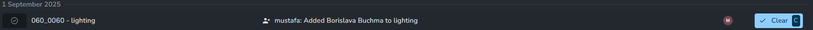
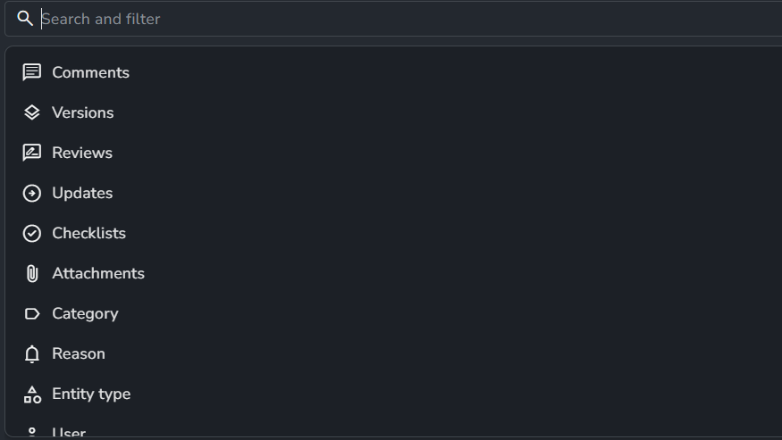
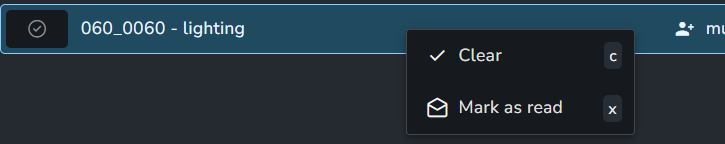

# Inbox and notifications

<PageInfo />

The Inbox lists the activity that concerns the signed-in user across all projects: comments that mention them, assignments, publishes, reviews and status changes on the work they follow. Messages can be marked read and cleared, so the Inbox works as a list of items that still need attention. Selecting a message opens its task, version or folder in the [details panel](../details-panel.md), where the user can reply. The **Inbox** button in the [App header](../app-header.md) opens it, as does `i+i`; the button carries a dot while **Important** has unread messages.

Each activity reaches a user at most once, through one reference: a mention, watching the entity, or a relation to it (assignee or author). The reference and the activity type decide the tab. Activity created by the user never appears in their own Inbox.

| Tab | Content | Unread count on the tab |
|---|---|---|
| [Important](important.md) (default) | Mentions and activity on watched entities, except status changes. The only tab that notifies. | Yes, up to **99+** |
| [Other](other.md) | Status changes, and activity on entities the user is only related to. | Yes, up to **99+** |
| [Cleared](cleared.md) | Cleared messages of both tabs, which can be restored. | No |

`/inbox` opens `/inbox/important`. Each tab has its own [views](../views.md), which store the filter and the **Unread** toggle.

## Messages

### Message list

Messages come from the projects where the user has an access group; managers and admins get messages from all projects. Users who are not managers do not see, and are not notified about, activity with a comment category they cannot access. Guests get no messages.

Messages are listed newest first, 100 at a time; scrolling to the end loads more (**Load more**). On **Important** and **Other**, day dividers separate the days. With nothing to show, the list reads **All caught up! No messages to show.** Unread messages are highlighted.

| Part | What it shows |
|---|---|
| Thumbnail | The thumbnail or icon of the entity. The tooltip gives the entity type and its subtype. |
| Path | The parents and name of the entity, separated by ` - `, for example `060_0060 - lighting`. |
| Unread count | The number of unread messages in a group, when there are two or more. |
| Type icon | The activity type, with a tooltip such as **Comment**, **Version published**, **Reviewable uploaded**, **Approved**, **Changes requested**, **Assigned**, **Unassigned** or **Reassigned**. |
| Category dots | The comment categories of the messages. |
| Text | The author and text of the newest message; comments are cut after 75 characters. For status changes, the first and last status of the group. |
| Author, date | The author's avatar and the date: relative for today, otherwise month, day and time. |
| **Clear** / **Unclear** | Shown on hover and on the selected row. With several rows selected: **Clear selection** / **Unclear selection**. |

### Grouping

Related messages are shown as one row:

- **Version publishes and reviewables:** when the list holds more than one, they are grouped per parent folder within 5-minute windows. The row names the products for up to four versions, otherwise the number of versions and products.
- **Assignee changes:** additions and removals on the same task within 5 seconds become one **Assigned**, **Unassigned** or **Reassigned** row that names the users.
- **Other activity:** the same activity type on the same entity on the same day.

### Details panel

Selecting a message opens its entity in the [details panel](../details-panel.md) with its [activity feed](../details-panel.md#activity-feed), marks the message (or the whole group) read, and, for comments, highlights them in the feed. Selecting the selected message again closes the panel.

### Watchers

A watcher receives the activity on an entity in **Important** (status changes go to **Other**). Users become watchers automatically when they:

- post a comment or other activity on the entity (service users and guests excepted),
- upload a reviewable to a version,
- publish a version; the author of the version watches it too,
- are assigned to a task.

Removing an assignee removes them as watcher. When a version is published for a task, the watchers of the task become watchers of the version. The **Watchers** button of the [details panel](../details-panel.md#watchers) lists the watchers of an entity and adds or removes them, for example to follow a shot without being assigned to it.

### Real-time notifications

New messages appear and the unread counts update without a reload. For a new message in **Important**:

| Condition | Result |
|---|---|
| **Desktop notifications** on, page focused | A toast with the first line of the message. Selecting it opens **Important**. |
| **Desktop notifications** on, page not focused, browser permission granted | A desktop notification "New AYON message". Selecting it focuses the page and opens **Important**. |
| **Notification sound** on, page not focused | A chime. |

Messages for **Other** do not notify. Both switches are on the [Profile](../account/profile.md) page and work independently.

## Controls and interactions

### Toolbar

| Control | What it does | On tabs |
|---|---|---|
| **Search and filter** | Filters the messages, see [Filters](#filters). Without a selected project the bar is disabled, with the tooltip **Select a project to enable filtering**. | All |
| **Unread** | Shows only unread messages. Stored in the view of the tab. | Important, Other |
| **Enable notifications** | Asks the browser for permission to show desktop notifications and turns on **Desktop notifications** in the [profile](../account/profile.md). Hidden once the permission is granted. Disabled unless the server is reached over HTTPS or as `localhost`, with the tooltip **Browser notifications only work over HTTPS**. | All |
| **Clear read** | Clears the read messages; unread ones stay. With filters, clears only the matching read messages loaded in the list. | Important, Other |
| **Clear all** (`Shift`+`C`) | Clears every message of the tab, in all projects or in the selected project. With filters or **Unread**, clears only the matching messages loaded in the list. | Important, Other |
| **Refresh** (`R`) | Reloads the messages and the unread counts. | All |

### Projects and filters

The project list on the left chooses between all projects and one project. Selecting a project shows only its messages and enables the filters; selecting it again returns to all projects. The selected project is kept in the `inboxProject` URL parameter.

<Columns widths="55 45">
<Column>

#### Filters

| Filter | Values |
|---|---|
| **Comments** | Comments |
| **Versions** | Version publishes and reviewables |
| **Reviews** | **All reviews**, **Approved**, **Requested changes** |
| **Updates** | Status, assignee, tag and type changes |
| **Checklists** | Comments with a checklist |
| **Attachments** | Activity with attached files |
| **Category** | The comment categories of the project, and **No category** |
| **Reason** | **Mentioned**, **Watching**, **Related** (only the first two on **Important**) |
| **Entity type** | **Task**, **Version**, **Folder** |
| **User** | The author, or the assignee of an assignment change |
| **Posted date** | Date ranges, and **Custom range** |

Typed text matches the message text, the name and label of the entity, and the names of its parents.

</Column>
<Column>

</Column>
</Columns>

### Actions on messages

<Columns widths="60 40">
<Column>

- **Clear** (`C`) moves a message to **Cleared** and marks it read. On **Cleared** the same button reads **Unclear** and moves it back as unread.
- **Mark as read** / **Mark as unread** (`X`) toggles the read state. Not available on **Cleared**.
- **Right-click** a message for the same actions. With several messages selected, the menu acts on all of them, for example **Clear** followed by the number of messages.
- `C` acts on the hovered message, or on the selection when the hovered message is part of it. `X` acts on the selection when several messages are selected, otherwise on the hovered message.

</Column>
<Column>

</Column>
</Columns>

### Keyboard shortcuts

| Key | What it does |
|---|---|
| `ArrowUp`, `ArrowDown`, `Tab`, `Shift`+`Tab` | Select the previous or next message. |
| `Shift`+`ArrowUp` / `Shift`+`ArrowDown`, `Shift`+click | Extend the selection. |
| `Ctrl`/`Cmd`+click | Add a message to the selection or remove it. |
| `C` | Clear or unclear. |
| `X` | Mark read or unread. |
| `Shift`+`C` | **Clear all**. |
| `R` | **Refresh**. |

## Related

- [Important](important.md)
- [Other](other.md)
- [Cleared](cleared.md)
- [Details panel](../details-panel.md)
- [Views](../views.md)
- [Profile](../account/profile.md)
- [Keyboard shortcuts](../quick-navigation.md#keyboard-shortcuts)
