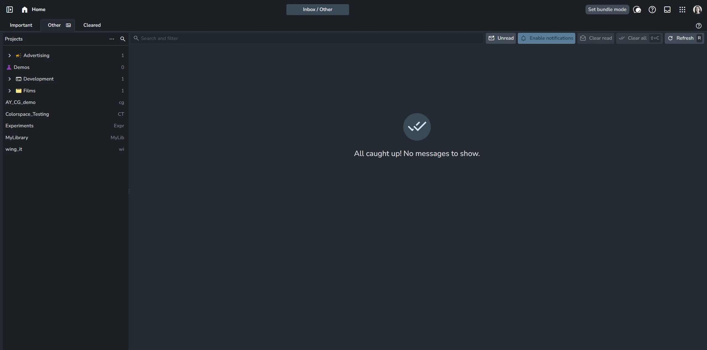

# Other

<PageInfo />

**Other** is the second tab of the [Inbox](index.md). It lists every status change that reaches the user, and the activity on entities the user is related to, as assignee or author, without watching them. New messages here update the unread count but never notify, so the tab suits a look now and then. Mentions and activity on watched entities go to [Important](important.md). The layout, filters and actions are described on the [Inbox](index.md) page.

## What lands here

A message lands here when the user's reference to the activity is a relation, or when the activity is a status change, whatever the reference.

| Activity | Why |
|---|---|
| A status change of a folder, task, product or version the user watches or is related to | Status changes never go to **Important** |
| Activity on a task the user is assigned to | Relation (assignee) |
| Activity on a version of a task the user is assigned to | Relation (assignee) |
| Activity on a folder that directly contains a task the user is assigned to | Relation (assignee) |
| Activity on a version the user is the author of | Relation (author) |

A relation counts only when the user neither watches the entity nor is mentioned; otherwise the message goes to [Important](important.md). Assignees watch their tasks and authors watch their versions automatically, so relations land here mainly for activity on folders and for users who stopped watching. See [Watchers](index.md#watchers).

## Controls and interactions

- The tab shows the number of unread messages, up to **99+**. Its tooltip reads **Changes to tasks assigned to you or authored by you**.
- The dot on the **Inbox** button does not count this tab, and its messages bring no toast, desktop notification or chime.
- Messages are newest first, with day dividers.
- **Unread**, **Clear read** and **Clear all** act on this tab only.
- The **Reason** filter offers **Mentioned**, **Watching** and **Related**.

## Related

- [Inbox and notifications](index.md)
- [Important](important.md)
- [Cleared](cleared.md)
- [Details panel](../details-panel.md)
