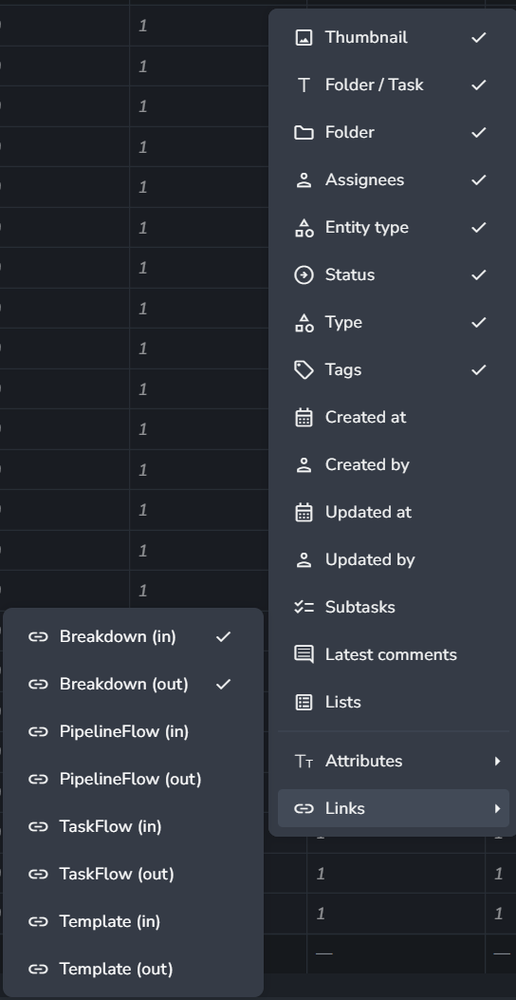
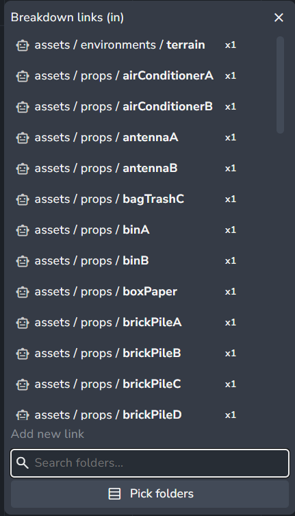
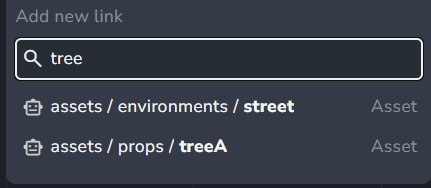

# Links manager

<PageInfo />

A link is a stored relationship between two entities of the same project, for example a breakdown link from a prop asset to the environment or shot that uses it. Links are data on the server, so pipeline tools and addons can read them and act on them. The links manager is the popover that lists the links of one entity for one link type and adds or removes them. It opens from the link columns of the [Overview](production-tracking/overview.md) and [Lists](production-tracking/lists.md) tables.

## Links and the links manager

### Link types

Each project defines its link types in its [anatomy](project/anatomy.md). A link type has a name, an input entity type (where the link starts), an output entity type (where it points), a color and a style (`solid` or `dashed`). Its full name is `name|input|output`, for example `breakdown|folder|folder`. The entity types are folder, task, product, version, representation and workfile.

Every project has these link types, which cannot be deleted:

| Link type | Input | Output |
|---|---|---|
| `breakdown` | folder | folder |
| `template` | folder | folder |
| `generative` | version | version |
| `reference` | version | version |

An entity cannot be linked to itself.

### Link columns

<Columns widths="55 45">
<Column>

Each link type adds two columns, named after the link type and the direction:

| Column | Shows |
|---|---|
| **Breakdown (in)** | Links that point to the entity (the entity is the output). |
| **Breakdown (out)** | Links that start at the entity (the entity is the input). |

The columns are hidden by default. They are turned on in the column menu (the **+** at the end of the column headers) under **Links**, and are kept in the page's [view](views.md).

- The Overview offers the link types whose input or output is a folder or a task. A list offers the link types of its entity type, so version links appear in version lists.
- The [Products](production-tracking/products.md) page has no link columns.
- A cell shows the linked entities as chips, for example **terrain** and **+45** for the others, or a **+** when empty. A cell of an entity of the wrong type is disabled.

</Column>
<Column>

</Column>
</Columns>

### The popover

<Columns widths="55 45">
<Column>

Double-clicking a link cell opens the links manager for that entity and link type.

| Part | Content |
|---|---|
| Header | The link type and direction, for example **Breakdown links (in)**, and a close button. |
| Link list | One row per linked entity: its icon, path and name, and a count such as **x1**. Several links to the same entity share one row. Without links: **No links yet**. |
| **Add new link** | A search field (**Search folders...**, **Search tasks...**, ...) and a **Pick folders** (or tasks, ...) button. |

A row of an entity the user cannot read shows **Access Restricted**; managers and admins see **Unknown** for a linked entity that no longer exists.

</Column>
<Column>

</Column>
</Columns>

An access group can limit the link types its users may create, with the **Restrict entity links creation** permission (see [Permissions](studio/permissions.md)); managers and admins are not limited. Defining or deleting link types needs write access to the project anatomy.

## Controls and interactions

<Columns widths="55 45">
<Column>

| Control | What it does |
|---|---|
| Click a row | Opens the linked folder, task, version or representation in the [details panel](details-panel.md). |
| Unlink button (on hover) | Removes the link, or all links to that entity (**Remove all N links**). |
| Count (**x1**, **x3**, ...) | Click to type a number: links are added or removed until the count matches. The lowest number is 1; the unlink button removes the rest. |
| Search field | Finds entities of the target type by name. `ArrowUp` and `ArrowDown` move through the results, `Enter` or a click adds the link. |
| **Pick** button | Opens a picker that starts at the current folder, to select one or more entities. |
| `Escape`, or a click outside | Closes the popover. |

Adding and removing links can be undone with the table's undo.

</Column>
<Column>

</Column>
</Columns>

### Copy and paste

Selected link cells can be copied and pasted between entities in the table.

| Shortcut | Action |
|---|---|
| `Ctrl`/`Cmd` + `C` | Copies the links of the selected cells. |
| `Ctrl`/`Cmd` + `V` | Replaces the links of the target cell with the copied ones. |
| `Shift` + `Ctrl`/`Cmd` + `V` | Adds the copied links to the existing ones. |

A paste that would link an entity to itself is refused with **You can't link an entity to itself**.

### Other ways to create links

Addons and the REST API create links as well. The API takes the `input` and `output` entity ids and a `linkType`; many links can be created in one request.

## Power features

These features need the [Power Pack](../../addons/production-tracking/power-pack/index.md) and a license.

### Links dialog

Pressing `G` with an entity selected opens a graph of its links, and `L` opens its links in columns, where they can also be edited. Pressing the same key again closes the dialog; the other key switches between the two. Without the Power Pack, the keys open the Power Pack dialog.

## Related

- [Overview](production-tracking/overview.md)
- [Lists](production-tracking/lists.md)
- [Details panel](details-panel.md)
- [Project anatomy](project/anatomy.md)
- [Permissions](studio/permissions.md)
