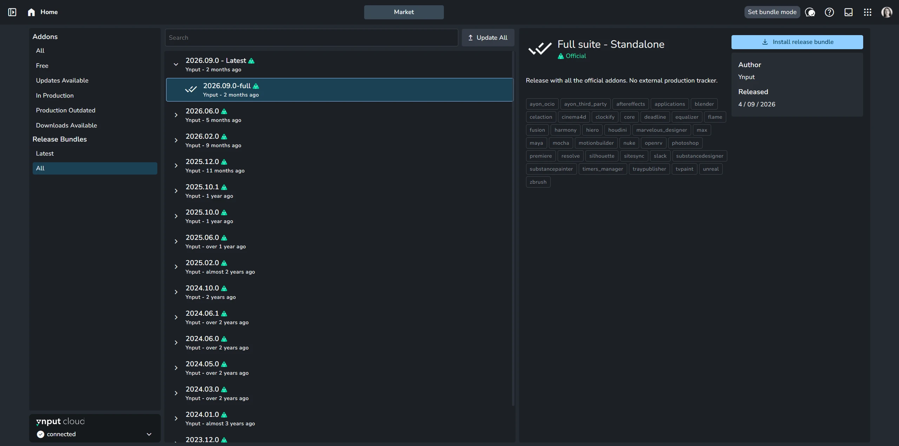

# Market

<PageInfo />

The Market is the catalog of addons and pipeline release bundles that Ynput publishes for AYON servers. It shows which addons and versions are already on the server, downloads new addons and updates straight from Ynput Cloud, and starts the installation of a tested release. A downloaded addon is not used until a bundle includes it, so the Market works together with [Bundles](studio/bundles.md) and the [Install pipeline release](dialogs/install-pipeline-release.md) dialog. Uploading an addon from a file is done on [Addons](studio/addons.md) instead.

## Addons and releases

The page has three columns: the filters with the Ynput Cloud connection on the left, the list in the middle, and the details of the selected item on the right.

### Filters

| Group | Filter | Shows |
|---|---|---|
| **Addons** | **All** | Every addon, downloaded or not. |
| | **Free** | Addons free to download, without a subscription. |
| | **Updates Available** | Downloaded addons with a newer version. |
| | **In Production** | Downloaded addons used by the production bundle. |
| | **Production Outdated** | Addons whose version in the production bundle is outdated. |
| | **Downloads Available** | Addons not downloaded yet. |
| **Release Bundles** | **Latest** | The latest pipeline release. |
| | **All** | Every pipeline release. |

The chosen filter and the selected item are kept in the address, for example `/market?selected=blender`, so a link opens the same addon.

### Addon list

Each card shows the addon icon, title and publisher, a badge for official addons (published by Ynput) and verified publishers, and an action button. Downloaded addons come first, then addons with updates, then official ones, then the rest by name. Addons flagged as cloud-only appear only on servers managed by Ynput Cloud.

| Button | Meaning |
|---|---|
| **Install** | Not downloaded. Downloads the addon. |
| **Update** | Downloaded, a newer version exists. Downloads it. |
| **Downloaded** | Downloaded and up to date. |
| **Pending** | Waiting for **Update All** to reach it. |
| **Downloading**, **Updating** | Download in progress. |
| **Finished** | Downloaded in this session. |
| **Failed** | The download failed; the details show the error. |
| **Subscribe** | The addon needs a subscription that the connected account does not have. |

Downloads run on the server as events (see [Event Viewer](event-viewer.md)), so their progress is the same in every browser. When a download finishes, the app asks to restart the server, which loads addons at start.

### Addon details

| Part | Content |
|---|---|
| Header | Icon, title and **Official**, **Verified** or **Unverified**. |
| Tags | **Subscription** for licensed addons (marked as included in a plan when it is a Power feature) and **Early preview** for beta addons. |
| Description | The publisher's description. |
| **Downloaded Versions** | A downloaded version, with **+n more** for the others, or **Not downloaded**. |
| **Production Usage** | The version in the production bundle, or **Not used in Production**. See the actions below. |
| **Author**, **Latest Version** | The publisher, and the newest version that works with this server, with a note when newer versions need a server update. |
| Links | The publisher's links by type, such as **Github** and **Documentation**. |

The action button at the top right depends on the state:

| Button | When | What it does |
|---|---|---|
| **Download v&lt;version&gt;** | Not downloaded, or an update exists | Downloads the newest compatible version. |
| **v&lt;version&gt; (server update required)** | The newest version needs a newer server | Disabled. |
| **Downloading...**, **Downloaded !**, **Pending...** | During a download, after it, or during **Update All** | Disabled. |
| **Uninstall** | Downloaded and up to date | Opens [Addons](studio/addons.md) with the addon selected, where it can be removed. |
| **Subscribe** | A subscription is needed | Opens the subscription page. |
| **Report** | The download failed | Opens a bug report form. |

The arrow next to the button lists all versions: downloaded ones have a check mark, versions that need a newer server are disabled. Choosing one downloads it. Under **Production Usage**, **Use &lt;version&gt;** opens [Bundles](studio/bundles.md) with a copy of the production bundle that uses the newest downloaded version; when production is current, **Bundle** opens the production bundle at this addon.

### Release bundles

A pipeline release is a tested set of addons, launcher installers and dependency packages. The list groups the releases by version (the part of the name before the first `-`); the newest group reads **Latest**. Expanding a group shows its releases, for example a full suite and a smaller variant.

| Part | Content |
|---|---|
| Header | Icon, label and **Official**. |
| Description | What the release contains. |
| Addons | One tag per addon. Clicking one opens it in the addon list. |
| **Install release bundle** | Opens the [Install pipeline release](dialogs/install-pipeline-release.md) dialog for this release. |
| **Author**, **Released** | Ynput, and the release date. |

The latest release is available to every connected server. Installing earlier releases needs the Power Pack, see [Release history](#release-history).

## Controls and interactions

| Control | What it does |
|---|---|
| **Search** | Filters the list by name. For releases, the group title matches too. |
| **Update All** | Downloads the newest version of every downloaded addon that has an update. It reads **Updating...** while it runs and **All Updated** when done. |
| Group arrow | Expands or collapses a release group. |
| Card | Selects the item and opens its details. |
| Card button | Downloads or updates the addon, see [Addon list](#addon-list). |

### Connecting to Ynput Cloud

The Market needs the server to be connected to a Ynput Cloud account, but no paid plan. The box at the bottom of the filters reads **connected** or **link an account**. When connected, its dropdown shows the instance and the organization, with **Disconnect**. Actions that need the connection open the **Connect to Ynput Cloud** dialog, which lists **Addon Market Access**, **Official Release Bundles** and **Automated Bootstrapping** and returns to the Market after signing in. A server in offline mode cannot reach the Market.

The menu entry is shown to admins, and the server returns the catalog only to admins. See [Ynput Cloud](../../ynput-cloud/index.md).

## Power features

These features need the [Power Pack](../../addons/production-tracking/power-pack/index.md) and a license, see [Power features](../../production-tracking/power-features.md).

### Release history

Every pipeline release in the list can be installed, not only the latest. Without the Power Pack, **Install release bundle** of an earlier release is a Power Pack button that opens the Power Pack dialog.

## Related

- [Bundles](studio/bundles.md)
- [Addons](studio/addons.md)
- [Install pipeline release](dialogs/install-pipeline-release.md)
- [Services](services.md)
- [App header](app-header.md)
- [Keyboard shortcuts](quick-navigation.md#keyboard-shortcuts)
- [Addons catalog](../../addons/index.md)
