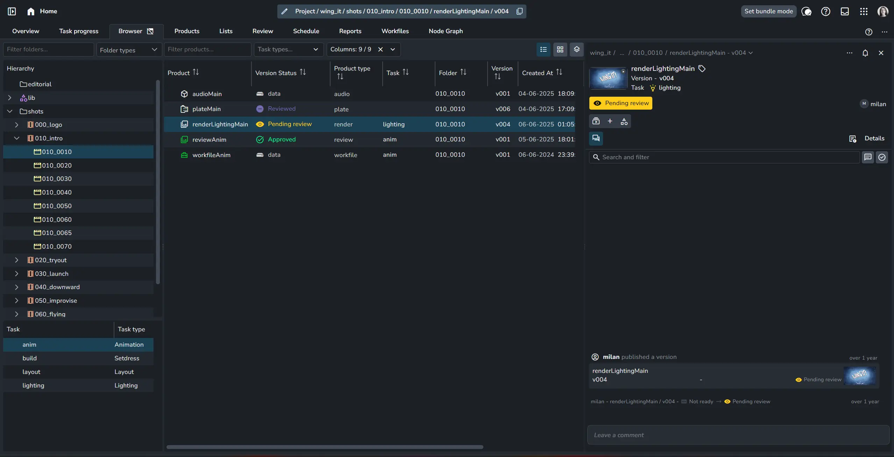

# Browser page (deprecated)

<PageInfo />

The Browser lists the products published to a project, folder by folder, each with its latest version. It is deprecated and no longer developed: the [Products](products.md) page replaces it. Its tab is shown only when the server's frontend flags include `enable-legacy-version-browser`; the page URL still opens without it.

## Folders and products

| Region | Contents |
|---|---|
| Left | The folder hierarchy, with **Filter folders...** and **Folder types**, and the task list of the selected folders below it |
| Middle | The products of the selected folders, filtered by the selected tasks |
| Right | The [details panel](../details-panel.md) of the selected product or version |

The product list has the columns **Product**, **Version Status**, **Product type**, **Task**, **Folder**, **Version**, **Created At**, **Author** and **Frames**. Most columns sort with a click on their header. The **Version Status** cell changes the status of the shown version, and the **Version** cell switches which version of the product is shown.

## Controls and interactions

| Control | What it does |
|---|---|
| **Filter products...** | Filters the products by text |
| **Task types...** | Shows only products of tasks of the chosen types. **Filter products by task** on the [Workfiles](workfiles.md) task menu sets it too |
| **Columns** | Shows or hides columns; **Hide column** on a column header does the same |
| View buttons | **List View**, **Card View** (thumbnails) and **Grouped View** |

- `Spacebar` opens the selected version in the [web viewer](../web-viewer.md).
- The right-click menu of a product has **Open in viewer**, **Upload version** (for one product), a disabled **Add to list (deprecated)**, **Product detail** and **Version detail**.

## Related

- [Products and versions](products.md)
- [Workfiles](workfiles.md)
- [Details panel](../details-panel.md)
