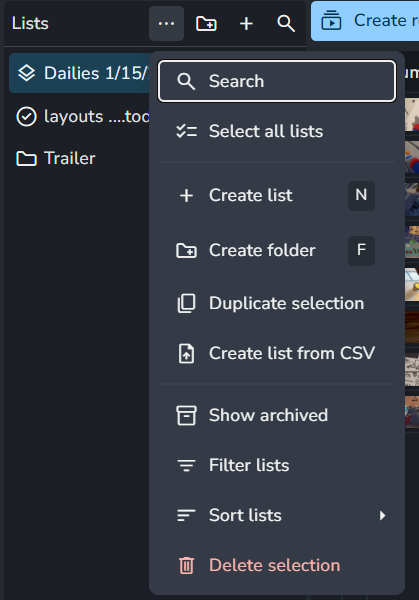
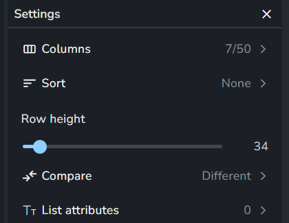
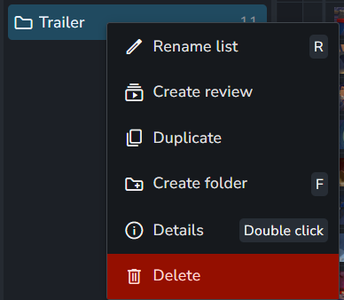
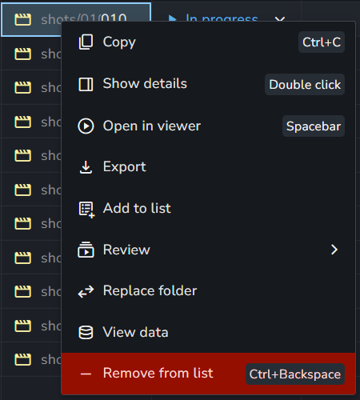
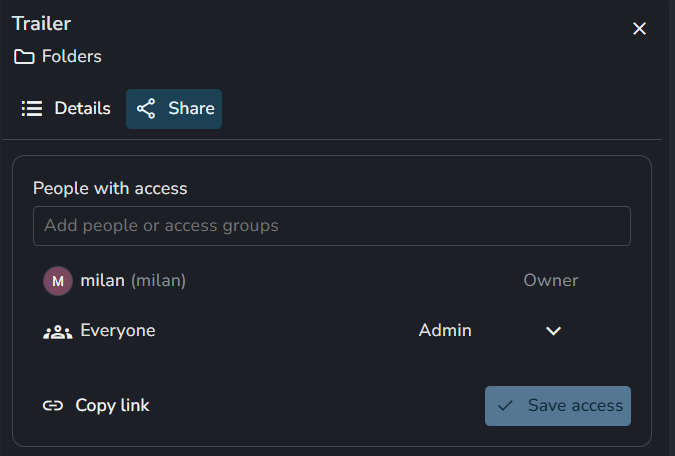

# Lists

<PageInfo />

A list collects folders, tasks or versions from anywhere in a project into one table, outside the folder hierarchy: shots for a trailer, versions for dailies, tasks to chase, or a personal to-do list. The lists table on the left chooses the list, the items table in the middle shows and edits its items, and the panel on the right shows the list details or the selected item in the [details panel](../details-panel.md). Items are added from other pages with **Add to list**, for example from [Task progress](task-progress.md), [Products](products.md) or the [Project overview](overview.md). Lists of the review session type are shown by the [Review addon](../../../addons/production-tracking/review/index.md) instead.

## Lists and items

### Lists table

Each row is a list, with an icon for its entity type and the number of items. A list holds one entity type, chosen when it is created: **Folder**, **Task** or **Version**. Products cannot be added; **Add to list** on a product adds its featured version.

<Columns widths="55 45">
<Column>

| Control | What it does |
|---|---|
| `+` (**Create list**, `N`) | Creates a list. The dialog asks for the **List label** and the **Entity type** |
| Folder button (**Create folder**, `F`) | Creates a list folder, see [List folders](#list-folders). Without the Power Pack, it opens the Power Pack dialog |
| Search button | Filters the lists by name |
| `...` menu | **Search**, **Select all lists**, **Create list**, **Create folder**, **Duplicate selection**, **Create list from CSV**, **Show archived**, **Filter lists**, **Sort lists** and **Delete selection** |

**Filter lists** filters by **Entity Type**, **Tags** and the attributes of lists. **Create list from CSV** creates a list from a CSV file, see [Import CSV](../dialogs/import-csv.md).

</Column>
<Column>

</Column>
</Columns>

### Items table

The items of the selected list, one row per item. It works like the [Project overview](overview.md) table: filters, columns, sorting and editing in cells. List attributes, list values and comparing need the Power Pack, see [Power features](#power-features). Items can be reordered by dragging. Columns that cannot be edited on a list, for example most columns of a version list, are read-only and show a lock icon.

### Details and sharing

The panel on the right shows the selected list with two tabs.

- **Details:** the list attributes (**Label**, **Tags**, **List category**, **Active**) and read-only details: ID, entity type, list type, item count, owner, and who created and last updated it, and when.
- **Share:** the owner, **Everyone** with its access level, and **Copy link**. Without the Power Pack, a **Manage list access** button opens the Power Pack dialog, and everyone has full control of every list; see [List access](#list-access).

## Controls and interactions

### Toolbar

| Control | What it does |
|---|---|
| **Create review** | Opens the list in a review session of the Review addon. Disabled for an empty list |
| Undo, redo, remove | Undo and redo edits; remove the selected items from the list |
| Search filter | Filters the items |
| **Compare with** | See [Compare](#compare). Without the Power Pack, a **Compare** button with a lightning symbol opens the Power Pack dialog |
| Sync button | Reloads the items |
| **Import / Export** | **Import** loads values into the list items from a file, see [Import CSV](../dialogs/import-csv.md). **Export** needs the Power Pack, see [Export](overview.md#export) |
| Actions | Addon actions that run on the list |
| **Customize** | **Columns**, **Sort**, **Row height**, **Compare** and **List attributes**. **Compare** and **List attributes** need the Power Pack |

### Context menus

<Gallery columns={2} rows={1} more="show-all">

</Gallery>

A list, in the lists table:

| Entry | What it does |
|---|---|
| **Rename list** / **Rename folder** (`R`) | Renames it |
| **Create review** | Creates a review session from the list |
| **Duplicate** | Copies the list |
| **Edit folder** | Changes the label, scope, icon and color of a folder |
| **Create list** (`N`), **Create list from CSV** | On a folder: creates a list in it |
| **Create folder** (`F`) / **Create subfolder** | Creates a folder with the selected lists, or a subfolder |
| **Move list** / **Move folder** | Opens a folder picker, which can also take a list out of its folder. Shown with the Power Pack |
| **Make root folder** (`Shift`+`Alt`+`F`) | Moves a subfolder to the top level |
| **Select all lists** | On a folder: selects its lists |
| **Details** (double-click) | Opens the list details |
| **Delete** | Deletes the lists, or a folder only (its lists stay). `Ctrl`/`Cmd` + click skips the confirmation |

An item, in the items table: **Copy** (`Ctrl`+`C`), **Paste** (`Ctrl`+`V`), **Show details** (double-click), **Open in viewer** (`Spacebar`), **Export**, **Add to list**, **Review**, **Replace** (folder, task or version: swaps the item for another entity of the same type), **View data** and **Remove from list** (`Ctrl`+`Backspace`, can be undone).

## Power features

These features need the [Power Pack](../../../addons/production-tracking/power-pack/index.md) and a license.

### List folders

List folders sort lists into a hierarchy; a folder holds lists and other folders. A folder has a **Label**, a **Scope** (**Lists**, **Review Sessions** or both), and an optional icon and color. `F` depends on the selection: with nothing selected it creates an empty folder, with lists selected a folder that contains them, with a folder selected a subfolder. Users who are not admins or managers can edit and delete only the folders they own.

### List attributes and list values

List attributes are extra fields defined on one list, shown as extra columns with a value for each item. They are not shared between lists. Examples: an approval checkbox per director, a delivery date, the vendor of outsourced work, or a flag per cut. They are added, renamed and deleted in **Customize** > **List attributes**. Without the Power Pack, its **Add attribute** button opens the Power Pack dialog.

An item can also hold its own value for any attribute of the entity, a list value, without changing the entity itself. A value the item does not set is shown greyed, inherited from the entity. Fields that only the entity has, such as status or assignees, still edit the entity; their column headers show the entity type icon.

### Compare

**Compare with** in the toolbar adds a compare column next to each attribute column: **Entities** compares the list values with the entities' own values, **Choose a list...** with the values of the same items in another list of the same entity type. Two lists can also be compared from the lists table: **Compare lists** when two lists are selected, or **Compare with current list** on the right-click menu of another list. **Customize** > **Compare** sets what is highlighted (**Highlight**), the highlight **Color**, and **Show entities from both lists**, which adds the items found only in the compared list as read-only rows.

### List access

With the Power Pack, the **Share** tab has **People with access**, where users and access groups are added with an access level, and **Save access**.

<Columns widths="55 45">
<Column>

| Level | Can |
|---|---|
| None | Not see the list |
| Viewer | View the list and its items |
| Editor | Also add and remove items |
| Admin | Everything: rename, delete, change list attributes and manage access |

Admins and managers always have full control. A list without access settings is open to everyone.

</Column>
<Column>

</Column>
</Columns>

### Other Power features

- **Advanced filters**, **column summaries** and **saved and shared views** work as on the [Overview](overview.md#power-features).
- **Export** of the items to Excel or CSV, see [Export](overview.md#export).
- **Import** into lists can keep separate values per list, see [List values](../dialogs/import-csv.md#list-values) in Import CSV.

## Related

- [Review sessions](../../../addons/production-tracking/review/index.md)
- [Project overview](overview.md)
- [Products and versions](products.md)
- [Import CSV](../dialogs/import-csv.md)
- [Views](../views.md)
- [Details panel](../details-panel.md)
- [Power Pack](../../../addons/production-tracking/power-pack/index.md)
