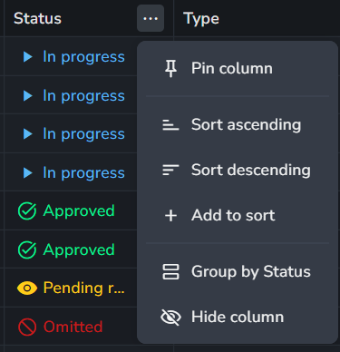
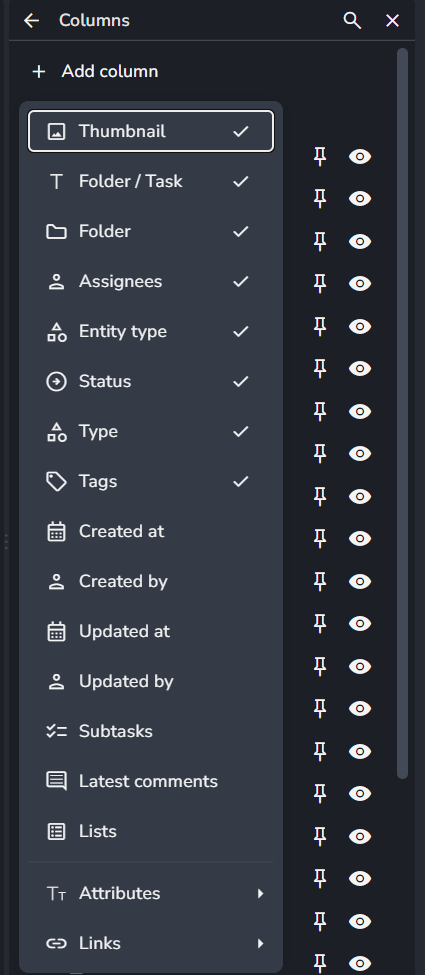
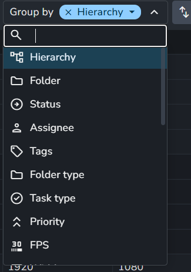
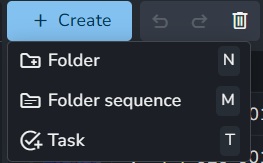
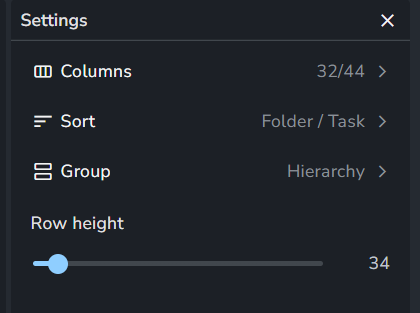
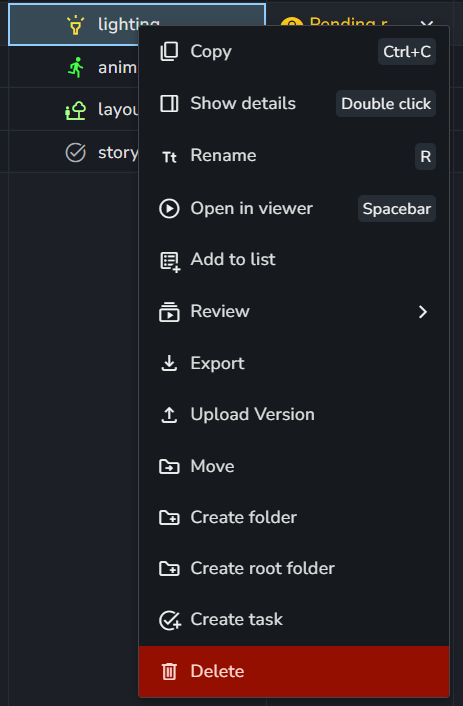
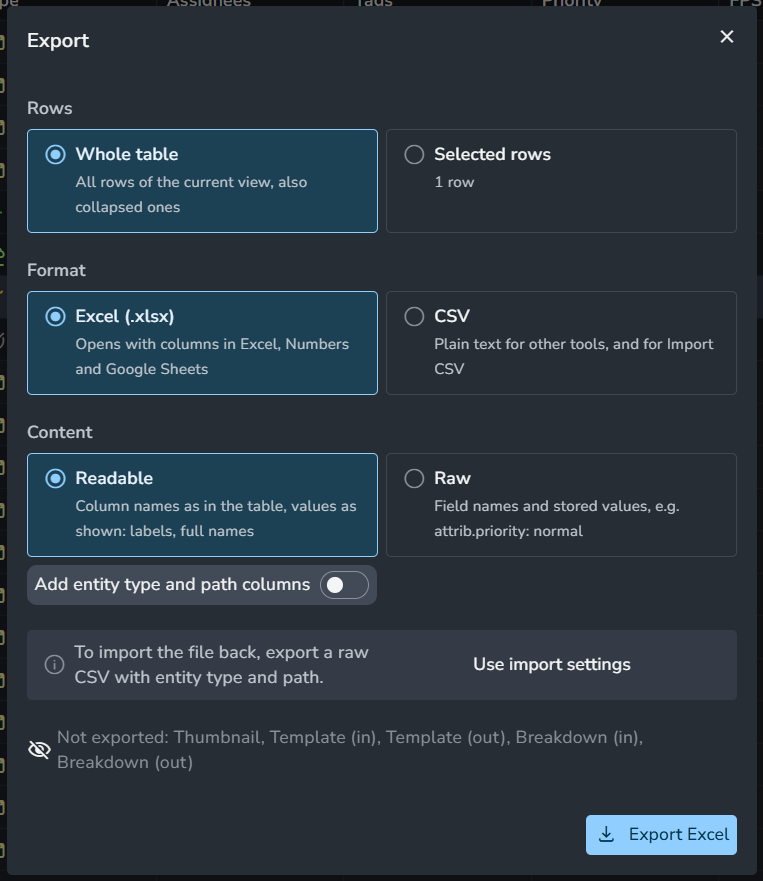

# Project overview

<PageInfo />

The Overview is the default page of a project and the place to view and edit its folders and tasks. It is a spreadsheet: one row per folder or task, one column per field or attribute, with editing in cells, copy and paste, filtering, grouping, creating, moving and exporting. The [slicer](../slicer.md) on the left limits the rows, for example to one sequence, and the [details panel](../details-panel.md) on the right shows the selected row. For progress at a glance, use [Task progress](task-progress.md); for published versions, [Products](products.md).

## Table

### Rows

With **Group by** set to **Hierarchy** (the default), folders are shown with their subfolders and tasks nested below them; the arrow on a folder row expands it. A value inherited from a parent folder is shown in gray; a cell can keep it or hold its own value, and **Inherit from parent** in the right-click menu clears an own value. The read restrictions of the user's access groups limit the rows, and cells the user cannot edit are read-only.

### Editing

| Action | How |
|---|---|
| Edit a cell | Double-click it. Cells with options, such as status or assignees, open their menu with one click on the arrow |
| Select cells | `Shift` + click selects a range, `Ctrl`/`Cmd` + click adds cells, dragging selects a block. Clicking the row selector at the left selects whole rows |
| Move between cells | Arrow keys, `Tab` and `Shift` + `Tab` |
| Copy and paste | `Ctrl`/`Cmd` + `C` and `Ctrl`/`Cmd` + `V`, also to and from other spreadsheet software |
| Undo and redo | The arrows in the toolbar, `Ctrl`/`Cmd` + `Z` and `Ctrl`/`Cmd` + `Shift` + `Z` |
| Delete | The bin in the toolbar (**Delete selected**), or **Delete** in the right-click menu |

All attributes of the selected entity can also be edited in the [details panel](../details-panel.md).

### Columns

<Columns widths="55 45">
<Column>

Clicking a header sorts by that column, clicking again reverses the order. Columns can be reordered by dragging. The `...` button on a header opens the column menu: **Pin column** (keeps it at the left while scrolling), **Sort ascending**, **Sort descending**, **Add to sort** (sorts by several columns), **Group by** the column, and **Hide column**.

The `+` at the end of the headers, or **Add column** in **Customize** > **Columns**, adds a column: built-in fields such as **Entity type**, **Created at**, **Updated by**, **Subtasks**, **Latest comments** and **Lists**, any attribute under **Attributes**, and link columns under **Links**, see [Links manager](../links-manager.md).

</Column>
<Column>

</Column>
</Columns>

### Grouping

**Group by** in the toolbar arranges the rows: **Hierarchy**, **Folder** (tasks grouped by their folder), or a field such as **Status**, **Assignee**, **Tags**, **Folder type**, **Task type**, **Priority** or an attribute of type string, integer or float. Clearing it with `×` shows a flat list of tasks. Each grouping has an ascending or descending order. A group row can be expanded and collapsed, and **Ungroup** in its right-click menu removes the grouping. The **Group** settings in **Customize** need the Power Pack, see [Group settings](#group-settings).

## Controls and interactions

### Toolbar

| Control | What it does |
|---|---|
| **Create** | Creates a **Folder** (`N`), a **Folder sequence** (`M`) or a **Task** (`T`). A task needs a selected folder, which becomes its parent. The name is generated from the label by the name template of the project anatomy and can be edited. `Ctrl`/`Cmd` + `Enter` confirms the dialog |
| Undo, redo, delete | See [Editing](#editing) |
| **Search and filter** | Fuzzy search by name or path, and filters on any attribute, with suggested or typed values. More filter options need the Power Pack, see [Advanced filters](#advanced-filters) |
| Sync button | Reloads the table with changes made by other users |
| **Group by** | See [Grouping](#grouping) |
| **Import / Export** | **Import** opens [Import CSV](../dialogs/import-csv.md) for the folder hierarchy. **Export** needs the Power Pack, see [Export](#export) |
| Actions | Addon actions for the project; up to two of them are shown as buttons, the rest in the menu next to them |
| **Customize** | **Columns**, **Sort**, **Group** and **Row height**. These settings, the filters and the grouping are saved in the page's [view](../views.md) |

<Gallery columns={2} rows={1} more="show-all">

</Gallery>

### Right-click menu

<Columns widths="55 45">
<Column>

The entries depend on the cell and the selection:

- **Copy** (`Ctrl`+`C`), **Copy row**, **Paste**.
- **Show details** (double-click), **Rename** (`R`), **Open in viewer** (`Spacebar`).
- **Add to list** (see [Lists](lists.md)), **Review** (review session actions).
- **Export** (Power Pack), see [Export](#export).
- **Upload Version**, see [Upload version](../dialogs/upload-version.md).
- **Move**: moves the selected folders and tasks to another folder through a destination dialog. A folder with published versions cannot be moved.
- **Create folder**, **Create root folder**, **Create task**.
- **Expand children** / **Collapse children** on folders (`Alt` + click on the arrow does the same), **Expand** / **Collapse** and **Ungroup** on group rows, **Inherit from parent** on own values.
- **Delete**.

</Column>
<Column>

</Column>
</Columns>

## Power features

These features need the [Power Pack](../../../addons/production-tracking/power-pack/index.md) and a license, see [Power features](../../../production-tracking/power-features.md).

### Advanced filters

With the Power Pack, the **Search and filter** dropdown offers more options:

- **Exclude:** a filter excludes its values, for example hides all Approved tasks.
- **Match all:** a filter requires all its values, for example both the Character and Animation tags.
- Fields such as assignees or tags can be tested for having a value or having none.
- Date attributes offer preset ranges such as **Today**, **Yesterday**, **This week**, **Last month** or **This year**. **Custom range...** is available without the Power Pack.

Without the Power Pack, **Exclude** and **Match all** and these options are marked with a lightning symbol and open the Power Pack dialog.

### Group settings

**Customize** > **Group** lists the fields to group by, with **Show empty groups** and the order of the groups. Without the Power Pack, the fields are marked with a lightning symbol and open the Power Pack dialog; the **Group by** button in the toolbar works without it.

### Column summaries

The table gets a summary footer. It counts the folders, tasks and selected rows, and shows a calculation for each column, such as **Sum**, **Average**, **Min** and **Max** for numbers, or how many cells are filled. Without the Power Pack, the footer is not shown.

### Export

**Import / Export** > **Export** (or **Export** in the right-click menu) opens the export dialog. Without the Power Pack, **Export** is marked with a lightning symbol and opens the Power Pack dialog.

<Columns widths="50 50">
<Column>

- **Rows:** **Whole table** (all rows of the current view, also collapsed ones) or **Selected rows**.
- **Format:** **Excel (.xlsx)** or **CSV**.
- **Content:** **Readable** (column names and values as shown) or **Raw** (field names and stored values).
- **Add entity type and path columns**, and **Use import settings**, which sets a raw CSV with those columns so the file can be imported back with [Import CSV](../dialogs/import-csv.md).

Columns that cannot be exported, such as thumbnails, are listed as **Not exported**. The export contains every row the user may read, also rows the table has not loaded.

</Column>
<Column>

</Column>
</Columns>

### Other Power features

- **Slicer:** slice types other than **Hierarchy**, and split panels, see [Slicer](../slicer.md#power-features).
- **Saved and shared views**, see [Views](../views.md#power-features).
- **Entity templates:** stored hierarchies reused to create folders and tasks, see [hierarchy templates](../../../addons/production-tracking/power-pack/index.md#hierarchy-templates).
- **[Calculated attributes](../../../production-tracking/calculated-attributes.md):** attributes computed from a formula on the server.

## Related

- [Slicer](../slicer.md)
- [Details panel](../details-panel.md)
- [Views](../views.md)
- [Import CSV](../dialogs/import-csv.md)
- [Upload version](../dialogs/upload-version.md)
- [Links manager](../links-manager.md)
- [Task progress](task-progress.md)
- [Home tasks](../home/tasks.md)
- [Attributes](../studio/attributes.md)
