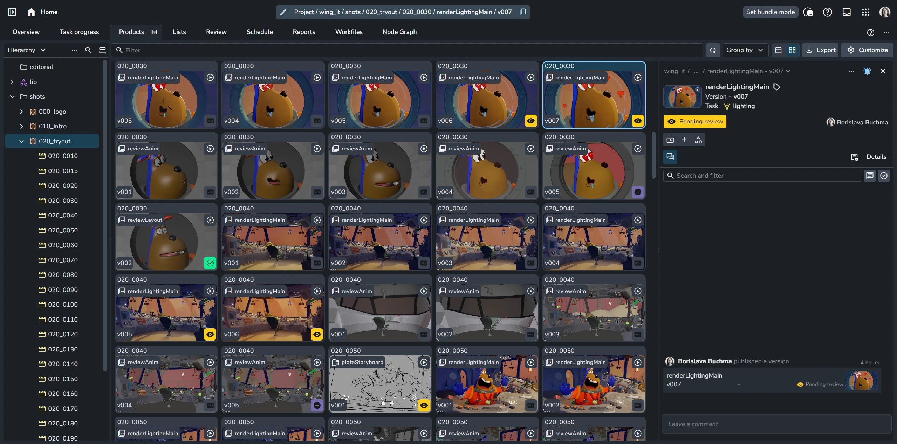
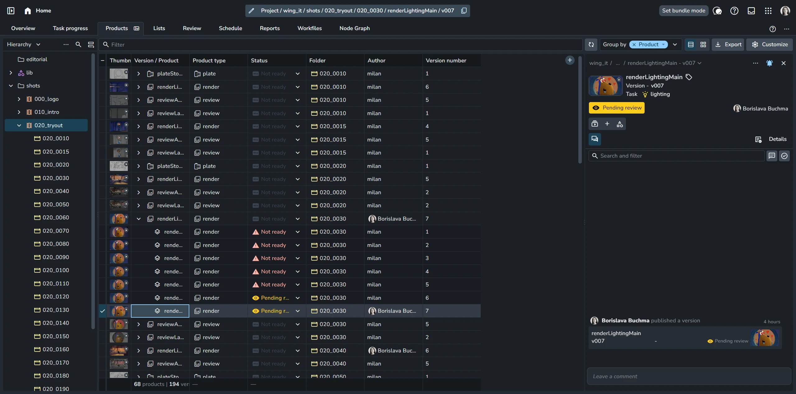
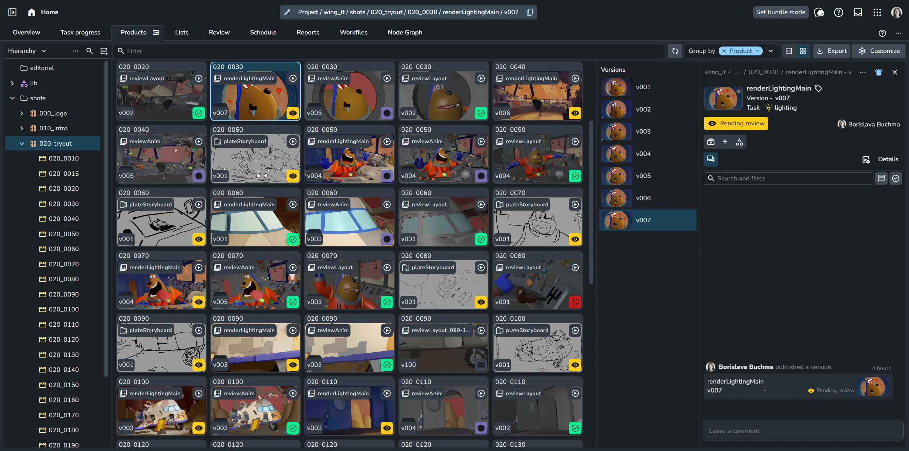
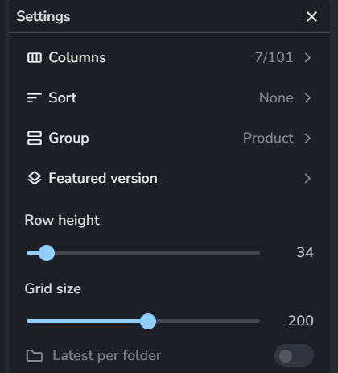
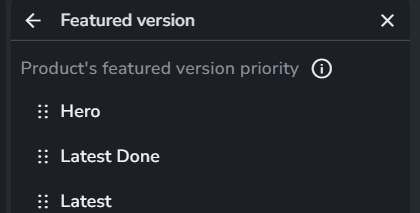
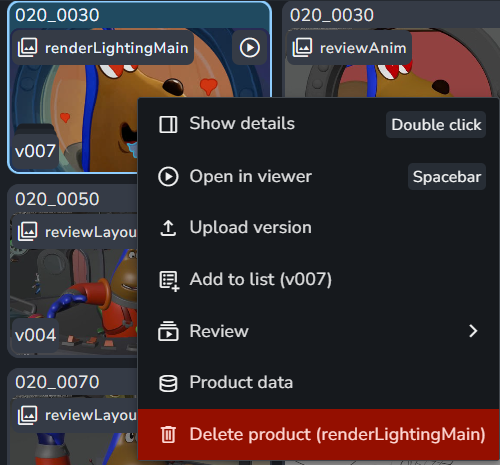

# Products and versions

<PageInfo />

The Products page lists everything published in a project. It shows **versions** (the default) or **products** with their versions, as a table or as cards with thumbnails, and lets users filter, group, sort, play media and edit version fields in place. The [slicer](../slicer.md) on the left limits the page to a folder, a list or a field value, and the [details panel](../details-panel.md) on the right shows the selected version or product. The page replaces the deprecated [Browser](browser.md).

## Versions and products

### Versions

Each row or card is one version: by default a flat list of all versions. Table cells such as **Status** can be edited in place. **Group by** a version field, such as **Status**, **Author** or **Task type**, puts the versions into groups, ordered ascending or descending.

### Products

**Group by** > **Product** shows one row or card per product.

- In the table, the arrow on a product row expands it to its versions.
- On the cards, each product shows its **featured version**: its thumbnail, version and status. Selecting a product opens the **Versions** panel next to the cards, with all its versions; selecting one there opens it in the details panel.
- A version filter keeps a product when at least one of its versions matches. For example, a status filter of Approved lists only products with an approved version.

<Gallery columns={2} rows={1} more="show-all">

</Gallery>

### Table and cards

The two buttons next to **Group by** switch between the **Table** (`T`) and the **Cards** (`C`).

- **Table:** a spreadsheet with one column per field. Clicking a header sorts by it. Columns are shown, hidden, ordered and pinned in **Customize**.
- **Cards:** each card shows the folder, the product name with its type icon, the thumbnail, the version and the status icon. A play button marks versions with reviewables. The card size is set with **Grid size** in **Customize**.

A hero version is marked with a star after its version name, in both views.

### Featured version

The featured version is the version a product stands for on the cards and in the player. **Customize** > **Featured version** sets the order of the rules that choose it: **Hero**, **Latest Done** and **Latest**. The first rule a product matches wins.

## Controls and interactions

### Toolbar

| Control | What it does |
|---|---|
| Search filter | Filters on the attributes of the version, the product, the folder and the task. **Latest Done** among the version values matches the highest version of each product with a status of the done state. More filter options need the Power Pack, see [Power features](#power-features) |
| Sync button | Reloads the page after new versions or products are published |
| **Group by** | Groups by **Product** or by a version field. The arrow on the chosen option switches ascending and descending. The `×` clears it, back to a flat list of versions |
| **Table** / **Cards** | Switch the view, shortcuts `T` and `C` |
| **Export** | Needs the Power Pack, see [Power features](#power-features) |
| **Customize** | Opens the settings panel |

### Customize panel

<Columns widths="60 40">
<Column>

| Setting | What it does |
|---|---|
| **Columns** | Show, hide, order and pin columns |
| **Sort** | The sort order of the table and the cards |
| **Group** | The grouping, as in the toolbar. Needs the Power Pack, see [Power features](#power-features) |
| **Featured version** | The order of **Hero**, **Latest Done** and **Latest** |
| **Row height** | The height of table rows |
| **Grid size** | The size of the cards, from 90 to 300 |
| **Latest per folder** | Shows only the latest published version of each folder. Disabled when grouped by product |

</Column>
<Column>

</Column>
</Columns>

These settings, the filters and the view mode are part of the page's view, see [Views](../views.md).

### Interactions

<Columns widths="55 45">
<Column>

- **Open details panel:** click a row or card; double-click, or **Show details**, also opens a closed panel.
- **Play:** `Spacebar` opens the selected version in the [web viewer](../web-viewer.md); for a product, its featured version.
- **Cards from the keyboard:** the arrow keys move the selection, with `Shift` they extend it; `Home` and `End` jump to the first and last card. With a product selected, `Tab` moves to the Versions panel.
- **Right-click menu:** **Show details**, **Open in viewer**, **Upload version** (see [Upload version](../dialogs/upload-version.md)), **Add to list** (see [Lists](lists.md)), **Review** (review session actions), **Product data** or **Version data** (the raw data), and, on the name, **Delete product** or **Delete version**.

</Column>
<Column>

</Column>
</Columns>

## Power features

These features need the [Power Pack](../../../addons/production-tracking/power-pack/index.md) and a license.

The page has the same Power features as the [Overview](overview.md#power-features):

- **Advanced filters:** **Exclude**, **Match all**, testing a field for a value, and preset date ranges in the search filter, see [Advanced filters](overview.md#advanced-filters).
- **Group settings:** **Customize** > **Group**, with **Show empty groups** and the group order, see [Group settings](overview.md#group-settings). The **Group by** button in the toolbar works without the Power Pack.
- **Column summaries:** a summary footer for the table. Grouped by product, it counts products and versions. See [Column summaries](overview.md#column-summaries).
- **Export** of the table, or the selected rows, to Excel or CSV, see [Export](overview.md#export).
- **Slicer:** slice types other than **Hierarchy**, and split panels, see [Slicer](../slicer.md#power-features).
- **Saved and shared views**, see [Views](../views.md#power-features).

## Related

- [Slicer](../slicer.md)
- [Details panel](../details-panel.md)
- [Upload version](../dialogs/upload-version.md)
- [Lists](lists.md)
- [Views](../views.md)
- [Browser](browser.md) (deprecated)
- [Versions without a pipeline](../../../production-tracking/track-work-without-a-pipeline.md)
- [Reviewables](../details-panel.md#version-files-tab)
