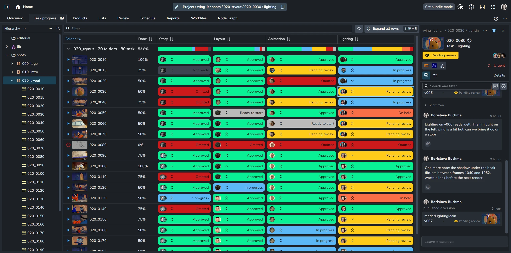
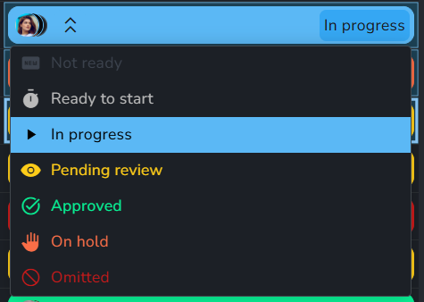
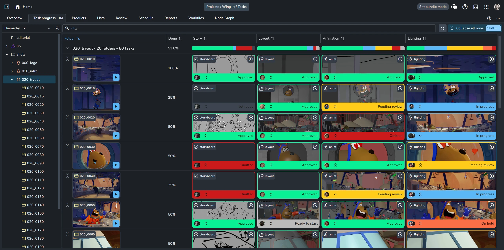
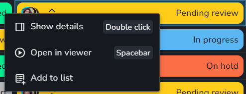

# Task progress

<PageInfo />

The Task progress page shows the tasks of a project as a matrix: one row per folder, one column per task type, and the task cards of that type in each cell. It answers "how far is this sequence?" at a glance and lets producers change the status, assignees and priority of many tasks at once. The [slicer](../slicer.md) on the left chooses the folders, and the [details panel](../details-panel.md) on the right shows the selected task or folder. For a spreadsheet of all folder and task attributes, use the [Project overview](overview.md); for the tasks of one user, [Home tasks](../home/tasks.md).

## Progress table

The table stays empty with **Select a folder to begin.** until something is selected in the slicer.

### Columns

| Column | Contents |
|---|---|
| **Folder** | The folder name and thumbnail, pinned to the left and sortable. The arrow on the left expands or collapses the row. Clicking the name or thumbnail selects the folder and opens it in the details panel |
| **Done** | The share of the folder's active tasks whose status has the **done** state, as a percentage. Sortable |
| One column per task type | The task cards of that type, in the order of the task types in the project anatomy. Clicking the header sorts the rows by the task status. Columns can be resized |

Folders are grouped under their parent. A parent row shows its name, the number of folders and tasks, the Done percentage, and a bar per task type with the share of each status in its color. The arrow on the left collapses the parent.

### Task cards

A card shows the assignees, the priority and the status of one task, in the color of its status. Hovering the card shows the task name.

- **Select:** click a card. `Ctrl`/`Cmd` + click adds to the selection, `Shift` + click selects a range. `Enter` selects the focused card.
- **Edit:** the assignee, priority and status areas of a selected card open their menus. A change applies to every selected task. With several tasks selected, adding or removing an assignee changes only that assignee on each task; their other assignees stay.

<Columns widths="55 45">
<Column>

The status menu lists the task statuses of the project in their colors, with the current one highlighted.

</Column>
<Column>

</Column>
</Columns>

### Expanded rows

**Expand all rows** (`Shift`+`E`) shows every row with larger cards that include the thumbnail, the task name with its type icon and a play button for tasks with reviewables. The button then reads **Collapse all rows**. Single rows can still be expanded or collapsed with their arrow.

## Controls and interactions

### Toolbar

| Control | What it does |
|---|---|
| Search filter | Free text and filters on **attributes**, **task type**, **status**, **assignees** and **tags**. The field used by the slicer is not offered |
| Sync button | Reloads the page when tasks or folders change elsewhere |
| **Expand all rows** / **Collapse all rows** | Shows or hides the expanded cards of all rows. Shortcut `Shift`+`E` |

Filter rules: several values in one filter match any of them; several filters must all match; the same filter can be added twice, for example two tag filters; a filter can exclude its values instead of including them.

### Interactions

<Columns widths="60 40">
<Column>

- **Open details panel:** double-click a card, or **Show details** in its right-click menu. `Escape` hides the panel.
- **Play reviewables:** `Spacebar` on a card or a folder opens it in the [web viewer](../web-viewer.md).
- **Add to list:** right-click the selected cards and choose **Add to list**, see [Lists](lists.md).
- **Column width:** right-click a task type header and choose **Reset column width**.

</Column>
<Column>

</Column>
</Columns>

The read restrictions of the user's access group limit which folders and tasks are listed.

## Power features

These features need the [Power Pack](../../../addons/production-tracking/power-pack/index.md) and a license, see [Power features](../../../production-tracking/power-features.md).

- **Slicer:** slice types other than **Hierarchy**, and split panels, see [Slicer](../slicer.md#power-features).
- **Saved and shared views**, see [Views](../views.md#power-features).

## Related

- [Project overview](overview.md)
- [Home tasks](../home/tasks.md)
- [Slicer](../slicer.md)
- [Details panel](../details-panel.md)
- [Lists](lists.md)
- [Reviewables](../../../production-tracking/reviewables.md)
