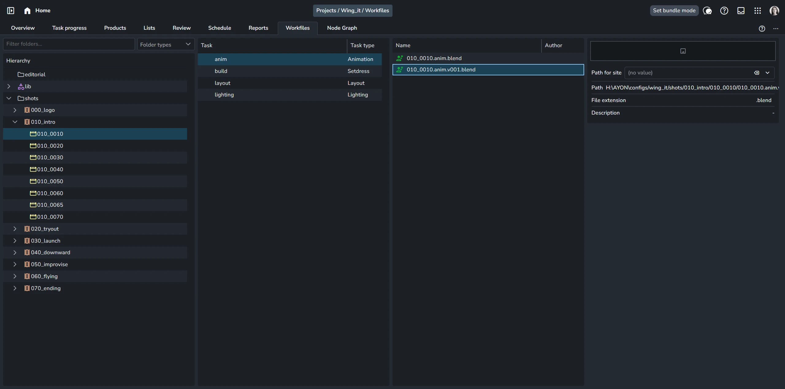
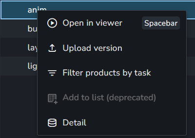
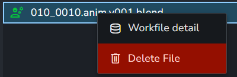

# Workfiles

<PageInfo />

The **Workfiles** tab lists the workfile records of a project's tasks. Folders are picked in a hierarchy, tasks in the task list next to it, and the workfiles of the selected tasks appear in a third column, with the selected workfile's thumbnail, path and attributes in a detail panel on the right. The records are written by the pipeline when artists save scene files with the [Workfiles tool](../../../pipeline/workfiles.md); the tab only shows them and can delete them. It has no action that opens a workfile or starts an application: workfiles are opened from the Workfiles tool inside an application or from the [Launcher](../../../pipeline/launcher.md). What a workfile is and how it relates to tasks is described in the [data model](../../how-ayon-works/entities.md#workfile).

## Folders, tasks and workfiles

The page has four columns. Each depends on the one to its left: selecting folders loads their tasks, selecting tasks loads their workfiles, and selecting a workfile fills the detail panel. The selection and the expanded folders are kept in the browser and restored when the page is opened again; selecting a project from the project menu clears them.

### Hierarchy

The folder tree of the project. Each folder shows its label (the name when there is no label) with its folder type icon; hovering shows the name. Several folders can be selected, and their tasks appear in the task list.

| Control | What it does |
|---|---|
| **Filter folders...** | Filters the tree by folder name, ignoring case. A matching folder is shown with its parents and all of its children |
| **Folder types** | Multi-select of the project's folder types. With types chosen, only folders of those types and their parents remain. The chosen types are shown by their capital letters, for example `S` for `Shot` |
| Expand arrow | Expands or collapses a folder. `Ctrl`/`Cmd` + click on the arrow of a selected folder expands or collapses all selected folders |

Managers and admins see every folder, task and workfile. For other users, the **Restrict folder read** setting of their access groups limits the folders, and with them the tasks and workfiles. See [Permissions](../../how-ayon-works/permissions.md#permission-keys) and [Project access](../project/project-access.md).

### Task list

| Column | Contents |
|---|---|
| **Task** | Task label with the icon of its task type. Inactive tasks are dimmed and show a crossed-out eye icon. Tasks with the same name in several selected folders are grouped under one expandable row |
| **Folder** | Folder label of the task. Shown only when more than one folder is selected |
| **Task type** | Task type name |

Tasks are sorted by label. Several tasks can be selected; a click on the empty area below the rows clears the selection. When the folder selection changes, tasks with the same names as the previously selected ones are selected again, so moving from shot to shot keeps, for example, the `compositing` task selected. Each selected task gets a highlight color on its icon (up to ten tasks), and its workfiles carry the same color in the workfile list. With no task in the selected folders the list shows **No tasks found**.

### Workfile list

The workfiles of all selected tasks in one table, in the order they were created. One workfile can be selected at a time. With no task selected, or no workfile in the selected tasks, it shows **No workfiles found**.

| Column | Contents |
|---|---|
| **Name** | File name of the workfile, taken from the end of its path, with an icon in the highlight color of its task. Hovering shows the full stored path |
| **Author** | Avatar of the user who created the workfile. When another user updated it last, a second avatar shows that user; otherwise the creator's full name follows the avatar. Hovering an avatar shows **Created by** or **Updated by** with the user and the date and time. The cell stays empty when the creator is not a user of the project |

The columns cannot be sorted and the list has no search field. It holds at most the first 1000 workfiles of the selected tasks. Workfiles of inactive tasks and inactive workfiles are listed too. Workfiles in AYON's internal folder are not listed.

### Detail panel

| Element | Contents |
|---|---|
| Thumbnail | The thumbnail of the workfile, or a placeholder image icon when it has none |
| **Path for site** | Dropdown of the sites registered to the signed-in user, by site ID. It shows **(no value)** until a site is chosen; the choice is remembered in the browser and can be cleared |
| **Path** | The workfile path with its `{root[...]}` placeholders replaced by root paths. A click copies the path |
| Attributes | One row per workfile attribute that has a value, labelled with the attribute title. Hovering the title shows the attribute description |

The roots used for **Path** come from the project anatomy for the platform of the selected site, overridden by the user's [root overrides](../project/roots.md) for that site. Without a site, the anatomy roots for the platform of the browser are used. A root that cannot be resolved stays as a placeholder.

The attributes a workfile can carry are those with the workfile scope on the [Attributes](../studio/attributes.md) page. The default ones are **File extension** and **Description**. The **Restrict attribute read** setting of the user's access groups can hide some of them.

## Controls and interactions

### Context menus

<Gallery columns={2} rows={1} more="show-all">

</Gallery>

A folder:

| Entry | What it does |
|---|---|
| **Open in viewer** (`Spacebar`) | Opens the folder in the [web viewer](../web-viewer.md) |
| **Add to list (deprecated)** | Always disabled |
| **Detail** | Opens a dialog with the raw data of the selected folder |
| **View all versions as latest** | Resets the version selection kept for the deprecated [Browser](browser.md) |

A task:

| Entry | What it does |
|---|---|
| **Open in viewer** (`Spacebar`) | Opens the task in the web viewer |
| **Upload version** | Opens the [Upload version](../dialogs/upload-version.md) dialog for the task and its folder. Enabled for a single task |
| **Filter products by task** / **Filter products by tasks** | Sets the task type filter of the deprecated [Browser](browser.md) to the task types of the selected tasks |
| **Add to list (deprecated)** | Always disabled |
| **Detail** | Opens a dialog with the raw data of the selected task |

A workfile (a right-click also selects it):

| Entry | What it does | Shown to |
|---|---|---|
| **Workfile detail** | Opens the **workfile detail** dialog with the raw data of the workfile as JSON | Everyone |
| **Delete File** | Asks for confirmation (**Delete &lt;name&gt;**, "Are you sure? This cannot be undone"), then deletes the workfile record and its links from the server. The scene file on disk is not touched | Everyone; the server accepts it only from managers, admins and users whose **Restrict folder delete** setting allows the folder of the workfile's task |

### Keyboard shortcuts

| Shortcut | Where | Action |
|---|---|---|
| `ArrowUp` / `ArrowDown` | Hierarchy, task list, workfile list | Move the selection to the previous or next row |
| `Shift` + `ArrowUp` / `ArrowDown` | Hierarchy, task list | Extend the selection |
| `Spacebar` | Hierarchy, task list | Open the first selected folder or task in the web viewer |

Other shortcuts of the web app are listed in [Keyboard shortcuts](../quick-navigation.md#keyboard-shortcuts).

## Related

- [Workfiles tool](../../../pipeline/workfiles.md)
- [Launcher](../../../pipeline/launcher.md)
- [Upload version](../dialogs/upload-version.md)
- [AYON entities](../../how-ayon-works/entities.md#workfile)
- [Roots](../project/roots.md)
- [Attributes](../studio/attributes.md)
- [Project production tracking](index.md)
