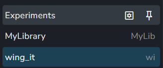
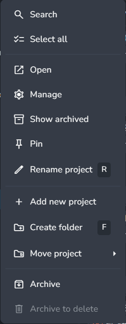
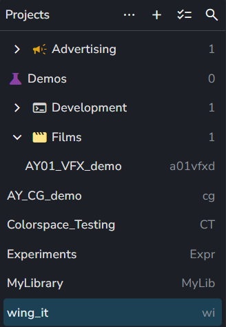

# Project list

<PageInfo />

The project list, titled **Projects**, sits on the left of several pages and selects the projects the page works on. It also pins, organizes and manages projects. It looks like the [slicer](slicer.md) of the project pages, which filters a page by folder, assignee or status instead; the project list is the one with the **Projects** header. Pins, folders and archived projects are the same everywhere the list appears.

## Projects and folders

### Where it appears

| Page | Selection | Notes |
|---|---|---|
| [Home tasks](home/tasks.md) | One or several projects | Shows the tasks of all selected projects |
| [Inbox](inbox/index.md) | One project or none | Viewing only: no new project, rename, folders, archive or delete |
| [Projects Manager](project/index.md) | One project | All tabs work on the selected project |

### The list

- Each row shows the project name and, on the right, the project code.
- **Pinned projects** are listed at the top, above a line, with a pin icon in place of the code. Pins are stored in the user's preferences on the server, so they follow the user to other browsers.
- Archived projects are hidden unless **Show archived** is on.
- With the Power Pack, projects can be grouped in folders, see [Project folders](#project-folders).

## Controls and interactions

<Columns widths="60 40">
<Column>

| Control | What it does |
|---|---|
| `...` | Opens the list menu, see [Menu](#menu). |
| **+** (**Add new project**) | Opens the **Create a new project** dialog. Shown to users who can create projects. |
| **Select all** | Selects all projects. Shown where several projects can be selected. |
| **Search projects** | Opens a search field above the list. |
| Click a project | Selects it. `Ctrl`/`Cmd` + click or `Shift` + click selects several, where the page allows it. |
| Double-click a project | Opens the project. |
| Settings button (on hover) | Opens the project's **Project settings** tab. |
| Pin button (on hover) | Pins or unpins the project. |

</Column>
<Column>

</Column>
</Columns>

### Menu

<Columns widths="65 35">
<Column>

The `...` menu and the right-click menu on a project offer the same actions for the selected projects. The right-click menu leaves out **Search**, **Add new project** and **Show archived**.

| Entry | What it does | Available to |
|---|---|---|
| **Search** | Opens the search field | Everyone |
| **Select all** / **Unselect all** | Selects or clears all projects, where several can be selected | Everyone |
| **Open** | Opens the project | Everyone except guests |
| **Manage** | Opens the project's **Anatomy** tab | Everyone except guests |
| **Show archived** | Shows or hides archived projects. Stored in the browser | Everyone except guests |
| **Pin** / **Unpin** | Pins or unpins the selected projects | Everyone |
| **Rename project** (`R`) | Edits the project label in place. The project name does not change | Managers and admins |
| **Add new project** | Opens the **Create a new project** dialog | Users who can create projects |
| **Create folder** (`F`) | Without the Power Pack, marked with a lightning symbol; it opens the Power Pack dialog. See [Project folders](#project-folders) | Managers and admins |
| **Archive** / **Activate** | Sets one project inactive or active | Managers and admins |
| **Delete** | Deletes an archived project after a confirmation. For an active project the entry reads **Archive to delete** and is disabled | Managers and admins |

Addons can add entries of their own to both menus.

</Column>
<Column>

</Column>
</Columns>

Archiving keeps all data. Deleting removes the project with all its entities from the server and from every user's access, and cannot be undone; pipeline files on the studio storage are not touched.

## Power features

These features need the [Power Pack](../../addons/production-tracking/power-pack/index.md) and a license, see [Power features](../../production-tracking/power-features.md).

### Project folders

<Columns widths="60 40">
<Column>

**Project folders** group projects, with an icon, a color and the number of projects on the right. A folder opens with the arrow on its left. Folders can be nested. Folders are hidden while searching. Everyone sees them; only managers and admins can create, change, move and delete them.

| Entry | What it does |
|---|---|
| **Create folder** (`F`), **Create subfolder** | Creates a project folder and puts the selected projects into it |
| **Move project**, **Move folder** | Moves the selection into a folder, or out of it with **Unset folder** / **Make root folder** (`Shift+Alt+F`) |
| **Rename folder** (`R`), **Edit folder**, **Delete (only folder)** | Changes or deletes a folder. Deleting a folder keeps its projects |

</Column>
<Column>

</Column>
</Columns>

## Related

- [Home tasks](home/tasks.md)
- [Inbox](inbox/index.md)
- [Projects Manager](project/index.md)
- [Projects](home/projects.md): the table of all projects in Home
- [Slicer](slicer.md)
