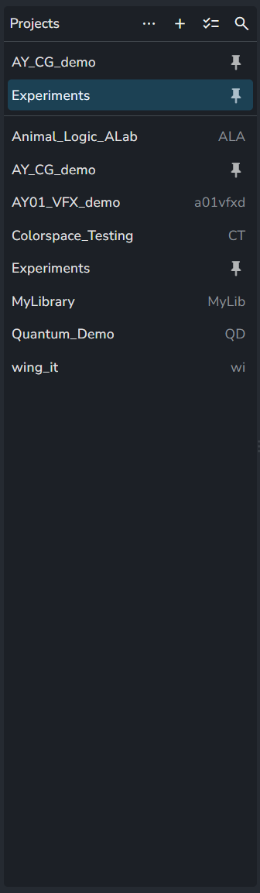

# Project list

<PageInfo />

The project list, titled **Projects**, sits on the left of several pages of the web app and selects the projects the page works on. It also pins, organizes and manages projects.

It looks like the [slicer](slicer.md) on project pages, which filters a page by hierarchy, assignees, status or task type. The project list is the one with the **Projects** header.

## Where it appears

| Page | Selection | Notes |
|---|---|---|
| [Home tasks](home/tasks.md) | One or several projects | Shows the tasks of all selected projects |
| [Inbox](inbox/index.md) | One project or none | Only viewing actions: no new project, rename, folders, archive or delete |
| [Projects Manager](project/index.md) | One project | All tabs work on the selected project |

Pins, folders and archived projects are the same in all of them.

## Controls

| Control | What it does |
|---|---|
| `...` | Opens the list menu, see [Menu](#menu) |
| **+** (**Add new project**) | Opens the **Create a new project** dialog. Shown to users who can create projects |
| **Select all** | Selects all projects. Shown where several projects can be selected |
| **Search projects** | Opens a search field above the list. Folders are hidden while searching |
| Click a project | Selects it. `Ctrl`/`Cmd` + click or `Shift` + click selects several, where the page allows it |
| Double-click a project | Opens the project |
| Settings button (on hover) | Opens the project's **Project settings** tab |
| Pin button (on hover) | Pins or unpins the project |

Pinned projects are listed at the top of the list, above a line, and keep a pin icon in place of the project code. Pins are stored in the user's preferences on the server, so they follow the user to other browsers.

## Menu

The `...` menu and the right-click menu on a project offer the same actions for the selected projects. The right-click menu leaves out **Search**, **Add new project** and **Show archived**.

| Entry | What it does | Available to |
|---|---|---|
| **Search** | Opens the search field | Everyone |
| **Select all** / **Unselect all** | Selects or clears all projects, where several projects can be selected | Everyone |
| **Open** | Opens the project | Everyone except guests |
| **Manage** | Opens the project's **Anatomy** tab | Everyone except guests |
| **Show archived** | Shows or hides archived projects. Stored in the browser | Everyone except guests |
| **Pin** / **Unpin** | Pins or unpins the selected projects | Everyone |
| **Rename project** (`R`) | Edits the project label in place. The project name does not change | Managers and admins |
| **Add new project** | Opens the **Create a new project** dialog | Users who can create projects |
| **Create folder** (`F`), **Create subfolder** | Creates a project folder. The selected projects are put into it | Power Pack feature |
| **Move project**, **Move folder** | Moves the selection into a folder, or out of it with **Unset folder** / **Make root folder** (`Shift+Alt+F`) | Power Pack feature |
| **Rename folder** (`R`), **Edit folder**, **Delete (only folder)** | Changes or deletes a folder. Deleting a folder keeps its projects | Power Pack feature |
| **Archive** / **Activate** | Sets one project inactive or active | Managers and admins |
| **Delete** | Deletes an archived project after a confirmation. For an active project the entry reads **Archive to delete** and is disabled | Managers and admins |

Addons can add entries of their own to both menus, for the selected projects.

Project folders are a [Power Pack](../../addons/production-tracking/power-pack/index.md) feature. Without a Power Pack license, the folder entries open the Power Pack dialog. Only managers and admins can create, change, move and delete folders.

Archiving keeps all data, and an archived project is hidden unless **Show archived** is on. Deleting removes the project with all its entities from the server and from every user's access, and cannot be undone. Pipeline files on the studio storage are not touched.

## Related

- [Home tasks](home/tasks.md)
- [Inbox](inbox/index.md)
- [Projects Manager](project/index.md)
- [Projects](home/projects.md): the table of all projects in Home
