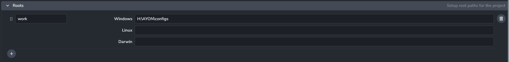
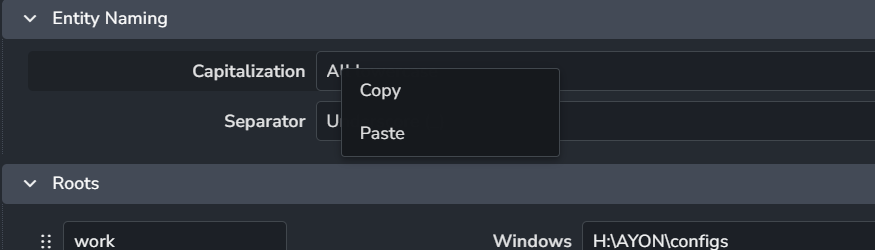

# Anatomy

<PageInfo />

The **Anatomy** tab of the [Projects Manager](index.md) edits the anatomy of the selected project: its roots, path templates, project attributes and the lists of types, statuses and tags its entities can use. A project gets its anatomy as a copy of an anatomy preset when it is created, and the web app opens this tab for the new project. From then on the anatomy is the project's own: changes here do not reach the preset or other projects (see [Creating a project](../../how-ayon-works/creating-a-project.md#the-anatomy-preset-becomes-the-projects-own-anatomy)). The presets are edited on the [Anatomy presets](../studio/anatomy-presets.md) page, and per-workstation root paths on the [Roots](roots.md) tab.

## Anatomy editor

The editor fills the page to the right of the [project list](../project-list.md). Each section is a collapsible panel with a short description on the right. How roots and templates decide file paths is explained in [Storage](../../how-ayon-works/storage.md); types, statuses, tags and links in [AYON entities](../../how-ayon-works/entities.md#statuses-types-and-tags).

### Sections

| Section | Content |
|---|---|
| **Entity Naming** | **Capitalization** (**All lowercase**, **All UPPERCASE**, **Keep original capitalization**, **Capitalize Every Word**, **capitalize Every Word Except First**) and **Separator** (**None**, **Underscore (_)**, **Dash (-)**, **Dot (.)**), used to suggest entity names from labels. |
| **Roots** | One entry per root: the root name and a path for **Windows**, **Linux** and **Darwin**. |
| **Templates** | **Version padding**, **Version template**, **Frame padding**, **Frame template**, and the template groups **Work**, **Publish**, **Hero**, **Delivery**, **Staging directories** and **Others**. Each template has a **Name**; work, publish, hero and delivery templates have a **Directory template** and a **File name template**. |
| **Attributes** | The project's own values of every attribute whose scope includes projects (see [Attributes](../studio/attributes.md)). Folders and tasks inherit them. |
| **Folder types** | **Name**, **Short name**, **Color**, **Icon**. |
| **Task types** | **Name**, **Short name**, **Color**, **Icon**. |
| **Link types** | **Link type**, **Input type**, **Output type**, **Color**, **Style** (solid or dashed). |
| **Statuses** | **Name**, **Short name**, **State** (**Not Started**, **In Progress**, **Done**, **Blocked**), **Icon**, **Color** and **Scope**, which limits the status to entity types. |
| **Tags** | **Name**, **Color**. |
| **Product Types** | **Default appearance** (**Default color**, **Default icon**) and **Appearance overrides**: color and icon per product base type. |

<Gallery columns={2} rows={1} more="show-all">

</Gallery>

### Lists and order

Roots, types, statuses and tags are lists. The handle on the left of an item drags it to another place, the **+** button below a list adds an item, and the delete button on the right removes one.

The order of folder types, task types and statuses matters: a new folder or task takes the first type, and a new entity the first status whose scope fits it. Names in the lists of roots, folder types, task types, statuses and tags must be unique, and templates need unique names within a group.

### Saving

**Save changes** sends the complete anatomy to the server, which validates it and writes it into the project in one transaction. If any part fails, nothing is saved, and the page shows **Failed to save anatomy** with the server's message. A successful save shows **Anatomy saved**.

- The project needs at least one folder type, one task type and one status.
- Folder types, task types, statuses and tags are written to the project's own tables in the order of the lists. Renaming an item renames it on every entity that uses it. Items removed from a list are deleted from the project; removing a folder type, task type or status that entities still use makes the save fail.
- Link types, roots, templates, entity naming and product types are stored with the project.
- Changed project attributes are stored as the project's attribute values, and the inherited values of folders and tasks are rebuilt.
- The server emits project change events for the saved changes.

Saving changes nothing on disk.

## Controls and interactions

### Toolbar

| Control | What it does | Shown to |
|---|---|---|
| **Copy anatomy** | Copies the anatomy as shown in the editor, including unsaved edits, to the clipboard as JSON. | Users who can view the anatomy |
| **Paste anatomy** | Reads JSON from the clipboard and replaces the whole editor content with it, as an unsaved edit. Shows **No content to paste** or **Invalid JSON** when the clipboard cannot be used. | Users who can view the anatomy |
| **Read-only** | Text shown instead of edit rights. | Users with **Read only** on **Project anatomy** in this project |
| **Save changes** | Saves the anatomy to the project. Active when the editor differs from the saved anatomy. Without edit rights its tooltip reads **You don't have edit permissions**. | Users who can view the anatomy |

Managers and admins can view and save the anatomy of every project. Users need **Read only** (view) or **Read & Write** (view and save) on **Project anatomy** in the project; this is a project permission of the access groups (see [Permissions](../studio/permissions.md#permission-settings)). Without it, the toolbar is hidden and the page shows **You don't have permission to view this project's anatomy**, and the project list puts the projects the user can view first.

### Field menu

<Columns widths="60 40">
<Column>

Right-clicking a field or a section offers **Copy** and **Paste**: they copy that value as JSON, or paste JSON from the clipboard into it. Hovering a field shows its description as a tooltip.

</Column>
<Column>

</Column>
</Columns>

### Copy an anatomy between projects

**Copy anatomy** and **Paste anatomy** work between projects and with [anatomy presets](../studio/anatomy-presets.md), which have the same structure. To give a project the anatomy of another one, copy it there, select the target project, paste and save. To copy only one part, such as the statuses, use **Copy** and **Paste** in the right-click menu of that section.

## Related

- [Project configuration](index.md)
- [Anatomy presets](../studio/anatomy-presets.md)
- [Roots](roots.md)
- [Creating a project](../../how-ayon-works/creating-a-project.md)
- [Storage](../../how-ayon-works/storage.md)
- [AYON entities](../../how-ayon-works/entities.md)
