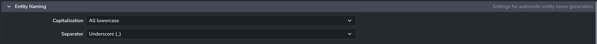

# Anatomy

<PageInfo />

The **Anatomy** tab of the [Projects Manager](index.md) edits the anatomy of the selected project: its roots, path templates, project attributes and the lists of types, statuses and tags its entities can use. This page is also the reference of every anatomy field; [anatomy presets](../studio/anatomy-presets.md) use the same fields. A project gets its anatomy as a copy of an anatomy preset when it is created, and the web app opens this tab for the new project. From then on the anatomy is the project's own: changes here do not reach the preset or other projects (see [Creating a project](../../how-ayon-works/creating-a-project.md#project-configuration)). Per-workstation root paths are set on the [Roots](roots.md) tab.

The page shows the anatomy to the right of the [project list](../project-list.md), as collapsible sections with a short description on the right of each; the sections below, from Entity Naming to Product Types, follow the order of the page. How roots and templates decide file paths is explained in [Storage](../../how-ayon-works/storage.md); types, statuses, tags and links in [AYON entities](../../how-ayon-works/entities.md#statuses-types-and-tags).

:::caution Changing the anatomy during production
Roots and templates decide where files are written and where the pipeline looks for them. Changing them during production applies to new work only: existing files are not moved or renamed, and tools may no longer find existing work files. Renaming or removing statuses and tags changes the entities that use them (see [Saving](#saving)), while addon settings that name a status or tag keep the old name. See [Creating a project](../../how-ayon-works/creating-a-project.md#project-configuration).
:::

:::note Studio and project scope
Addon settings that offer anatomy template names or link types as choices read them from the primary anatomy preset in the studio settings, and from the project's own anatomy in the project settings. A template added only to the project anatomy is therefore not offered in the studio settings, and a template added only to the primary preset is not offered in the project settings. A project created from a preset keeps no link to it.
:::

## Entity Naming

How the web app suggests a folder or task name from the label typed when the entity is created or renamed. The suggestion can be overwritten as long as the name stays valid. The label is split into words at spaces, accents are removed, characters other than letters, digits, `_`, `-` and `.` are dropped, and the words are joined with the separator.

<Settings>
<Setting name="Capitalization" default="All lowercase">

How the words of the suggested name are capitalized: **All lowercase** (`lower`), **All UPPERCASE** (`upper`), **Keep original capitalization** (`keep`), **Capitalize Every Word** (`pascal`) or **capitalize Every Word Except First** (`camel`).

</Setting>
<Setting name="Separator" default="Underscore (_)">

Character placed between the words: **None** (words are joined directly), **Underscore (_)**, **Dash (-)** or **Dot (.)**.

</Setting>
</Settings>

## Roots

Named base paths of the project storage, with one path per platform. Templates start with a root, written `{root[work]}` for the root `work`, so the same template works on every platform. A workstation can replace the paths for itself on the [Roots](roots.md) tab; the order in which root paths are applied is in [Storage](../../how-ayon-works/storage.md#roots).

<Settings>
<Setting name="Root">

One storage location. The default anatomy has one root, `work`, with the paths shown as defaults below. Root names must be unique.

<Settings>
<Setting name="Root name" default="work">

Name used in templates as `{root[name]}`. Letters, digits and `_` only.

</Setting>
<Setting name="Windows" default="C:/projects">

Path on Windows.

</Setting>
<Setting name="Linux" default="/mnt/share/projects">

Path on Linux.

</Setting>
<Setting name="Darwin" default="/Volumes/projects">

Path on macOS.

</Setting>
</Settings>

</Setting>
</Settings>

## Templates

:::tip Templates are chosen in the Core addon settings
The anatomy only defines templates by name. Which template a tool uses is decided by profiles in the [Core addon settings](../../../addons/essentials/core/settings.md#workfiles): each profile matches a context, such as a task type or a host, and names a template of one group. A new template is used only once a profile names it, renaming or removing a template needs the profiles that name it changed too, and a profile that names a missing template makes the save or publish fail. See [Profiles that pick a template](../../../pipeline/naming-conventions.md#profiles-that-pick-a-template).
:::

Path templates turn the context of a work file or a publish into a directory and a file name. Templates are kept in groups, and each entry has a name. The keys, syntax and padding formats used in templates are described in [Naming conventions](../../../pipeline/naming-conventions.md#template-syntax).

<!-- screenshot: Anatomy tab of wing_it, Templates expanded -->

<Settings>
<Setting name="Version padding" default="3">

Number of digits of the version number in `{@version}`: version 3 gives `v003`. Larger numbers keep all their digits.

</Setting>
<Setting name="Version template" default="v{version:0>{@version_padding}}">

Format of `{@version}`. Keep the `v` prefix: parts of the pipeline expect it.

</Setting>
<Setting name="Frame padding" default="4">

Number of digits of the frame number in `{@frame}`: frame 7 gives `0007`. Published sequences are renumbered to this padding.

</Setting>
<Setting name="Frame template" default="{frame:0>{@frame_padding}}">

Format of `{@frame}`.

</Setting>
<Setting name="Template">

One entry of a group. Names must be unique within a group; characters other than letters, digits, `-`, `_` and spaces are removed from them. The **Work**, **Publish** and **Hero** groups must contain an entry named `default`.

<Settings>
<Setting name="Name">

Name by which settings and tools select the entry.

</Setting>
<Setting name="Directory template">

Directory, filled with the [template keys](../../../pipeline/naming-conventions.md#template-keys). **Work**, **Publish**, **Hero** and **Delivery** entries. **Staging directories** entries have a single **Directory** field.

</Setting>
<Setting name="File name template">

File name inside the directory. **Work**, **Publish**, **Hero** and **Delivery** entries. The full path of an entry is its directory, a slash and its file name.

</Setting>
<Setting name="Template value">

A single template string. **Others** entries only.

</Setting>
</Settings>

</Setting>
</Settings>

### Work

The work area of a task, where the Workfiles tool saves and lists work files, and the work file name. Selected by **Workfile template profiles** in the [Core addon settings](../../../addons/essentials/core/settings.md#workfiles); the shipped profiles select `default`, and `unreal` for the Unreal host.

| Name | Directory template | File name template |
|---|---|---|
| `default` | `{root[work]}/{project[name]}/{hierarchy}/{folder[name]}/work/{task[name]}` | `{project[code]}_{folder[name]}_{task[name]}_{@version}<_{comment}>.{ext}` |
| `unreal` | `{root[work]}/{project[name]}/unreal/{task[name]}` | `{project[code]}_{folder[name]}.{ext}` |

### Publish

The directory and file names of published versions. Selected by **Template name profiles** in the [Core addon settings](../../../addons/essentials/core/settings.md#publish-tool), by product base type, host, task type and task name. In the table, "default directory" stands for `{root[work]}/{project[name]}/{hierarchy}/{folder[name]}/publish/{product[type]}/{product[name]}/{@version}`.

| Name | Directory template | File name template |
|---|---|---|
| `default` | default directory | `{project[code]}_{folder[name]}_{product[name]}_{@version}<_{output}><.{@frame}><_{udim}>.{ext}` |
| `render` | default directory | `{project[code]}_{folder[name]}_{product[name]}_{@version}<_{output}><.{@frame}>.{ext}` |
| `online` | default directory | `{originalBasename}<.{@frame}><_{udim}>.{ext}` |
| `source` | `{root[work]}/{originalDirname}` | `{originalBasename}.{ext}` |
| `maya2unreal` | `{root[work]}/{project[name]}/{hierarchy}/{folder[name]}/publish/{product[type]}` | `{product[name]}_{@version}<_{output}><.{@frame}>.{ext}` |
| `simpleUnrealTextureHero` | `{root[work]}/{project[name]}/{hierarchy}/{folder[name]}/publish/{product[type]}/hero` | `{originalBasename}.{ext}` |
| `simpleUnrealTexture` | `{root[work]}/{project[name]}/{hierarchy}/{folder[name]}/publish/{product[type]}/{@version}` | `{originalBasename}_{@version}.{ext}` |
| `unrealuasset` | default directory | `{originalBasename}.{ext}` |

Templates with `originalBasename` keep the names of the source files. A directory with `originalDirname` publishes the files where they are, which requires them to be inside a project root.

### Hero

The path of the hero version, the unversioned copy of the latest version of a product. Selected by **Hero template name profiles** in the [Core addon settings](../../../addons/essentials/core/settings.md#publish-tool).

| Name | Directory template | File name template |
|---|---|---|
| `default` | `{root[work]}/{project[name]}/{hierarchy}/{folder[name]}/publish/{product[type]}/{product[name]}/hero` | `{project[code]}_{folder[name]}_{product[name]}_hero<_{output}><.{@frame}><_{udim}>.{ext}` |

### Delivery

Output paths of the **Deliver Versions** action of the [Browser](../../../pipeline/browser.md#delivery), chosen in its dialog. The group is empty by default. The templates are filled with the context of the delivered representation and the [datetime keys](../../../pipeline/naming-conventions.md#template-keys); a sequence needs the `frame` key.

### Staging directories

Directories for the temporary files written while publishing. Selected by **Custom Staging Dir Profiles** in the [Core addon settings](../../../addons/essentials/core/settings.md#publish-tool); without a matching profile a temporary directory is used. The group is empty by default, and not every host integration supports custom staging directories.

### Others

Extra templates for addons and custom tools that read them by name. The group is empty by default.

## Attributes

The project's own values of every attribute whose scope includes projects, such as frame rate and resolution. Folders and tasks inherit them unless they override them (see [Attributes and inheritance](../../how-ayon-works/entities.md#attributes-and-inheritance)). A new project starts with the default values of the attributes. The attributes themselves are defined on the [Attributes](../studio/attributes.md) page of the studio settings.

<!-- screenshot: Anatomy tab of wing_it, Attributes expanded -->

## Folder types

The types a folder of the project can have. A folder can use only a type from this list, and a new folder without a type takes the first one.

<!-- screenshot: Anatomy tab of wing_it, Folder types expanded -->

<Settings>
<Setting name="Folder type">

One type. Names must be unique; short names should be.

<Settings>
<Setting name="Name">

Name of the type, filled into `folder[type]`. Up to 100 characters.

</Setting>
<Setting name="Short name">

Abbreviation of the type.

</Setting>
<Setting name="Color" default="#cccccc">

Color of the folder type's icon wherever folders are shown, for example in the Project overview or Task progress.

</Setting>
<Setting name="Icon" default="folder">

Material Symbols icon of the type.

</Setting>
</Settings>

</Setting>
</Settings>

Default folder types, with their short names: **Folder**, **Library** (`lib`), **Asset**, **Episode** (`ep`), **Sequence** (`sq`), **Shot** (`sh`).

## Task types

The types a task of the project can have. A task can use only a type from this list, and a new task without a type takes the first one.

<!-- screenshot: Anatomy tab of wing_it, Task types expanded -->

<Settings>
<Setting name="Task type">

One type. Names must be unique; short names should be.

<Settings>
<Setting name="Name">

Name of the type, filled into `task[type]`. Up to 100 characters.

</Setting>
<Setting name="Short name">

Abbreviation of the type, filled into `task[short]`.

</Setting>
<Setting name="Color" default="#cccccc">

Color of the task type's icon wherever tasks are shown, for example in the Project overview or the details panel.

</Setting>
<Setting name="Icon" default="task_alt">

Material Symbols icon of the type.

</Setting>
</Settings>

</Setting>
</Settings>

Default task types:

| Name | Short name | Name | Short name |
|---|---|---|---|
| Generic | `gener` | Layout | `lay` |
| Art | `art` | Setdress | `dress` |
| Modeling | `mdl` | Animation | `anim` |
| Texture | `tex` | FX | `fx` |
| Lookdev | `look` | Lighting | `lgt` |
| Rigging | `rig` | Paint | `paint` |
| Edit | `edit` | Compositing | `comp` |
| | | Roto | `roto` |
| | | Matchmove | `matchmove` |

## Link types

The kinds of links that can be made between entities of the project. A link type is identified by its name together with its input and output entity types, so the same name can exist for different pairs. Links themselves are described in [AYON entities](../../how-ayon-works/entities.md#links).

<!-- screenshot: Anatomy tab of wing_it, Link types expanded -->

<Settings>
<Setting name="Link">

One link type.

<Settings>
<Setting name="Link type">

Name of the link type, up to 100 characters.

</Setting>
<Setting name="Input type">

Entity type at the input end: folder, product, version, representation, task or workfile.

</Setting>
<Setting name="Output type">

Entity type at the output end, from the same list.

</Setting>
<Setting name="Color">

Color of the link where links are drawn.

</Setting>
<Setting name="Style" default="solid">

Line style: **solid** or **dashed**.

</Setting>
</Settings>

</Setting>
</Settings>

The default link types are `generative` and `reference` from version to version, and `breakdown` and `template` from folder to folder. Publishing creates `generative` and `reference` links; the workfile template builder uses `template` links by default to find linked folders. These four are required: they cannot be removed, and a project missing one gets it back when the project is loaded. Removing another link type deletes all links of that type.

## Statuses

The statuses entities of the project can have. A new entity takes the first status whose scope contains its entity type. The opening screenshot shows this section.

<Settings>
<Setting name="Status">

One status. Names must be unique; short names should be.

<Settings>
<Setting name="Name">

Name of the status, up to 100 characters.

</Setting>
<Setting name="Short name">

Abbreviation of the status, such as `PRG`.

</Setting>
<Setting name="State" default="Not Started">

Groups statuses regardless of their names: **Not Started**, **In Progress**, **Done** or **Blocked**.

</Setting>
<Setting name="Icon">

Material Symbols icon of the status.

</Setting>
<Setting name="Color" default="#cacaca">

Color of the status wherever it is shown, for example on task cards, in the details panel, Task progress and Home tasks.

</Setting>
<Setting name="Scope" default="All entity types">

Entity types that can use the status: **Folder**, **Product**, **Version**, **Representation**, **Task**, **Workfile**.

</Setting>
</Settings>

</Setting>
</Settings>

Default statuses:

| Name | Short name | State | Scope |
|---|---|---|---|
| Not ready | `NRD` | Not Started | Folder, Product, Task |
| Ready to start | `RDY` | Not Started | Folder, Task |
| In progress | `PRG` | In Progress | Folder, Task |
| Pending review | `RVW` | In Progress | Folder, Version, Task |
| Approved | `APP` | Done | Folder, Product, Version, Task |
| On hold | `HLD` | Blocked | Folder, Task |
| Omitted | `OMT` | Blocked | Folder, Product, Version, Representation, Task |

## Tags

The tags that can be added to entities of the project. An entity can have any number of tags from this list.

<!-- screenshot: Anatomy tab of wing_it, Tags expanded -->

<Settings>
<Setting name="Tag">

One tag. Names must be unique.

<Settings>
<Setting name="Name">

Name of the tag, up to 100 characters.

</Setting>
<Setting name="Color" default="#cacaca">

Color of the tag wherever it is shown, for example in the details panel or on task cards.

</Setting>
</Settings>

</Setting>
</Settings>

Default tags: `important` and `for reel`.

## Product Types

How product types look in the web app and in the AYON tools: a color and an icon per product base type. These values change only the display, not paths or publishing. Product types themselves are described in [Product types](../../../pipeline/product-types.md).

<!-- screenshot: Anatomy tab of wing_it, Product Types expanded -->

<Settings>
<Setting name="Default appearance">

Used for every product base type without an override.

<Settings>
<Setting name="Default color" default="#cccccc" />
<Setting name="Default icon" default="deployed_code" />
</Settings>

</Setting>
<Setting name="Appearance overrides" default="19 product base types">

Color and icon of single product base types.

<Settings>
<Setting name="Name">

Product base type, such as `render`.

</Setting>
<Setting name="Color" default="#cccccc" />
<Setting name="Icon" default="deployed_code" />
</Settings>

</Setting>
</Settings>

The default overrides set icons for `image`, `render`, `review`, `plate`, `camera`, `model`, `texture`, `look`, `rig`, `animation`, `cache`, `layout`, `setdress`, `groom`, `matchmove`, `vdbcache`, `lightrig`, `lut` and `workfile`.

## Editing and saving

### Lists and order

Roots, types, statuses and tags are lists. The handle on the left of an item drags it to another place, the **+** button below a list adds an item, and the delete button on the right removes one.

The order of folder types, task types and statuses matters: a new folder or task takes the first type, and a new entity the first status whose scope fits it. Names in the lists of roots, folder types, task types, statuses and tags must be unique, and templates need unique names within a group.

### Saving

**Save changes** sends the complete anatomy to the server, which validates it and writes it into the project in one transaction. If any part fails, nothing is saved, and the page shows **Failed to save anatomy** with the server's message. A successful save shows **Anatomy saved**.

- The project needs at least one folder type, one task type and one status.
- Folder types, task types, statuses and tags are written to the project's own tables in the order of the lists. Renaming an item renames it on every entity that uses it. Items removed from a list are deleted from the project; removing a folder type, task type or status that entities still use makes the save fail.
- Link types are written to the project's own table as well. Removing a link type deletes its links; removing one of the four default link types makes the save fail.
- Roots, templates, entity naming and product types are stored with the project.
- Changed project attributes are stored as the project's attribute values, and the inherited values of folders and tasks are rebuilt.
- The server emits project change events for the saved changes.

Saving changes nothing on disk.

## Controls and interactions

### Toolbar

| Control | What it does | Shown to |
|---|---|---|
| **Copy anatomy** | Copies the anatomy as shown on the page, including unsaved edits, to the clipboard as JSON. | Users who can view the anatomy |
| **Paste anatomy** | Reads JSON from the clipboard and replaces the whole anatomy on the page with it, as an unsaved edit. Shows **No content to paste** or **Invalid JSON** when the clipboard cannot be used. | Users who can view the anatomy |
| **Read-only** | Text shown instead of edit rights. | Users with **Read only** on **Project anatomy** in this project |
| **Save changes** | Saves the anatomy to the project. Active when the page differs from the saved anatomy. Without edit rights its tooltip reads **You don't have edit permissions**. | Users who can view the anatomy |

Managers and admins can view and save the anatomy of every project. Users need **Read only** (view) or **Read & Write** (view and save) on **Project anatomy** in the project; this is a project permission of the access groups (see [Permissions](../studio/permissions.md#permission-settings)). Without it, the toolbar is hidden and the page shows **You don't have permission to view this project's anatomy**, and the project list puts the projects the user can view first.

### Field menu

<Columns widths="60 40">
<Column>

Right-clicking a field or a section offers **Copy** and **Paste**: they copy that value as JSON, or paste JSON from the clipboard into it. Hovering a field shows its description as a tooltip.

</Column>
<Column>

</Column>
</Columns>

### Copy an anatomy between projects

**Copy anatomy** and **Paste anatomy** work between projects and with [anatomy presets](../studio/anatomy-presets.md), which have the same structure. To give a project the anatomy of another one, copy it there, select the target project, paste and save. To copy only one part, such as the statuses, use **Copy** and **Paste** in the right-click menu of that section.

## FAQ

### A template is not offered in the addon settings

Addon settings list the templates of the anatomy that belongs to their scope: the studio settings list those of the primary anatomy preset, the project settings those of the project anatomy. Add the template to the anatomy of the scope being edited. A template selected in the studio settings must also exist in the anatomy of every project that uses the setting, otherwise saving or publishing fails there.

### Publishing fails because a template is missing

A profile in the Core addon settings names a template that the project anatomy does not have. Add a template with that name to the matching group of the project anatomy, or change the profile in the [project settings](project-settings.md).

## Related

- [Project configuration](index.md)
- [Anatomy presets](../studio/anatomy-presets.md)
- [Roots](roots.md)
- [Creating a project](../../how-ayon-works/creating-a-project.md)
- [Storage](../../how-ayon-works/storage.md)
- [AYON entities](../../how-ayon-works/entities.md)
- [Naming conventions](../../../pipeline/naming-conventions.md)
- [Core addon settings](../../../addons/essentials/core/settings.md)
