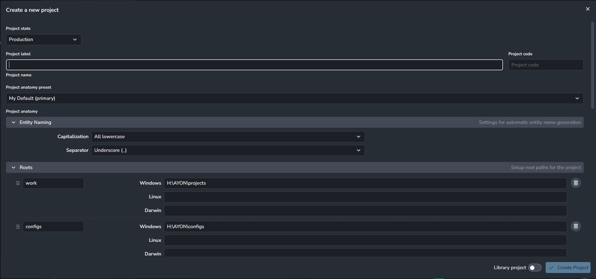

# Project configuration

<PageInfo />

The project configuration, called **Projects Manager** in the [URI bar](../app-header.md#uri-bar) (its App menu entry reads **Projects Settings**), configures projects one at a time: their anatomy, addon settings, access groups, user access, per-site settings and roots, and teams. It has a [project list](../project-list.md) on the left and a row of tabs at the top; each tab works on the project selected in the list. The server-wide configuration is in [Studio configuration](../studio/index.md).

## Opening it

| Way | Opens |
|---|---|
| **App** menu > **Projects Settings** | The **Project settings** tab |
| `p+p` | The **Project settings** tab, keeping the current query parameters, so the selected project stays selected |
| `a+a` | The **Anatomy** tab, in the same way |
| Settings button on a project row of a project list | The **Project settings** tab for that project |
| `/manageProjects` without a tab | The first tab the user can open for the selected project, in the order Anatomy, Project settings, Site settings, Project access, Roots, Teams, Project permissions |

The selected project is kept in the `project` query parameter, for example `/manageProjects/anatomy?project=wing_it`.

## Tabs

| Tab | URL path | Shown to | Page |
|---|---|---|---|
| **Anatomy** | `/manageProjects/anatomy` | Managers and admins; users with **Read only** or **Read & Write** on **Project anatomy** in at least one project | [Anatomy](anatomy.md) |
| **Project settings** | `/manageProjects/projectSettings` | Managers and admins; users with **Read only** or **Read & Write** on **Project addon settings** in at least one project | [Project settings](project-settings.md) |
| **Project permissions** | `/manageProjects/permissions` | Managers and admins | [Project permissions](project-permissions.md) |
| **Project access** | `/manageProjects/projectAccess` | Managers and admins; users with **Read only** or **Read & Write** on **Project access** in at least one project | [Project access](project-access.md) |
| **Site settings** | `/manageProjects/siteSettings` | Everyone | [Site settings](site-settings.md) |
| **Roots** | `/manageProjects/roots` | Everyone | [Roots](roots.md) |
| **Teams** | `/manageProjects/teams` | Managers and admins | [Teams](teams.md) |

For users with the **User** level, a tab is listed when their access groups grant it in at least one project. Whether it can be used for the selected project is checked on the tab itself, which shows a message such as **You don't have permission to view this project's anatomy** otherwise. A user who opens **Project permissions** or **Teams** through its URL is sent to the first tab they can open. The permission settings are described on the [Permissions](../studio/permissions.md#permission-settings) page.

The help button at the right end of the tab row (tooltip **Get help for this page**) opens the help article for the open tab.

## Project list

The [project list](../project-list.md) on the left selects the project the tabs work on. Only one project can be selected here. **Project access** has its own project pane instead, where several projects can be selected.

## Create a new project

**Add new project** (the **+** button of the project list) opens the **Create a new project** dialog, for users who can create projects. On success the new project is selected in the list. The fields, the rules for name and code, and what the server creates are described in [Creating a project](../../how-ayon-works/creating-a-project.md).

## Related

- [Project list](../project-list.md)
- [Creating a project](../../how-ayon-works/creating-a-project.md)
- [Permissions (how AYON works)](../../how-ayon-works/permissions.md)
- [Settings scopes and storage](../../backend/settings/index.md)
- [Studio configuration](../studio/index.md)
