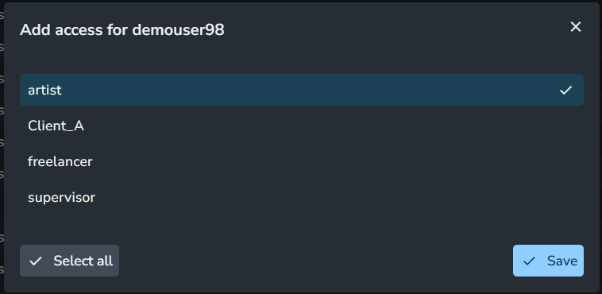
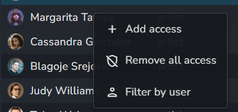

# Project access

<PageInfo />

The **Project access** tab of the [Projects Manager](index.md) gives users access to projects. Users with the **User** level see a project only after an access group is assigned to them in it; managers and admins have access to all projects and are not listed. What each access group allows is defined on the studio [Permissions](../studio/permissions.md) page, and can be changed for one project on the [Project permissions](project-permissions.md) tab. Which groups a new project gives to which users is set with **Default projects access** on the [Users](../studio/users.md) page; it is applied when a project is created and does not change existing projects.

## Projects, users and access groups

The tab does not use the project list of the other tabs. It has three panes of its own: **Projects**, **All users** and **Access groups**.

| Pane | Content |
|---|---|
| **Projects** | Column **Project name**, with multiple selection. Starts with the project of the `project` query parameter. Active projects the user can edit come first. Projects with read-only access are marked **(read only)**; archived projects and projects without access are shown in italics. |
| **All users** | Columns **User** and **Project access groups**, the groups the user has in the selected projects. The **User** column can be sorted. **All users assigned** when the list is empty. |
| **Access groups** | One collapsible panel per studio access group, with the users who have it in the selected projects. **No users assigned** for an empty group. The expanded state is stored in the user's preferences. |

Only active users with the **User** level are listed. Selecting one or several projects shows the users and groups of all of them; changes then apply to every selected project.

### Adding and removing access

<Columns widths="55 45">
<Column>

**Add access** gives the selected users access groups in the selected projects. When only one access group is visible, it is assigned at once; otherwise the **Add access for &lt;users&gt;** dialog opens. Each group in it shows its state for the selected users: all of them have it (checked), some of them, or none. Clicking a group switches it between all and none; **Select all** (`Ctrl+A`) selects or clears all groups. **Save** (`Ctrl+Enter`) saves only the changed groups: groups switched to none are removed from the users. Success shows **Access added**.

**Remove access** removes the selected users from the selected access group and shows **Access removed**. Removing the last group of a user in a project removes the project from the user.

Changes are saved at once. Open sessions of the affected users are updated, so the change applies without signing in again.

</Column>
<Column>

</Column>
</Columns>

### When the panes cannot be used

The **All users** and **Access groups** panes are replaced by a message when they cannot be used:

| Message | Cause |
|---|---|
| **Select an active project to manage users its access groups** | No project is selected. |
| **Project disabled** | An archived project is selected. |
| **Missing permissions** | The user has no access to **Project access** in a selected project. |
| **Missing Users permissions** | The user list cannot be loaded. Users need **List all users** in the studio permissions of an access group in their **Default projects access**. |

Editing needs the manager or admin role, or **Read & Write** on **Project access** in every selected project. A user with **Read only** sees the assignments without being able to change them.

## Controls and interactions

### Toolbar

| Control | What it does |
|---|---|
| **Search and filter** | Free text search on user name and full name, and filters by **Project**, **User** and **Access Group**. The filters are kept for the browser tab. |
| **Add access** (`a`) | See [Adding and removing access](#adding-and-removing-access). Active when users are selected. |
| **Remove access** (`r`) | Active when users are selected in an access group panel. |

The global `a+a` shortcut (Anatomy) is turned off on this tab, so that `a` can be used.

### Rows and right-click menu

<Columns widths="60 40">
<Column>

Hovering a row in **All users** shows an **Add** button with its `A` shortcut. Rows in the access group panels show **Remove** (`R`), and an add button when more than one access group is visible. Right-clicking a user offers:

| Entry | What it does |
|---|---|
| **Add access** | Adds access groups to the user, or to all selected users when the user is selected |
| **Remove access** | Removes the access group of the panel. Only in the access group panels |
| **Remove all access** | Removes all access groups of the users in the selected projects |
| **Filter by user** | Adds the users to the **User** filter |

A right-clicked user outside the selection is acted on alone, without changing the selection.

</Column>
<Column>

</Column>
</Columns>

### Several projects at once

Selecting several projects in the **Projects** pane (`Ctrl`/`Cmd` + click or `Shift` + click) assigns or removes groups in all of them in one step, for example to give a new artist the same group in every running show.

## Related

- [Users](../studio/users.md)
- [Permissions](../studio/permissions.md)
- [Project permissions](project-permissions.md)
- [Permissions (how AYON works)](../../how-ayon-works/permissions.md)
- [Project configuration](index.md)
